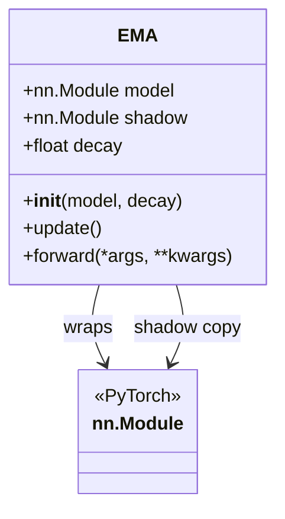
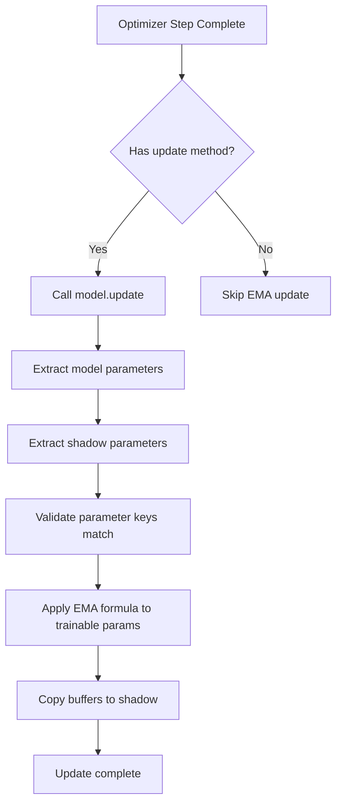
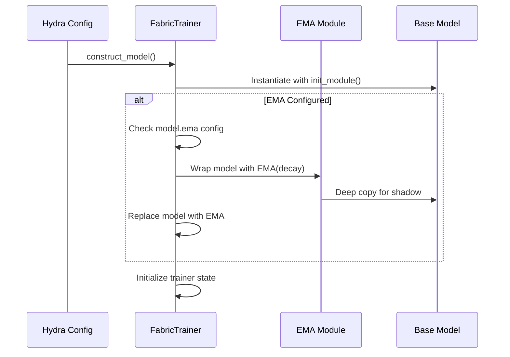
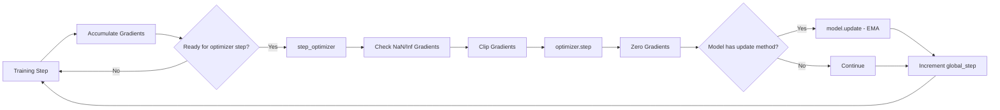
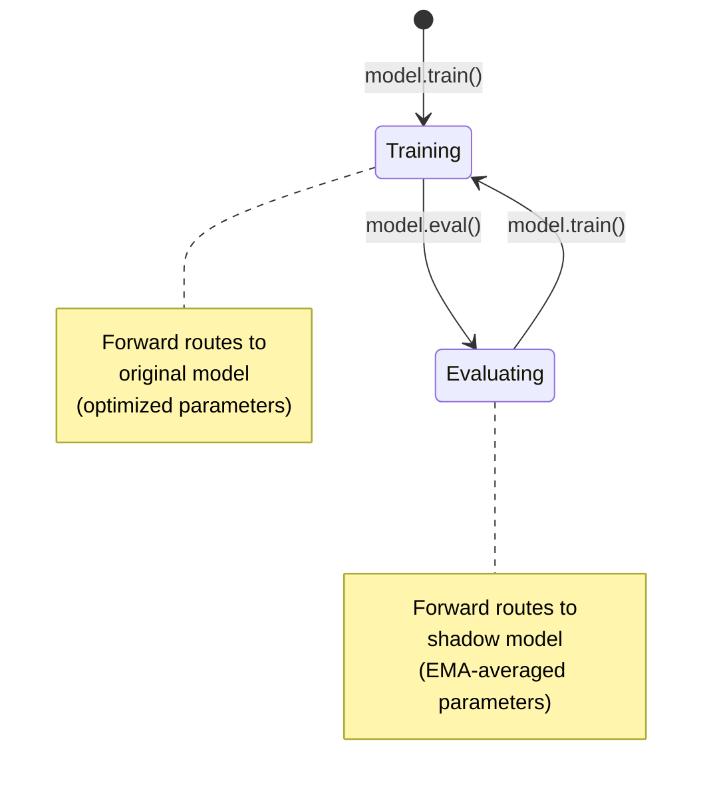
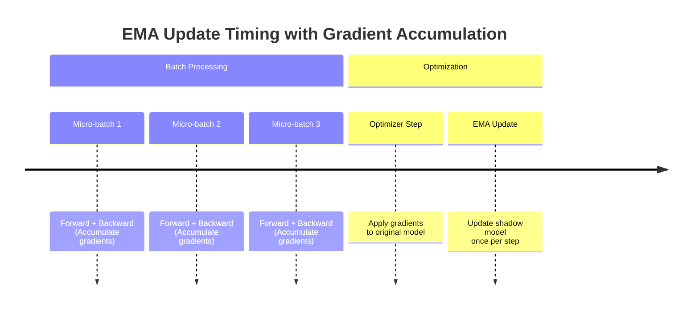

The Exponential Moving Average (EMA) system in Foundry provides a robust mechanism for maintaining a smoothed shadow copy of model parameters during training. This implementation enhances model stability and generalization by averaging parameters across training iterations, which is particularly valuable for generative models like RFdiffusion3 and structure prediction networks like RosettaFold3.

## Mathematical Foundation

The EMA algorithm maintains a shadow copy of model parameters that updates according to the exponential moving average formula:

```
shadow_t = decay × shadow_{t-1} + (1 - decay) × θ_t
```

where `θ_t` represents the current model parameters at iteration `t`, and `decay` (typically 0.999) controls the smoothing factor. This formulation ensures that recent parameter updates have stronger influence while maintaining a long-term memory of parameter trajectories.

Sources: [EMA.py](src/foundry/training/EMA.py#L8-L24)

## Core Implementation Architecture

The EMA system is implemented as a PyTorch `nn.Module` wrapper that seamlessly integrates with existing models through a transparent interface. The architecture consists of three primary components: the EMA wrapper class, the update mechanism, and dynamic dispatch logic.

### EMA Module Structure



The EMA class maintains two model instances: the original model (trained via standard optimization) and the shadow model (updated via the EMA algorithm). Both models share identical architectures but maintain independent parameter states.

Sources: [EMA.py](src/foundry/training/EMA.py#L8-L23)

### Parameter Update Mechanism

The update process occurs after each optimizer step and follows a systematic approach:



The update mechanism distinguishes between trainable parameters and buffers. Trainable parameters receive the EMA transformation, while buffers (non-trainable state like batch norm statistics) are directly copied to maintain consistency.

Sources: [EMA.py](src/foundry/training/EMA.py#L30-L60)

### Dynamic Dispatch Pattern

The EMA module implements intelligent routing based on the model's training state:

| Training State | Forward Behavior | Use Case |
|---------------|------------------|----------|
| `model.train()` | Routes to original model | Standard training iterations |
| `model.eval()` | Routes to shadow model | Validation, inference, checkpointing |

This design enables automatic model selection without requiring explicit intervention from training code, ensuring that evaluation always uses the EMA-averaged parameters.

Sources: [EMA.py](src/foundry/training/EMA.py#L62-L68)

## Integration with Training Harness

The FabricTrainer provides native EMA support through a seamless integration pattern that handles model wrapping, parameter updates, and checkpoint management.

### Model Wrapping Workflow



The model construction process automatically detects EMA configuration and wraps the model before trainer state initialization. This occurs within Fabric's `init_module()` context for proper device placement and precision handling.

Sources: [fabric.py](src/foundry/trainers/fabric.py#L255-L280)

### Training Loop Integration

EMA updates are triggered automatically during the training loop after each optimizer step:



The trainer's `step_optimizer()` method performs EMA updates after the optimizer step and gradient zeroing, ensuring that the shadow model reflects the latest parameter state.

Sources: [fabric.py](src/foundry/trainers/fabric.py#L697-L755)

### Validation Mode Switching

The validation loop automatically switches to the shadow model through the `eval()` mode transition:



This automatic mode switching ensures that validation metrics always reflect the EMA-averaged parameters without requiring manual intervention.

Sources: [fabric.py](src/foundry/trainers/fabric.py#L565-L630)

## Configuration System

EMA configuration follows Foundry's hierarchical Hydra structure, enabling per-model customization while maintaining consistency across training pipelines.

### Configuration Structure

```yaml
# models/rfd3/configs/model/components/ema.yaml
decay: 0.999  # From AF-3
```

The EMA configuration is composed into the base model configuration through Hydra's composition mechanism:

```yaml
# models/rfd3/configs/model/rfd3_base.yaml
defaults:
  - optimizers/adam@optimizer
  - schedulers/af3@lr_scheduler
  - samplers/edm@net.inference_sampler
  - components/ema@ema        # EMA configuration
  - components/rfd3_net@net
  - _self_
```

Sources: [ema.yaml](models/rfd3/configs/model/components/ema.yaml#L1), [rfd3_base.yaml](models/rfd3/configs/model/rfd3_base.yaml#L1-L9)

### Configuration Parameters

| Parameter | Type | Default | Description |
|-----------|------|---------|-------------|
| `decay` | float | 0.999 | EMA decay rate controlling averaging window. Higher values = longer memory. |

The decay rate of 0.999, inherited from AlphaFold 3, provides an effective averaging window of approximately 1,000 iterations. This value balances stability with responsiveness to parameter changes.

> [!TIP]
> When adjusting the decay rate, consider your dataset size and training duration. Smaller datasets or shorter training runs may benefit from lower decay values (e.g., 0.995) to allow faster adaptation, while large-scale training typically uses 0.999 or higher.

## Checkpoint and State Management

The EMA system integrates with Foundry's checkpointing infrastructure, automatically saving both the original and shadow model states.

### Checkpoint Saving Strategy

When checkpoints are saved, the EMA wrapper's state dictionary includes both model states:

```python
# Checkpoint structure for EMA models
checkpoint = {
    "model": {
        # Contains both original and shadow parameters
        "model": original_model_state_dict,
        "shadow": shadow_model_state_dict,
    },
    "optimizer": optimizer_state_dict,
    "scheduler": scheduler_state_dict,
    # ... other state
}
```

The checkpoint saving process occurs through the standard `save_checkpoint()` method, with EMA states preserved automatically through PyTorch's state_dict mechanism.

Sources: [fabric.py](src/foundry/trainers/fabric.py#L782-L800)

### Checkpoint Loading Considerations

When loading checkpoints with EMA models, the system handles both scenarios:

| Scenario | Behavior |
|----------|----------|
| Loading from EMA checkpoint | Both original and shadow states restored |
| Loading from non-EMA checkpoint | Only original state loaded, shadow initialized via deepcopy |

The loading process uses Foundry's weight loading utilities to handle potential parameter mismatches and size differences between architectures.

Sources: [fabric.py](src/foundry/trainers/fabric.py#L820-L850)

## Advanced Usage Patterns

### Selective EMA Application

For models with frozen parameters, the EMA update mechanism automatically respects `requires_grad` flags:

```python
# Only parameters with requires_grad=True are updated via EMA
for name, param in model_params.items():
    if param.requires_grad:
        shadow_params[name].sub_(
            (1.0 - self.decay) * (shadow_params[name] - param)
        )
```

This behavior enables mixed training scenarios where only certain model components (e.g., fine-tuned layers) receive EMA smoothing.

Sources: [EMA.py](src/foundry/training/EMA.py#L46-L50)

### Multi-Model Considerations

When working with GANs or other multi-model architectures, each model can have independent EMA configuration:

```python
# Example: Generator and Discriminator with different EMA settings
generator = EMA(generator_model, decay=0.9999)  # Slower decay for stability
discriminator = EMA(discriminator_model, decay=0.999)  # Standard decay
```

The FabricTrainer's architecture supports this pattern through custom `construct_model()` implementations in specialized trainers.

### Gradient Accumulation Compatibility

EMA updates occur at the optimizer step level, not the micro-batch level, ensuring consistency with gradient accumulation:



This design ensures that EMA updates reflect the accumulated gradient direction rather than individual micro-batch updates.

Sources: [fabric.py](src/foundry/trainers/fabric.py#L477-L550)

## Performance and Memory Considerations

### Memory Overhead

The EMA system requires approximately 2x the model parameter memory:

| Component | Memory Requirement |
|-----------|-------------------|
| Original model | 1.0 × parameter size |
| Shadow model | 1.0 × parameter size |
| **Total** | **2.0 × parameter size** |

For large models (e.g., RFdiffusion3 with billions of parameters), this represents a significant memory consideration. However, the shadow model does not maintain gradient buffers, reducing overall memory overhead during training.

### Computational Impact

EMA updates add minimal computational overhead:

- **Parameter update**: O(n) where n is the number of parameters
- **Operation count**: Single fused operation per parameter
- **Frequency**: Once per optimizer step (not per micro-batch)

The computational cost is typically negligible compared to forward/backward passes, especially for large models.

## Best Practices and Recommendations

### Decay Rate Selection

> [!TIP]
> When selecting decay rates, consider the effective averaging window: effective_window = 1 / (1 - decay). For decay=0.999, this is approximately 1,000 iterations. Adjust based on your dataset size and training stability requirements.

### Validation and Inference

Always use EMA-averaged parameters for evaluation and deployment:

```python
# Validation automatically uses EMA model
trainer.validate(val_loaders, ckpt_path="path/to/checkpoint")

# Inference should set model to eval mode
model.eval()  # Routes to EMA shadow
predictions = model(inputs)
```

### Monitoring EMA Effectiveness

Track metrics comparing training and validation performance:

| Metric | Interpretation |
|--------|---------------|
| Large train-val gap | May benefit from EMA |
| Stable validation metrics | EMA is providing regularization benefit |
| Degrading validation | Check decay rate and training stability |

### Troubleshooting

| Issue | Diagnosis | Solution |
|-------|-----------|----------|
| Out of memory during training | Shadow model exceeding GPU capacity | Reduce model size or use gradient checkpointing |
| Validation metrics unstable | Decay rate too low or too high | Experiment with decay values (0.995-0.9999) |
| Slow training speed | Unexpected EMA overhead | Verify EMA updates occur at step level, not batch level |

## Next Steps

For deeper understanding of Foundry's training infrastructure, explore the following documentation:

- [Training Harness with FabricTrainer](7-training-harness-with-fabrictrainer) - Comprehensive overview of the training system architecture
- [Checkpoint Management System](8-checkpoint-management-system) - Details on state persistence and restoration
- [Callbacks and Metrics Logging](17-callbacks-and-metrics-logging) - Advanced monitoring and instrumentation techniques

For model-specific implementations using EMA, see:

- [RFdiffusion3: All-Atom Generative Model](9-rfdiffusion3-all-atom-generative-model) - EMA configuration for diffusion models
- [RosettaFold3: Structure Prediction Network](10-rosettafold3-structure-prediction-network) - EMA usage in structure prediction