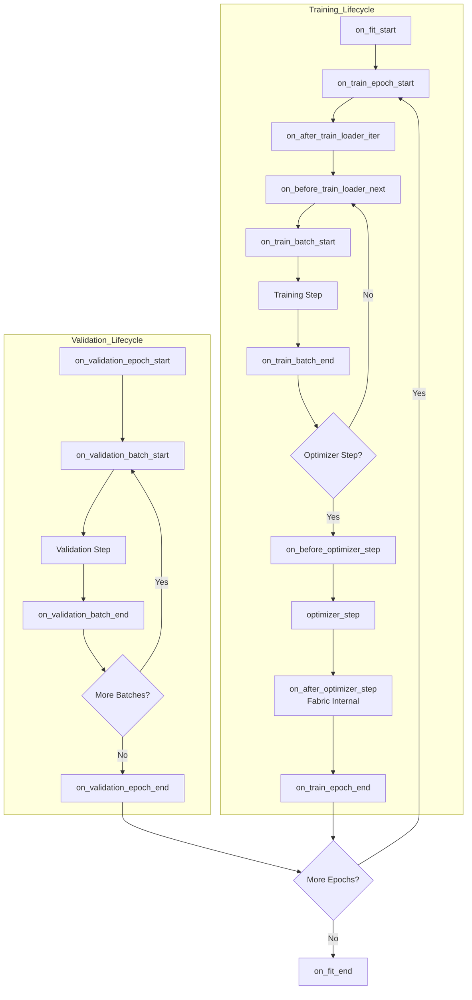
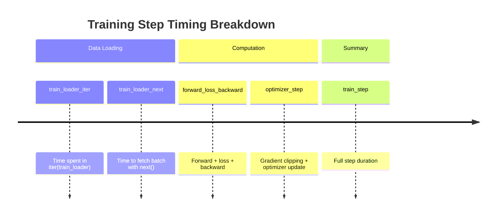
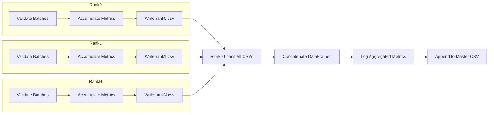

This page explores the callback and metrics logging infrastructure in Foundry, which provides a flexible, hook-based system for monitoring training progress, collecting validation metrics, and logging model behavior. The architecture follows PyTorch Lightning conventions while integrating seamlessly with PyTorch Lightning Fabric for distributed training scenarios.

## Callback Architecture Overview

Foundry's callback system centers around the `BaseCallback` abstract base class, which defines a comprehensive set of lifecycle hooks that the `FabricTrainer` invokes at strategic points during training and validation. This design allows developers to inject custom logic at specific stages without modifying the core training loop.
Sources: [callback.py](/src/foundry/callbacks/callback.py#L9-L116)

The callback hooks span three major categories: **epoch-level hooks** (fit start/end, epoch start/end), **training loop hooks** (batch start/end, optimizer step timing, data loading), and **validation loop hooks** (epoch/batch start/end). Crucially, the `on_after_optimizer_step` hook is called internally by Fabric and does **not** receive the trainer object, so developers must use `on_before_optimizer_step` or the `optimizer_step` hook for logic requiring trainer access.
Sources: [callback.py](/src/foundry/callbacks/callback.py#L27-L78)



The `FabricTrainer` invokes these hooks through `self.fabric.call()`, which ensures callbacks are executed consistently across all ranks in distributed training setups. This mechanism automatically handles rank synchronization and allows callbacks to access trainer state, the underlying Fabric instance, and model components.
Sources: [fabric.py](/src/foundry/trainers/fabric.py#L477-L560)

## Metric Computation Framework

Foundry provides a flexible metric computation system built around the `Metric` abstract base class and `MetricManager` container. Individual `Metric` subclasses compute specific evaluation metrics from model outputs, while the `MetricManager` orchestrates computation across multiple metrics and handles error management.
Sources: [metric.py](/src/foundry/metrics/metric.py#L179-L320)

The `Metric` class supports **conditional computation** based on tags present in input batches. Metrics can specify three types of tag constraints: `required_tags_all` (all tags must be present), `required_tags_any` (at least one tag must be present), and `prohibited_tags` (tags must not be present). This allows the same metric to be selectively applied to different types of batches (e.g., protein-only vs protein-ligand complexes).
Sources: [metric.py](/src/foundry/metrics/metric.py#L193-L220)

```python
from foundry.metrics import Metric

class RMSDMetric(Metric):
    def __init__(self):
        super().__init__(
            required_tags_any={"protein", "ligand"}
        )
    
    def compute(self, predicted_coords, target_coords):
        # Compute RMSD between predicted and target structures
        rmsd = np.sqrt(np.mean((predicted_coords - target_coords)**2))
        return {"rmsd": rmsd}
```

The `MetricManager` provides multiple instantiation patterns. The `instantiate_from_hydra()` classmethod creates metrics from configuration dictionaries, making it straightforward to define metrics declaratively in Hydra configs. The `from_metrics()` classmethod accepts pre-instantiated metric objects for programmatic construction. When calling a `MetricManager`, it computes all applicable metrics and returns results as a dictionary mapping metric names to computed values.
Sources: [metric.py](/src/foundry/metrics/metric.py#L62-L125), [metric.py](/src/foundry/metrics/metric.py#L244-L270)

> [!TIP]
> Use the `raise_errors=False` parameter when constructing a `MetricManager` if you want metric computation failures to be logged but not halt training. This is particularly useful during development when individual metrics may be unstable.

## Built-in Callbacks for Training Monitoring

Foundry includes several pre-built callbacks that monitor different aspects of the training process. These callbacks can be added individually or as groups depending on monitoring needs.
Sources: [train_logging.py](/src/foundry/callbacks/train_logging.py#L26-L279)

| Callback | Purpose | Hook Used | Output Format |
|----------|---------|-----------|---------------|
| `LogModelParametersCallback` | Display model parameter count | `on_fit_start` | Console table |
| `LogLearningRateCallback` | Monitor optimizer learning rate | `optimizer_step` | Logger/table |
| `LogDatasetSamplingRatiosCallback` | Track dataset sampling distribution | `on_train_epoch_end` | Console table |
| `PrintExampleIDBeforeForwardPassCallback` | Debug batch composition | `on_train_batch_start` | Console output |
| `LogAF3TrainingLossesCallback` | Track training losses for AlphaFold3 | `on_train_batch_end`, `on_train_epoch_end` | Logger |

The `LogLearningRateCallback` demonstrates a common pattern: it hooks into the `optimizer_step` lifecycle (which receives trainer access) rather than the Fabric-internal `on_after_optimizer_step`. This allows it to access both the optimizer state and the trainer's logging infrastructure. The callback logs the learning rate at configurable intervals, enabling visualization of learning rate schedules.
Sources: [train_logging.py](/src/foundry/callbacks/train_logging.py#L93-L115)

For complex training scenarios like AlphaFold3, the `LogAF3TrainingLossesCallback` provides detailed loss tracking. It can log individual structure losses within a diffusion batch (useful for debugging per-sample behavior) or aggregated batch losses. The callback accumulates losses across batches and computes epoch-level statistics that are synchronized across all distributed ranks.
Sources: [train_logging.py](/src/foundry/callbacks/train_logging.py#L116-L279)

## Timing and Performance Monitoring

The `TimingCallback` provides granular insight into computational bottlenecks by measuring the time spent in different stages of the training pipeline. It tracks six key phases: data loader iteration, batch fetching from the loader, forward pass/backward pass, optimizer step, and the overall training step.
Sources: [timing_logging.py](/src/foundry/callbacks/timing_logging.py#L9-L68)



The timing mechanism uses a `Timers` utility that supports nested timing contexts—critical for understanding how data loading overlaps with computation. Timings are aggregated over a configurable number of steps (default: 100) to reduce noise from single-step variability. The callback logs timing statistics to the configured logger (e.g., TensorBoard, Weights & Biases) and prints a formatted table for immediate feedback.
Sources: [timing_logging.py](/src/foundry/callbacks/timing_logging.py#L12-L68)

> [!TIP]
> The timing callback's hierarchical measurements can reveal whether data loading (typically CPU-bound) or forward/backward passes (GPU-bound) are limiting training throughput. If `train_loader_iter` dominates, consider prefetching or optimizing data augmentation pipelines.

## Health Monitoring: Gradients, Weights, and Activations

The `ActivationsGradientsWeightsTracker` callback provides comprehensive health monitoring by tracking statistics and distributions of model parameters and intermediate activations. This is invaluable for detecting training instabilities, vanishing/exploding gradients, and dead neurons.
Sources: [health_logging.py](/src/foundry/callbacks/health_logging.py#L45-L244)

The callback tracks three categories of tensors with configurable statistics:

| Tensor Category | Default Statistics | Default Histograms |
|-----------------|-------------------|-------------------|
| Gradients | mean, std, min, max, norm | Per-parameter distributions |
| Weights | mean, std, min, max, norm | Per-parameter distributions |
| Activations | mean, std, min, max, norm | Layer-wise distributions |

The callback uses **forward hooks** to capture activation values and inspects model parameters before the optimizer step to capture gradient information. Both statistics and histograms are logged at configurable frequency intervals, allowing developers to balance logging granularity with I/O overhead.
Sources: [health_logging.py](/src/foundry/callbacks/health_logging.py#L18-L74), [health_logging.py](/src/foundry/callbacks/health_logging.py#L161-L194)

Filtering functions allow selective tracking of specific parameters or activations based on name patterns or module types. This is particularly important for large models where logging every parameter would be prohibitively expensive. During validation, the callback temporarily deactivates hooks to prevent validation metrics from contaminating training statistics.
Sources: [health_logging.py](/src/foundry/callbacks/health_logging.py#L195-L212)

## Validation Metrics Aggregation

The `StoreValidationMetricsInDFCallback` addresses a critical challenge in distributed training: aggregating per-rank validation outputs into a unified analysis. During validation, each rank computes metrics independently, but meaningful analysis requires combining results across the entire validation set.
Sources: [metrics_logging.py](/src/foundry/callbacks/metrics_logging.py#L16-L212)



The callback operates in two phases. During validation, each rank accumulates batch-level metrics in a pandas DataFrame, handling both scalar metrics and nested dictionaries through recursive flattening. At the end of the validation epoch, each rank writes its partial results to a rank-specific CSV file with explicit flushing to ensure data integrity.
Sources: [metrics_logging.py](/src/foundry/callbacks/metrics_logging.py#L27-L124)

In the second phase, rank 0 loads all rank-specific CSVs, concatenates them into a single DataFrame, logs aggregated statistics grouped by dataset, and appends the results to a master CSV file spanning all epochs. This master file provides a complete validation history that can be analyzed post-training or visualized in tools like TensorBoard. Temporary rank-specific files are cleaned up after aggregation.
Sources: [metrics_logging.py](/src/foundry/callbacks/metrics_logging.py#L124-L206)

The callback supports selective metric saving through the `metrics_to_save` parameter, which accepts either "all" or a list of prefix strings. This flexibility allows researchers to focus on specific metrics of interest while avoiding disk usage from irrelevant outputs.
Sources: [metrics_logging.py](/src/foundry/callbacks/metrics_logging.py#L19-L24)

## Integrating Callbacks with FabricTrainer

Callbacks are integrated with the `FabricTrainer` through the constructor's `callbacks` parameter, which accepts either a single `BaseCallback` instance or a list of callbacks. These callbacks are passed directly to the underlying PyTorch Lightning Fabric instance, which manages their lifecycle and ensures hooks are called at appropriate points.
Sources: [fabric.py](/src/foundry/trainers/fabric.py#L61-L63), [fabric.py](/src/foundry/trainers/fabric.py#L124-L130)

```python
from foundry.trainers import FabricTrainer
from foundry.callbacks import (
    TimingCallback,
    LogLearningRateCallback,
    ActivationsGradientsWeightsTracker,
    StoreValidationMetricsInDFCallback
)

trainer = FabricTrainer(
    max_epochs=100,
    output_dir="./checkpoints",
    callbacks=[
        TimingCallback(log_every_n=50),
        LogLearningRateCallback(log_every_n=10),
        ActivationsGradientsWeightsTracker(
            log_freq=100,
            log_grads={"mean": np.mean, "norm": lambda x: np.linalg.norm(x)},
            keep_cache=False
        ),
        StoreValidationMetricsInDFCallback(
            save_dir="./validation_outputs",
            metrics_to_save=["rmsd", "lddt"]
        )
    ],
    loggers=[...]  # Lightning Fabric loggers
)
```

The trainer supports both **step-based** and **epoch-based** callback execution frequency. For example, timing and learning rate callbacks typically log every N optimizer steps, while parameter logging occurs once at fit start. This flexibility ensures monitoring overhead is proportional to the value of the information being collected.
Sources: [timing_logging.py](/src/foundry/callbacks/timing_logging.py#L12-L17), [train_logging.py](/src/foundry/callbacks/train_logging.py#L26-L29)

For distributed training, Foundry provides the `@rank_zero_only` decorator from PyTorch Lightning, which ensures that logging operations only execute on the primary process. This prevents duplicate logs and race conditions when writing to shared resources like log files or visualization tools.
Sources: [timing_logging.py](/src/foundry/callbacks/timing_logging.py#L4), [timing_logging.py](/src/foundry/callbacks/timing_logging.py#L18-L19)

## Next Steps

- For understanding how callbacks integrate with the broader training infrastructure, see [Training Harness with FabricTrainer](7-training-harness-with-fabrictrainer)
- To learn about checkpoint management and how callbacks interact with saving model state, refer to [Checkpoint Management System](8-checkpoint-management-system)
- For distributed training considerations when using callbacks, explore [Distributed Training with DDP](15-distributed-training-with-ddp)