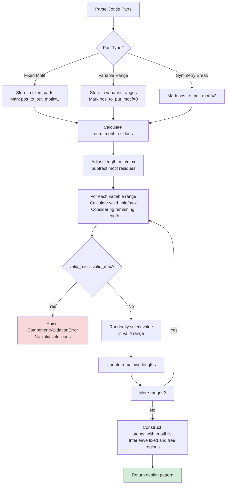
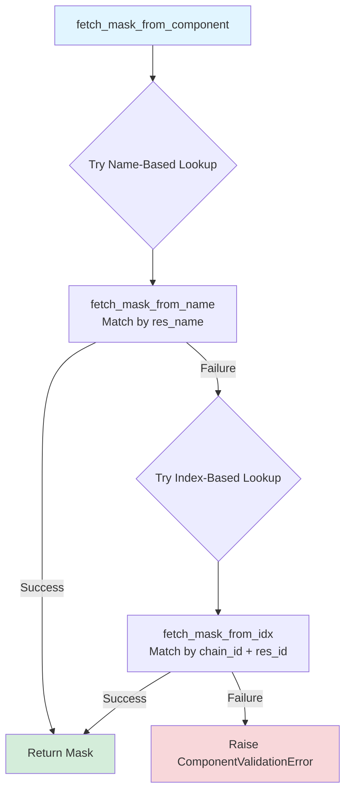
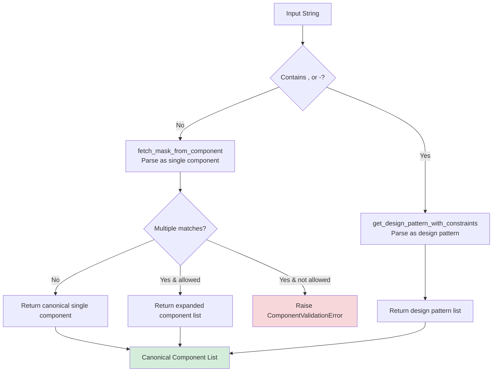

Component parsing and validation form the foundational infrastructure for specifying structural design constraints within Foundry's protein design workflow. This system enables precise specification of which residues and atoms should be fixed, unindexed, or modified during model inference through a robust parsing and validation framework.

## Architecture Overview

The component parsing system operates at the intersection between user-specified design constraints and model input tokenization. It processes contig strings—compact specifications of residue ranges and component selections—into structured design patterns that the inference engines can interpret. The architecture follows a layered validation approach, ensuring that each component is parsed correctly, validated against available structural data, and converted into appropriate atom masks.

```mermaid
flowchart TD
    A[User Input<br>Contig String] --> B[split_contig<br>Parse Chain+ResID]
    A --> C[extract_pn_unit_info<br>Parse Ranges]
    A --> D[get_design_pattern_with_constraints<br>Convert to Pattern]
    
    B --> E[ComponentStr<br>Type-safe identifier]
    C --> E
    D --> F[Design Pattern<br>[int, str, /0] list]
    
    F --> G[get_motif_components_and_breaks<br>Extract components + breaks]
    G --> H[Component List]
    H --> I[fetch_mask_from_component<br>Generate atom masks]
    
    I --> J[AtomArray Mask<br>Ready for model input]
    
    style A fill:#e1f5ff
    style J fill:#d4edda
    style E fill:#fff3cd
```

The parsing flow transforms human-readable specifications into machine-readable masks, with validation at each stage ensuring structural consistency.

## Core Component Types

Foundry recognizes three primary component types, each with distinct parsing and validation rules:

| Component Type | Format | Example | Description |
|----------------|--------|---------|-------------|
| **Single Residue** | `ChainID + ResID` | `A20`, `B1051` | References a specific residue by chain and residue number |
| **Residue Range** | `ChainID + Start-End` | `A20-25`, `B1051-1051` | Spans multiple contiguous residues; single residue ranges collapse to single residue |
| **Non-Protein Ligand** | `ResName` | `HEM`, `ATP` | References ligands or non-standard residues by residue name |

The parsing system distinguishes these types through pattern matching: components containing letters with digits are interpreted as chain-based references, while uppercase-only strings are treated as ligand or non-protein identifiers.
Sources: [components.py](src/foundry/utils/components.py#L42-L63), [components.py](src/foundry/utils/components.py#L66-L82)

## Parsing Infrastructure

### Component String Validation

The `ComponentStr` class provides a type-safe wrapper for component identifiers, integrating with the `split_contig` function for structural validation:

```python
class ComponentStr(str):
    """Component identifier, e.g. "A1" for residues, "B12", etc."""
```

The `split_contig` function validates and parses single residue references using regex-like pattern matching. It extracts the chain ID (first character) and residue ID (remaining digits), raising `ComponentValidationError` for malformed inputs or negative residue indices.
Sources: [components.py](src/foundry/utils/components.py#L42-L63)

> [!TIP]
> Component validation is strict—negative residue indices, malformed strings, or non-existent residues immediately raise `ComponentValidationError` with contextual details about the failure. This fail-fast approach prevents cascading errors later in the pipeline.

### Range Parsing

For residue ranges, `extract_pn_unit_info` handles both single residues (`A20`) and multi-residue spans (`A20-25`). The regex pattern `([A-Za-z])(\d+)(?:-(\d+))?` captures:
- Group 1: Chain identifier (letters)
- Group 2: Start residue number
- Group 3: End residue number (optional)

When the optional end residue is omitted, the function collapses single-residue ranges to single residues.
Sources: [components.py](src/foundry/utils/components.py#L66-L82)

## Design Pattern Generation

The `get_design_pattern_with_constraints` function transforms complex contig specifications into design patterns with constraint satisfaction. This function enables mixed-mode designs combining fixed motifs (existing structure) with flexible regions (generated sequence).

### Contig Syntax

Contig strings use comma-separated segments with three semantic types:

| Segment Type | Syntax | Example | Semantics |
|--------------|--------|---------|-----------|
| **Variable Length** | `min-max` or `number` | `0-40`, `10` | Specifies flexible region bounds or exact length |
| **Fixed Motif** | `ChainIDStart-End` | `A20-21`, `B25-25` | References existing structure to preserve |
| **Symmetry Break** | `/0` | `/0` | Marks symmetry group boundaries |

### Constraint Resolution Algorithm

The algorithm performs bounded constraint satisfaction using a greedy allocation strategy:



The key innovation is the **valid range calculation** that ensures each variable segment can accommodate the remaining length requirement while respecting its own bounds. For each position `i` in the variable ranges:

```
valid_min = max(min_value_i, remaining_length_min - sum(min_values of later ranges))
valid_max = min(max_value_i, remaining_length_max - sum(max_values of later ranges))
```

This forward-looking constraint ensures feasibility before random selection.
Sources: [components.py](src/foundry/utils/components.py#L85-L174)

### Example Transformation

Input: `'1-5,A20-21,1-5,A25-25,1-5'` with `length=10-10`

| Segment | Type | Interpretation |
|---------|------|----------------|
| `1-5` | Variable | 1-5 new residues |
| `A20-21` | Fixed | Preserve residues A20, A21 |
| `1-5` | Variable | 1-5 new residues |
| `A25-25` | Fixed | Preserve residue A25 |
| `1-5` | Variable | 1-5 new residues |

Output (one possible resolution): `[2, 'A20', 'A21', 2, 'A25', 3]`

This pattern indicates: 2 new residues, then A20, then A21, then 2 new residues, then A25, then 3 new residues. The integers sum to 7, and fixed residues contribute 3, matching the total length of 10.
Sources: [components.py](src/foundry/utils/components.py#L85-L89)

## Motif Component Extraction

For unindexed token processing (used in partial design and conditional generation), `get_motif_components_and_breaks` separates contig strings into individual components with positional relationship metadata.

### Break Semantics

Breaks indicate whether consecutive residues should be indexed together or treated as independent units:

| Input | Components | Breaks | Interpretation |
|-------|------------|--------|----------------|
| `A14,A15,A16` | `[A14, A15, A16]` | `[True, True, True]` | Three independent residues |
| `A14-15,A16` | `[A14, A15, A16]` | `[True, False, True]` | Residues A14-15 coupled, A16 independent |

The break array controls positional encoding leakage between residues in the model's tokenization scheme.
Sources: [components.py](src/foundry/utils/components.py#L177-L230)

> [!TIP]
> Set `index_all=True` to disable all breaks (`[False, False, ...]`), enabling full indexing of concatenated tokens. This is useful when you want the model to treat all motif residues as a single continuous unit.

## Atom Mask Generation

The final validation stage converts component specifications into atom-level masks for the underlying `AtomArray` structure. This three-tier system enables granular control over which atoms participate in model operations.

### Mask Retrieval Hierarchy



The catch-all `fetch_mask_from_component` function attempts ligand name lookup first, falling back to residue index lookup.
Sources: [components.py](src/foundry/utils/components.py#L368-L379)

### Name-Based Masking

`fetch_mask_from_name` matches non-protein components by residue name (e.g., `HEM`, `ATP`). It validates by checking against available non-protein residue names and provides helpful error messages listing available options when matches fail.
Sources: [components.py](src/foundry/utils/components.py#L349-L365)

### Index-Based Masking

`fetch_mask_from_idx` matches residues by chain identifier and residue number, returning a boolean mask for atoms belonging to that residue. This is the primary method for protein residue selection.
Sources: [components.py](src/foundry/utils/components.py#L333-L346)

## Atom Name Selection

`get_name_mask` provides hierarchical atom selection within components, enabling specification of backbone, sidechain, or custom atom sets.

### Selection Modes

| Mode | Syntax | Atoms Selected | Use Case |
|------|--------|-----------------|----------|
| **All Atoms** | `"ALL"` | All atoms in component | Full constraint |
| **Backbone** | `"BKBN"` | `N, CA, C, O` | Conformational flexibility with fixed backbone |
| **TIP** | `"TIP"` | Residue-specific terminal atoms | Geometry-preserving partial fixity |
| **Explicit List** | `"N,CA,C,O,CB"` | Specified atoms only | Precise control |

### TIP (Terminal Important Part) Atoms

The TIP system selects residue-specific atom sets that preserve geometric constraints while maximizing flexibility. These are defined in `constants.py` and represent the minimal set of atoms needed to maintain sidechain orientation and rotameric states.
Sources: [constants.py](src/foundry/constants.py#L1-L29), [components.py](src/foundry/utils/components.py#L266-L277)

Example TIP sets:

| Residue | TIP Atoms | Rationale |
|---------|-----------|-----------|
| HIS | CG, ND1, CD2, CE1, NE2 | Fixed imidazole ring |
| TRP | CG, CD1, CD2, NE1, CE2, CE3, CZ2, CZ3, CH2 | Fixed both aromatic rings |
| TYR | CZ, OH | Ring remains rotatable |
| ARG | CD, NE, CZ, NH1, NH2 | Fixed guanidinium group |

> [!TIP]
> Residues like ALA, GLY, and PRO have `None` for TIP atoms because they lack meaningful sidechain geometry to preserve. When specifying TIP for these residues, use `BKBN` or `ALL` instead.

### Validation Rules

The function enforces strict validation:

1. **Uniqueness**: Atom names in the selection must be unique
2. **Existence**: All requested atoms must exist in the component
3. **Multiplicity**: Number of matching atoms must be a multiple of requested names (handles multiple residues/ligands with same names)
4. **Non-Empty**: No empty atom names in comma-separated lists

Validation failures raise `ComponentValidationError` with detailed context including available atoms when matches fail.
Sources: [components.py](src/foundry/utils/components.py#L238-L330)

## Component Unraveling

`unravel_components` provides a safe interface for converting string inputs into canonical component lists, handling both simple components and complex design patterns.

### Resolution Strategy



The function handles symmetry cases where a component string maps to multiple residues (e.g., `LIG_NAME` for symmetric ligands). When `allow_multiple_matches=False`, this raises an error; with `allow_multiple=True`, it returns all matching residues as separate components.
Sources: [components.py](src/foundry/utils/components.py#L382-L415)

## Error Handling Architecture

The `ComponentValidationError` exception class provides structured error reporting with contextual information:

```python
raise ComponentValidationError(
    "Could not find requested atoms 'N,CA,C,O' in atom array.",
    component="A20",
    details={"available_atoms": ["N", "CA", "C", "O", "CB"]}
)
```

The error message format automatically prefixes with component identifier and appends details dictionary when provided, enabling precise debugging of parsing failures.
Sources: [components.py](src/foundry/utils/components.py#L25-L39)

## Integration with Design Workflows

The component parsing system integrates with Foundry's inference engines through the `DesignInputSpecification` class in RFD3. Typical usage patterns include:

```python
spec = DesignInputSpecification(
    input='protein.pdb',
    length='10-10',
    ligand='L:G',
    unindex='A92-96,B2,E5',
    select_fixed_atoms={
        'B2': 'ND1,CG,NE2,CD2,CB,CE1',
        'E5': "OH,CZ,CE1,CE2,CD2,CD1,CG,CB"
    }
)
```

The `unindex` parameter specifies residues for `get_motif_components_and_breaks`, while `select_fixed_atoms` uses `get_name_mask` for TIP-based atom selection.
Sources: [enzymes.ipynb](examples/enzymes.ipynb#L27-L33)

## Key Design Principles

1. **Fail-Fast Validation**: Errors are detected and reported immediately with contextual information
2. **Type Safety**: `ComponentStr` wrapper provides IDE-aware type checking
3. **Constraint Satisfaction**: Design pattern generation respects global length constraints while enabling local flexibility
4. **Granular Control**: Atom-level masking enables precise specification of fixed versus flexible degrees of freedom
5. **Helpful Errors**: Validation errors include available alternatives and suggested corrections

For advanced pattern usage and mask generation strategies, see [Design Pattern with Constraints](19-design-pattern-with-constraints). For implementation details on mask application to atom arrays, refer to [Mask Generation for Partial Design](20-mask-generation-for-partial-design).