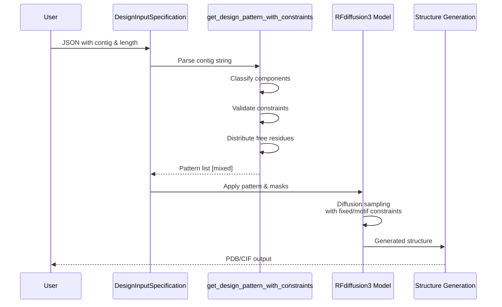

The Design Pattern with Constraints system in Foundry provides a powerful mechanism for specifying structural blueprints in protein design problems. This system enables precise control over which residues are fixed (preserved from input structures) and which are freely generated by the model, while supporting complex length constraints and chain terminators. The constraint-based pattern translation sits at the core of RFdiffusion3's ability to design biomolecular interactions under precise structural specifications.

## Architecture and Core Concepts

The design pattern system operates as a **constraint satisfaction engine** that translates human-readable contig strings into executable design specifications. At its foundation lies the principle of separating **fixed segments** (residues explicitly preserved from input structures) from **variable ranges** (free residues to be generated by the model), while ensuring all length constraints are mathematically satisfiable.

The system supports three fundamental component types in contig strings:

| Component Type | Format | Example | Meaning |
|---------------|--------|---------|---------|
| Fixed Residue | `{ChainID}{ResidueIndex}` | `A20` | Single residue from chain A at position 20 |
| Fixed Range | `{ChainID}{Start}-{End}` | `A20-21` | Multiple residues from chain A (positions 20-21) |
| Variable Range | `{Start}-{End}` | `1-5` | Free residues to generate (1-5 residues) |
| Chain Terminator | `/0` | `/0` | Marks end of a polypeptide chain |
| Single Variable | `{Number}` | `3` | Exactly N free residues |

**Contig strings** are comma-separated specifications that define the complete structural blueprint. For example, `'1-5,A20-21,1-5,A25-25,1-5,A30-30,/0,1-5'` specifies a pattern with alternating free regions and fixed motif residues, where integers represent numbers of free residues and `A20`, `A21`, etc. represent specific residues to be preserved from the input structure. The accompanying `length` parameter (e.g., `'10-10'`) constrains the total number of free residues across all variable ranges.

## Pattern Translation Algorithm

The `get_design_pattern_with_constraints()` function implements a sophisticated algorithm for converting contig strings into executable design patterns. The translation process follows a multi-stage pipeline that ensures all constraints are mathematically consistent before generating the final pattern.

```mermaid
flowchart TD
    A[Input: Contig String] --> B[Parse & Classify Components]
    B --> C{Component Type?}
    C -->|Contains Letters| D[Fixed Segment<br>Extract: ChainID, Start, End]
    C -->|/0| E[Chain Terminator]
    C -->|Digits| F[Variable Range<br>Extract: Min, Max]
    
    D --> G[Track Fixed Position: 1]
    E --> H[Track Terminator Position: 2]
    F --> I[Track Variable Position: 0]
    
    G --> J[Calculate Total Motif Residues]
    H --> J
    I --> J
    
    J --> K[Adjust Length Constraints<br>length -= motif_residues]
    K --> L{Validate Feasibility<br>valid_min ≤ valid_max?}
    
    L -->|Invalid| M[Raise ComponentValidationError]
    L -->|Valid| N[Distribute Free Residues<br>Random allocation within bounds]
    
    N --> O[Reassemble Pattern<br>Merge fixed, free, terminators]
    O --> P[Output: List[str]]
```

### Stage 1: Component Classification

The algorithm begins by parsing the contig string and classifying each component into one of three categories: fixed segments, variable ranges, or chain terminators. This classification enables the system to handle each component type with its specific logic.

For components containing letters, the system extracts the protein/nuclieic acid unit identifier (`pn_unit_id`), start position, and end position using the `extract_pn_unit_info()` function which employs a regex pattern `r"([A-Za-z])(\d+)(?:-(\d+))?"` to parse chain identifiers and residue ranges. Components matching `/0` are flagged as chain terminators, while numeric components are parsed as variable ranges with minimum and maximum bounds.

Sources: [components.py#L85-L109](/src/foundry/utils/components.py#L85-L109)

### Stage 2: Constraint Adjustment

After classification, the system calculates the total number of motif residues by summing the lengths of all fixed segments (`end - start + 1` for each fixed range). This count is then subtracted from the user-specified length constraints to determine the remaining length budget for free residues.

The length parameter supports both single values (e.g., `'10'`) and ranges (e.g., `'10-15'`). If not specified, the system defaults to `0-9999`, effectively removing length constraints. This adjustment ensures that the total length of the final design equals the sum of fixed motif residues plus randomly allocated free residues.

Sources: [components.py#L111-L122](/src/foundry/utils/components.py#L111-L122)

### Stage 3: Free Residue Distribution

The core of the algorithm distributes the available free residue budget across all variable ranges. For each variable range, the system calculates a **valid allocation window** by considering:

1. The range's intrinsic minimum and maximum bounds
2. The minimum remaining length required for subsequent variable ranges
3. The maximum remaining length allowable for subsequent variable ranges

The valid minimum for a range is the maximum of its intrinsic minimum and the remaining minimum length minus the sum of minimums for all subsequent ranges. Similarly, the valid maximum is the minimum of its intrinsic maximum and the remaining maximum length minus the sum of maximums for subsequent ranges.

This calculation ensures that allocating a value within the valid window for the current range leaves a feasible allocation window for all remaining ranges. If at any point `valid_min > valid_max`, the system raises a `ComponentValidationError`, indicating that the specified constraints are mathematically impossible to satisfy.

Sources: [components.py#L124-L148](/src/foundry/utils/components.py#L124-L148)

### Stage 4: Random Allocation and Reassembly

Once the valid allocation windows are established for all variable ranges, the system randomly selects a value within each window using `random.randint(valid_min, valid_max)`. The selected values are appended to the `num_free_atoms` list, and the remaining length budget is decremented accordingly.

Finally, the system reassembles the design pattern by iterating through the original contig string in order. For each position:
- Fixed segments (position marker = 1): Pop the next fixed segment from `fixed_parts` and append each individual residue (e.g., `A20`, `A21`)
- Variable ranges (position marker = 0): Pop the next free residue count from `num_free_atoms`
- Chain terminators (position marker = 2): Append `/0`

The output is a mixed list where integers represent free residue counts and strings represent fixed residues or terminators (e.g., `[2, 'A20', 'A21', 2, 'A25', 3, 'A30', '/0', 3]`).

Sources: [components.py#L150-L176](/src/foundry/utils/components.py#L150-L176)

## Component Validation and Error Handling

The design pattern system includes robust error handling through the `ComponentValidationError` exception class. This specialized exception captures detailed context about validation failures, including the problematic component and additional diagnostic information.

For example, when parsing a contig component, `split_contig()` validates that residue indices are non-negative integers and raises `ComponentValidationError` with the component string and explanatory message if validation fails. Similarly, `extract_pn_unit_info()` validates the regex match and raises an error for malformed contig formats.

The mask retrieval functions (`fetch_mask_from_idx()`, `fetch_mask_from_name()`, `fetch_mask_from_component()`) perform validation by checking if the specified component exists in the input atom array. If a component is not found, these functions raise `ComponentValidationError` with details about available non-protein residue names, aiding in debugging and providing actionable feedback.

Sources: [components.py#L25-L48](/src/foundry/utils/components.py#L25-L48), [components.py#L333-L375](/src/foundry/utils/components.py#L333-L375)

## Component Resolution and Canonicalization

The `unravel_components()` function provides a **safe canonicalization layer** that converts various input specifications into standardized component strings. This function handles three distinct input patterns:

1. **Complex patterns**: Strings containing commas or hyphens are interpreted as full design patterns and processed through `get_design_pattern_with_constraints()`

2. **Single component strings**: Simple strings like `'Z9'` or `'L:G'` are resolved by attempting to fetch a mask from the atom array, then extracting the unique chain and residue identifiers to form a canonical component string

3. **Error handling**: If a component maps to multiple residues and `allow_multiple_matches` is False, the function raises `ComponentValidationError`. When enabled (e.g., for symmetric designs), it returns all matching residues as a deduplicated list

This canonicalization is crucial for ensuring consistent component references throughout the design pipeline, allowing users to specify residues by chain-position identifiers, non-protein residue names, or through complex design patterns with equal reliability.

Sources: [components.py#L382-L416](/src/foundry/utils/components.py#L382-L416)

> [!TIP]
> When working with symmetric designs, always set `allow_multiple_matches=True` in `unravel_components()`. Symmetry generates multiple equivalent chains, and strict validation will otherwise reject components that resolve to multiple symmetric positions.

## Motif Components and Breaks

For advanced design scenarios where positional encoding between contigs needs selective control, the `get_motif_components_and_breaks()` function provides granular management of breaks in motif regions. This function converts contig strings into two parallel lists: `components` (individual residue identifiers) and `breaks` (boolean flags indicating whether to insert a positional break).

The break logic follows these rules:
- Single fixed residues (e.g., `A14`): Always insert a break (`True`)
- Fixed ranges (e.g., `A14-15`): Insert break at the start of the range (`True`) followed by no breaks for subsequent residues (`False`)
- Chain terminators (`/0`): Break value is `None` (special handling)
- Variable ranges: Break value is `None`

The `index_all` parameter overrides this behavior by setting all non-None breaks to `False`, enabling full indexing of concatenated tokens. This is particularly useful for scenarios where motif tokens should be treated as a continuous block rather than individual residues.

Sources: [components.py#L177-L237](/src/foundry/utils/components.py#L177-L237)

## Practical Applications and Examples

The design pattern with constraints system is integral to RFdiffusion3's capabilities across multiple application domains. The following examples demonstrate real-world usage patterns drawn from the test suite and documentation.

### Enzyme Design with Catalytic Motifs

Enzyme design tasks typically involve preserving catalytic residues while generating the surrounding scaffold. The contig pattern specifies fixed catalytic residues interspersed with variable regions for scaffold generation:

```json
{
  "unindex": "A108,A139,A152,A156",
  "length": "180-200"
}
```

Here, residues A108, A139, A152, and A156 are fixed as the catalytic motif, while the length constraint specifies that the total number of generated free residues should be between 180-200. The `unindex` parameter indicates these residues should have their positions inferred by the model rather than being pre-specified in the input.

Sources: [enzyme_design.md](/models/rfd3/docs/enzyme_design.md)

### Test Case: Selection Canonicalization

The test suite demonstrates the equivalence of different component specification methods. A residue specified by chain-position (`Z9`), non-protein name (`L:G`), or dictionary format (`{name: atom_names}`) all resolve to the same canonical component and generate identical atom masks:

```python
canonical_components_0 = unravel_components("Z9", atom_array=atom_array_ref)
canonical_components_1 = unravel_components("L:G", atom_array=atom_array_ref)
# Both resolve to the same canonical residue
assert canonical_components_0[0] == canonical_components_1[0]
```

This flexibility allows users to specify components using the most convenient notation for their task while the system maintains internal consistency.

Sources: [test_selections.py#L27-L70](/models/rfd3/tests/test_selections.py#L27-L70)

## Integration with the Design Pipeline

The design pattern system operates within RFdiffusion3's broader architecture, integrating with input specification, mask generation, and trajectory generation. The pattern translation occurs early in the pipeline, establishing the structural blueprint before diffusion sampling.



The pattern list generated by `get_design_pattern_with_constraints()` is used to create binary masks that specify which atoms are fixed (motif) versus which should be sampled by the diffusion process. These masks are propagated through the transformer architecture, guiding the generation process to satisfy the specified constraints.

For comprehensive understanding of the input specification system, see [Component Parsing and Validation](18-component-parsing-and-validation). For mask generation strategies, refer to [Mask Generation for Partial Design](20-mask-generation-for-partial-design).

> [!TIP]
> Always validate your contig patterns against the input structure's atom array before running expensive inference. The `fetch_mask_from_component()` function provides pre-flight checking to catch missing residues or invalid references before diffusion sampling begins.

## Key Implementation Details

### Random Allocation Strategy

The algorithm uses Python's `random.randint()` for allocating free residues within valid windows. This introduces stochasticity—different runs with the same contig and length constraints will produce different distributions of free residues across variable ranges. For reproducible designs, set the random seed before calling `get_design_pattern_with_constraints()`.

### ComponentStr Subclass

The `ComponentStr` class extends Python's `str` type specifically for component identifiers. This type annotation enables clear distinction between generic strings and validated component strings throughout the codebase. The `split_component()` class method provides a convenient interface for extracting chain and residue information.

### AtomWorks Integration

The mask retrieval functions rely on AtomWorks' `AtomArray` data structure, which provides efficient boolean indexing for atoms, residues, and chains. The `res_id`, `chain_id`, `res_name`, and `atom_name` attributes are used extensively for component resolution and mask generation.

Sources: [components.py#L42-L48](/src/foundry/utils/components.py#L42-L48)

## Error Scenarios and Troubleshooting

| Error Scenario | Root Cause | Resolution |
|----------------|------------|------------|
| `ComponentValidationError: No valid selections possible` | Length constraints too tight for variable ranges | Increase `length` parameter or adjust contig variable ranges |
| `ComponentValidationError: Residue not found` | Specified component doesn't exist in atom array | Verify chain IDs and residue numbers match input structure |
| `ComponentValidationError: Component maps to multiple residues` | Non-unique component reference without `allow_multiple_matches` | Use specific chain-position or enable multi-match for symmetry |
| `ComponentValidationError: Invalid contig format` | Malformed chain-residue syntax | Use `{ChainID}{Residue}` or `{ChainID}{Start}-{End}` format |

## Next Steps

The Design Pattern with Constraints system provides the foundation for precise structural control in biomolecular design. To deepen your understanding:

- Explore how masks are generated from these patterns in [Mask Generation for Partial Design](20-mask-generation-for-partial-design)
- Understand the full input specification system in [Component Parsing and Validation](18-component-parsing-and-validation)
- Learn how these patterns integrate with RFdiffusion3's architecture in [RFdiffusion3: All-Atom Generative Model](9-rfdiffusion3-all-atom-generative-model)
- Review practical examples in the RFD3 documentation, including [enzyme design](/models/rfd3/docs/enzyme_design.md) and [symmetry](/models/rfd3/docs/symmetry.md)

For hands-on experimentation, examine the test suite in `models/rfd3/tests/test_selections.py`, which demonstrates canonicalization, mask generation, and unindexed break functionality across various scenarios.