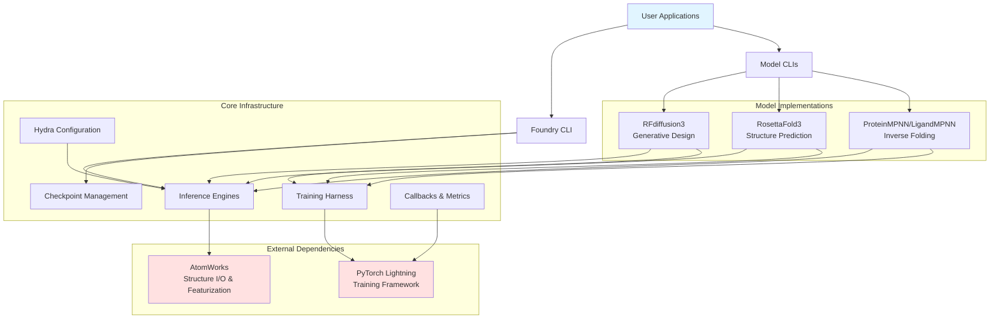
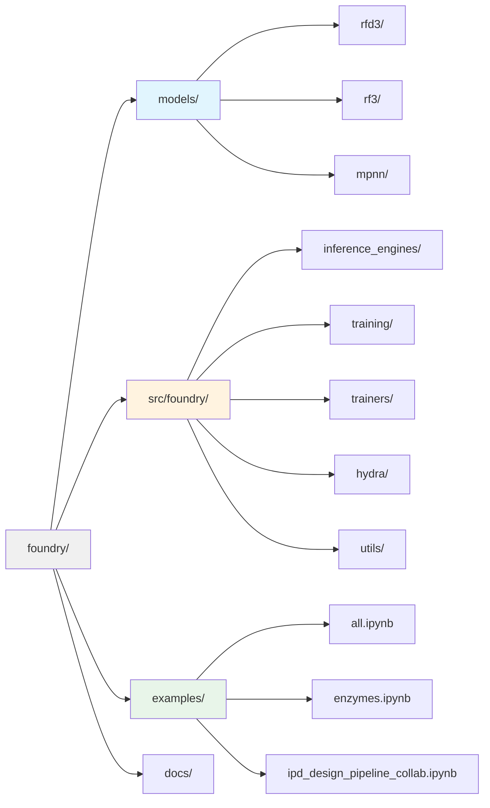

Foundry is a unified framework that provides tooling and infrastructure for using and training state-of-the-art models for protein design, including generative design (RFdiffusion3), inverse folding (ProteinMPNN and LigandMPNN), and structure prediction (RosettaFold3). All models within Foundry rely on AtomWorks for structure manipulation, preprocessing, and featurization during both training and inference. This Quick Start guide will walk you through installation, model setup, and basic usage for all supported models.

Sources: [README.md](/README.md#L1-L6), [pyproject.toml](/pyproject.toml#L24-L51)

## Architecture Overview

Foundry follows a strict dependency hierarchy where the core framework provides shared infrastructure that is extended by model-specific implementations. The architecture is designed with modularity in mind, allowing you to work with individual models or combine them into complete protein design pipelines.



The architecture shows that Foundry provides a unified training and inference infrastructure that all models leverage. The core modules handle common concerns like configuration management, checkpoint loading, and distributed training, while model-specific code implements the unique architectures and inference logic for each model type.

Sources: [README.md](/README.md#L59-L64), [checkpoint_registry.py](/src/foundry/inference_engines/checkpoint_registry.py#L33-L70)

## Installation

Foundry supports Python 3.12 or higher and can be installed with all model dependencies or with optional extras for specific models. The recommended installation method depends on your intended use case.

### Installation Options

| Installation Type | Command | Use Case |
|-------------------|---------|----------|
| **Complete** | `pip install rc-foundry[all]` | Full pipeline with all models (recommended for beginners) |
| **RFdiffusion3 only** | `pip install rc-foundry[rfd3]` | Generative protein design workflows |
| **RosettaFold3 only** | `pip install rc-foundry[rf3]` | Structure prediction tasks |
| **MPNN only** | `pip install rc-foundry[mpnn]` | Inverse folding and sequence design |

For development workflows, you can install Foundry and models in editable mode:

```bash
# Install foundry and all models in editable mode
uv pip install -e . -e ./models/rf3 -e ./models/rfd3 -e ./models/mpnn

# Or install only foundry (no models)
uv pip install -e .
```

The editable installation allows you to modify shared utilities in Foundry and see changes immediately, work on specific models without installing all models, and add new models as independent packages in the `models/` directory.

Sources: [README.md](/README.md#L8-L12), [pyproject.toml](/pyproject.toml#L54-L66), [README.md](/README.md#L68-L81)

## Project Structure

Understanding the repository structure helps you navigate the codebase and locate the resources you need.



<details>
<summary>📁 Detailed Directory Structure</summary>

```
foundry/
├── models/                          # Model-specific implementations
│   ├── rfd3/                       # RFdiffusion3 generative model
│   │   ├── configs/                 # Hydra configurations
│   │   ├── docs/                    # Model documentation and examples
│   │   └── src/rfd3/               # Model source code
│   ├── rf3/                        # RosettaFold3 structure prediction
│   │   ├── configs/                # Hydra configurations
│   │   ├── docs/                   # Model documentation
│   │   └── src/rf3/                # Model source code
│   └── mpnn/                       # ProteinMPNN/LigandMPNN
│       ├── configs/                # Hydra configurations
│       └── src/mpnn/               # Model source code
├── src/foundry/                    # Core infrastructure
│   ├── inference_engines/          # Base inference engine & checkpoint registry
│   ├── training/                   # Training utilities (EMA, checkpointing)
│   ├── trainers/                   # FabricTrainer implementation
│   ├── hydra/                      # Custom Hydra resolvers
│   ├── callbacks/                  # PyTorch Lightning callbacks
│   └── utils/                      # Shared utilities (DDP, alignment, etc.)
├── examples/                       # Interactive notebooks
│   ├── all.ipynb                   # All models demo
│   ├── enzymes.ipynb               # Enzyme design example
│   └── ipd_design_pipeline_collab.ipynb  # Full pipeline tutorial
└── src/foundry_cli/                # Command-line interface
    └── download_checkpoints.py     # Checkpoint installation CLI
```

</details>

The `models/` directory contains all model-specific code, configurations, and documentation. The core Foundry infrastructure in `src/foundry/` provides shared functionality for training, inference, and utilities. The `examples/` directory contains Jupyter notebooks demonstrating usage patterns and complete workflows.

Sources: [README.md](/README.md#L59-L64), [get_repo_structure](/get_repo_structure), [checkpoint_registry.py](/src/foundry/inference_engines/checkpoint_registry.py#L1-L20)

## Model Overview

Foundry supports three primary model families, each serving distinct protein design and analysis tasks.


| Model | Category | Primary Function | Key Capability |
|-------|----------|-------------------|----------------|
| **RFdiffusion3 (RFD3)** | Generative Design | Creates novel protein structures | Design under complex constraints (ligands, nucleic acids, symmetry) |
| **RosettaFold3 (RF3)** | Structure Prediction | Predicts 3D structures from sequence | Competitive with leading closed-source models, supports complexes |
| **ProteinMPNN/LigandMPNN** | Inverse Folding | Designs sequences for fixed backbones | Handles ligands, DNA/RNA, and custom constraints |


These models can be combined into complete design pipelines: RFD3 generates backbone structures, MPNN designs sequences, and RF3 validates or refines the designs.

Sources: [README.md](/README.md#L29-L52), [rfd3/README.md](/models/rfd3/README.md#L3-L7), [rf3/README.md](/models/rf3/README.md#L1-L14)

## Downloading Model Weights

All model checkpoints can be downloaded using the Foundry CLI, which provides a unified interface for checkpoint management with progress tracking and optional hash verification.

### Basic Download Commands

Download all models (complete pipeline):

```bash
foundry install all --checkpoint-dir /path/to/ckpt/dir
```

Download recommended beginner models:

```bash
foundry install rfd3 ligandmpnn rf3 --checkpoint-dir /path/to/ckpt/dir
```

Download individual models:

```bash
# RFdiffusion3 (generative design)
foundry install rfd3 --checkpoint-dir /path/to/ckpt/dir

# RosettaFold3 (structure prediction)
foundry install rf3 --checkpoint-dir /path/to/ckpt/dir

# ProteinMPNN (inverse folding)
foundry install proteinmpnn --checkpoint-dir /path/to/ckpt/dir

# LigandMPNN (ligand-aware inverse folding)
foundry install ligandmpnn --checkpoint-dir /path/to/ckpt/dir
```

> [!TIP]
> The checkpoint directory is optional and defaults to `~/.foundry/checkpoints` if not specified. After downloading, the CLI sets the `FOUNDRY_CHECKPOINTS_DIR` environment variable in your `.env` file, allowing you to run inference without supplying checkpoint paths in future runs.

### Available Checkpoints

| Model Name | Filename | Description | Size |
|------------|----------|-------------|------|
| `rfd3` | `rfd3_latest.ckpt` | Latest RFdiffusion3 checkpoint | ~3GB |
| `rf3` | `rf3_foundry_01_24_latest_remapped.ckpt` | Latest RF3 (data through Jan 2024) | ~2GB |
| `rf3_preprint_921` | `rf3_foundry_09_21_preprint_remapped.ckpt` | RF3 for benchmarking (data through Sep 2021) | ~2GB |
| `rf3_preprint_124` | `rf3_foundry_01_24_preprint_remapped.ckpt` | Original preprint RF3 | ~2GB |
| `proteinmpnn` | `proteinmpnn_v_48_020.pt` | ProteinMPNN weights (48 neighbors, σ=0.20) | ~500MB |
| `ligandmpnn` | `ligandmpnn_v_32_010_25.pt` | LigandMPNN weights (32 neighbors, σ=0.10) | ~500MB |
| `solublempnn` | `solublempnn_v_48_020.pt` | SolubleMPNN weights | ~500MB |

The download process includes automatic progress tracking and optional hash verification to ensure file integrity. Use the `--force` flag to overwrite existing checkpoints.

Sources: [download_checkpoints.py](/src/foundry_cli/download_checkpoints.py#L122-L150), [checkpoint_registry.py](/src/foundry/inference_engines/checkpoint_registry.py#L33-L70)

## Running Your First Inference

Each model provides a command-line interface for inference. The examples below assume you have downloaded the checkpoints to your checkpoint directory.

### RFdiffusion3: Design a Protein Structure

RFdiffusion3 accepts design specifications in JSON format and generates novel protein structures satisfying your constraints.

```bash
rfd3 design out_dir=logs/inference_outs/demo/0 \
  inputs=models/rfd3/docs/demo.json \
  ckpt_path=null \
  skip_existing=False \
  dump_trajectories=True \
  align_trajectory_structures=True
```

Key parameters:
- `out_dir`: Output directory for results (auto-created)
- `inputs`: Path to JSON file specifying design constraints
- `ckpt_path`: Checkpoint path (use `null` to use default from `FOUNDRY_CHECKPOINTS_DIR`)
- `dump_trajectories`: Save intermediate diffusion steps (useful for visualization)
- `align_trajectory_structures`: Align trajectory structures for comparison


RFdiffusion3 supports diverse design scenarios including nucleic acid binders, small molecule binders, protein-protein interfaces, enzyme active sites, and symmetric assemblies.

Sources: [rfd3/README.md](/models/rfd3/README.md#L24-L38), [rfd3/README.md](/models/rfd3/README.md#L40-L48)

### RosettaFold3: Predict Structure from Sequence

RosettaFold3 predicts 3D structures from amino acid sequences and provides confidence metrics for quality assessment.

```bash
rf3 fold inputs='tests/data/5vht_from_json.json'
```

Specify a custom checkpoint:

```bash
rf3 fold inputs='tests/data/5vht_from_json.json' \
  ckpt_path='/path/to/rf3_checkpoint.ckpt'
```

Outputs include:
- `{input}_metrics.csv` - Overall confidence metrics (pTM, ptm_threshold, etc.)
- `{input}.score` - Granular confidence metrics per residue
- `{input}_model_{N}.cif.gz` - Compressed structure predictions for each diffusion seed

For high-confidence predictions, expect pTM values > 0.8 even without multiple sequence alignments.

Sources: [rf3/README.md](/models/rf3/README.md#L55-L78), [rf3/README.md](/models/rf3/README.md#L29-L50)

### ProteinMPNN/LigandMPNN: Design Sequences

ProteinMPNN and LigandMPNN design sequences for fixed backbone structures, with LigandMPNN additionally supporting ligand-aware design.

```bash
# For protein-only design
mpnn inference model_type=protein_mpnn \
  backbone_path=/path/to/structure.pdb \
  out_dir=/path/to/output

# For ligand-aware design
mpnn inference model_type=ligand_mpnn \
  backbone_path=/path/to/complex.pdb \
  out_dir=/path/to/output
```

Important settings for legacy weights:
- `model_type`: Set to `"protein_mpnn"` or `"ligand_mpnn"`
- `is_legacy_weights`: Set to `True` for original model weights

> [!TIP]
> If you're benchmarking against original ProteinMPNN/LigandMPNN models, use the old repositories until the Foundry API and public weights fully stabilize. The Foundry team is actively validating the re-implementation and welcomes feedback on discrepancies.

Sources: [mpnn/README.md](/models/mpnn/README.md#L34-L40), [mpnn/README.md](/models/mpnn/README.md#L63-L70), [pyproject.toml](/pyproject.toml#L86-L88)

## Interactive Examples

The repository provides interactive Jupyter notebooks demonstrating usage patterns and complete design pipelines.

| Notebook | Description | Topics Covered |
|----------|-------------|----------------|
| `all.ipynb` | All models demo | Basic inference for each model type |
| `enzymes.ipynb` | Enzyme design | Active site design with constraints |
| `ipd_design_pipeline_collab.ipynb` | Full pipeline | Complete workflow from design to validation |

Launch a notebook to explore interactive examples:

```bash
jupyter notebook examples/all.ipynb
```

For an interactive Google Colab notebook walking through a basic design pipeline with RFD3, MPNN, and RF3, see the [IPD Design Pipeline Tutorial](https://colab.research.google.com/drive/1ZwIMV3n9h0ZOnIXX0GyKUuoiahgifBxh?usp=sharing).

Sources: [README.md](/README.md#L24-L27), [get_repo_structure](/get_repo_structure)

## Next Steps

Now that you have Foundry installed and understand the basics, consider exploring these resources to deepen your knowledge:

- **[End-to-End Design Pipeline Tutorial](3-end-to-end-design-pipeline-tutorial)** - Learn how to combine RFD3, MPNN, and RF3 into a complete protein design workflow
- **[Google Colab Quick Start](4-google-colab-quick-start)** - Run interactive examples in the cloud without local installation
- **[Architecture and Design Philosophy](5-architecture-and-design-philosophy)** - Understand the architectural principles guiding Foundry's design

If you're interested in extending Foundry or customizing models:
- **[Inference Engine Architecture](6-inference-engine-architecture)** - Deep dive into the inference framework
- **[Hydra Configuration System](12-hydra-configuration-system)** - Learn to configure models effectively
- **[Adding New Models to Foundry](21-adding-new-models-to-foundry)** - Guide for implementing custom models
