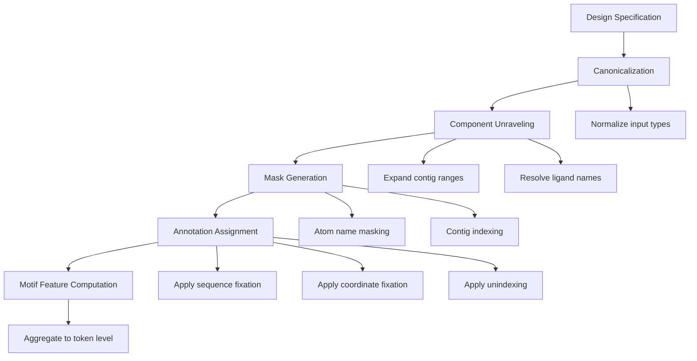
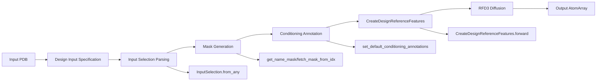

Mask generation for partial design is a foundational mechanism in Foundry that enables selective fixation of structural elements during protein generation. This system allows precise control over which atoms and residues remain fixed while others are freely designed, supporting workflows ranging from scaffold preservation to epitope grafting.

**Architectural Context**: The mask generation system operates through a hierarchical pipeline: specification parsing → component resolution → atom-level masking → conditioning annotation assignment. Each layer builds upon the previous to transform high-level design intent into precise atom-level boolean masks that drive the diffusion process.


## Core Mask Generation Functions

The mask generation API provides three primary functions for selecting atoms in AtomArray structures. Each function returns a boolean mask of the same length as the input atom array, where `True` indicates selected atoms.

### Atom Name-Based Masking

The `get_name_mask()` function enables selection by atom names with flexible specifications:

```python
def get_name_mask(
    source_names: np.ndarray, 
    query_names: str, 
    source_resname: str | None = None
) -> np.ndarray
```

This function supports multiple query formats:

| Query Type | Example | Description |
|------------|---------|-------------|
| `"ALL"` | `"ALL"` | Select all atoms in token |
| `"BKBN"` | `"BKBN"` | Select backbone atoms (N, CA, C, O) |
| `"TIP"` | `"TIP"` | Select farthest atoms from backbone for geometry constraints |
| Comma-separated | `"N,CA,C,O,CB"` | Exact atom name queries |
| List | `["N", "CA", "C", "O"]` | List of atom names |

Sources: [components.py](src/foundry/utils/components.py#L115-L196)

The TIP selection requires a residue name to determine geometry-specific atoms defined in `TIP_BY_RESTYPE` constants. This enables ligand-aware masking where the most structurally critical atoms are selected to preserve binding geometry.

### Contig-Based Masking

For residue-level selection, the `fetch_mask_from_idx()` function converts contig strings to atom masks:

```python
def fetch_mask_from_idx(contig_str, *, atom_array) -> np.ndarray
```

Contig strings follow the format `ChainIDResID` (e.g., `"A20"`, `"B15"`). The function validates the contig format and returns atoms matching both chain ID and residue ID.

Sources: [components.py](src/foundry/utils/components.py#L199-L213)

### Component-Based Masking

The `fetch_mask_from_component()` function provides a unified interface that handles both protein residues and non-protein components:

```python
def fetch_mask_from_component(component, *, atom_array) -> np.ndarray
```

This function first attempts to match the component as a ligand/residue name, then falls back to contig-based matching. This enables seamless handling of mixed protein-ligand systems.

Sources: [components.py](src/foundry/utils/components.py#L229-L239)

## Conditioning Annotations System

Foundry uses a comprehensive annotation system to control the diffusion process at multiple levels of granularity. These annotations are boolean flags assigned to each atom that determine how the generative model treats that atom.

### Required Conditioning Annotations

The system defines three required annotations that control fundamental diffusion behavior:

| Annotation | Purpose | Default Value |
|------------|---------|---------------|
| `is_motif_atom_with_fixed_seq` | Atom sequence is fixed during generation | `True` |
| `is_motif_atom_with_fixed_coord` | Atom 3D coordinates are fixed during generation | `True` |
| `is_motif_atom_unindexed` | Atom is part of unindexed region (no positional encoding) | `False` |

Sources: [constants.py](models/rfd3/src/rfd3/constants.py#L18-L25)

These annotations work in combination to define four diffusion modes:

- **Fixed motif**: Both sequence and coordinates fixed (scaffold preservation)
- **Fixed sequence, diffused structure**: Sequence fixed but coordinates diffuse (re-scaffolding)
- **Diffused sequence, fixed structure**: Coordinates fixed but sequence diffuses (sequence design on fixed backbone)
- **Fully diffused**: Neither sequence nor coordinates fixed (de novo generation)

### Annotation Propagation

The `set_default_conditioning_annotations()` function efficiently applies annotations across atom arrays:

```python
def set_default_conditioning_annotations(
    atom_array,
    motif=False,
    unindexed=False,
    mask=None,
    dtype=bool,
    additional: set | list = None
) -> AtomArray
```

This function supports both global application (no mask) and selective application (with mask), enabling fine-grained control over which regions receive which conditioning.

Sources: [conditioning_base.py](models/rfd3/src/rfd3/transforms/conditioning_base.py#L89-L130)

### Motif Feature Extraction

The `get_motif_features()` function computes motif-level boolean features from atom-level annotations:

```python
def get_motif_features(atom_array) -> dict:
    returns: {
        "is_motif_atom": boolean array,
        "is_motif_token": boolean array (aggregated to token level)
    }
```

This function identifies atoms with any conditioning (fixed sequence, fixed coordinates, or unindexed) and aggregates this information to the token (residue) level using logical OR operations.

Sources: [conditioning_base.py](models/rfd3/src/rfd3/transforms/conditioning_base.py#L67-L78)

> [!TIP]
> Token-level aggregation is critical for efficient diffusion processing. The system uses `apply_and_spread_token_wise()` to convert atom-level masks to token-level features, enabling the diffusion model to process residues as cohesive units rather than individual atoms.

## Input Specification and Parsing

The `DesignInputSpecification` class provides a declarative interface for specifying partial design constraints through configuration.

### Selection Parameters

The specification supports multiple selection parameters for different conditioning aspects:

```python
class DesignInputSpecification(BaseModel):
    # Coordinate fixation
    select_fixed_atoms: Optional[InputSelection]
    
    # Sequence fixation
    select_unfixed_sequence: Optional[InputSelection]
    
    # RASA accessibility conditioning
    select_buried: Optional[InputSelection]
    select_partially_buried: Optional[InputSelection]
    select_exposed: Optional[InputSelection]
    
    # Hydrogen bond conditioning
    select_hbond_acceptor: Optional[InputSelection]
    select_hbond_donor: Optional[InputSelection]
    
    # Protein-protein interface conditioning
    select_hotspots: Optional[InputSelection]
```

Sources: [input_parsing.py](models/rfd3/src/rfd3/inference/input_parsing.py#L88-L138)

### InputSelection Canonicalization

The `InputSelection` class normalizes various input formats to a consistent internal representation:

```python
class InputSelection(BaseModel):
    def from_any(cls, v: Union[str, bool, dict, None], atom_array: AtomArray)
```

Supported input formats include:

| Input Type | Example | Canonicalization Result |
|------------|---------|------------------------|
| String contig | `"A10-20"` | All atoms in residues 10-20 of chain A |
| Boolean `True` | `True` | All atoms in structure |
| Boolean `False` | `False` | No atoms |
| Dictionary | `{"A10": "N,CA,C", "A11": "BKBN"}` | Atom-specific selection per residue |

Sources: [parsing.py](models/rfd3/src/rfd3/inference/parsing.py#L29-L74)

The `canonicalize_()` function handles the conversion logic, calling `unravel_components()` to expand contig ranges and `fetch_mask_from_idx()` to resolve individual components.

Sources: [parsing.py](models/rfd3/src/rfd3/inference/parsing.py#L113-L166)

### Mutual Exclusivity Validation

The specification includes validation to ensure selections are mutually exclusive where appropriate:

```python
@model_validator(mode="after")
def assert_exclusivity(self):
    # Assert indexed and unindexed do not overlap
    # Assert RASA binning is mutually exclusive
```

This prevents conflicting conditioning where the same atom would be subject to contradictory diffusion constraints.

Sources: [input_parsing.py](models/rfd3/src/rfd3/inference/input_parsing.py#L329-L365)

## Mask Generation Pipeline

The complete mask generation pipeline transforms design specifications into atom-level masks through a series of well-defined steps:



### Stage 1: Canonicalization

Input specifications are normalized through `canonicalize_()` which converts:
- Boolean values to atom-level masks
- Contig strings to residue ranges
- Atom name specifications to normalized lists

Sources: [parsing.py](models/rfd3/src/rfd3/inference/parsing.py#L113-L166)

### Stage 2: Component Unraveling

The `unravel_components()` function expands compact specifications into explicit component lists:

```python
def unravel_components(
    v: str, 
    *, 
    atom_array: AtomArray = None, 
    allow_multiple_matches: bool = False
) -> List[str]
```

For example, `"A10-12"` is expanded to `["A10", "A11", "A12"]`, enabling per-residue control while maintaining compact input syntax.

Sources: [components.py](src/foundry/utils/components.py#L256-L310)

### Stage 3: Mask Generation

Masks are generated through specialized functions based on selection type:
- **Coordinate masking**: `get_name_mask()` for atom-level selection
- **Sequence masking**: `fetch_mask_from_idx()` for residue-level selection
- **Component masking**: `fetch_mask_from_component()` for ligand selection

Sources: [components.py](src/foundry/utils/components.py#L199-L239)

### Stage 4: Annotation Assignment

Generated masks are assigned to atom array annotations through `set_default_conditioning_annotations()`, which applies the masks with configurable defaults for different regions.

Sources: [conditioning_base.py](models/rfdry/src/rfd3/transforms/conditioning_base.py#L89-L130)

### Stage 5: Feature Computation

Final motif features are computed via `get_motif_features()`, aggregating atom-level annotations to token-level features used by the diffusion model.

Sources: [conditioning_base.py](models/rfd3/src/rfd3/transforms/conditioning_base.py#L67-L78)

## Practical Usage Patterns

### Fixed Backbone Design

Preserve scaffold structure while designing new sequence:

```python
spec = DesignInputSpecification(
    input="scaffold.pdb",
    select_fixed_atoms=True,  # All coordinates fixed
    select_unfixed_sequence="A1-100",  # Redesign all sequence
    contig="A1-100"  # Define design region
)
```

Sources: [input_parsing.py](models/rfd3/src/rfd3/inference/input_parsing.py#L88-L138)

### Epitope Grafting

Design new protein while preserving binding interface:

```python
spec = DesignInputSpecification(
    input="epitope.pdb",
    contig="A1-10",  # Include epitope
    select_fixed_atoms={"A1": "BKBN", "A2-10": "ALL"},  # Fix backbone of A1, all of A2-10
    select_unfixed_sequence=True  # Design surrounding scaffold
)
```

Sources: [parsing.py](models/rfd3/src/rfd3/inference/parsing.py#L113-L166)

### Ligand-Bound Design

Design protein around fixed ligand:

```python
spec = DesignInputSpecification(
    input="complex.pdb",
    ligand="LIG",
    select_fixed_atoms={"LIG": "TIP"},  # Fix ligand geometry-constraining atoms
    contig="A10-20,LIG",  # Include ligand in design
    length="80-100"  # Design surrounding scaffold
)
```

Sources: [components.py](src/foundry/utils/components.py#L115-L196)

### Partial Diffusion

Apply limited noise to existing structure:

```python
spec = DesignInputSpecification(
    input="structure.pdb",
    partial_t=5.0,  # Add 5Å of noise
    select_fixed_atoms="A1-50",  # Keep N-terminus fixed
    select_unfixed_sequence="A51-100"  # Redesign C-terminus
)
```

Sources: [input_parsing.py](models/rfd3/src/rfd3/inference/input_parsing.py#L145-L148)

> [!TIP]
> When working with ligands, always use "TIP" atom selection instead of "ALL" for fixed atoms. TIP selects the geometry-constraining atoms that preserve binding orientation while allowing the generative model more flexibility with less critical atoms.

## Design Reference Features

The `CreateDesignReferenceFeatures` transform integrates mask-generated information with the diffusion model's reference feature system:

```python
class CreateDesignReferenceFeatures(Transform):
    def __init__(
        self,
        generate_conformers,
        provide_reference_conformer_when_unmasked,
        ground_truth_conformer_policy,
        provide_elements_for_unindexed_components,
        **kwargs
    )
```

This transform creates reference conformer information for conditioned atoms while leaving unconditioned regions with zero reference features, enabling classifier-free guidance during diffusion.

Sources: [design_transforms.py](models/rfd3/src/rfd3/transforms/design_transforms.py#L76-L125)

## Validation and Error Handling

The mask generation system includes comprehensive validation through `ComponentValidationError` exceptions:

| Error Type | Trigger | Resolution |
|------------|---------|------------|
| Invalid contig format | Non-alphanumeric characters in contig | Use format `ChainIDResID` |
| Residue not found | Contig doesn't match input structure | Verify chain IDs and residue numbers |
| Atom names not found | Query atoms don't exist in residue | Check residue type and available atoms |
| Overlapping selections | Same atom in multiple mutually exclusive selections | Ensure selections are disjoint |

Sources: [components.py](src/foundry/utils/components.py#L22-L46)

## Advanced Masking Techniques

### Conditional Masking

Combine multiple selection criteria using dictionary syntax:

```python
select_fixed_atoms={
    "A1-10": "BKBN",  # Backbone only for N-terminus
    "A11-20": "ALL",  # All atoms for core
    "A21-30": "N,CA,C,O,CB,CG"  # Specific atoms for interface
}
```

Sources: [parsing.py](models/rfd3/src/rfd3/inference/parsing.py#L113-L166)

### Sequential Masking

Apply masks in sequence for complex designs:

```python
# First fix ligand
atom_array = set_default_conditioning_annotations(
    atom_array, 
    motif=True, 
    mask=fetch_mask_from_component("LIG", atom_array=atom_array)
)

# Then unfix scaffold sequence
atom_array = set_default_conditioning_annotations(
    atom_array,
    motif=False,  # Diffuse
    mask=fetch_mask_from_idx("A10-20", atom_array=atom_array)
)
```

Sources: [conditioning_base.py](models/rfd3/src/rfd3/transforms/conditioning_base.py#L89-L130)

### Breakpoint Insertion

Control positional encoding breaks using unindexing:

```python
unindexed = get_motif_components_and_breaks("A10,A11-12,A13", index_all=False)
# Returns: components=["A10", "A11", "A12", "A13"], breaks=[True, True, False, True]
```

This enables control over which regions share positional encoding information during generation.

Sources: [components.py](src/foundry/utils/components.py#L129-L186)

## Integration with Design Pipeline

The mask generation system integrates with the broader Foundry design pipeline:



The generated masks flow through the inference pipeline, ultimately controlling which regions are preserved and which are generated by the diffusion model.

Sources: [design_transforms.py](models/rfd3/src/rfd3/transforms/design_transforms.py#L76-L125)

## Next Steps

- **Component Parsing**: Understand how contig strings are parsed into component specifications in [Component Parsing and Validation](18-component-parsing-and-validation)
- **Design Patterns**: Learn how masks combine with length constraints in [Design Pattern with Constraints](19-design-pattern-with-constraints)
- **Inference Engine**: See how masks are used in the inference pipeline in [Implementing Custom Inference Engines](23-implementing-custom-inference-engines)
- **RFdiffusion3 Model**: Understand how the model uses conditioning annotations in [RFdiffusion3: All-Atom Generative Model](9-rfdiffusion3-all-atom-generative-model)

The mask generation system provides the foundation for precise control over protein generation, enabling both creative design and rigorous constraint preservation across diverse protein engineering applications.