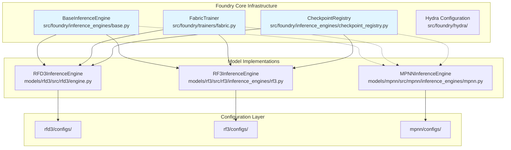
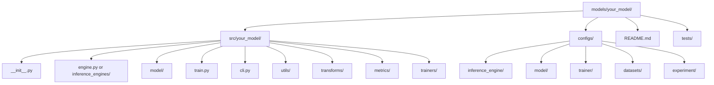

This guide provides a comprehensive framework for integrating new biomolecular AI models into Foundry's modular architecture. Foundry is designed as a shared training and inference infrastructure that supports multiple models through a common base class, allowing you to leverage existing components while implementing model-specific logic.

## Architecture Overview

Foundry follows a hierarchical integration pattern where models are organized as independent packages that inherit from core infrastructure components. The architecture separates concerns into three layers: base infrastructure, model-specific implementations, and training harnesses.



The base `BaseInferenceEngine` class provides essential functionality including checkpoint loading, trainer construction, and pipeline initialization. Models extend this base class to implement inference-specific logic while reusing infrastructure code.

**Sources:** [BaseInferenceEngine](src/foundry/inference_engines/base.py#L32-L154), [CheckpointRegistry](src/foundry/inference_engines/checkpoint_registry.py#L1-L71)

## Integration Prerequisites

Before integrating a new model, ensure you understand Foundry's core abstractions and have the necessary components in place. The integration requires architectural decisions about whether your model follows the standard pattern (extends `BaseInferenceEngine`) or requires a custom inference engine (like MPNN).

### Required Components

| Component | Purpose | Implementation Required |
|-----------|---------|-------------------------|
| **Model Package** | Contains all model-specific code | Create `models/{your_model}/` directory structure |
| **Inference Engine** | Handles model loading and inference | Extend `BaseInferenceEngine` or implement custom class |
| **Configuration Files** | Hydra-based parameter management | Create `models/{your_model}/configs/` hierarchy |
| **Model Architecture** | Neural network definition | Implement in `models/{your_model}/src/{your_model}/model/` |
| **Trainer** | Training orchestration | Extend `FabricTrainer` or create model-specific trainer |
| **Output Container** | Standardized result format | Implement dataclass for model outputs |

### Directory Structure Template



**Sources:** [RFD3 Structure](models/rfd3/), [RF3 Structure](models/rf3/), [MPNN Structure](models/mpnn/)

## Step 1: Create Model Package Structure

Begin by establishing the directory structure for your model. This follows the pattern established by existing models and ensures compatibility with Foundry's packaging system.

```bash
mkdir -p models/your_model/src/your_model
mkdir -p models/your_model/src/your_model/model
mkdir -p models/your_model/src/your_model/inference_engines
mkdir -p models/your_model/src/your_model/trainers
mkdir -p models/your_model/src/your_model/transforms
mkdir -p models/your_model/src/your_model/metrics
mkdir -p models/your_model/src/your_model/utils
mkdir -p models/your_model/configs/inference_engine
mkdir -p models/your_model/configs/model
mkdir -p models/your_model/configs/trainer
mkdir -p models/your_model/configs/datasets
mkdir -p models/your_model/tests
```

Initialize the package with a minimal `__init__.py` file that declares your model and version:

```python
"""Your Model - Brief description of what it does."""

__version__ = "0.1.0"
```

**Sources:** [RFD3 Init](models/rfd3/src/rfd3/__init__.py#L1-L13), [RF3 Init](models/rf3/src/rf3/__init__.py#L1-L4)

## Step 2: Implement or Extend Inference Engine

Choose your integration approach based on whether your model can leverage Foundry's standard checkpoint and training infrastructure.

### Option A: Extend BaseInferenceEngine (Recommended)

Use this approach if your model uses PyTorch checkpoints, requires standard trainer initialization, and benefits from Foundry's transform pipeline. This is the path taken by RFdiffusion3 and RosettaFold3.

Create your inference engine class in `models/your_model/src/your_model/engine.py`:

```python
from foundry.inference_engines import BaseInferenceEngine
from dataclasses import dataclass

@dataclass
class YourModelOutput:
    """Output container for your model predictions."""
    example_id: str
    predictions: Any
    # Add model-specific fields here
    
    def dump(self, out_dir, **kwargs):
        """Save outputs to disk."""
        pass

class YourModelInferenceEngine(BaseInferenceEngine):
    """Inference engine for your model."""
    
    def __init__(
        self,
        *,
        # Model-specific parameters
        batch_size: int = 1,
        num_steps: int = 100,
        # Output control parameters
        dump_predictions: bool = True,
        **kwargs,
    ):
        # Initialize base class with transform and trainer overrides
        super().__init__(
            transform_overrides={
                "batch_size": batch_size,
                # Add transform-specific overrides
            },
            inference_sampler_overrides={
                "num_timesteps": num_steps,
            },
            **kwargs,
        )
        
        # Store model-specific configuration
        self.batch_size = batch_size
        self.dump_predictions = dump_predictions
    
    def run(
        self,
        inputs,
        **kwargs,
    ):
        """Run inference on the provided inputs."""
        # Initialize model if not already done
        self.initialize()
        
        # Process inputs
        # Run model inference
        # Generate outputs
        pass
```

The `BaseInferenceEngine` provides several critical methods you leverage:

- `initialize()`: Loads checkpoint, constructs trainer and pipeline
- `_construct_trainer()`: Instantiates trainer and loads model weights
- `_construct_pipeline()`: Builds transform pipeline from configuration
- `_override_checkpoint_config()`: Merges runtime overrides with checkpoint config

**Sources:** [BaseInferenceEngine](src/foundry/inference_engines/base.py#L32-L154), [RFD3 Implementation](models/rfd3/src/rfd3/engine.py#L135-L200), [RF3 Implementation](models/rf3/src/rf3/inference_engines/rf3.py#L222-L340)

### Option B: Custom Inference Engine

Use this approach if your model has unique requirements such as different checkpoint formats, no need for trainer infrastructure, or custom loading logic. ProteinMPNN uses this pattern.

Create a standalone inference engine class:

```python
from dataclasses import dataclass

class YourModelInferenceEngine:
    """Custom inference engine for your model."""
    
    def __init__(
        self,
        *,
        checkpoint_path: str,
        model_type: str = "default",
        device: str | torch.device | None = None,
        **kwargs,
    ):
        """Initialize engine and load model."""
        self.checkpoint_path = checkpoint_path
        self.model_type = model_type
        self.device = device
        
        self._build_and_load_model()
    
    def _build_and_load_model(self):
        """Build model architecture and load weights."""
        pass
    
    def run(self, *, inputs, **kwargs):
        """Run inference."""
        pass
```

**Sources:** [MPNN Implementation](models/mpnn/src/mpnn/inference_engines/mpnn.py#L37-L94)

## Step 3: Configure Hydra Integration

Foundry uses Hydra for configuration management. Create a structured configuration hierarchy that follows the established patterns.

### Inference Engine Configuration

Create `models/your_model/configs/inference_engine/base.yaml`:

```yaml
# @package _global_
defaults:
  - _self_

_target_: your_model.engine.YourModelInferenceEngine

# Checkpoint configuration
ckpt_path: null  # Path to checkpoint or registered name

# Model parameters
batch_size: 1
num_steps: 100

# Output control
out_dir: ???
dump_predictions: true
verbose: false
seed: null
```

Create model-specific configuration in `models/your_model/configs/inference_engine/your_model.yaml`:

```yaml
# @package _global_
defaults:
  - base
  - _self_

_target_: your_model.engine.YourModelInferenceEngine

# Model-specific defaults
batch_size: 8
num_steps: 50

# Additional parameters specific to your model
parameter_1: value_1
parameter_2: value_2
```

**Sources:** [RFD3 Config](models/rfd3/configs/inference_engine/rfdiffusion3.yaml#L1-L66), [RF3 Config](models/rf3/configs/inference_engine/rf3.yaml#L1-L33)

### Model Configuration

Create the model architecture configuration:

```yaml
# models/your_model/configs/model/your_model.yaml
net:
  _target_: your_model.model.YourModel
  
  # Architecture parameters
  hidden_dim: 256
  num_layers: 12
  num_heads: 8
  
  # Optimizer configuration
  optimizer:
    _target_: torch.optim.AdamW
    _partial_: true
    lr: 0.001
    weight_decay: 0.01
  
  # Scheduler configuration
  scheduler:
    _target_: torch.optim.lr_scheduler.CosineAnnealingLR
    _partial_: true
    T_max: 100000
```

### Trainer Configuration

Create trainer configuration that extends the base trainer:

```yaml
# models/your_model/configs/trainer/your_model.yaml
defaults:
  - ddp
  
model:
  _target_: your_model.trainers.YourModelTrainer
  
# Training-specific parameters
max_epochs: 1000
n_examples_per_epoch: 24000
grad_accum_steps: 1
precision: bf16-mixed
```

**Sources:** [RFD3 Trainer Config](models/rfd3/configs/trainer/rfd3_base.yaml), [RF3 Trainer Config](models/rf3/configs/trainer/rf3.yaml)

## Step 4: Implement Trainer Class

Your model needs a trainer class that extends `FabricTrainer` to orchestrate training. Create `models/your_model/src/your_model/trainers/your_trainer.py`:

```python
from foundry.trainers import FabricTrainer
from typing import Any

class YourModelTrainer(FabricTrainer):
    """Trainer for your model."""
    
    def __init__(self, **kwargs):
        super().__init__(**kwargs)
    
    def construct_model(self):
        """Instantiate the model."""
        # Get model configuration from state
        model_cfg = self.state["train_cfg"].model
        
        # Instantiate model
        model = hydra.utils.instantiate(model_cfg.net)
        
        # Wrap with EMA if configured
        if self.state["train_cfg"].model.ema is not None:
            from foundry.training import EMA
            ema = hydra.utils.instantiate(self.state["train_cfg"].model.ema)
            model = ema(model)
        
        # Store model in state
        self.initialize_or_update_trainer_state({"model": model})
    
    @abstractmethod
    def training_step(self, batch: Any, batch_idx: int, is_accumulating: bool) -> None:
        """Execute a single training step."""
        model = self.state["model"]
        
        # Forward pass
        outputs = model(batch)
        
        # Compute loss
        loss = outputs["loss"]
        
        # Backward pass
        self.fabric.backward(loss)
        
        # Log metrics
        if not is_accumulating and self.trainer_should_log:
            self.log_dict({"train_loss": loss}, step=self.global_step)
    
    @abstractmethod
    def validation_step(self, batch: Any, batch_idx: int, val_loader_name: str = None) -> dict:
        """Execute a single validation step."""
        model = self.state["model"]
        
        # Forward pass
        outputs = model(batch)
        
        # Compute validation metrics
        metrics = {
            "val_loss": outputs["loss"],
            # Add model-specific metrics
        }
        
        return metrics
```

**Sources:** [FabricTrainer Base](src/foundry/trainers/fabric.py#L52-L154), [FabricTrainer Methods](src/foundry/trainers/fabric.py#L627-L654)

## Step 5: Create Model Architecture

Implement your neural network architecture in `models/your_model/src/your_model/model/`. This is model-specific and depends on your architecture choice.

**Sources:** [RFD3 Model](models/rfd3/src/rfd3/model/), [RF3 Model](models/rf3/src/rf3/model/)

## Step 6: Register Checkpoints

Add your model's checkpoint to the central registry in `src/foundry/inference_engines/checkpoint_registry.py`:

```python
REGISTERED_CHECKPOINTS = {
    # Existing models...
    "your_model": RegisteredCheckpoint(
        url="https://your-server.com/your_model.ckpt",
        filename="your_model_latest.ckpt",
        description="Your Model checkpoint description",
        sha256=None,  # Optional: add checksum for verification
    ),
}
```

This allows users to reference your model by name without specifying full paths:

```python
engine = YourModelInferenceEngine(ckpt_path="your_model")
```

**Sources:** [CheckpointRegistry](src/foundry/inference_engines/checkpoint_registry.py#L33-L71)

## Step 7: Create Training Entry Point

Create `models/your_model/src/your_model/train.py` for launching training:

```python
from lightning.pytorch.cli import LightningCLI

class YourModelCLI(LightningCLI):
    def add_arguments_to_parser(self, parser):
        parser.add_argument(
            "--experiment",
            type=str,
            default=None,
            help="Experiment configuration to use"
        )

if __name__ == "__main__":
    cli = YourModelCLI(
        model_class=None,  # Model is constructed by trainer
        subclass_mode_model=True,
    )
```

**Sources:** [RFD3 Train](models/rfd3/src/rfd3/train.py), [RF3 Train](models/rf3/src/rf3/train.py)

## Step 8: Add CLI Entry Point

Create a command-line interface in `models/your_model/src/your_model/cli.py`:

```python
import typer
from your_model.engine import YourModelInferenceEngine

app = typer.Typer()

@app.command()
def predict(
    inputs: str = typer.Argument(..., help="Path to input file(s)"),
    out_dir: str = typer.Option("./outputs", "--out_dir", "-o", help="Output directory"),
    ckpt_path: str = typer.Option("your_model", "--ckpt_path", "-c", help="Checkpoint path"),
    batch_size: int = typer.Option(1, "--batch-size", "-b", help="Batch size"),
):
    """Run inference with your model."""
    engine = YourModelInferenceEngine(
        ckpt_path=ckpt_path,
        batch_size=batch_size,
    )
    
    results = engine.run(inputs=inputs, out_dir=out_dir)
    print(f"Results saved to {out_dir}")

if __name__ == "__main__":
    app()
```

**Sources:** [RFD3 CLI](models/rfd3/src/rfd3/cli.py), [RF3 CLI](models/rf3/src/rf3/cli.py)

## Step 9: Update Package Configuration

Modify `pyproject.toml` to include your new model in the build system:

```toml
[project.optional-dependencies]
your_model = [
    "your-dependency>=1.0.0",
]
all = [
    "rc-foundry[rfd3]",
    "rc-foundry[rf3]",
    "rc-foundry[mpnn]",
    "rc-foundry[your_model]",
]

[project.scripts]
# Existing entries...
your_model = "your_model.cli:app"

[tool.hatch.build.targets.wheel]
packages = [
  "src/foundry",
  "src/foundry_cli",
  "models/rf3/src/rf3",
  "models/rfd3/src/rfd3",
  "models/mpnn/src/mpnn",
  "models/your_model/src/your_model",  # Add your model
]

[tool.hatch.build.targets.wheel.force-include]
# Existing entries...
"models/your_model/configs" = "your_model/configs"  # Add your model configs
```

**Sources:** [pyproject.toml](pyproject.toml#L1-L194)

## Step 10: Create Documentation and Examples

Write comprehensive documentation in `models/your_model/README.md` following the established pattern:

```markdown
# Your Model

Brief description of what your model does and its key capabilities.

## Get Started
1. Install Your Model:
```bash
pip install rc-foundry[your_model]
```

2. Download checkpoint:
```bash
foundry install your_model --checkpoint-dir /path/to/ckpt/dir
```

## Run Inference
```bash
your_model predict inputs=path/to/input.json out_dir=./outputs
```

## Training
Instructions for training from scratch or fine-tuning.

## Citation
BibTeX citation information.
```

**Sources:** [RFD3 README](models/rfd3/README.md#L1-L175), [RF3 README](models/rf3/README.md#L1-L200)

> [!TIP]
> When implementing your inference engine, carefully consider which configuration parameters should be exposed at the `__init__` level versus which should remain in the checkpoint config. Parameters that users frequently override (like batch size, number of steps) should be init parameters, while model architecture details typically remain in the checkpoint configuration.

## Step 11: Implement Tests

Create tests for your model in `models/your_model/tests/` to ensure integration works correctly:

```python
import pytest
from your_model.engine import YourModelInferenceEngine

def test_engine_initialization():
    """Test that inference engine initializes correctly."""
    engine = YourModelInferenceEngine(
        ckpt_path="your_model",
        batch_size=1,
    )
    assert engine.batch_size == 1

def test_run_inference():
    """Test that inference runs without errors."""
    engine = YourModelInferenceEngine(
        ckpt_path="your_model",
        batch_size=1,
    )
    # Add actual inference test
    pass
```

**Sources:** [Test Structure](tests/conftest.py)

## Step 12: Add Dependency Management

Update `pyproject.toml` to add model-specific dependencies:

```toml
[project.optional-dependencies]
your_model = [
    "required-package>=1.0.0",
    "another-package>=2.0.0",
]
```

> [!TIP]
> Consider using optional dependencies to keep the base installation lightweight. Only require packages that are essential for your model's functionality. Test-specific dependencies should go in the `dev` extra.

## Integration Checklist

Use this checklist to verify your model integration is complete:

| Component | Status | Notes |
|-----------|--------|-------|
| Package directory structure created | ☐ | Follows `models/your_model/` pattern |
| `__init__.py` with version declaration | ☐ | Contains version and docstring |
| Inference engine implemented | ☐ | Extends Base or custom class |
| Output container dataclass | ☐ | Includes `dump()` method |
| Hydra configs created | ☐ | inference_engine, model, trainer |
| Trainer class implemented | ☐ | Extends FabricTrainer |
| Model architecture implemented | ☐ | Located in `model/` directory |
| Checkpoint registered | ☐ | Added to `checkpoint_registry.py` |
| Training entry point | ☐ | `train.py` created |
| CLI entry point | ☐ | `cli.py` created |
| pyproject.toml updated | ☐ | Packages, scripts, dependencies |
| README documentation | ☐ | Installation and usage instructions |
| Tests implemented | ☐ | Basic integration tests |
| Build system tested | ☐ | Package builds and installs correctly |

## Common Patterns and Best Practices

### Transform Pipeline Integration

Foundry uses a transform pipeline for data preprocessing. Your model should define transforms in `models/your_model/src/your_model/transforms/` and reference them in your configuration:

```yaml
# models/your_model/configs/datasets/val.yaml
dataset:
  _target_: atomworks.datasets.AtomStructureDataset
  
  transform:
    _target_: your_model.transforms.YourTransform
    
    # Transform parameters
    parameter_1: value_1
```

The `BaseInferenceEngine._construct_pipeline()` method automatically loads and instantiates the transform from the first validation dataset in your configuration.

**Sources:** [BaseInferenceEngine Pipeline](src/foundry/inference_engines/base.py#L209-L230)

### Metrics Integration

If your model produces confidence metrics or other quality assessments, implement metrics in `models/your_model/src/your_model/metrics/` and configure them:

```yaml
# models/your_model/configs/inference_engine/your_model.yaml
metrics_cfg:
  metric_1:
    _target_: your_model.metrics.YourMetric
  metric_2:
    _target_: your_model.metrics.AnotherMetric
```

The `RF3InferenceEngine` demonstrates this pattern with PTM, IPTM, and clashing chains metrics.

**Sources:** [RF3 Metrics](models/rf3/src/rf3/inference_engines/rf3.py#L49-L90), [RF3 Metrics Config](models/rf3/configs/inference_engine/rf3.yaml#L24-L32)

### Callback Integration

Foundry provides a callback system for logging and monitoring. Create custom callbacks in `models/your_model/src/your_model/callbacks/`:

```python
from foundry.callbacks import BaseCallback

class YourModelCallback(BaseCallback):
    def on_train_batch_end(self, trainer, batch_idx, outputs):
        """Called after each training batch."""
        pass
```

**Sources:** [Callback Base](src/foundry/callbacks/callback.py), [RFD3 Callbacks](models/rfd3/src/rfd3/callbacks.py)

## Troubleshooting Integration Issues

### Common Challenges

| Issue | Symptom | Solution |
|-------|---------|----------|
| Checkpoint loading fails | `FileNotFoundError` or `KeyError` | Verify checkpoint path and structure matches training checkpoint format |
| Hydra config not found | `ConfigCompositionException` | Check config file paths and default references in YAML |
| Import errors | `ModuleNotFoundError` | Ensure package is in `pyproject.toml` packages list and installed |
| Trainer initialization fails | Missing trainer state keys | Verify `initialize_or_update_trainer_state()` calls match checkpoint structure |
| Distributed training errors | NCCL or DDP issues | Check `num_nodes` and `devices_per_node` configuration |

### Debug Mode

Enable verbose logging to troubleshoot issues:

```python
engine = YourModelInferenceEngine(
    ckpt_path="your_model",
    verbose=True,  # Enables detailed logging and config tree printing
)
```

**Sources:** [BaseInferenceEngine Verbose](src/foundry/inference_engines/base.py#L62-L64)

## Next Steps

After completing your model integration, consider these advanced topics:

- **[Model-Specific Configuration Structure](22-model-specific-configuration-structure)**: Deep dive into organizing complex model configurations
- **[Implementing Custom Inference Engines](23-implementing-custom-inference-engines)**: For models requiring non-standard inference patterns
- **[Checkpoint Management System](8-checkpoint-management-system)**: Advanced checkpoint handling and versioning
- **[Training Harness with FabricTrainer](7-training-harness-with-fabrictrainer)**: Extended training features and optimization techniques

**Sources:** [Navigation Catalog](#NAVIGATION_CONTEXT)