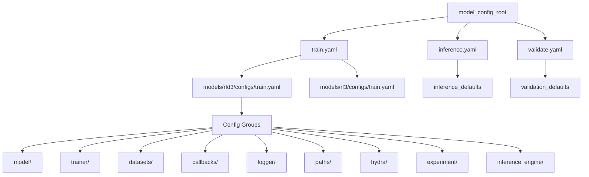

Foundry employs a **hierarchical, composable configuration architecture** where each model maintains an independent configuration namespace under `models/{model_name}/configs/`. This design enables model-specific customization while preserving consistent organizational patterns across the codebase. The system leverages Hydra's configuration composition to assemble complete runtime configurations from modular components, allowing fine-grained control over inference, training, and validation workflows.

Sources: [models/rfd3/configs/train.yaml](models/rfd3/configs/train.yaml#L1-L28), [models/rf3/configs/train.yaml](models/rf3/configs/train.yaml#L1-L43)

## Configuration Namespace Architecture

Each model inhabits a dedicated configuration directory with a standardized structure. The entry points—`train.yaml`, `inference.yaml`, and `validate.yaml`—define the composition hierarchy through Hydra's defaults list, orchestrating the assembly of sub-configurations from functional directories.



The configuration composition follows a **layered override pattern** where higher-priority configurations (lower in the defaults list) override lower-priority ones. This enables experiment-specific customization while maintaining sensible defaults.

Sources: [models/rfd3/configs/train.yaml](models/rfd3/configs/train.yaml#L5-L22), [models/rf3/configs/train.yaml](models/rf3/configs/train.yaml#L9-L30)

## RFD3 Configuration Structure

RFdiffusion3 exemplifies the comprehensive configuration pattern with extensive customization options across multiple domains.

### Core Entry Points

The training configuration assembles components through explicit defaults:

```yaml
defaults:
  - model: rfd3_base
  - trainer: rfd3_base
  - datasets: design_base
  - callbacks: design_callbacks
  - dataloader: fast
  - paths: default
  - hydra: default
  - logger: default
  - _self_
```

Each default references a configuration group that itself may compose further sub-configurations, creating a deep but navigable hierarchy.

Sources: [models/rfd3/configs/train.yaml](models/rfd3/configs/train.yaml#L5-L14)

### Model Component Composition

The `rfd3_base.yaml` model config demonstrates nested composition:

```yaml
defaults:
  - optimizers/adam@optimizer
  - schedulers/af3@lr_scheduler
  - samplers/edm@net.inference_sampler
  - components/ema@ema
  - components/rfd3_net@net
  - _self_
```

The `@` syntax places the loaded configuration at a specific path within the output config, enabling structured organization of nested parameters. For example, the EDM sampler configuration is nested under `net.inference_sampler`.

Sources: [models/rfd3/configs/model/rfd3_base.yaml](models/rfd3/configs/model/rfd3_base.yaml#L1-L9)

### Inference Engine Configuration

RFD3's inference engine config defines extensive parameters for diffusion sampling:

| Parameter Category | Key Parameters | Purpose |
|-------------------|----------------|---------|
| **Diffusion Args** | `num_timesteps: 200`, `step_scale: 1.5`, `noise_scale: 1.003` | Control the denoising trajectory |
| **CFG Guidance** | `use_classifier_free_guidance`, `cfg_scale: 1.5`, `cfg_features` | Enable conditional generation |
| **Spatial Control** | `center_option: "all"`, `s_trans: 1.0` | Manage coordinate transformations |
| **Output Control** | `cleanup_guideposts`, `read_sequence_from_sequence_head` | Configure result formatting |

> [!TIP]
> The `center_option` parameter determines which residues are centered during diffusion: `"all"` centers the entire complex, `"motif"` centers only fixed regions, and `"diffuse"` centers only the designed regions.

Sources: [models/rfd3/configs/inference_engine/rfdiffusion3.yaml](models/rfd3/configs/inference_engine/rfdiffusion3.yaml#L17-L66)

### Dataset Configuration Hierarchy

The `design_base.yaml` dataset config composes multiple training and validation datasets with conditional transforms:

```yaml
defaults:
  - train/pdb/rfd3_train_interface@train.pdb.sub_datasets.interface
  - train/pdb/rfd3_train_pn_unit@train.pdb.sub_datasets.pn_unit
  - val/unconditional@val.unconditional
  - val/unconditional_deep@val.unconditional_deep
  - val/indexed@val.indexed
  - conditions/unconditional@global_transform_args.train_conditions.unconditional
  # ... additional conditions
```

The training conditions specify **frequency-weighted sampling** for different design tasks:

```yaml
train_conditions:
  unconditional:
    frequency: 5.0
  sequence_design:
    frequency: 2.0
  island:
    frequency: 1.0
  tipatom:
    frequency: 0.0
  ppi:
    frequency: 0.0
```

Higher frequencies indicate that a condition appears more frequently during training, enabling balanced exposure to diverse design scenarios.

Sources: [models/rfd3/configs/datasets/design_base.yaml](models/rfd3/configs/datasets/design_base.yaml#L1-L98)

## RF3 Configuration Structure

RosettaFold3 follows the same architectural pattern but with model-specific adaptations for structure prediction.

### Model Architecture Configuration

RF3 defines comprehensive model parameters including channel dimensions, feature embedding configurations, and diffusion module specifications:

```yaml
# Channel dimensions
c_s: 384
c_z: 128
c_atom: 128
c_atompair: 16
c_s_inputs: 449

# Feature initializer with atom-level embedding
feature_initializer:
  input_feature_embedder:
    atom_attention_encoder:
      c_atom_1d_features: 393  # 392 + 1 has_atom_level_embedding
      use_atom_level_embedding: true
      atom_level_embedding_dim: 384
```

The configuration supports both base and **confidence-enhanced variants**, with the latter adding additional heads for predicted error estimation.

Sources: [models/rf3/configs/model/rf3.yaml](models/rf3/configs/model/rf3.yaml#L1-L43), [models/rf3/configs/experiment/pretrained/rf3.yaml](models/rf3/configs/experiment/pretrained/rf3.yaml#L1-L51)

### Inference Engine Parameters

RF3's inference config emphasizes structure prediction-specific parameters:

```yaml
n_recycles: 10
diffusion_batch_size: 5
num_steps: 50
template_noise_scale: 1e-5
early_stopping_plddt_threshold: 0.5
```

The `metrics_cfg` section instantiates confidence metrics dynamically:

```yaml
metrics_cfg:
  ptm:
    _target_: rf3.metrics.predicted_error.ComputePTM
  iptm:
    _target_: rf3.metrics.predicted_error.ComputeIPTM
  count_clashing_chains:
    _target_: rf3.metrics.clashing_chains.CountClashingChains
```

This pattern enables runtime instantiation of metric objects with configurable parameters.

Sources: [models/rf3/configs/inference_engine/rf3.yaml](models/rf3/configs/inference_engine/rf3.yaml#L1-L33)

## Experiment Configuration Pattern

Experiment configurations provide **versioned hyperparameter sets** that override base configurations. They follow a consistent pattern:

```yaml
# @package _global_

name: train-base
tags: [print-model]
project: aa_design

defaults:
  - override /datasets: pdb_and_distillation
  - override /model: rf3
  - override /trainer: rf3

# Experiment-specific overrides
datasets:
  diffusion_batch_size_train: 16
  crop_size: 256
```

The `@package _global_` directive ensures the configuration is placed at the root of the merged output config. The `override` syntax explicitly replaces the default group selection.

Sources: [models/rfd3/configs/experiment/pretrain.yaml](models/rfd3/configs/experiment/pretrain.yaml#L1-L31), [models/rf3/configs/experiment/pretrained/rf3.yaml](models/rf3/configs/experiment/pretrained/rf3.yaml#L1-L51)

## Configuration Group Reference

| Group | Purpose | RFD3 | RF3 | MPNN |
|-------|---------|------|-----|------|
| **model/** | Network architecture, optimizers, schedulers | ✓ | ✓ | Planned |
| **trainer/** | Training loop, validation, loss functions | ✓ | ✓ | Planned |
| **datasets/** | Data sources, transforms, validation sets | ✓ | ✓ | Planned |
| **inference_engine/** | Inference parameters, sampling, I/O | ✓ | ✓ | Planned |
| **callbacks/** | Training callbacks, metrics logging | ✓ | ✓ | N/A |
| **logger/** | Experiment tracking (WandB, CSV) | ✓ | ✓ | N/A |
| **paths/** | Directory structure, checkpoint locations | ✓ | ✓ | N/A |
| **hydra/** | Hydra runtime behavior | ✓ | ✓ | N/A |
| **experiment/** | Versioned hyperparameter sets | ✓ | ✓ | N/A |

Sources: [get_repo_structure](models/rfd3/configs), [get_repo_structure](models/rf3/configs)

## Path Management Strategy

Path configurations centralize all directory references and use Hydra's runtime interpolation:

```yaml
defaults:
  - _self_
  - data: default

root_dir: ${oc.env:PROJECT_ROOT}
log_dir: /net/scratch/${oc.env:USER}/training/logs
output_dir: ${hydra:runtime.output_dir}
work_dir: ${hydra:runtime.cwd}
```

The `${oc.env:VAR}` syntax accesses environment variables, while `${hydra:runtime}` references Hydra-generated paths. This enables **portable configuration** that adapts to different deployment environments without code modification.

Sources: [models/rfd3/configs/paths/default.yaml](models/rfd3/configs/paths/default.yaml#L1-L22)

## Debug and Development Configurations

Special configurations support rapid iteration during development:

```yaml
defaults:
  - inference_engine: dev
  - _self_
```

The `dev.yaml` inference engine config typically reduces computational requirements for quick testing. Similarly, experiment configurations can override batch sizes and dataset sizes:

```yaml
trainer:
  limit_train_batches: 4
  limit_val_batches: 4

model:
  net:
    inference_sampler:
      num_timesteps: 50  # Reduced from default 200
```

Sources: [models/rfd3/configs/dev.yaml](models/rfd3/configs/dev.yaml#L1-L10), [models/rf3/configs/experiment/quick-rf3.yaml](models/rf3/configs/experiment/quick-rf3.yaml#L1-L62)

## Extension Guidelines

To add configuration support for a new model:

1. **Create model directory**: `models/{model_name}/`
2. **Establish config structure**: Replicate the standard `configs/` subdirectory layout
3. **Define entry points**: Create `train.yaml`, `inference.yaml`, `validate.yaml`
4. **Implement components**: Add model-specific configurations under `model/` and `trainer/`
5. **Register with Hydra**: Ensure config search path includes the new directory

> [!TIP]
> Use the `@package _global_` directive in top-level configs and the `@` syntax for nested composition to maintain consistency with existing models. This ensures predictable configuration merging and override behavior.

Sources: [models/rfd3/configs/train.yaml](models/rfd3/configs/train.yaml#L1-L3), [models/rf3/configs/train.yaml](models/rf3/configs/train.yaml#L1-L3)

## Next Steps

For deeper understanding of the configuration system:

- **Hydra Integration**: Learn about the composition mechanics and resolver system in [Hydra Configuration System](12-hydra-configuration-system)
- **Custom Resolvers**: Understand dynamic value resolution in [Custom Resolvers for Dynamic Configs](13-custom-resolvers-for-dynamic-configs)
- **Model Implementation**: See how configurations map to concrete architectures in [Adding New Models to Foundry](21-adding-new-models-to-foundry)

For practical model usage:

- **RFD3 Design**: Explore the all-atom generative model capabilities in [RFdiffusion3: All-Atom Generative Model](9-rfdiffusion3-all-atom-generative-model)
- **RF3 Prediction**: Understand structure prediction workflows in [RosettaFold3: Structure Prediction Network](10-rosettafold3-structure-prediction-network)