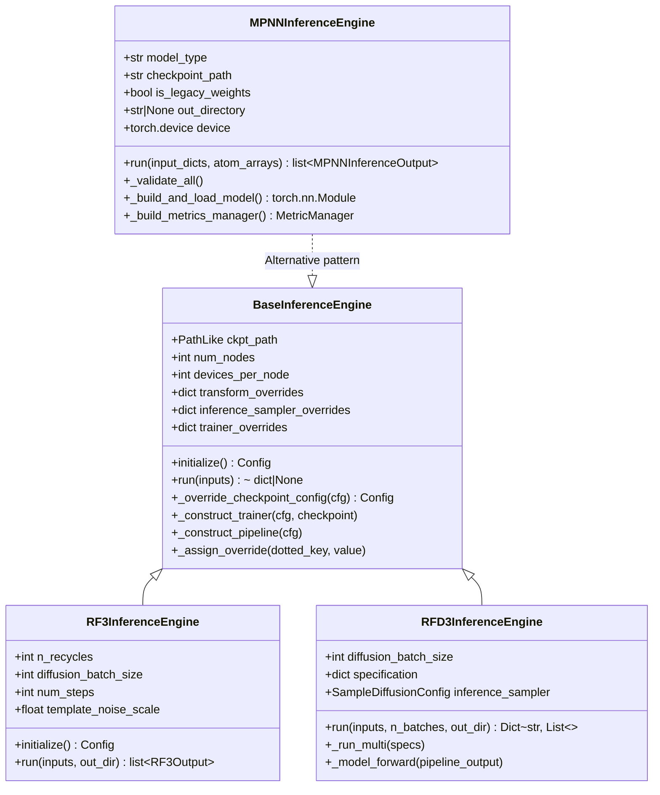
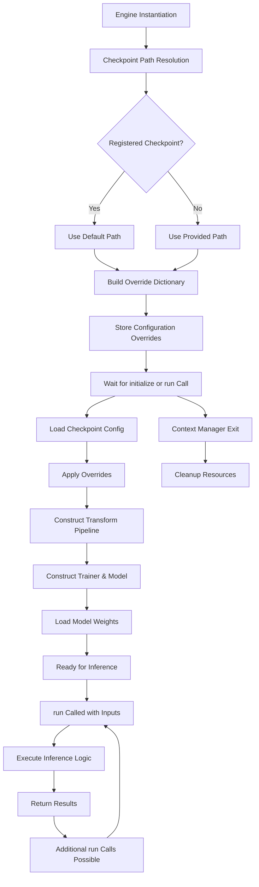
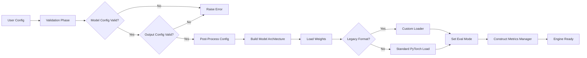

This guide provides a comprehensive architectural blueprint for implementing custom inference engines within Foundry's modular design system. Inference engines serve as the critical bridge between trained models and production inference workflows, separating expensive model initialization from efficient repeated inference operations.

## Architecture Overview

Foundry's inference engine architecture is built around two distinct implementation patterns: the **BaseInferenceEngine inheritance pattern** for complex models requiring distributed training infrastructure integration, and the **standalone engine pattern** for models with simpler inference requirements. This dual approach optimizes both development complexity and runtime efficiency.



The BaseInferenceEngine provides a foundation for models that leverage Foundry's FabricTrainer infrastructure, including automatic distributed inference, checkpoint loading, and configuration management. The MPNNInferenceEngine demonstrates a custom implementation optimized for models with lightweight inference requirements that don't require the full training infrastructure.

Sources: [base.py](src/foundry/inference_engines/base.py#L32-L50), [rf3.py](models/rf3/src/rf3/inference_engines/rf3.py#L208-L235), [mpnn.py](models/mpnn/src/mpnn/inference_engines/mpnn.py#L37-L50)

## Core Architecture Patterns

### BaseInferenceEngine Inheritance Pattern

The BaseInferenceEngine establishes a sophisticated initialization-to-inference separation that optimizes both memory usage and startup time. The architecture follows a clear lifecycle: configuration resolution, lazy initialization, optional repeated inference, and resource cleanup.



The initialization process leverages a sophisticated configuration override system that uses dotted path notation to precisely target nested configuration values. This enables fine-grained control without requiring full configuration file modifications. The override system applies changes at three distinct levels: transform pipeline configuration, inference sampler parameters, and trainer settings.

Sources: [base.py](src/foundry/inference_engines/base.py#L125-L143), [base.py](src/foundry/inference_engines/base.py#L160-L213)

### Configuration Override System

The override mechanism enables runtime customization through a hierarchical dictionary structure. Overrides are applied in a specific order to ensure proper precedence: base overrides first, trainer overrides second, and inference sampler overrides last.

| Override Category | Dotted Path Prefix | Typical Parameters |
|------------------|-------------------|-------------------|
| Transform Pipeline | None (direct) | `diffusion_batch_size`, `n_recycles`, `undesired_res_names` |
| Trainer Settings | `trainer.` | `num_nodes`, `devices_per_node`, `metrics` |
| Inference Sampler | `model.net.inference_sampler.` | `num_timesteps`, `cfg_scale`, `step_scale` |

The `_assign_override` method implements path-based dictionary mutation, automatically creating intermediate dictionaries as needed and setting the final value at the specified key. This approach allows intuitive configuration like `"trainer.num_nodes": 4` or `"model.net.inference_sampler.num_timesteps": 100`.

Sources: [base.py](src/foundry/inference_engines/base.py#L104-L123), [base.py](src/foundry/inference_engines/base.py#L199-L207)

> [!TIP]
> When implementing custom inference engines, carefully design your override structure to align with the configuration tree in your model's training config. Mismatched dotted paths will silently fail to apply overrides, leading to unexpected behavior at inference time.

## Implementation Strategy

### Step 1: Choose Your Implementation Pattern

Select between BaseInferenceEngine inheritance and standalone implementation based on your model's complexity:

| Factor | BaseInferenceEngine Inheritance | Standalone Implementation |
|--------|-------------------------------|---------------------------|
| **Model Complexity** | High (requires distributed training infrastructure) | Low to moderate |
| **Inference Speed** | Slower initialization (fabric trainer setup) | Faster startup (direct model loading) |
| **Configuration** | Hydra-based with checkpoint overrides | Manual configuration management |
| **Use Cases** | RF3, RFD3 (diffusion models) | MPNN (sequence design) |
| **Distributed Inference** | Built-in support via Fabric | Manual implementation required |

The BaseInferenceEngine pattern is ideal when your model requires:
- Distributed inference across multiple GPUs or nodes
- Integration with Foundry's training infrastructure (FabricTrainer)
- Complex transform pipelines loaded from checkpoint configs
- Seamless checkpoint management and weight loading

The standalone pattern suits models with:
- Simple forward pass requirements
- No need for distributed inference
- Custom weight loading logic (e.g., legacy formats)
- Lightweight initialization requirements

Sources: [rf3.py](models/rf3/src/rf3/inference_engines/rf3.py#L208-L235), [mpnn.py](models/mpnn/src/mpnn/inference_engines/mpnn.py#L37-L90)

### Step 2: Implementing with BaseInferenceEngine

#### Initialization and Override Construction

Subclass initialization should override specific parameters while passing all others to the base class. The RF3InferenceEngine demonstrates this pattern, setting transform overrides for recycling, batch size, and template noise while delegating checkpoint path and distributed settings to the base constructor.

Sources: [rf3.py](models/rf3/src/rf3/inference_engines/rf3.py#L272-L316)

#### Pipeline and Trainer Construction

The base class's `_construct_pipeline` method extracts the transform configuration from the first validation dataset in the checkpoint config, applies any overrides, and instantiates the pipeline via Hydra. This ensures consistency between training and inference data preprocessing. The `_construct_trainer` method instantiates the trainer using Hydra, launches the Fabric accelerator, loads the checkpoint, and prepares the model for evaluation by removing optimizer states.

Sources: [base.py](src/foundry/inference_engines/base.py#L209-L229), [base.py](src/foundry/inference_engines/base.py#L165-L197)

#### Customizing the run() Method

Subclasses must implement the `run()` method to define their inference logic. The method signature supports multiple input types: dictionaries of input specifications, AtomArray objects, or file paths. The RF3InferenceEngine implementation demonstrates handling AtomArray inputs directly and managing output directory creation for batch inference.

Sources: [base.py](src/foundry/inference_engines/base.py#L144-L151), [rf3.py](models/rf3/src/rf3/inference_engines/rf3.py#L350-L450)

### Step 3: Implementing Standalone Engines

The MPNNInferenceEngine provides a comprehensive template for standalone implementations. The architecture emphasizes configuration validation, model loading, and metrics management without relying on BaseInferenceEngine infrastructure.



The validation phase performs comprehensive checks on model type, checkpoint path existence, and output directory configuration. The post-processing step normalizes paths to absolute form. Model construction instantiates the appropriate architecture class (ProteinMPNN or LigandMPNN) based on the model_type parameter, then loads weights using either legacy or modern PyTorch checkpoint formats.

Sources: [mpnn.py](models/mpnn/src/mpnn/inference_engines/mpnn.py#L91-L183)

#### Pipeline and Batch Management

Standalone engines must implement their own pipeline construction logic. MPNNInferenceEngine builds a transform pipeline dynamically for each batch, allowing per-input customization of parameters like occupancy thresholds and undesired residue names. The `_run_batch` method orchestrates the pipeline execution, feature collation, model forward pass, and metrics computation.

Sources: [mpnn.py](models/mpnn/src/mpnn/inference_engines/mpnn.py#L278-L450)

#### Input Processing and Output Writing

The `run()` method accepts either `input_dicts` or `atom_arrays`, creating a flexible interface for different workflows. For each input, it constructs an `MPNNInferenceInput` object that handles RNG seeding for deterministic sampling across batches. The `_write_outputs` method handles CIF and FASTA file generation based on engine-level configuration flags.

Sources: [mpnn.py](models/mpnn/src/mpnn/inference_engines/mpnn.py#L204-L276), [mpnn.py](models/mpnn/src/mpnn/inference_engines/mpnn.py#L492-L557)

## Configuration Management

### Checkpoint Registration

Foundry provides a checkpoint registration system that enables model discovery and automatic path resolution. The `RegisteredCheckpoint` dataclass encapsulates checkpoint metadata including URL, filename, description, and optional SHA256 checksum. The `get_default_checkpoint_dir()` function determines the checkpoint storage location by checking the `FOUNDRY_CHECKPOINTS_DIR` environment variable first, then defaulting to `~/.foundry/checkpoints`.

Registered checkpoints enable users to reference models by name rather than full paths. For example, passing `"rfd3"` as `ckpt_path` resolves to the default installation directory automatically.

Sources: [checkpoint_registry.py](src/foundry/inference_engines/checkpoint_registry.py#L8-L33), [base.py](src/foundry/inference_engines/base.py#L68-L82)

### Hydra Configuration Integration

Model-specific inference configurations are managed through Hydra's hierarchical configuration system. Each model includes an `inference_engine` configuration directory that defines engine-specific parameters.

**RF3 Configuration Structure:**
```yaml
defaults:
  - base
  - _self_

_target_: rf3.inference_engines.rf3.RF3InferenceEngine

ckpt_path: rf3_foundry_01_24_latest.ckpt
n_recycles: 10
diffusion_batch_size: 5
num_steps: 50
template_noise_scale: 1e-5
metrics_cfg:
  ptm: {_target_: rf3.metrics.predicted_error.ComputePTM}
  iptm: {_target_: rf3.metrics.predicted_error.ComputeIPTM}
```

**RFD3 Configuration Structure:**
```yaml
defaults:
  - base
  - _self_

_target_: rfd3.engine.RFD3InferenceEngine

diffusion_batch_size: 8
inference_sampler:
  kind: "default"
  use_classifier_free_guidance: false
  cfg_scale: 1.5
  num_timesteps: 200
  step_scale: 1.5
```

These configurations enable both CLI usage and programmatic instantiation with sensible defaults while allowing runtime override.

Sources: [rf3.yaml](models/rf3/configs/inference_engine/rf3.yaml#L1-L33), [rfdiffusion3.yaml](models/rf3/configs/inference_engine/rfdiffusion3.yaml#L1-L66)

## Distributed Inference Support

BaseInferenceEngine provides built-in distributed inference capabilities through Lightning Fabric. The `num_nodes` and `devices_per_node` parameters control the distributed configuration. During trainer construction, the fabric accelerator is launched with the specified distributed settings, enabling automatic data parallelism across GPUs and nodes.

Distributed inference requires careful data loader construction. The RFD3InferenceEngine demonstrates this pattern using `assemble_distributed_inference_loader_from_json`, which creates sharded datasets and appropriate distributed samplers based on world size and rank.

Sources: [base.py](src/foundry/inference_engines/base.py#L42-L44), [base.py](src/foundry/inference_engines/base.py#L175-L176), [engine.py](models/rfd3/src/rfd3/engine.py#L248-L260)

## Output Management and Metrics

### Output Data Structures

Well-designed inference engines define structured output containers that encapsulate both predictions and metadata. The RF3InferenceEngine uses `RF3Output`, which includes:

- `atom_array`: Predicted atomic coordinates
- `summary_confidences`: Aggregated confidence metrics (pTM, ipTM, ranking score)
- `confidences`: Per-atom confidence data
- `example_id`: Sample identifier
- `sample_idx`: Batch index for multi-sample inference
- `seed`: Random seed used for generation

The `dump()` method handles serialization to multiple file formats (CIF, compressed CIF, JSON) with optional confidence output.

Sources: [rf3.py](models/rf3/src/rf3/inference_engines/rf3.py#L95-L131)

### Metrics Integration

BaseInferenceEngine integrates metrics through the trainer's metrics system. Subclasses can provide a `metrics_cfg` parameter during initialization that specifies which metrics to compute. RF3InferenceEngine defaults to pTM, ipTM, and clash counting metrics. The metrics are computed during inference and included in output confidence files.

Standalone engines like MPNNInferenceEngine construct a `MetricManager` directly, adding metrics like sequence recovery and interface sequence recovery for ligand-containing structures.

Sources: [rf3.py](models/rf3/src/rf3/inference_engines/rf3.py#L40-L60), [mpnn.py](models/mpnn/src/mpnn/inference_engines/mpnn.py#L184-L199)

## Best Practices and Common Patterns

### Input Validation and Canonicalization

Robust inference engines implement comprehensive input validation. RF3InferenceEngine uses `prepare_inference_inputs_from_paths` to convert file paths to structured `InferenceInput` objects. RFD3InferenceEngine provides `_canonicalize_inputs` that handles multiple input types (JSON files, AtomArrays, specifications) and normalizes them to a consistent internal representation.

MPNNInferenceEngine validates both model configuration (type, checkpoint path, legacy flags) and output configuration (directory paths, write flags) separately, providing clear error messages for misconfigurations.

Sources: [rf3.py](models/rf3/src/rf3/inference_engines/rf3.py#L1-L200), [engine.py](models/rfd3/src/rfd3/engine.py#L350-L410), [mpnn.py](models/mpnn/src/mpnn/inference_engines/mpnn.py#L91-L133)

### Deterministic Inference

For reproducible results, engines should support seeding. BaseInferenceEngine accepts a `seed` parameter that, when not None, calls `seed_everything` to set global RNG state. MPNNInferenceEngine extends this by supporting per-input seeding through the input dictionary, enabling deterministic sampling across batches while allowing variation between inputs.

Sources: [base.py](src/foundry/inference_engines/base.py#L48-L49), [base.py](src/foundry/inference_engines/base.py#L88-L91), [mpnn.py](models/mpnn/src/mpnn/inference_engines/mpnn.py#L254-L265)

### Resource Management

BaseInferenceEngine implements the context manager protocol, enabling automatic resource cleanup when used with the `with` statement. The `__exit__` method nullifies trainer and pipeline references and resets the initialization flag, allowing proper memory cleanup.

> [!TIP]
> When implementing long-running inference pipelines, consider using the context manager pattern to ensure proper resource cleanup, especially in distributed environments where GPU memory fragmentation can be problematic.

Sources: [base.py](src/foundry/inference_engines/base.py#L238-L246)

### Error Handling and Logging

Inference engines should use ranked logging to ensure only rank zero produces output in distributed settings. The `RankedLogger` utility from `foundry.utils.ddp` provides this functionality. Engines should log key events: checkpoint loading, model initialization, inference progress, and output writing.

Sources: [base.py](src/foundry/inference_engines/base.py#L20-L24), [mpnn.py](models/mpnn/src/mpnn/inference_engines/mpnn.py#L34)

## Testing Strategy

Comprehensive testing ensures inference engine reliability. The MPNN test suite provides patterns for engine-level testing:

**Configuration Validation Tests**: Verify that invalid model types, missing checkpoints, or misconfigured output settings raise appropriate errors with clear messages.

**End-to-End Integration Tests**: Test complete inference workflows with real structure files, verifying output structure generation, sequence design, and metrics computation.

**Behavioral Tests**: Validate specific behaviors like temperature effects on entropy, design-scope annotations, and fixed-residue handling.

Tests should use fixture-based checkpoint generation to avoid dependency on external files, and minimal AtomArray construction for fast unit tests.

Sources: [test_inference_engine.py](models/mpnn/tests/test_inference_engine.py#L1-L200)

## Migration Path from Existing Implementations

When migrating custom inference code to Foundry's architecture, consider the following mapping:

| Existing Component | Foundry Equivalent |
|-------------------|-------------------|
| Manual model loading | BaseInferenceEngine._construct_trainer |
| Custom data preprocessing | Transform pipeline with overrides |
| Manual checkpoint management | Checkpoint registry system |
| Ad-hoc configuration | Hydra configs with override system |
| Direct PyTorch loops | Trainer.validation_step or model.forward |

The migration should preserve existing functionality while gaining Foundry's infrastructure benefits: distributed inference, checkpoint management, and configuration consistency.

## Next Steps

For complete understanding of the inference engine architecture, refer to:

- [Inference Engine Architecture](6-inference-engine-architecture) - Deep dive into the foundational design principles
- [Training Harness with FabricTrainer](7-training-harness-with-fabrictrainer) - Trainer infrastructure used by BaseInferenceEngine
- [Checkpoint Management System](8-checkpoint-management-system) - Checkpoint discovery and loading mechanisms

For model-specific implementation details:

- [RosettaFold3: Structure Prediction Network](10-rosettafold3-structure-prediction-network) - RF3InferenceEngine implementation
- [ProteinMPNN and LigandMPNN: Inverse Folding](11-proteinmpnn-and-ligandmpnn-inverse-folding) - Standalone engine pattern

For extending Foundry with new models:

- [Adding New Models to Foundry](21-adding-new-models-to-foundry) - Complete model integration guide
- [Model-Specific Configuration Structure](22-model-specific-configuration-structure) - Hydra configuration patterns