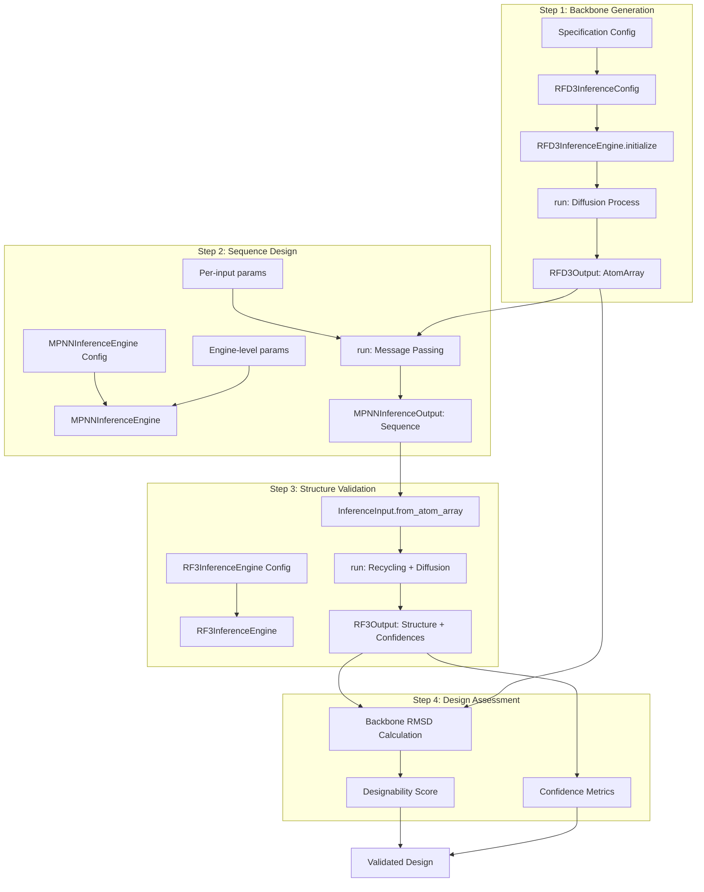

This tutorial guides you through a complete *de novo* protein design workflow using Foundry's three core deep learning models: RFdiffusion3 (RFD3) for backbone generation, ProteinMPNN for sequence design, and RosettaFold3 (RF3) for structure validation. The pipeline demonstrates how to integrate these models to generate novel proteins with high designability.


Sources: [README.md](/README.md#L1-L30)

## Pipeline Overview

The end-to-end design pipeline follows a three-stage workflow that transforms from structural concepts to validated protein designs. Each model serves a specific purpose: RFD3 generates novel backbone conformations, MPNN designs amino acid sequences optimized for those backbones, and RF3 refolds the designed sequences to validate designability through structural prediction.

| Stage | Model | Purpose | Input | Output |
|-------|-------|---------|-------|--------|
| 1. **Backbone Generation** | RFD3 | Generate novel protein structures | Conditioning specifications | AtomArray structures |
| 2. **Sequence Design** | MPNN | Design sequences for backbones | Backbone AtomArrays | Designed sequences with structures |
| 3. **Structure Validation** | RF3 | Predict structure from sequence | Designed sequences | Predicted structures + confidence metrics |

Sources: [all.ipynb](/examples/all.ipynb#L9-L23), [ipd_design_pipeline_collab.ipynb](/examples/ipd_design_pipeline_collab.ipynb#L21-L35)

```mermaid
flowchart LR
    A[Input Specifications] --> B[RFD3 Backbone Generation]
    B --> C[Generated Backbones<br/>AtomArray]
    C --> D[MPNN Sequence Design]
    D --> E[Designed Sequences<br/>with structures]
    E --> F[RF3 Structure Validation]
    F --> G[Refolded Structures<br/>+ Confidence Metrics]
    G --> H[RMSD Comparison]
    H --> I[Validated Design]
    
    style B fill:#e1f5fe
    style D fill:#fff3e0
    style F fill:#f3e5f5
```



Sources: [all.ipynb](/examples/all.ipynb#L17-L18), [base.py](/src/foundry/inference_engines/base.py#L32-L36)

## Prerequisites and Setup

Before running the pipeline, you must install Foundry with all model dependencies and download the required checkpoint files. The installation process requires approximately 6GB of storage for the model weights (3GB for RFD3, 3GB for RF3, and <100MB for MPNN).

```bash
# Install Foundry with all models
pip install 'rc-foundry[all]'

# Download model checkpoints
foundry install rfd3 ligandmpnn rf3
```

For Jupyter notebook users, register your foundry environment to enable model imports:
```bash
python -m ipykernel install --user --name=foundry --display-name "foundry"
```

> [!TIP]
> Set environment variables for optional mirror paths before importing: `CCD_MIRROR_PATH` for chemical component definitions and `PDB_MIRROR_PATH` for structure templates. This enables offline operation and faster data access.

Sources: [all.ipynb](/examples/all.ipynb#L40-L44), [ipd_design_pipeline_collab.ipynb](/examples/ipd_design_pipeline_collab.ipynb#L14-L30)

## Step 1: Backbone Generation with RFD3

RFdiffusion3 (RFD3) is an all-atom generative model that produces novel protein structures through a diffusion process. The model accepts conditioning specifications that define design constraints, such as target length, fixed regions, symmetry requirements, or bound ligands.

### Configuration and Parameters

The `RFD3InferenceConfig` class provides comprehensive control over the generation process through several key parameters:

| Parameter | Type | Default | Description |
|-----------|------|---------|-------------|
| `specification` | dict | `{}` | Conditioning specifications (length, contigs, symmetry) |
| `diffusion_batch_size` | int | 16 | Number of structures to generate per batch |
| `ckpt_path` | str/Path | `"rfd3"` | Checkpoint path or registered model name |
| `inference_sampler` | dict | `{}` | Diffusion sampling configuration |
| `cleanup_virtual_atoms` | bool | `True` | Remove virtual guidepost atoms from output |
| `dump_trajectories` | bool | `False` | Save intermediate diffusion steps |

Sources: [engine.py](/models/rfd3/src/rfd3/engine.py#L38-L77)

### Running Backbone Generation

Initialize the RFD3 inference engine with your specifications and run generation. The model outputs a dictionary mapping example IDs to lists of `RFD3Output` objects, each containing an `AtomArray` structure and associated metadata.

```python
from lightning.fabric import seed_everything
from rfd3.engine import RFD3InferenceConfig, RFD3InferenceEngine

# Set seed for reproducibility
seed_everything(0)

# Configure RFD3 inference
config = RFD3InferenceConfig(
    specification={
        'length': 80,  # Generate 80-residue proteins
    },
    diffusion_batch_size=2,  # Generate 2 structures per batch
)

# Initialize engine and run generation
model = RFD3InferenceEngine(**config)
outputs = model.run(
    inputs=None,      # None for unconditional generation
    out_dir=None,     # None to return in memory (no file output)
    n_batches=1,      # Generate 1 batch
)
```

Extract and visualize the generated backbone for downstream use:
```python
# Extract the first generated backbone
first_key = next(iter(outputs.keys()))
atom_array = outputs[first_key][0].atom_array

# Visualize the generated backbone
view(atom_array)
```

Sources: [all.ipynb](/examples/all.ipynb#L68-L107), [engine.py](/models/rfd3/src/rfd3/engine.py#L200-L264)

### Output Structure

Each `RFD3Output` contains the following components:
- **atom_array**: Full atomic structure as Biotite `AtomArray`
- **metadata**: Dictionary of generation metadata and conditioning information
- **example_id**: Unique identifier for the generated structure
- **denoised_trajectory_stack**: Optional stack of intermediate structures (if `dump_trajectories=True`)

The `RFD3Output` class provides a `dump()` method that saves structures to CIF format with optional JSON metadata files, facilitating external analysis and visualization in tools like PyMOL or ChimeraX.

Sources: [engine.py](/models/rfd3/src/rfd3/engine.py#L86-L130)

## Step 2: Sequence Design with MPNN

ProteinMPNN and LigandMPNN are inverse-folding models that design amino acid sequences optimized to fold into target backbone structures. MPNN uses a message-passing neural network to predict residue identities based on structural context, supporting both protein-only design and ligand-aware design scenarios.

### Model Selection and Configuration

MPNN provides two model types with different capabilities:

| Model Type | Description | Use Case |
|------------|-------------|----------|
| `protein_mpnn` | Original ProteinMPNN | Standard protein-only design |
| `ligand_mpnn` | Extended model with ligand support | Protein-ligand complex design |

The `MPNNInferenceEngine` accepts engine-level configuration (shared across all inputs) and per-input configuration (customized per structure):

```python
from mpnn.inference_engines.mpnn import MPNNInferenceEngine

# Configure MPNN inference engine
engine_config = {
    "model_type": "ligand_mpnn",  # or "protein_mpnn"
    "is_legacy_weights": True,    # Required for current weights
    "out_directory": None,        # Return results in memory
    "write_structures": False,
    "write_fasta": False,
}

# Configure per-input inference options
input_configs = [
    {
        "batch_size": 10,         # Generate 10 sequences per structure
        "remove_waters": True,    # Exclude water molecules
        "temperature": 0.1,       # Sampling temperature
    }
]

# Run sequence design
model = MPNNInferenceEngine(**engine_config)
mpnn_outputs = model.run(input_dicts=input_configs, atom_arrays=[atom_array])
```

Sources: [all.ipynb](/examples/all.ipynb#L112-L145), [mpnn.py](/models/mpnn/src/mpnn/inference_engines/mpnn.py#L40-L49)

### Key Inference Parameters

The MPNN inference pipeline supports extensive customization through per-input parameters:

| Parameter | Type | Default | Description |
|-----------|------|---------|-------------|
| `batch_size` | int | 1 | Number of sequences to generate |
| `temperature` | float | 0.1 | Sampling temperature (lower = more confident) |
| `remove_waters` | bool | `None` | Exclude water molecules from context |
| `fixed_residues` | list | `None` | Residue indices to keep fixed |
| `designed_residues` | list | `None` | Residue indices to design (all if `None`) |
| `decode_type` | str | `"auto_regressive"` | Decoding strategy |
| `structure_noise` | float | 0.0 | Add noise to backbone coordinates |

Sources: [inference.py](/models/mpnn/src/mpnn/utils/inference.py#L36-L73)

### Extracting Designed Sequences

MPNN returns a list of `MPNNInferenceOutput` objects, each containing the designed sequence and corresponding structure. Convert residue names to one-letter codes for analysis:

```python
from biotite.structure import get_residue_starts
from biotite.sequence import ProteinSequence

# Extract and display designed sequences
for i, item in enumerate(mpnn_outputs):
    res_starts = get_residue_starts(item.atom_array)
    # Convert 3-letter codes to 1-letter
    seq_1letter = ''.join(
        ProteinSequence.convert_letter_3to1(res_name)
        for res_name in item.atom_array.res_name[res_starts]
    )
    print(f"Sequence {i+1}: {seq_1letter}")
```

Sources: [all.ipynb](/examples/all.ipynb#L147-L159)

> [!TIP]
> For design tasks requiring specific amino acid preferences, use the `bias` and `omit` parameters. `bias` assigns per-residue preferences (dictionary mapping positions to amino acid probabilities), while `omit` excludes specific residues from consideration globally.

Sources: [inference.py](/models/mpnn/src/mpnn/utils/inference.py#L63-L68)

## Step 3: Structure Validation with RF3

RosettaFold3 (RF3) predicts protein structures from amino acid sequences, validating that MPNN-designed sequences will adopt the intended backbone conformation. By comparing the RF3-predicted structure against the original RFD3 backbone, you can assess designability through RMSD and confidence metrics.

### RF3 Inference Configuration

The `RF3InferenceEngine` controls prediction quality through sampling and recycling parameters:

| Parameter | Type | Default | Description |
|-----------|------|---------|-------------|
| `n_recycles` | int | 10 | Number of recycling iterations |
| `diffusion_batch_size` | int | 5 | Sequences processed per batch |
| `num_steps` | int | 50 | Diffusion steps for structure prediction |
| `template_noise_scale` | float | 1e-5 | Noise added to template structures |
| `early_stopping_plddt_threshold` | float | `None` | Stop recycling if pLDDT falls below threshold |

```python
from rf3.inference_engines.rf3 import RF3InferenceEngine
from rf3.utils.inference import InferenceInput

# Initialize RF3 inference engine
inference_engine = RF3InferenceEngine(ckpt_path='rf3', verbose=False)

# Create input from MPNN-designed structure
input_structure = InferenceInput.from_atom_array(atom_array, example_id="example_protein")
rf3_outputs = inference_engine.run(inputs=input_structure)
```

Sources: [all.ipynb](/examples/all.ipynb#L177-L195), [rf3.py](/models/rf3/src/rf3/inference_engines/rf3.py#L241-L256)

### Confidence Metrics

RF3 provides comprehensive confidence metrics for evaluating prediction quality:

| Metric | Description | Scale |
|--------|-------------|-------|
| `overall_plddt` | Per-residue confidence (average) | 0-1 (higher is better) |
| `overall_pae` | Predicted Aligned Error (average) | Å (lower is better) |
| `ptm` | Predicted TM-score | 0-1 (higher is better) |
| `iptm` | Interface pTM (multi-chain) | 0-1 (higher is better) |
| `ranking_score` | Combined quality metric | Higher is better |
| `has_clash` | Steric clash detected | Boolean |

The ranking score combines multiple metrics: `0.8 * ipTM + 0.2 * pTM - 100 * has_clash`, providing a single quality score for model selection.

```python
# Extract top-ranked prediction
rf3_output = rf3_outputs["example_protein"][0]

# Access summary confidences
summary = rf3_output.summary_confidences
print(f"Overall pLDDT: {summary['overall_plddt']:.3f}")
print(f"pTM: {summary['ptm']:.3f}")
print(f"Ranking score: {summary['ranking_score']:.3f}")
```

Sources: [all.ipynb](/examples/all.ipynb#L165-L182, #L197-L216), [rf3.py](/models/rf3/src/rf3/inference_engines/rf3.py#L79-L90, #L98-L146)

### Per-Atom Confidence Details

RF3 outputs granular confidence metrics for detailed analysis:

```python
conf = rf3_output.confidences

# Access per-atom/residue confidences
print(f"atom_plddts: {len(conf['atom_plddts'])} values")
print(f"PAE matrix: {len(conf['pae'])}x{len(conf['pae'][0])}")

# Preview first 10 atom pLDDTs
import numpy as np
print(f"First 10 atom pLDDTs: {np.round(conf['atom_plddts'][:10], 2).tolist()}")
```

The `atom_plddts` array provides per-atom confidence scores that can be mapped to B-factor columns for visualization in structural analysis tools.

Sources: [all.ipynb](/examples/all.ipynb#L218-L230)

## Validation and Design Assessment

The final validation step compares the RF3-predicted structure against the original RFD3-generated backbone using backbone RMSD. Low RMSD (< 2.0 Å) indicates the designed sequence is likely to fold into the intended conformation (high designability).

```python
from biotite.structure import rmsd, superimpose
from atomworks.constants import PROTEIN_BACKBONE_ATOM_NAMES
import numpy as np

# Get structures for comparison
aa_generated = atom_array              # Original RFD3 backbone
aa_refolded = rf3_output.atom_array    # RF3-predicted structure

# Filter to backbone atoms (N, CA, C, O)
bb_generated = aa_generated[np.isin(aa_generated.atom_name, PROTEIN_BACKBONE_ATOM_NAMES)]
bb_refolded = aa_refolded[np.isin(aa_refolded.atom_name, PROTEIN_BACKBONE_ATOM_NAMES)]

# Superimpose structures and calculate RMSD
bb_refolded_fitted, _ = superimpose(bb_generated, bb_refolded)
rmsd_value = rmsd(bb_generated, bb_refolded_fitted)

print(f"Backbone RMSD: {rmsd_value:.2f} Å")
print(f"Designability: {'Excellent' if rmsd_value < 1.0 else 'Good' if rmsd_value < 2.0 else 'Moderate'}")
```

### RMSD Interpretation Guide

| RMSD Range | Interpretation | Designability |
|------------|----------------|---------------|
| < 1.0 Å | Excellent agreement | High confidence |
| 1.0 - 2.0 Å | Good agreement | Moderate to high confidence |
| 2.0 - 3.0 Å | Moderate agreement | Consider redesign |
| > 3.0 Å | Poor agreement | Low confidence, redesign required |

Sources: [all.ipynb](/examples/all.ipynb#L232-L260)

### Exporting Results

Export structures to CIF format for external visualization and analysis:

```python
from atomworks.io.utils.io_utils import to_cif_file

# Export structures
to_cif_file(aa_generated, "generated.cif")
to_cif_file(aa_refolded, "refolded.cif")
```


Sources: [all.ipynb](/examples/all.ipynb#L262-L273)

## Advanced Pipeline Configuration

### Batch Processing

Process multiple structures in parallel by adjusting batch sizes across all models:

```python
# RFD3: Generate multiple backbones
rfd3_config = RFD3InferenceConfig(
    specification={'length': 80},
    diffusion_batch_size=4,  # 4 backbones per batch
)

# MPNN: Design multiple sequences per backbone
mpnn_input_configs = [
    {"batch_size": 20} for _ in range(4)  # 20 sequences per backbone
]

# RF3: Predict multiple models per sequence
rf3_engine = RF3InferenceEngine(ckpt_path='rf3', diffusion_batch_size=5)
```

### Conditional Design

RFD3 supports complex conditioning through specification dictionaries:

```python
# Contig-based design with fixed regions
specification = {
    'contigmap': 'A20-30,B1-10,A31-40',  # Fixed regions
    'length': 80,
}

# Symmetry constraints
specification = {
    'symmetry': 'C3',  # Threefold symmetry
    'length': 120,
}

# Ligand-bound design
specification = {
    'ligand': 'path/to/ligand.cif',
    'hotspot_res': ['A10', 'A15', 'A20'],  # Interface residues
}
```

Sources: [engine.py](/models/rfd3/src/rfd3/engine.py#L425-L525)

## Troubleshooting Guide

| Issue | Symptoms | Solutions |
|-------|----------|-----------|
| **Out of Memory** | CUDA OOM errors during generation | Reduce `diffusion_batch_size` across all models; enable `low_memory_mode=True` in RFD3 |
| **Low Confidence** | pLDDT < 0.7, high PAE values | Increase RFD3 length specifications; add more fixed regions; redesign with higher MPNN `temperature` |
| **High RMSD** | RMSD > 3.0 Å after refolding | Generate more RFD3 backbones; use higher MPNN `batch_size`; check for design constraints conflicts |
| **Checkpoint Not Found** | `Invalid checkpoint` error | Run `foundry install <model>` or provide absolute path to checkpoint |
| **Slow Inference** | Long generation times | Increase batch sizes for GPU utilization; reduce `n_recycles` in RF3; disable `dump_trajectories` |

> [!TIP]
> For memory-constrained environments, use RFD3's `low_memory_mode=True` to enable efficient tokenization. This reduces peak memory usage at the cost of slightly longer initialization time.

Sources: [engine.py](/models/rfd3/src/rfd3/engine.py#L68-L70), [rf3.py](/models/rf3/src/rf3/inference_engines/rf3.py#L244-L246)

## Pipeline Flow Diagram

The complete end-to-end workflow integrates all three models with data flow transformations:



Sources: [base.py](/src/foundry/inference_engines/base.py#L125-L151), [all.ipynb](/examples/all.ipynb#L9-L23)

## Next Steps

After completing this tutorial, explore these advanced topics:

- **Architecture Deep Dive**: Learn about the inference engine architecture in [Inference Engine Architecture](6-inference-engine-architecture)
- **Custom Model Integration**: Extend Foundry with new models using [Adding New Models to Foundry](21-adding-new-models-to-foundry)
- **Advanced RFD3 Features**: Master contig-based design and symmetry in [RFdiffusion3: All-Atom Generative Model](9-rfdiffusion3-all-atom-generative-model)
- **Training Your Own Models**: Set up distributed training with [Distributed Training with DDP](15-distributed-training-with-ddp)
- **Component System**: Understand design constraints with [Component Parsing and Validation](18-component-parsing-and-validation)

For hands-on experimentation, try the [enzymes.ipynb](/examples/enzymes.ipynb) notebook which demonstrates active site design scenarios.
