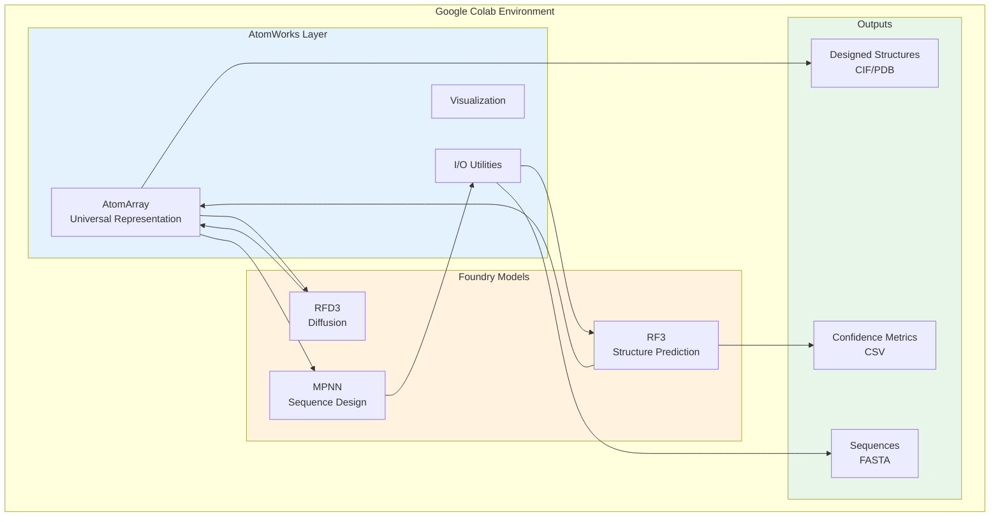

Get started with Foundry's protein design pipeline immediately using Google Colab—no local installation required. This interactive tutorial walks you through an end-to-end workflow combining three state-of-the-art deep learning models for protein design, all running in your browser with free GPU access.


This guide is perfect for developers who want to explore Foundry's capabilities without configuring a local environment or for those needing a quick proof-of-concept before committing to a full installation.

## Why Google Colab?

Google Colab provides an ideal platform for protein design experimentation:

| Advantage | Description |
|-----------|-------------|
| **Free GPU Access** | T4 GPUs available without cost—essential for deep learning models |
| **Zero Configuration** | Pre-configured environment with Python 3.12+ |
| **Instant Setup** | Install and run in under 5 minutes |
| **Interactive Exploration** | Modify parameters and see results immediately |
| **No Resource Commitment** | Experiment without local disk space (~6GB for all models) |

Sources: [README.md](README.md#L15-L25)

## The End-to-End Pipeline

The Colab tutorial demonstrates a complete protein design workflow that mirrors professional workflows used at the Institute for Protein Design:

```mermaid
flowchart LR
    A[GPU Runtime Setup] --> B[Installation<br/>rc-foundry[all]]
    B --> C[Download Weights<br/>~6GB total]
    C --> D[RFD3<br/>All-Atom Generation]
    D --> E[MPNN<br/>Sequence Design]
    E --> F[RF3<br/>Structure Validation]
    F --> G[RMSD Analysis]
    G --> H[Export Structures<br/>CIF format]
    
    style D fill:#e1f5ff
    style E fill:#fff4e1
    style F fill:#e8f5e9
```

**Core Models:**

| Model | Role | Key Parameters | Output |
|-------|------|----------------|--------|
| **RFD3** (RFdiffusion3) | Backbone generation | `length`, `diffusion_batch_size`, `n_batches` | Novel protein structures as AtomArray |
| **MPNN** (ProteinMPNN/LigandMPNN) | Sequence design | `batch_size`, `remove_waters`, `model_type` | Designed amino acid sequences |
| **RF3** (RosettaFold3) | Structure validation | Confidence metrics (pLDDT, PAE, pTM) | Predicted structure + confidence scores |

Sources: [ipd_design_pipeline_collab.ipynb](examples/ipd_design_pipeline_collab.ipynb#L47-L60), [all.ipynb](examples/all.ipynb#L11-L20)

## Prerequisites and Setup

### 1. Enable GPU Runtime

Before running the notebook, ensure GPU acceleration is enabled:

1. Go to **Runtime → Change runtime type**
2. Select **T4 GPU** (or better—A100/V100 for faster runs)
3. Click **Save**

> [!TIP]
> GPU is mandatory. Running these models on CPU will be extremely slow and may time out for larger structures.

Sources: [ipd_design_pipeline_collab.ipynb](examples/ipd_design_pipeline_collab.ipynb#L5-L10)

### 2. Installation Process

The Colab notebook handles installation automatically:

```python
import os

# Set environment variables for AtomWorks mirrors
os.environ['CCD_MIRROR_PATH'] = ''
os.environ['PDB_MIRROR_PATH'] = ''

if not os.path.isfile("FOUNDRY_READY"):
    print("Installing rc-foundry...")
    
    # Uninstall torchvision first to avoid operator conflicts
    os.system("pip uninstall -y torchvision")
    
    # Install rc-foundry with all model dependencies
    os.system("pip install -q 'rc-foundry[all]'")
    
    # Mark as ready to skip re-installation
    os.system("touch FOUNDRY_READY")
    
    print("Done!")
else:
    print("rc-foundry already installed.")
```

**Key Points:**
- Installation occurs once per session (marked by `FOUNDRY_READY` file)
- `rc-foundry[all]` includes RFD3, MPNN, and RF3 packages
- Torchvision uninstalled to prevent version conflicts
- Installation typically takes 2-3 minutes on Colab

Sources: [ipd_design_pipeline_collab.ipynb](examples/ipd_design_pipeline_collab.ipynb#L13-L31)

### 3. Download Model Weights

```python
# Download model weights (~6GB total, skips already-downloaded models)
os.system("foundry install rfd3 ligandmpnn rf3")
```

**Download Breakdown:**

| Model | Size | Time (typical connection) |
|-------|------|---------------------------|
| RFD3 | ~3GB | 2-3 minutes |
| RF3 | ~3GB | 2-3 minutes |
| MPNN | <100MB | <30 seconds |
| **Total** | **~6GB** | **~5-7 minutes** |

> [!TIP]
> Weights download to Colab's temporary storage. They're cleared when your runtime disconnects, so you'll need to re-download for each new session.

Sources: [ipd_design_pipeline_collab.ipynb](examples/ipd_design_pipeline_collab.ipynb#L33-L36), [README.md](README.md#L16-L22)

## Step-by-Step Pipeline Walkthrough

### Step 1: All-Atom Generation with RFD3

RFD3 generates novel protein structures through diffusion, capable of designing under complex constraints:

```python
from lightning.fabric import seed_everything
from rfd3.engine import RFD3InferenceConfig, RFD3InferenceEngine

# Set seed for reproducibility
seed_everything(0)

# Configure RFD3 inference
config = RFD3InferenceConfig(
    specification={
        'length': 80,  # Generate 80-residue proteins
    },
    diffusion_batch_size=2,  # Generate 2 structures per batch
)

# Initialize engine and run generation
model = RFD3InferenceEngine(**config)
outputs = model.run(
    inputs=None,      # None for unconditional generation
    out_dir=None,     # None to return in memory (no file output)
    n_batches=1,      # Generate 1 batch
)
```

**Understanding the Output:**

```python
# Extract first generated structure for downstream use
first_key = next(iter(outputs.keys()))
atom_array = outputs[first_key][0].atom_array

# Visualize the generated structure
view(atom_array)
```

The `atom_array` is a Biotite `AtomArray` object—Foundry's universal structure representation that seamlessly flows through all models in the pipeline.

Sources: [ipd_design_pipeline_collab.ipynb](examples/ipd_design_pipeline_collab.ipynb#L61-L91), [rfd3/README.md](models/rfd3/README.md#L1-L10)

### Step 2: Sequence Design with MPNN

MPNN designs amino acid sequences that will fold into your target backbone:

```python
from mpnn.inference_engines.mpnn import MPNNInferenceEngine

# Configure MPNN inference engine
engine_config = {
    "model_type": "ligand_mpnn",  # or "protein_mpnn"
    "is_legacy_weights": True,    # Required for current weights
    "out_directory": None,        # Return results in memory
    "write_structures": False,
    "write_fasta": False,
}

# Configure per-input inference options
input_configs = [
    {
        "batch_size": 10,         # Generate 10 sequences per structure
        "remove_waters": True,
    }
]

# Run sequence design on the RFD3-generated backbone
model = MPNNInferenceEngine(**engine_config)
mpnn_outputs = model.run(input_dicts=input_configs, atom_arrays=[atom_array])
```

**Extracting Designed Sequences:**

```python
from biotite.structure import get_residue_starts
from biotite.sequence import ProteinSequence

# Extract and display the designed sequences
print(f"Generated {len(mpnn_outputs)} designed sequences:\n")

for i, item in enumerate(mpnn_outputs):
    res_starts = get_residue_starts(item.atom_array)
    # Convert 3-letter codes to 1-letter using Biotite
    seq_1letter = ''.join(
        ProteinSequence.convert_letter_3to1(res_name)
        for res_name in item.atom_array.res_name[res_starts]
    )
    print(f"Sequence {i+1}: {seq_1letter}")
```

**MPNN Variants:**

| Model | Use Case | Key Features |
|-------|----------|--------------|
| `protein_mpnn` | Protein-only design | Original ProteinMPNN |
| `ligand_mpnn` | Ligand-aware design | Handles small molecules, ions, DNA/RNA |
| `soluble_mpnn` | Soluble protein design | Optimized for solubility |

Sources: [ipd_design_pipeline_collab.ipynb](examples/ipd_design_pipeline_collab.ipynb#L119-L159), [mpnn/README.md](models/mpnn/README.md#L1-L30)

### Step 3: Structure Prediction with RF3

RF3 validates your design by predicting the structure from the designed sequence:

```python
from rf3.inference_engines.rf3 import RF3InferenceEngine
from rf3.utils.inference import InferenceInput

# Initialize RF3 inference engine
inference_engine = RF3InferenceEngine(ckpt_path='rf3', verbose=False)

# Create input from the MPNN-designed structure
input_structure = InferenceInput.from_atom_array(atom_array, example_id="example_protein")
rf3_outputs = inference_engine.run(inputs=input_structure)

# Extract the top-ranked prediction
rf3_output = rf3_outputs["example_protein"][0]
```

**Confidence Metrics:**

```python
summary = rf3_output.summary_confidences

print("=== Summary Confidences ===")
print(f"  Overall pLDDT:    {summary['overall_plddt']:.3f}")
print(f"  Overall PAE:      {summary['overall_pae']:.2f} A")
print(f"  pTM:              {summary['ptm']:.3f}")
print(f"  Ranking score:    {summary['ranking_score']:.3f}")
```

| Metric | Range | Interpretation |
|--------|-------|----------------|
| **pLDDT** | 0-1 | Per-residue confidence (>0.9 = high) |
| **PAE** | 0-∞ Å | Predicted Aligned Error (<2Å = good) |
| **pTM** | 0-1 | Predicted TM-score (>0.8 = high confidence) |

Sources: [ipd_design_pipeline_collab.ipynb](examples/ipd_design_pipeline_collab.ipynb#L193-L236), [rf3/README.md](models/rf3/README.md#L1-L20)

### Step 4: Validation and Export

The final validation step compares RF3's prediction against the original RFD3 backbone:

```python
from biotite.structure import rmsd, superimpose
from atomworks.constants import PROTEIN_BACKBONE_ATOM_NAMES

# Get structures for comparison
aa_generated = atom_array              # Original RFD3 backbone
aa_refolded = rf3_output.atom_array    # RF3-predicted structure

# Filter to backbone atoms (N, CA, C, O)
bb_generated = aa_generated[np.isin(aa_generated.atom_name, PROTEIN_BACKBONE_ATOM_NAMES)]
bb_refolded = aa_refolded[np.isin(aa_refolded.atom_name, PROTEIN_BACKBONE_ATOM_NAMES)]

# Superimpose structures and calculate RMSD
bb_refolded_fitted, _ = superimpose(bb_generated, bb_refolded)
rmsd_value = rmsd(bb_generated, bb_refolded_fitted)

print(f"Backbone RMSD: {rmsd_value:.2f} A")
```

**RMSD Interpretation:**

| RMSD (Å) | Designability | Action |
|----------|---------------|--------|
| <1.0 | Excellent | Proceed with confidence |
| 1.0-2.0 | Good | Acceptable for many applications |
| 2.0-3.0 | Moderate | Consider refinement or redesign |
| >3.0 | Poor | Redesign or adjust parameters |

**Export for Downstream Analysis:**

```python
from atomworks.io.utils.io_utils import to_cif_file

# Export structures to CIF format for visualization in PyMOL/ChimeraX
to_cif_file(aa_generated, "generated.cif")
to_cif_file(aa_refolded, "refolded.cif")
```

Sources: [ipd_design_pipeline_collab.ipynb](examples/ipd_design_pipeline_collab.ipynb#L254-L290)

## Architecture Overview



All three models share a common architecture through [AtomWorks](https://github.com/RosettaCommons/atomworks), providing:
- Unified structure representation via `AtomArray`
- Consistent I/O across all models
- Shared visualization utilities
- Seamless data flow between pipeline stages

Sources: [README.md](README.md#L8-L11)

## Common Issues and Troubleshooting

| Issue | Cause | Solution |
|-------|-------|----------|
| **Out of Memory** | GPU insufficient for batch size | Reduce `diffusion_batch_size` to 1 |
| **Slow Downloads** | Poor network connection | Download models individually instead of `all` |
| **Torchvision Conflicts** | Version incompatibility | Ensure torchvision uninstall runs before installation |
| **Runtime Disconnects** | Session timeout | Save checkpoints frequently; reduce model complexity |

## Accessing the Colab Notebook

The interactive Google Colab notebook is available here:

**🔗 [IPD Design Pipeline Tutorial](https://colab.research.google.com/drive/1ZwIMV3n9h0ZOnIXX0GyKUuoiahgifBxh?usp=sharing)**

This live notebook includes all the code described above, with:
- Pre-configured GPU settings
- Automatic installation scripts
- Interactive 3D visualization
- Pre-computed examples for comparison

Sources: [README.md](README.md#L26-L28)

## Next Steps

After completing the Colab tutorial, explore these resources to deepen your understanding:

### Immediate Next Steps
- **[Quick Start](2-quick-start)**: Local installation guide for persistent development
- **[End-to-End Design Pipeline Tutorial](3-end-to-end-design-pipeline-tutorial)**: Extended tutorial with advanced features

### Deep Dive into Models
- **[RFdiffusion3: All-Atom Generative Model](9-rfdiffusion3-all-atom-generative-model)**: Comprehensive RFD3 documentation and advanced conditioning
- **[RosettaFold3: Structure Prediction Network](10-rosettafold3-structure-prediction-network)**: RF3 architecture and API reference
- **[ProteinMPNN and LigandMPNN: Inverse Folding](11-proteinmpnn-and-ligandmpnn-inverse-folding)**: MPNN variants and parameter tuning

### Infrastructure
- **[Inference Engine Architecture](6-inference-engine-architecture)**: Understanding how engines orchestrate models
- **[Hydra Configuration System](12-hydra-configuration-system)**: Advanced configuration management
- **[Adding New Models to Foundry](21-adding-new-models-to-foundry)**: Extending Foundry with custom models

## Summary

This Google Colab Quick Start provides immediate access to Foundry's complete protein design pipeline without local installation. You've learned how to:

1. **Set up GPU-accelerated Colab environment** in under 5 minutes
2. **Generate novel structures** with RFD3's diffusion model
3. **Design sequences** with MPNN's inverse folding
4. **Validate designs** with RF3's structure prediction
5. **Export results** for downstream analysis in PyMOL/ChimeraX

The pipeline demonstrates Foundry's core philosophy: **unified architecture through AtomWorks enables seamless integration of diverse protein design models**, from generation to validation.

Ready to take the next step? Install Foundry locally and explore the full capabilities described in the [Quick Start](2-quick-start) guide.