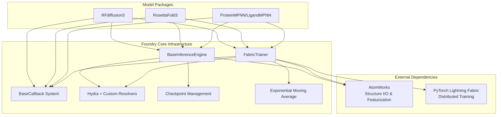

Foundry embodies a modular, extensible architecture designed to support diverse biomolecular modeling tasks while maintaining clean separation of concerns. The framework provides shared infrastructure for training and inference across multiple protein design models, enabling developers to add new models with minimal code duplication.

## Foundational Architecture Principles

The architecture follows a strict dependency hierarchy: **foundry → atomworks**. This clear separation defines responsibility boundaries—atomworks handles all structure I/O, preprocessing, and featurization operations, while foundry provides model architectures, training harnesses, and inference endpoints. This design ensures that structural manipulation logic remains decoupled from modeling logic, allowing each layer to evolve independently.

The framework adopts a **package-per-model architecture** where each model (RF3, RFD3, MPNN) exists as an independent package within the `models/` directory. Each model package contains its own `pyproject.toml`, source code in `src/`, configuration files, and tests. This structure enables selective installation—users can install only the models they need, and developers can work on specific models without affecting others.

**Modularity through abstraction** manifests in two critical base classes. The `BaseInferenceEngine` separates expensive model initialization from inference execution, allowing multiple inference runs with minimal overhead. The `FabricTrainer` provides a reusable training harness built on PyTorch Lightning Fabric, implementing gradient accumulation, mixed precision training, distributed data parallelism, and native EMA support. Both classes employ the Template Method pattern, defining the skeleton of operations while allowing subclasses to customize specific steps.

Sources: [pyproject.toml](/pyproject.toml#L1-L194), [README.md](/README.md#L58-L85), [base.py](/src/foundry/inference_engines/base.py#L32-L246), [fabric.py](/src/foundry/trainers/fabric.py#L52-L924)

## Core Infrastructure Components

### Training Harness Architecture

The `FabricTrainer` class serves as the foundation for all model training, orchestrating the complete training lifecycle while providing extensibility points. The training harness follows a clear progression: initialization → model/optimizer/scheduler construction → Fabric setup → training loop → validation loop → checkpointing. This linear flow ensures predictable behavior while allowing customization at each stage through abstract methods and callbacks.

The harness implements **gradient accumulation** transparently, handling the complex logic of accumulating gradients across multiple batches before optimizer steps. Mixed precision training with bfloat16 or float16 reduces memory footprint while maintaining numerical stability. Distributed training support via DDP enables multi-node and multi-GPU scaling, with configurable NCCL timeouts and parameter discovery settings for production environments.

**Exponential Moving Average (EMA)** integration provides model weight smoothing without requiring users to implement complex tracking logic. The EMA module maintains a shadow model updated with a decay factor, automatically swapping between training and EMA weights during validation based on the training phase.

Sources: [fabric.py](/src/foundry/trainers/fabric.py#L1-L8), [EMA.py](/src/foundry/training/EMA.py#L8-L68)

### Inference Engine Architecture

The `BaseInferenceEngine` establishes a **two-phase lifecycle**: initialization and execution. During initialization, the engine loads checkpoints, constructs the model pipeline using Hydra configuration, applies configuration overrides for transforms and samplers, and sets up distributed contexts if needed. During execution, the engine processes inputs through the pipeline, runs model inference, and returns structured outputs.

This separation optimizes resource usage—expensive operations like model loading happen once, while inference can run repeatedly without reinitialization. The engine supports flexible input formats including `AtomArray` objects, file paths, and dictionaries, automatically handling conversion through the pipeline system. Context manager support enables automatic cleanup with `with BaseInferenceEngine(...) as engine:` syntax.

**Configuration override mechanisms** provide granular control without modifying checkpoint configs. Users can override transform parameters, inference sampler settings, and trainer options through dotted key paths, enabling experimentation with different configurations while preserving original checkpoint configurations.

Sources: [base.py](/src/foundry/inference_engines/base.py#L32-L246), [checkpoint_registry.py](/src/foundry/inference_engines/checkpoint_registry.py#L1-L71)

### Callback System

The callback architecture enables **composable lifecycle hooks** across training and inference. The `BaseCallback` class defines comprehensive hook points at fit boundaries, epoch boundaries, batch boundaries, optimizer steps, and checkpoint operations. This design separates cross-cutting concerns like logging, metrics computation, and health monitoring from core training logic.

Callbacks execute at deterministic points in the training lifecycle, with clear ordering semantics. The trainer invokes hooks sequentially at each defined point, passing trainer context to enable callbacks to inspect and modify training state. This enables use cases like early stopping, learning rate adjustment, metrics logging, and gradient monitoring without modifying trainer code.

Sources: [callback.py](/src/foundry/callbacks/callback.py#L9-L117)

## Configuration Management Philosophy

Foundry embraces **configuration-driven development** through deep Hydra integration. Configuration files define models, transforms, samplers, optimizers, and schedulers, with Hydra handling composition, inheritance, and overrides. This approach enables reproducible experiments without code changes—different configurations can represent entirely different training runs or inference scenarios.

**Custom Hydra resolvers** extend configuration capabilities with dynamic resolution at runtime. The `register_resolvers()` function registers resolvers for importing modules dynamically and converting chain type information to regex patterns. This enables configuration files to reference classes and functions by string paths, eliminating hard-coded imports in configuration files.

The resolver system exemplifies the framework's design philosophy: **flexibility through composability**. Rather than building complex configuration logic into the core framework, Foundry extends Hydra's capabilities with targeted custom resolvers that solve specific domain problems like dataset filtering by chain type.

Sources: [resolvers.py](/src/foundry/hydra/resolvers.py#L1-L78)

## Dependency and Package Organization

The monorepo structure follows **strict dependency boundaries** enforced through package layout. The `src/foundry/` directory contains shared infrastructure with no model-specific code. Each model in `models/<model>/src/` imports from foundry but maintains isolation from other models. This circular dependency prevention ensures clean upgrades and enables independent versioning of model packages.

**Hatch-based build system** packages multiple Python distributions from a single repository. The `packages` list in `pyproject.toml` defines which subpackages become installable distributions, while `force-include` directives ensure configuration files are packaged with models. This enables workflows like `uv pip install -e . -e ./models/rf3` for developers, while end users can install `rc-foundry[all]` or individual model packages.

The build system supports **dynamic versioning** via VCS integration, automatically deriving version numbers from git tags. This eliminates manual version management while ensuring reproducible builds across development and production environments.

Sources: [pyproject.toml](/pyproject.toml#L78-L111), [README.md](/README.md#L66-L85)

## Extensibility Patterns

Foundry enables extensibility through **abstract base classes with clear extension points**. New models extend `BaseInferenceEngine` and `FabricTrainer`, implementing abstract methods like `training_step()` and `validation_step()` while inheriting full training infrastructure. This eliminates boilerplate code for distributed training, checkpointing, and logging.

The **pipeline architecture** for data transformation provides a composable approach to preprocessing. Transforms are modular components that can be chained together, applied conditionally, and configured independently. Each model package defines its own transform library in a `transforms/` directory, reusing only the patterns from foundry rather than the implementations.

> [!TIP]
> When extending Foundry with new models, leverage the existing pipeline system by defining transforms as separate modules with clear input/output contracts. This maintains testability and enables transform reuse across different models even when the underlying architectures differ significantly.

Sources: [base.py](/src/foundry/inference_engines/base.py#L32-L246), [fabric.py](/src/foundry/trainers/fabric.py#L627-L654)

## System Architecture Overview

This diagram illustrates the layered architecture where model packages depend only on foundry's abstract interfaces, never on each other. The foundry core provides shared implementations, while external dependencies like AtomWorks and PyTorch Lightning form the foundation.

## Key Design Trade-offs

**Simplicity vs. Flexibility**: Foundry prioritizes configuration-driven flexibility over code simplicity. Complex behaviors like distributed training, mixed precision, and EMA are handled by the framework rather than requiring users to implement them. This reduces the learning curve for common use cases while enabling power users to override defaults through configuration.

**Performance vs. Abstraction**: The callback system introduces minimal overhead while providing maximum extensibility. Hooks execute at well-defined points without complex conditionals, maintaining training loop performance while enabling cross-cutting concerns. The two-phase inference engine architecture optimizes for multiple inference runs after a single expensive initialization.

**Modularity vs. Integration**: Each model package maintains strict isolation, enabling independent development and testing. However, the shared foundry infrastructure ensures consistency in training behavior, checkpoint format, and logging across all models. This balance enables rapid prototyping of new models while preserving production-grade reliability.

Sources: [README.md](/README.md#L1-L50), [common.py](/src/foundry/common.py#L8-L109)

## Architectural Principles Summary

| Principle | Implementation | Benefit |
|-----------|---------------|---------|
| **Separation of Concerns** | atomworks (structures) → foundry (models) | Independent evolution of structure handling and modeling logic |
| **Package-per-Model** | Isolated packages in `models/` | Selective installation, independent versioning, reduced coupling |
| **Abstract Base Classes** | `BaseInferenceEngine`, `FabricTrainer` | Consistent interfaces, reduced boilerplate, enforced patterns |
| **Configuration-Driven** | Hydra configs + custom resolvers | Reproducible experiments, no code changes for different runs |
| **Composable Callbacks** | `BaseCallback` lifecycle hooks | Cross-cutting concerns without modifying core logic |
| **Two-Phase Inference** | Initialize once, run multiple times | Optimal resource utilization for batch inference |

Sources: [README.md](/README.md#L58-L85), [pyproject.toml](/pyproject.toml#L1-L72)

## Next Steps

The architecture described here provides the foundation for understanding Foundry's system-level design. To gain deeper insights into specific components:

- Explore the [Inference Engine Architecture](6-inference-engine-architecture) to understand the complete inference pipeline and how models process inputs
- Examine the [Training Harness with FabricTrainer](7-training-harness-with-fabrictrainer) for details on distributed training, gradient handling, and checkpoint management
- Review the [Hydra Configuration System](12-hydra-configuration-system) to learn how configuration composition and overrides work in practice
- See [Adding New Models to Foundry](21-adding-new-models-to-foundry) for a practical guide to extending the architecture with custom models
