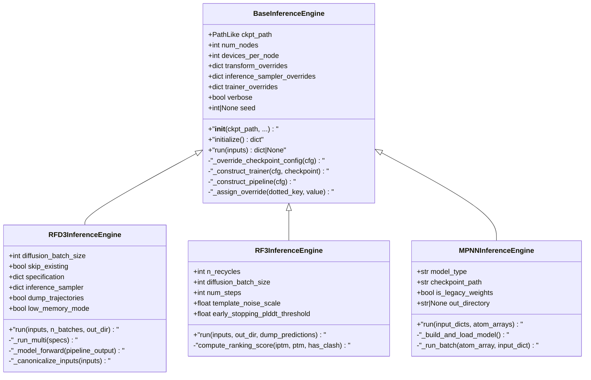
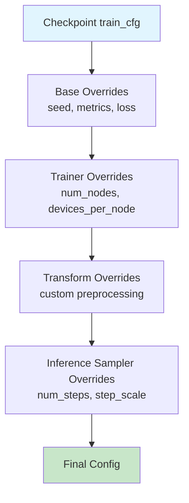

The inference engine architecture provides a unified abstraction layer for running deep learning models in Foundry, separating the expensive model initialization from efficient multi-sample inference. This design enables consistent interfaces across diverse model architectures including diffusion-based generative models (RFdiffusion3, RosettaFold3) and inverse folding networks (ProteinMPNN, LigandMPNN).

## Core Abstraction Layer

The architecture centers on `BaseInferenceEngine`, an abstract base class that establishes the initialization-inference separation pattern critical for production workloads. The class manages checkpoint loading, configuration merging, and distributed setup while delegating model-specific inference logic to subclasses.

Sources: [base.py](src/foundry/inference_engines/base.py#L32-L50)

### Initialization Phase

The base engine implements a two-phase lifecycle where `__init__` accepts configuration overrides without loading model weights, while `initialize()` performs the expensive checkpoint loading and trainer construction. This separation enables:

- Efficient checkpoint path resolution supporting both explicit paths and registered model names
- Random seed configuration for reproducibility
- Configuration override system merging user-provided settings with checkpoint defaults
- Accelerator detection and distributed strategy setup

The `initialize()` method loads the checkpoint configuration, applies overrides, constructs the data processing pipeline, and instantiates the FabricTrainer wrapper around the model.

Sources: [base.py](src/foundry/inference_engines/base.py#L125-L143), [base.py](src/foundry/inference_engines/base.py#L165-L198)

### Inference Phase

Subclasses implement the `run()` method which receives flexible input types (dictionaries, AtomArrays, or file paths) and returns model predictions. The base class guarantees initialization has occurred before inference executes.

Sources: [base.py](src/foundry/inference_engines/base.py#L144-L157)

> [!TIP]
> The BaseInferenceEngine stores configuration overrides in a nested `self.overrides` dictionary, using dotted keys (e.g., "trainer.seed", "model.net.inference_sampler.num_steps") that are later applied via OmegaConf.merge. This enables fine-grained parameter tuning without modifying checkpoint files.

## Checkpoint Management System

The checkpoint registry provides centralized model checkpoint management with URL resolution and default path handling. Each registered checkpoint includes:

- Remote URL for download
- Local filename for storage
- Human-readable description
- Optional SHA256 checksum for verification

The registry supports checkpoint lookup by name, enabling users to reference models like "rfd3" or "rf3" without knowing explicit file paths. Default storage prioritizes the `FOUNDRY_CHECKPOINTS_DIR` environment variable, falling back to `~/.foundry/checkpoints`.

Sources: [checkpoint_registry.py](src/foundry/inference_engines/checkpoint_registry.py#L22-L71)

| Model | Checkpoint Name | Use Case |
|-------|----------------|----------|
| RFdiffusion3 | `rfd3` | All-atom generative design |
| RosettaFold3 | `rf3` | Structure prediction |
| RosettaFold3 | `rf3_preprint_124` | Structure prediction (preprint) |
| ProteinMPNN | `proteinmpnn` | Protein inverse folding |
| LigandMPNN | `ligandmpnn` | Protein-ligand interface design |
| SolubleMPNN | `solublempnn` | Soluble protein design |

Sources: [checkpoint_registry.py](src/foundry/inference_engines/checkpoint_registry.py#L33-L71)

## Model-Specific Engine Implementations

### RFD3InferenceEngine

Extends the base class for RFdiffusion3, adding support for diffusion sampling, trajectory tracking, and design specification overrides. The engine introduces:

- `RFD3InferenceConfig`: Dataclass containing inference parameters including diffusion settings, output control flags, and batch specifications
- `RFD3Output`: Output container storing AtomArray structures, metadata, and optional trajectory stacks (both noisy and denoised)
- Input normalization supporting JSON files, PDB files, or in-memory AtomArray objects
- Automatic checkpoint skipping when outputs already exist in target directory
- Low memory mode for memory-constrained environments

The inference pipeline handles specification validation, pipeline construction, batch processing, and output formatting with support for guidepost cleanup, virtual atom removal, and trajectory alignment.

Sources: [engine.py](models/rfd3/src/rfd3/engine.py#L135-L200), [engine.py](models/rfd3/src/rfd3/engine.py#L38-L93)

### RF3InferenceEngine

Extends the base class for RosettaFold3 structure prediction, adding confidence metrics computation and model ranking. Key features:

- Ranking score calculation: `0.8 * ipTM + 0.2 * pTM - 100 * has_clash` for single-chain and multi-chain predictions
- Early stopping triggered when mean pLDDT falls below configurable threshold
- Template noise scaling and MSA handling configuration
- Compression support for large outputs
- AlphaFold3-compatible JSON output format with compact array serialization

The engine produces `RF3Output` objects containing predicted structures, summary confidence metrics, and optional full per-atom confidence data.

Sources: [rf3.py](models/rf3/src/rf3/inference_engines/rf3.py#L222-L395), [rf3.py](models/rf3/src/rf3/inference_engines/rf3.py#L79-L90)

### MPNNInferenceEngine

Implements a standalone inference engine for ProteinMPNN and LigandMPNN models with a simpler architecture optimized for sequence design tasks. Unlike the diffusion-based engines, MPNN:

- Uses direct PyTorch model loading without FabricTrainer wrapper
- Supports legacy weight formats for backward compatibility
- Outputs both CIF structures and FASTA sequence files
- Computes sequence recovery metrics during inference
- Handles polymer-ligand interface design contexts

The engine accepts either input dictionaries (parsed structures) or raw AtomArrays, returning `MPNNInferenceOutput` objects containing predicted sequences and structures.

Sources: [mpnn.py](models/mpnn/src/mpnn/inference_engines/mpnn.py#L37-L210)

## Configuration Override Hierarchy

The inference engines implement a hierarchical configuration system where settings at different levels combine with defined precedence:

1. **Checkpoint defaults**: Base configuration stored in the checkpoint's `train_cfg`
2. **Base overrides**: Engine-wide settings like random seed and device configuration
3. **Trainer overrides**: Training harness parameters (num_nodes, devices_per_node, metrics)
4. **Transform overrides**: Data transformation pipeline configuration
5. **Inference sampler overrides**: Model-specific sampling parameters (num_steps, step_scale, gamma_0)

The `_assign_override()` method uses dotted path notation to set nested configuration values, enabling precise parameter tuning through simple keyword arguments.

Sources: [base.py](src/foundry/inference_engines/base.py#L38-L118), [base.py](src/foundry/inference_engines/base.py#L199-L208)

> [!TIP]
> Inference engines accept `verbose=True` during initialization to print complete configuration trees via `print_config_tree()`. This is invaluable for debugging parameter resolution and understanding the final configuration after all overrides are applied.

## Distributed Inference Support

The architecture supports distributed inference across multiple nodes and devices through the FabricTrainer integration. Key capabilities:

- Multi-GPU inference via DDP strategy
- Multi-node scaling for large batch processing
- Automatic accelerator detection (CUDA, MPS, CPU)
- Ranked logging that only outputs from rank-zero process
- Random seed synchronization across workers

The `num_nodes` and `devices_per_node` parameters control resource allocation, with the FabricTrainer handling device initialization and distributed communication.

Sources: [base.py](src/foundry/inference_engines/base.py#L39-L50), [fabric.py](src/foundry/trainers/fabric.py#L52-L80)

| Parameter | Type | Default | Description |
|-----------|------|---------|-------------|
| `num_nodes` | int | 1 | Number of compute nodes for distributed inference |
| `devices_per_node` | int | 1 | GPU/CPU devices per node |
| `strategy` | str | "ddp" | Distributed strategy |
| `precision` | str | "bf16-mixed" | Mixed precision mode |

## Output Handling and Persistence

Each inference engine implements model-specific output formatting with standardized persistence patterns:

- **RFD3InferenceEngine**: Saves compressed CIF files with optional trajectory stacks and JSON metadata
- **RF3InferenceEngine**: Outputs AlphaFold3-compatible format with confidence metrics in JSON
- **MPNNInferenceEngine**: Generates both structural (CIF) and sequence (FASTA) outputs

Output file naming follows the pattern `{example_id}_{seed}_{sample_idx}` for RF3, while RFD3 uses `{jsonfilebasename}_{jsonkey}_{batch}_{model}` by default with optional `global_prefix` override.

Sources: [engine.py](models/rfd3/src/rfd3/engine.py#L94-L132), [rf3.py](models/rf3/src/rf3/inference_engines/rf3.py#L112-L146)

## Next Steps

Understanding the inference engine architecture provides the foundation for implementing custom model integrations. For practical applications:

- See [Adding New Models to Foundry](21-adding-new-models-to-foundry) for extending the system with custom architectures
- Explore [Implementing Custom Inference Engines](23-implementing-custom-inference-engines) for detailed subclassing patterns
- Review model-specific implementations: [RFdiffusion3](9-rfdiffusion3-all-atom-generative-model), [RosettaFold3](10-rosettafold3-structure-prediction-network), [ProteinMPNN](11-proteinmpnn-and-ligandmpnn-inverse-folding)
- Examine the [Training Harness with FabricTrainer](7-training-harness-with-fabrictrainer) to understand the trainer-inference engine relationship
