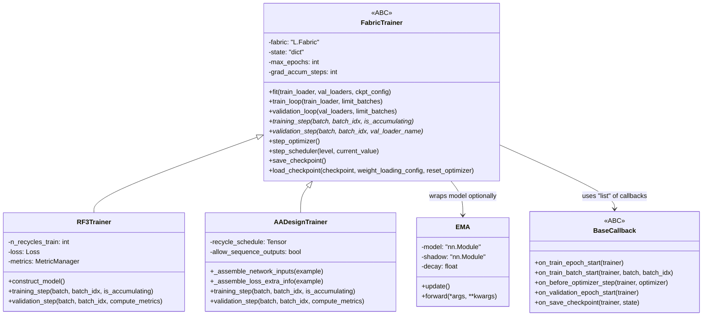

The FabricTrainer is Foundry's core training infrastructure—a generic, extensible harness built atop PyTorch Lightning Fabric that provides distributed training capabilities, checkpoint management, and seamless integration with model-specific implementations. This abstract base class eliminates boilerplate while maintaining flexibility for diverse training scenarios across RosettaFold3, RFdiffusion3, and other protein design models.

Sources: [fabric.py](src/foundry/trainers/fabric.py#L1-L9)

## Architectural Foundation

FabricTrainer leverages Lightning Fabric's low-level APIs to construct a custom training loop with explicit control over gradient accumulation, mixed precision training, and distributed strategy management. Unlike Lightning's Trainer class which imposes rigid abstractions, Fabric provides lightweight primitives that Foundry assembles into a purpose-built training workflow optimized for large-scale protein structure prediction and design tasks.

The architecture follows a template method pattern: `FabricTrainer` defines the skeleton of the training algorithm through methods like `fit()`, `train_loop()`, and `validation_loop()`, while abstract methods `training_step()` and `validation_step()` require implementation in model-specific subclasses. This design ensures consistent training behavior across models while allowing complete customization of the core computation.

Sources: [fabric.py](src/foundry/trainers/fabric.py#L52-L623)

## Core Infrastructure Components

### Distributed Training Configuration

FabricTrainer initializes Lightning Fabric with configurable distributed strategy, supporting DDP (Distributed Data Parallel), DeepSpeed, and FSDP (Fully Sharded Data Parallel). For multi-node GPU training, the harness automatically configures DDP with NCCL timeout management and parameter discovery settings. The `strategy` parameter determines distribution approach: `"ddp"` for standard DDP with custom timeout configuration, `"auto"` for interactive or single-device environments, or explicit strategy objects for advanced configurations.

> [!TIP]
> When training with partially frozen parameters, set `find_unused_parameters=True` to allow DDP to skip gradient synchronization for frozen layers. This incurs a modest performance penalty but enables training scenarios where only subsets of the model receive gradients.

The accelerator specification supports `"cpu"`, `"cuda"`, `"mps"`, `"gpu"`, `"tpu"`, or `"auto"` for automatic hardware detection. Precision options include full precision (`"32-true"`), half-precision AMP (`"16-mixed"`), or bfloat16 AMP (`"bf16-mixed"`), with the latter being default for optimal performance on modern GPU architectures.

Sources: [fabric.py](src/foundry/trainers/fabric.py#L53-L172)

### Training State Management

The `state` dictionary serves as the central repository for training components, maintaining references to the model, optimizer(s), scheduler(s), and training metrics. This dictionary enables checkpointing and restoration of complete training state, including epoch counters, global step tracking, and optimizer momentum states. The `initialize_or_update_trainer_state()` method provides a controlled interface for updating state entries, avoiding in-place modification anti-patterns.

State management follows a construction pipeline sequence: `construct_model()` → `construct_optimizer()` → `construct_scheduler()` → `setup_model_optimizers_and_schedulers()`. Each method updates the state dictionary, with the final `setup_model_optimizers_and_schedulers()` wrapping these components with Fabric to enable distributed training, automatic mixed precision, and gradient checkpointing.

Sources: [fabric.py](src/foundry/trainers/fabric.py#L172-L284)

### Exponential Moving Average (EMA)

Foundry's EMA implementation maintains a shadow model that tracks a decay-weighted average of the original model's parameters throughout training. The `EMA` class wraps the base model, providing dynamic dispatch that routes training calls to the original model and inference calls to the shadow model. This design enables seamless EMA integration without requiring model-level modifications.

The update mechanism applies the formula: `shadow_variable -= (1 - decay) * (shadow_variable - variable)`, which smooths parameter trajectories and often improves generalization. EMA updates occur automatically after each optimizer step when the model possesses an `update()` method, and both parameters and buffers (non-trainable state) are synchronized.

Sources: [EMA.py](src/foundry/training/EMA.py#L8-L68)

### Callback System

The `BaseCallback` abstract class defines hooks that execute at specific points in the training loop, enabling modular functionality injection without modifying core training logic. Callbacks receive the trainer instance as the first argument, providing access to trainer state, Fabric instance, and model components.

Callback hooks span the entire training lifecycle: epoch-level hooks (`on_train_epoch_start`, `on_train_epoch_end`), batch-level hooks (`on_train_batch_start`, `on_train_batch_end`), optimizer hooks (`on_before_optimizer_step`, `optimizer_step`), validation hooks, and checkpoint hooks. Notably, `on_after_optimizer_step` is called internally by Fabric without trainer access, so `optimizer_step` should be used for logic requiring trainer context.

Sources: [callback.py](src/foundry/callbacks/callback.py#L9-L117)

## Training Loop Execution

### Main Training Flow

The `fit()` method serves as the primary entry point, orchestrating the complete training lifecycle. It validates model construction, configures dataloaders with Fabric, initializes checkpoint loading, and manages the epoch-level training loop. The method automatically adjusts `n_examples_per_epoch` if the dataset contains insufficient examples compared to the configured target.

The training loop iterates through epochs, conditionally executing validation based on `validate_every_n_epochs`. Each epoch calls `train_loop()`, which iterates through batches with gradient accumulation support. After each epoch, validation runs if triggered, followed by checkpoint saving when checkpoint intervals are reached.

Sources: [fabric.py](src/foundry/trainers/fabric.py#L304-L475)

### Gradient Accumulation and Optimization

The `train_loop()` method implements sophisticated batch processing with gradient accumulation. It tracks whether the current batch requires an optimizer step based on `grad_accum_steps`, only synchronizing gradients and updating parameters when the accumulation counter reaches the target. This approach enables effective batch sizes that exceed GPU memory by spreading the computation across multiple forward-backward passes.

For each batch, the loop calls `training_step()`, which must be implemented by subclasses to perform forward and backward passes. The `is_accumulating` parameter indicates whether gradients are being accumulated, and the implementation should skip gradient synchronization during accumulation phases.

Sources: [fabric.py](src/foundry/trainers/fabric.py#L477-L564)

### Optimizer Step Execution

The `step_optimizer()` method encapsulates the complete optimization step sequence: NaN/Inf gradient checking, gradient clipping, optimizer stepping, gradient zeroing, and EMA updates. When `skip_nan_grad` is enabled, the method detects non-finite gradients and skips the update entirely, logging a warning and zeroing gradients to prevent state corruption.

Gradient clipping uses Fabric's `clip_gradients()` method with configurable maximum norm and error handling. The method can either silently clip non-finite gradients or raise an error based on `error_if_grad_nonfinite`. After optimizer stepping and gradient zeroing, the EMA update occurs automatically if the model is wrapped in an EMA instance.

Sources: [fabric.py](src/foundry/trainers/fabric.py#L697-L753)

### Scheduler Stepping

The `step_scheduler()` method provides flexible scheduler invocation at both epoch and step levels. The `SchedulerConfig` dataclass encapsulates the scheduler instance, interval (`"epoch"` or `"step"`), and frequency (defaulting to 1 for every interval occurrence). The method checks configuration compatibility with the current level and frequency before executing the step.

This design enables complex scheduling scenarios: warmup schedules that adjust every step, cosine annealing that updates every epoch, or custom patterns with arbitrary frequencies. The scheduler state is preserved in checkpoints and restored during training resumption.

Sources: [schedulers.py](src/foundry/training/schedulers.py#L65-L91)

## Validation Workflow

### Validation Loop Execution

The `validation_loop()` method runs evaluation on one or more validation datasets, supporting named validation loaders for differentiated metrics computation. The method switches the model to evaluation mode, disables gradient computation, and iterates through each validation loader, calling `validation_step()` for each batch.

Unlike the training loop, validation does not accumulate gradients or update parameters. It executes all registered validation callbacks, logs results through the configured loggers, and restores the model to training mode upon completion. The loop supports batch limiting for debugging purposes, though this should not be used in production training.

Sources: [fabric.py](src/foundry/trainers/fabric.py#L565-L623)

### Standalone Validation Mode

The `validate()` method enables independent model validation without training, useful for model assessment or benchmarking. It accepts a dictionary of validation loaders and a checkpoint path, loading the specified checkpoint and running validation on all provided datasets. This method facilitates checkpoint comparison, hyperparameter analysis, and production model evaluation.

Sources: [fabric.py](src/foundry/trainers/fabric.py#L666-L697)

## Model-Specific Implementations

### RosettaFold3 Trainer

`RF3Trainer` implements training for AlphaFold 3-style structure prediction models. The trainer manages recycling schedules, loss computation, and metrics calculation specific to structure prediction. The `construct_model()` method instantiates the RF3 architecture with optional EMA wrapping based on configuration.

The `training_step()` method assembles network inputs from batch data, executes the forward pass with configurable recycling, and computes structure-aware losses including coordinate prediction, confidence estimation, and template-aware terms. The `validation_step()` performs full inference with complete recycling and computes comprehensive structure prediction metrics.

Sources: [rf3.py](models/rf3/src/rf3/trainers/rf3.py#L36-L290)

### RFdiffusion3 Design Trainer

`AADesignTrainer` implements training for RFdiffusion3's amino acid design model. This trainer handles diffusion-specific concerns including noise schedules, timestep conditioning, and guidepost management. The `_assemble_network_inputs()` method constructs noisy coordinates with proper conditioning features.

The trainer implements sophisticated input assembly that validates tensor shapes and handles NaN values in coordinates during training. It supports various cleanup options for guideposts and virtual atoms, and manages sequence head outputs for residue type prediction. The recycling schedule follows a curriculum learning approach, with recycles scheduled per-example based on training progress.

Sources: [rfd3.py](models/rfd3/src/rfd3/trainer/rfd3.py#L32-L250)

## Configuration Options

| Parameter | Type | Default | Description |
|-----------|------|---------|-------------|
| `accelerator` | str | `"auto"` | Hardware accelerator: cpu, cuda, mps, gpu, tpu, auto |
| `strategy` | str | `"ddp"` | Distributed strategy: ddp, deepspeed, fsdp, auto |
| `devices_per_node` | int \| list \| str | `"auto"` | Devices per node for multi-GPU training |
| `num_nodes` | int | 1 | Number of compute nodes for distributed training |
| `precision` | str | `"bf16-mixed"` | Mixed precision: 32-true, 16-mixed, bf16-mixed |
| `max_epochs` | int | 1000 | Maximum training epochs |
| `grad_accum_steps` | int | 1 | Batches per optimizer step |
| `validate_every_n_epochs` | int | 1 | Frequency of validation runs |
| `n_examples_per_epoch` | int | 24,000 | Examples processed per epoch across all GPUs |
| `checkpoint_every_n_epochs` | int | 1 | Checkpoint frequency in epochs |
| `checkpoint_every_n_steps` | int \| None | None | Optional step-based checkpoint frequency |
| `clip_grad_max_norm` | float \| None | None | Gradient clipping threshold |
| `skip_nan_grad` | bool | False | Skip optimizer updates with NaN gradients |
| `error_if_grad_nonfinite` | bool | False | Raise error on non-finite gradients |

Sources: [fabric.py](src/foundry/trainers/fabric.py#L53-L172)

## Checkpoint Management

### Checkpoint Saving

The `save_checkpoint()` method persists complete training state to the configured output directory. Checkpoints include model parameters (including EMA shadow model if applicable), optimizer state, scheduler state, epoch counters, global step, and custom state entries. The method creates checkpoints within a `ckpt/` subdirectory of `output_dir`, using Fabric's distributed checkpointing to ensure consistency across processes.

Sources: [fabric.py](src/foundry/trainers/fabric.py#L782-L805)

### Checkpoint Loading

The `load_checkpoint()` method handles checkpoint restoration with flexible configuration. It accepts either a file path (to a specific checkpoint) or a dictionary (pre-loaded checkpoint), and supports weight loading policies through `WeightLoadingConfig`. The method loads model, optimizer, and scheduler states, handling EMA model restoration and parameter size mismatches gracefully.

The `reset_optimizer` parameter allows loading model weights without restoring optimizer state, useful for transfer learning scenarios where the training dynamics should be fresh. Weight loading policies enable strategies like "strict" loading (requiring exact parameter matches), "copy" (loading matching parameters, ignoring mismatches), or "reinitialize" (loading matching parameters, reinitializing mismatched ones).

Sources: [fabric.py](src/foundry/trainers/fabric.py#L835-L896)

## Best Practices

### Distributed Training Configuration

When configuring multi-node training, ensure `devices_per_node` specifies GPUs per node rather than total GPUs. For example, a 2-node cluster with 8 GPUs per node should use `devices_per_node=8` and `num_nodes=2`, not `devices_per_node=16`. Set appropriate `nccl_timeout` values for large-scale training to prevent premature termination on long operations.

Set `find_unused_parameters=True` only when necessary for partially frozen models, as this incurs performance overhead. For fully trained models, keep this parameter `False` for optimal gradient synchronization efficiency.

### Gradient Accumulation Strategy

Choose `grad_accum_steps` based on both memory constraints and batch size requirements. Calculate effective batch size as `grad_accum_steps × batch_size × num_gpus × num_nodes`. Monitor GPU memory utilization to avoid out-of-memory errors while maintaining sufficient batch diversity.

When using gradient accumulation with mixed precision, be aware that gradient scaling may behave differently across accumulation steps. The built-in NaN gradient detection helps identify numerical instability that can arise from aggressive accumulation or mixed precision training.

### EMA Configuration

EMA decay rates typically range from 0.999 to 0.9999 for stable convergence. Lower decay rates track model parameters more closely but provide less smoothing. Higher decay rates provide stronger smoothing but may lag behind rapid improvements in early training phases.

For large models, consider EMA checkpointing less frequently than model checkpoints to reduce I/O overhead, as EMA parameters change incrementally and can be reconstructed from recent model states.

## Next Steps

Understanding the training harness is foundational for both extending Foundry with new models and optimizing training workflows for existing models. The following documentation provides complementary information:

- [Distributed Training with DDP](15-distributed-training-with-ddp) - Deep dive into distributed training specifics and multi-node setup
- [Exponential Moving Average Implementation](16-exponential-moving-average-implementation) - Detailed EMA configuration and tuning strategies
- [Callbacks and Metrics Logging](17-callbacks-and-metrics-logging) - Custom callback development and metrics integration
- [Hydra Configuration System](12-hydra-configuration-system) - Configuration management for training experiments
- [Adding New Models to Foundry](21-adding-new-models-to-foundry) - Complete guide for implementing new model trainers
