The Checkpoint Management System in Foundry provides a comprehensive infrastructure for managing model checkpoints across training and inference workflows. This system handles three critical aspects: checkpoint acquisition and storage, flexible weight loading with policy-based configuration, and seamless integration with both training and inference pipelines. The architecture is designed to support large-scale protein design models while maintaining reproducibility and enabling fine-grained control over model state management.

Sources: [checkpoint_registry.py](src/foundry/inference_engines/checkpoint_registry.py#L1-L71), [weights.py](src/foundry/utils/weights.py#L1-L272), [fabric.py](src/foundry/trainers/fabric.py#L782-L900)

## Architecture Overview

The checkpoint management system operates through three interconnected layers that form a cohesive pipeline from model acquisition to inference. The foundation layer provides a centralized registry of all available model checkpoints with their metadata and download URLs. The weight management layer offers sophisticated policies for handling parameter loading, shape mismatches, and parameter freezing. The integration layer connects these components to the training harness and inference engines, providing seamless checkpoint operations across different contexts.

```mermaid
flowchart TB
    subgraph CLI["CLI Layer"]
        install[install]
        list[list]
        show[show]
        clean[clean]
    end
    
    subgraph Registry["Checkpoint Registry"]
        REGISTERED[REGISTERED_CHECKPOINTS]
        get_dir[get_default_checkpoint_dir]
        Registered[RegisteredCheckpoint]
    end
    
    subgraph Weight["Weight Management"]
        WeightConfig[WeightLoadingConfig]
        FreezeConfig[ParameterFreezingConfig]
        load_weights[load_weights_with_policies]
        freeze_params[freeze_parameters_with_config]
    end
    
    subgraph Integration["Integration Layer"]
        BaseEngine[BaseInferenceEngine]
        FabricTrainer[FabricTrainer]
        save_ckpt[save_checkpoint]
        load_ckpt[load_checkpoint]
    end
    
    install --> REGISTERED
    list --> REGISTERED
    show --> get_dir
    clean --> get_dir
    
    BaseEngine --> get_dir
    BaseEngine --> Registered
    
    FabricTrainer --> load_weights
    FabricTrainer --> freeze_params
    FabricTrainer --> save_ckpt
    FabricTrainer --> load_ckpt
```

The system follows a clear separation of concerns: the CLI handles user-facing operations, the registry manages metadata and path resolution, weight policies control parameter loading semantics, and integration components orchestrate these services within training and inference workflows.

Sources: [download_checkpoints.py](src/foundry_cli/download_checkpoints.py#L1-L274), [checkpoint_registry.py](src/foundry/inference_engines/checkpoint_registry.py#L1-L71)

## Checkpoint Registry and Metadata

The checkpoint registry serves as the central source of truth for all available model checkpoints, maintaining essential metadata including download URLs, filenames, descriptions, and optional SHA256 checksums for integrity verification. The registry defines the `RegisteredCheckpoint` dataclass which encapsulates this information and provides a `get_default_path()` method for resolving file locations.

Path resolution follows a clear priority hierarchy: first checking the `FOUNDRY_CHECKPOINTS_DIR` environment variable if set, then defaulting to `~/.foundry/checkpoints` in the user's home directory. This design enables both system-wide and user-specific checkpoint storage strategies while providing sensible defaults out of the box.

Sources: [checkpoint_registry.py](src/foundry/inference_engines/checkpoint_registry.py#L8-L71)

### Registered Model Checkpoints

The registry currently maintains entries for six model variants across three protein design systems:

| Model Name | Description | Filename |
|-----------|-------------|----------|
| `rfd3` | RFdiffusion3 checkpoint | rfd3_latest.ckpt |
| `rf3` | Latest RF3 checkpoint trained with data until 1/2024 | rf3_foundry_01_24_latest_remapped.ckpt |
| `proteinmpnn` | ProteinMPNN checkpoint | proteinmpnn_v_48_020.pt |
| `ligandmpnn` | LigandMPNN checkpoint | ligandmpnn_v_32_010_25.pt |
| `rf3_preprint_921` | RF3 preprint checkpoint trained with data until 9/2021 | rf3_foundry_09_21_preprint_remapped.ckpt |
| `rf3_preprint_124` | RF3 preprint checkpoint trained with data until 1/2024 | rf3_foundry_01_24_preprint_remapped.ckpt |
| `solublempnn` | SolubleMPNN checkpoint | solublempnn_v_48_020.pt |

Each checkpoint entry includes a description field that communicates key details such as training data cutoff dates, helping users select appropriate checkpoints for their use cases. The registry structure is extensible, allowing straightforward addition of new model variants as the ecosystem grows.

Sources: [checkpoint_registry.py](src/foundry/inference_engines/checkpoint_registry.py#L33-L71)

## CLI for Checkpoint Management

Foundry provides a comprehensive command-line interface for checkpoint management, accessible through the `foundry` command. This interface simplifies common operations like downloading, listing, displaying, and cleaning checkpoint files, with rich progress feedback and error handling.

Sources: [download_checkpoints.py](src/foundry_cli/download_checkpoints.py#L28-L274)

### Installation Command

The `foundry install` command downloads model checkpoints with optional hash verification. Users can specify models individually by name or use the `all` keyword to install all available checkpoints. The command supports custom checkpoint directory specification via the `--checkpoint-dir` flag and forced reinstallation with the `--force` flag.

The download process features a progress bar displaying download speed, time remaining, and bytes transferred. When a SHA256 hash is available in the registry, the CLI automatically verifies the downloaded file's integrity, removing corrupted files and reporting errors if verification fails.

Sources: [download_checkpoints.py](src/foundry_cli/download_checkpoints.py#L32-L137)

### Listing and Displaying Checkpoints

The `foundry list` command displays all available model checkpoints with their descriptions, providing a quick reference for available models. The `foundry show` command reports currently installed checkpoints in the checkpoint directory, displaying filenames and sizes in gigabytes. This is particularly useful for monitoring disk usage and verifying successful installations.

Sources: [download_checkpoints.py](src/foundry_cli/download_checkpoints.py#L180-L221)

### Cleanup Operations

The `foundry clean` command removes all downloaded checkpoint files from the checkpoint directory. By default, it requires confirmation before deletion, but this can be bypassed with the `--no-confirm` flag. The command displays the total size of files to be deleted, providing transparency before the removal operation proceeds.

Sources: [download_checkpoints.py](src/foundry_cli/download_checkpoints.py#L222-L274)

## Weight Loading Policies

The weight loading system provides fine-grained control over how checkpoint parameters are transferred to models, addressing common challenges such as architecture modifications, shape mismatches, and selective parameter updates. The `WeightLoadingPolicy` enum defines four strategies that can be applied globally, per-parameter, or through pattern matching.

Sources: [weights.py](src/foundry/utils/weights.py#L23-L115)

### Policy Types

| Policy | Behavior | Use Case |
|--------|----------|----------|
| `REINIT` | Always keep default initialization | Parameters that should not use checkpoint weights |
| `ZERO_INIT` | Always zero-initialize | Parameters requiring fresh initialization regardless of checkpoint |
| `COPY` | Copy from checkpoint only when shapes match exactly | Strict loading requiring architecture compatibility |
| `COPY_AND_ZERO_PAD` | Copy if same rank, zero-pad shape mismatches | Loading into modified architectures with expanded dimensions |

The system uses a two-tier policy application: first attempting the specified policy, then falling back to a configured fallback policy if the primary policy fails. This provides robustness when dealing with slightly modified architectures or missing parameters.

Sources: [weights.py](src/foundry/utils/weights.py#L23-L37)

### Pattern-Based Configuration

The `WeightLoadingConfig` class supports glob-style pattern matching for applying policies to parameter groups. Patterns use standard wildcards: `*` matches any sequence, `?` matches single characters, and `[abc]` matches any character in brackets. The `_PatternPolicyMixin` provides the pattern compilation and matching logic, enabling both exact parameter name matches and wildcard-based pattern application.

For example, `"model.*.weight"` matches any weight parameter in the model, while `"model.encoder?.weight"` matches encoder1.weight, encoder2.weight, etc. This enables concise configuration when multiple parameters share loading requirements.

Sources: [weights.py](src/foundry/utils/weights.py#L39-L115)

> [!TIP]
> The pattern matching system treats `.` as a literal dot by default, converting it to `\.` in the regex. To match actual dots in parameter names, you must explicitly include them in your patterns. This prevents unintended wildcard matching across module hierarchies.

## Parameter Freezing

Beyond weight loading, the system provides parameter freezing capabilities through the `ParameterFreezingConfig` class. This enables selective disabling of gradient computation for specific parameters after checkpoint loading, supporting transfer learning scenarios where backbone layers should remain frozen while task-specific heads are trained.

Like weight loading policies, freezing configuration supports both exact parameter names and glob patterns. The `freeze_by_default` parameter inverts the default behavior, freezing all parameters unless explicitly unfrozen by matching patterns. The `freeze_parameters_with_config()` function applies the configuration to model parameters, with optional verbose logging to report non-default policy applications.

Sources: [weights.py](src/foundry/utils/weights.py#L118-L163)

## Checkpoint Loading in Training

The `FabricTrainer` class provides comprehensive checkpoint loading capabilities through the `load_checkpoint()` method, which accepts either a file path or a pre-loaded checkpoint dictionary. The loading process handles three distinct state components: the model weights, optimizer state, and scheduler state.

Sources: [fabric.py](src/foundry/trainers/fabric.py#L835-L895)

### Model Weight Loading

The `_load_model()` method delegates to the `load_weights_with_policies()` function, applying the configured weight loading policies to transfer checkpoint weights to the model. This enables flexible handling of architecture differences, shape mismatches, and selective parameter updates through the policy system described above.

Sources: [fabric.py](src/foundry/trainers/fabric.py#L820-L830)

### Optimizer and Scheduler Loading

The `_load_optimizer()` and `_load_scheduler()` methods load optimizer and scheduler state if present in the checkpoint and if the corresponding objects exist in the trainer state. The `reset_optimizer` parameter in `load_checkpoint()` controls whether these components are loaded, enabling scenarios like loading pre-trained weights for fine-tuning with a fresh optimizer.

Sources: [fabric.py](src/foundry/trainers/fabric.py#L806-L818)

### State Management

The checkpoint loading process carefully manages state keys, explicitly ignoring the `train_cfg` key to prevent configuration conflicts. The system provides detailed logging for missing and extra keys, aiding debugging when checkpoint compatibility issues arise. The final loaded state includes the current epoch and global step, enabling seamless training resumption.

Sources: [fabric.py](src/foundry/trainers/fabric.py#L835-L895)

## Checkpoint Saving

The `save_checkpoint()` method in `FabricTrainer` handles checkpoint persistence during training. Checkpoints are saved to `output_dir/ckpt/` with filenames incorporating the current epoch number in the format `epoch-XXXX.ckpt`. The method calls the `on_save_checkpoint` hook before saving, allowing callbacks to modify the checkpoint state if needed.

If no output directory is configured, the method skips checkpoint saving and logs a warning. This design allows training runs without checkpoint persistence for debugging or validation purposes.

Sources: [fabric.py](src/foundry/trainers/fabric.py#L782-L791)

## Inference Engine Integration

The `BaseInferenceEngine` class integrates checkpoint management into the inference pipeline. The constructor accepts either a file path or a registered model name, automatically resolving checkpoint paths through the registry. When a model name is provided, the engine uses the registry to determine the default checkpoint location and validates the file exists before proceeding.

Sources: [base.py](src/foundry/inference_engines/base.py#L38-L120)

### Checkpoint Path Resolution

Path resolution logic checks if the provided path contains a dot. If not, it assumes a registered model name and queries the `REGISTERED_CHECKPOINTS` dictionary. This enables convenient usage like `BaseInferenceEngine("rfd3")` without needing to specify full paths. The engine logs the resolved checkpoint path for transparency and provides clear error messages if files are missing.

Sources: [base.py](src/foundry/inference_engines/base.py#L70-L83)

### Initialization and Loading

During initialization, the `initialize()` method loads the checkpoint file and extracts the training configuration. The trainer is constructed with this configuration and weights are loaded through the trainer's `load_checkpoint()` method. The optimizer state is explicitly set to `None` after loading to ensure inference uses the model in evaluation mode without optimizer state.

Sources: [base.py](src/foundry/inference_engines/base.py#L125-L170)

## Configuration Structure

Checkpoint management behavior is configured through the `CheckpointConfig` dataclass, which aggregates checkpoint path with loading options. This configuration supports the `weight_loading_config` and `parameter_freezing_config` parameters, enabling comprehensive control over checkpoint loading behavior through a single configuration object.

Sources: [weights.py](src/foundry/utils/weights.py#L261-L272)

## Best Practices

When working with the checkpoint management system, several practices ensure reliable operation:

1. **Use registered model names for inference**: The registry system simplifies checkpoint management, allowing model names instead of full paths. Use `BaseInferenceEngine("rfd3")` rather than manually specifying paths.

2. **Set FOUNDRY_CHECKPOINTS_DIR centrally**: Configure this environment variable to control checkpoint storage location across all foundry operations, ensuring consistency between training and inference.

3. **Use COPY_AND_ZERO_PAD for architecture modifications**: When loading checkpoints into modified architectures, this policy provides the most flexibility, copying compatible dimensions while zero-initializing expanded ones.

4. **Verify checkpoint integrity**: The CLI automatically performs SHA256 verification when hashes are available. For large downloads, this prevents corrupted files from causing subtle issues.

5. **Clean up old checkpoints**: Use `foundry clean` to remove unnecessary checkpoint files. The command displays total size before deletion, helping manage disk usage.

Sources: [checkpoint_registry.py](src/foundry/inference_engines/checkpoint_registry.py#L8-L15), [download_checkpoints.py](src/foundry_cli/download_checkpoints.py#L84-L137), [weights.py](src/foundry/utils/weights.py#L35-L36)

## Further Reading

The checkpoint management system integrates with other Foundry infrastructure components. For deeper understanding, explore the [Training Harness with FabricTrainer](7-training-harness-with-fabrictrainer) for checkpoint saving during training, [Hydra Configuration System](12-hydra-configuration-system) for configuration management, and [Implementing Custom Inference Engines](23-implementing-custom-inference-engines) for integrating checkpoint management into custom inference pipelines.