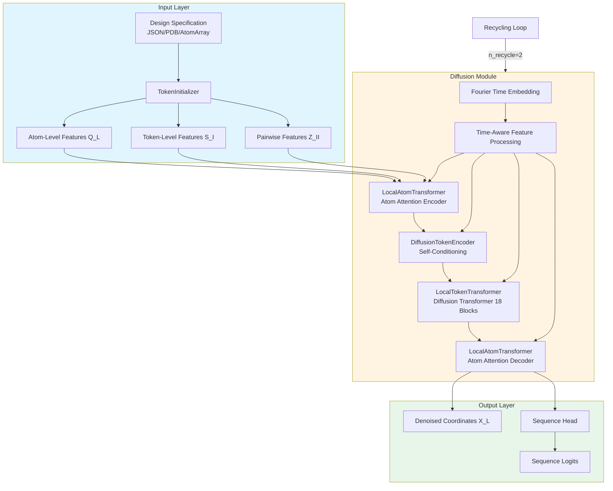
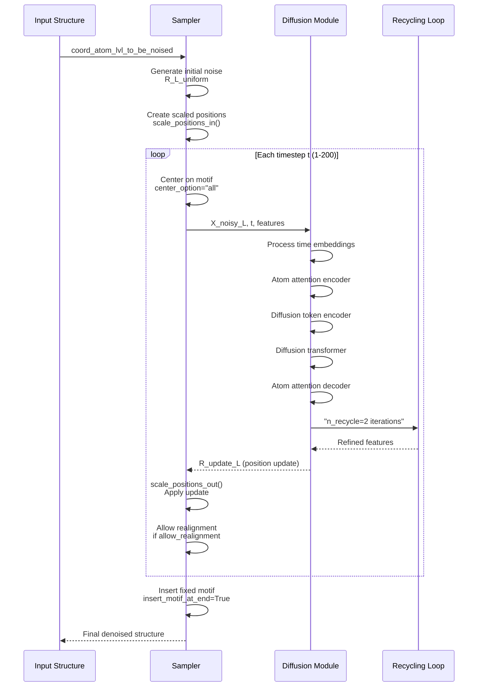

RFdiffusion3 (RFD3) is a sophisticated diffusion-based generative model designed for **all-atom biomolecular structure design** under complex constraints. Built as a streamlined derivative of AlphaFold 3, RFD3 focuses exclusively on the diffusion denoising module, enabling efficient de novo design of proteins, nucleic acid binders, small molecule binders, and enzymes with atomic-level precision.

## Architecture Overview

RFdiffusion3 employs a **multi-scale UNet-like architecture** that processes information across atom and token levels through iterative denoising. The model operates on a diffusion framework where atomic coordinates are progressively denoised from random noise to physically realistic structures, conditioned on design constraints.



### Core Model Components

The RFD3 model ([`RFD3.py`](models/rfd3/src/rfd3/model/RFD3.py#L18-L106)) orchestrates three primary modules:

- **TokenInitializer**: Converts input structures into multi-scale feature representations using relative position encoding, token-level features (residue type, motif information), and atom-level features (element, charge, guided features like hydrogen bond donors/acceptors, solvent accessibility)
- **RFD3DiffusionModule**: The denoising core with UNet architecture featuring 3-layer atom attention encoder, 2-block diffusion token encoder, 18-block diffusion transformer, and 3-layer atom attention decoder
- **ConditionalDiffusionSampler**: Manages the iterative diffusion sampling process with support for motif alignment, symmetry constraints, and classifier-free guidance

The diffusion module ([`RFD3_diffusion_module.py`](models/rfd3/src/rfd3/model/RFD3_diffusion_module.py#L32-L388)) implements a sophisticated attention mechanism with cross-attention upcast/downcast operations enabling information flow between atom and token representations. Key architectural parameters include channel dimensions c_s=384, c_z=128, c_atom=128, c_atompair=16, with c_token=768 for token-level processing.

Sources: [`RFD3.py`](models/rfd3/src/rfd3/model/RFD3.py#L18-L106), [`RFD3_diffusion_module.py`](models/rfd3/src/rfd3/model/RFD3_diffusion_module.py#L32-L388), [`rfd3_net.yaml`](models/rfd3/configs/model/components/rfd3_net.yaml#L1-L132)

## Diffusion Process and Sampling

RFdiffusion3 utilizes an **Euler-Maruyama solver** with stochastic sampling parameters optimized for structural design quality. The diffusion process follows a noise schedule controlled by sigma_data=16, with configurable parameters including num_timesteps (default 200), step_scale (1.5), gamma_0 (0.6), and noise_scale (1.003).



### Sampling Strategies

The inference sampler ([`inference_sampler.py`](models/rfd3/src/rfd3/model/inference_sampler.py#L18-L636)) supports multiple sampling strategies:

- **Default Sampling**: Standard motif-preserving diffusion with translational augmentation (s_trans=1.0) and centering on motif, all, or diffused regions
- **Symmetry Sampling**: Extends default sampling with symmetry constraints, applying symmetry transformations after fraction_sym_steps=0.9 of the diffusion process
- **Classifier-Free Guidance (CFG)**: Enhances design fidelity by computing guidance scale from reference features (cfg_scale=1.5 default), applied optionally with t_max cutoff

The sampler implements **motif preservation** through is_motif_atom_with_fixed_coord and is_motif_token_with_fully_fixed_coord masks, allowing partial diffusion where specified regions remain fixed. During sampling, fixed motifs are re-centered at each step to maintain structural context.

Sources: [`inference_sampler.py`](models/rfd3/src/rfd3/model/inference_sampler.py#L18-L636), [`rfdiffusion3.yaml`](models/rfd3/configs/inference_engine/rfdiffusion3.yaml#L1-L66)

## Conditioning System

RFdiffusion3 supports a rich **conditioning annotation system** that encodes design constraints directly into the atom array. Required annotations include component origin (`src_component`), design intent (`contig`), fixed/diffused status (`inpainting`), and motif information (`is_motif`).

> [!TIP]
> The conditioning system operates through a sophisticated annotation pipeline where atoms are tagged with design constraints through required annotations (inpainting, contig, is_motif, src_component) and optional guidance features (active_donor, active_acceptor, ref_atomwise_rasa, is_atom_level_hotspot). These annotations flow through the entire pipeline from input specification through feature initialization to the diffusion module, ensuring constraints are preserved throughout the generation process.

### Feature Encoding

Token-level features encoded in the TokenInitializer ([`rfd3_net.yaml`](models/rfd3/configs/model/components/rfd3_net.yaml#L9-L18)) include:

| Feature | Dimension | Purpose |
|---------|-----------|---------|
| ref_motif_token_type | 3 | Distinguishes motif, diffused, and fixed regions |
| restype | 32 | One-hot amino acid encoding |
| ref_plddt | 1 | Confidence score from reference structures |
| is_non_loopy | 1 | Identifies non-loop regions for secondary structure guidance |

Atom-level features ([`rfd3_net.yaml`](models/rfd3/configs/model/components/rfd3_net.yaml#L19-L36)) include chemical properties (ref_element, ref_charge), structural information (ref_pos, ref_atom_name_chars), and guided features for hydrogen bonding (active_donor, active_acceptor), solvent accessibility (ref_atomwise_rasa), and hotspot identification (is_atom_level_hotspot).

Sources: [`constants.py`](models/rfd3/src/rfd3/constants.py#L1-L213), [`rfd3_net.yaml`](models/rfd3/configs/model/components/rfd3_net.yaml#L9-L36)

## Inference Engine

The RFD3InferenceEngine ([`engine.py`](models/rfd3/src/rfd3/engine.py#L135-L403)) provides a unified interface for running design tasks with flexible input specification and output handling.

### Input Specification

The engine accepts multiple input formats through the `_canonicalize_inputs` method ([`engine.py`](models/rfd3/src/rfd3/engine.py#L330-L368)):

- **JSON files**: Primary method for complex design specifications with multiple contigs and constraints
- **PDB/AtomArray**: Direct structure input for simple design tasks
- **DesignInputSpecification**: Programmatic Python objects for automated workflows

The input parsing system ([`input_parsing.py`](models/rfd3/src/rfd3/inference/input_parsing.py)) validates specifications against required annotations and handles contig parsing for component assembly.

### Execution Pipeline

The inference workflow ([`engine.py`](models/rfd3/src/rfd3/engine.py#L200-L262)) follows these steps:

1. Input canonicalization and validation
2. Specification multiplication for batch processing
3. Pipeline construction with Atom14 data transforms
4. Diffusion sampling with model forward pass
5. Output assembly as AtomArray structures
6. Optional trajectory dumping and alignment

The engine supports batch processing with `diffusion_batch_size` configuration, multi-batch execution via `n_batches` parameter, and automatic checkpoint management for resuming interrupted runs.

Sources: [`engine.py`](models/rfd3/src/rfd3/engine.py#L135-L403), [`rfdiffusion3.yaml`](models/rfd3/configs/inference_engine/rfdiffusion3.yaml#L1-L66)

## Training Infrastructure

RFdiffusion3 provides complete training code extending Foundry's FabricTrainer through the AADesignTrainer ([`trainer/rfd3.py`](models/rfd3/src/rfd3/trainer/rfd3.py#L32-L486)).

### Training Loop

The training step ([`trainer/rfd3.py`](models/rfd3/src/rfd3/trainer/rfd3.py#L131-L185)) implements single-step denoising with loss computation on noisy-coordinates-to-denosed-coordinate predictions. Unlike inference, training does not run the full diffusion rollout but learns the denoising function with noise at random timesteps.

### Conditional Training

RFD3 trains on diverse conditioning tasks created dynamically during training ([`README.md`](models/rfd3/README.md#L134-L175)):

- Random motif token assignment and partial masking
- TIP atom conditioning (specific preset for atom-level constraints)
- Protein-protein interaction hotspot conditioning
- Secondary structure island conditioning
- Nucleic acid and small molecule contact conditioning

Training configuration ([`train.yaml`](models/rfd3/configs/train.yaml#L1-L28)) specifies model architecture, trainer settings, dataset configuration, callbacks, and paths through Hydra composition.

Sources: [`trainer/rfd3.py`](models/rfd3/src/rfd3/trainer/rfd3.py#L32-L486), [`train.py`](models/rfd3/src/rfd3/train.py#L25-L193), [`train.yaml`](models/rfd3/configs/train.yaml#L1-L28)

## Design Applications

RFdiffusion3 excels at diverse biomolecular design tasks with specialized example configurations.

### Supported Applications

| Application | Description | Example Config |
|-------------|-------------|----------------|
| Protein Binders | Design proteins binding to target protein surfaces | `protein_binder_design.json` |
| Small Molecule Binders | Design proteins binding to ligands and cofactors | `sm_binder_design.json` |
| Nucleic Acid Binders | Design proteins binding to DNA/RNA | `na_binder_design.json` |
| Enzyme Design | Design active sites with catalytic geometry | `enzyme_design.json` |
| Symmetric Design | Generate cyclic, dihedral, and higher-order symmetry | `symmetry.md` |
| Hydrogen Bond Conditioning | Constrain designs with specific H-bond networks | Requires HBPLUS installation |

### Configuration Example

Basic inference command:
```bash
rfd3 design out_dir=logs/inference_outs/demo/0 inputs=models/rfd3/docs/demo.json ckpt_path=null skip_existing=False dump_trajectories=True align_trajectory_structures=True
```

Key inference parameters ([`rfdiffusion3.yaml`](models/rfd3/configs/inference_engine/rfdiffusion3.yaml#L1-L66)) include:
- `step_scale`: Controls diversity vs designability (higher = less diverse, more designable)
- `center_option`: Specifies whether to center on "all", "motif", or "diffuse" regions
- `cfg_scale`: Classifier-free guidance strength
- `num_timesteps`: Number of denoising steps

Sources: [`README.md`](models/rfd3/README.md#L1-L175), [docs/](models/rfd3/docs/)

## Advanced Features

### Memory Optimization

RFD3 provides **low-memory mode** ([`engine.py`](models/rfd3/src/rfd3/engine.py#L68-L70)) for large structures by setting `low_memory_mode=True` or environment variable `RFD3_LOW_MEMORY_MODE=1`. This enables chunked pairwise embedding computation through the `chunked_pairwise_embedder` parameter, reducing peak memory usage at computational cost.

### Trajectory Analysis

The engine supports full trajectory dumping ([`engine.py`](models/rfd3/src/rfd3/engine.py#L64-L66)) with `dump_trajectories=True` and `align_trajectory_structures=True`, saving intermediate denoising steps for analysis, visualization, and debugging. The `_reshape_trajectory` function handles trajectory alignment and restructuring.

### Distributed Training

RFD3 integrates with Foundry's DDP support ([`README.md`](models/rfd3/README.md#L132-L157)) for multi-GPU and multi-node training. The trainer accepts `devices_per_node` and `num_nodes` parameters with automatic gradient accumulation configuration based on target batch size.

Sources: [`engine.py`](models/rfd3/src/rfd3/engine.py#L68-L70), [`README.md`](models/rfd3/README.md#L132-L157)

## Configuration System

RFdiffusion3 uses a hierarchical Hydra configuration system with modular composition:

### Configuration Structure

```
configs/
├── inference_engine/rfdiffusion3.yaml    # Main inference config
├── inference.yaml                         # Inference entry point
├── model/
│   ├── rfd3_base.yaml                    # Model composition
│   └── components/
│       ├── rfd3_net.yaml                 # Network architecture
│       └── ema.yaml                      # EMA configuration
├── trainer/
│   └── rfd3_base.yaml                    # Trainer composition
├── datasets/
│   └── design_base.yaml                  # Dataset base config
└── experiment/
    ├── pretrain.yaml                     # Pretraining overrides
    ├── test-uncond.yaml                  # Unconditional test
    └── debug.yaml                        # Debug configuration
```

Key configuration parameters in [`rfd3_net.yaml`](models/rfd3/configs/model/components/rfd3_net.yaml#L1-L132):
- Channel dimensions: `c_s`, `c_z`, `c_atom`, `c_atompair`, `c_token`
- Attention configuration: `n_head`, `kq_norm`, `dropout`
- Architecture depths: `n_pairformer_blocks`, `n_block` (18 for diffusion transformer)
- Recycling: `n_recycle=2`
- Downcast/upcast: Cross-attention method with configurable blocks

Sources: [`rfd3_base.yaml`](models/rfd3/configs/model/rfd3_base.yaml#L1-L9), [`inference.yaml`](models/rfd3/configs/inference.yaml#L1-L10)

## Integration with Foundry

RFdiffusion3 integrates deeply with Foundry's infrastructure:

- **Checkpoint Management**: Uses Foundry's checkpoint system with `ckpt_path` resolution to `FOUNDRY_CHECKPOINTS_DIR`
- **Training Harness**: Extends `FabricTrainer` ([`FabricTrainer`](7-training-harness-with-fabrictrainer)) with RFD3-specific validation and metrics
- **Callbacks**: Custom callbacks for design metrics, structure dumping, and training logging
- **Configuration**: Leverages Hydra configuration system ([`Hydra Configuration System`](12-hydra-configuration-system)) with custom resolvers
- **Dataset System**: Uses AtomWorks-compatible dataset instantiation ([`Dataset Instantiation`](14-dataset-instantiation-and-sampling))

The model follows Foundry's inference engine pattern ([`Inference Engine Architecture`](6-inference-engine-architecture)), implementing the standard `run()` method with batch processing and output handling.

Sources: [`__init__.py`](models/rfd3/src/rfd3/__init__.py#L1-L13), [`README.md`](models/rfd3/README.md#L13-L35)

## Next Steps

For comprehensive design workflows, explore:

- **RosettaFold3**: Structure prediction for design scaffolds via [RosettaFold3: Structure Prediction Network](10-rosettafold3-structure-prediction-network)
- **Sequence Design**: Refine RFdiffusion3 outputs with [ProteinMPNN and LigandMPNN: Inverse Folding](11-proteinmpnn-and-ligandmpnn-inverse-folding)
- **Advanced Configuration**: Customize models with [Model-Specific Configuration Structure](22-model-specific-configuration-structure)
- **Extension**: Add new models via [Adding New Models to Foundry](21-adding-new-models-to-foundry)

For training customization, consult [Distributed Training with DDP](15-distributed-training-with-ddp) and [Exponential Moving Average Implementation](16-exponential-moving-average-implementation).
