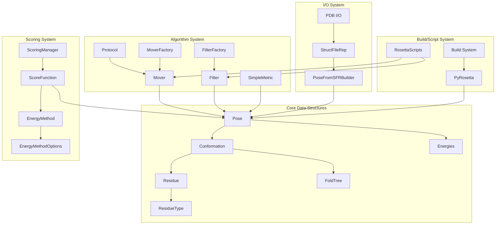
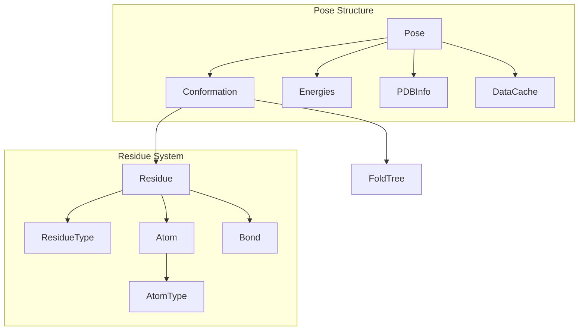
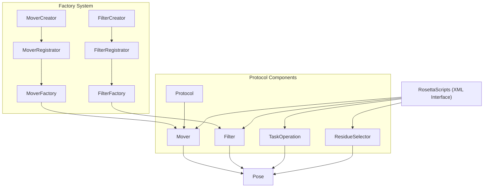
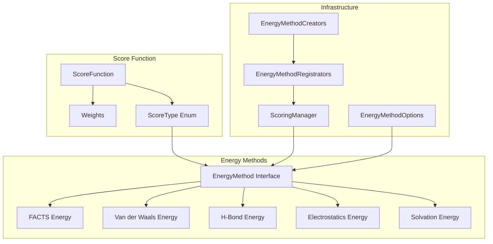
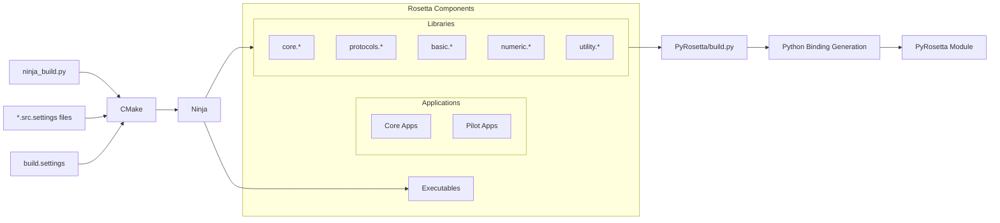
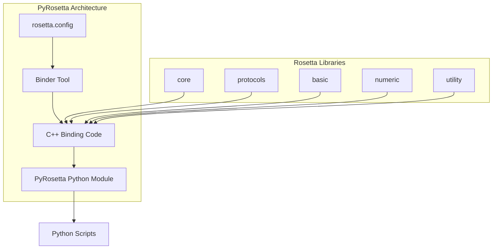
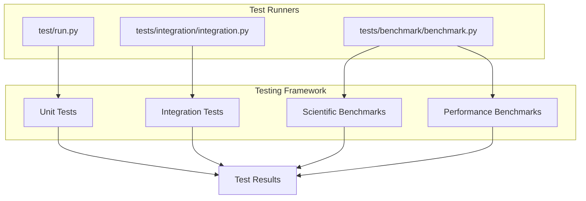
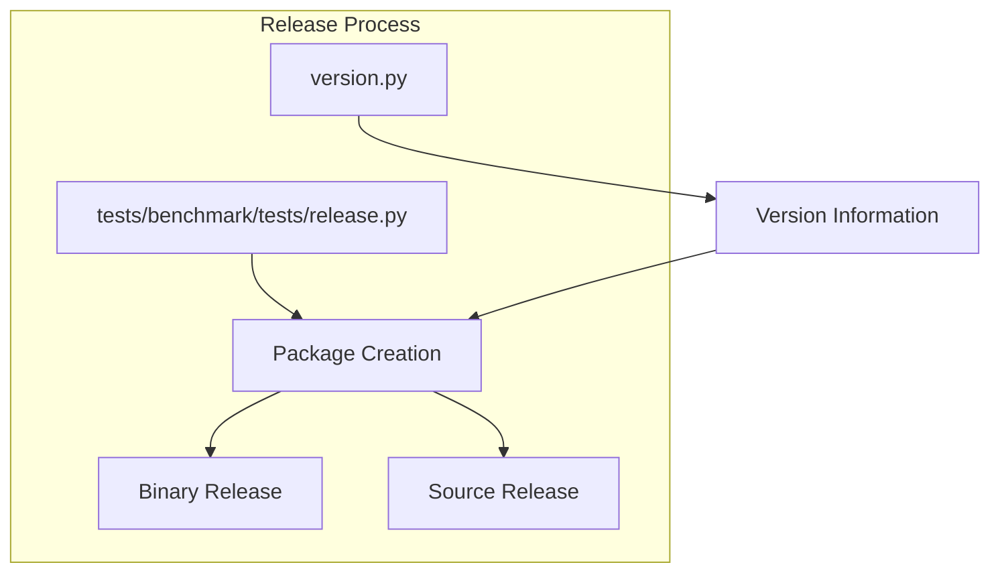

# Overview

Relevant source files

The following files were used as context for generating this wiki page:

- [LICENSE.PyRosetta.md](LICENSE.PyRosetta.md)
- [database/citations/rosetta_citations.txt](database/citations/rosetta_citations.txt)
- [source/external/cxxtest/cxxtest/ErrorFormatter.h](source/external/cxxtest/cxxtest/ErrorFormatter.h)
- [source/external/libxml2/trio.c](source/external/libxml2/trio.c)
- [source/src/apps.src.settings](source/src/apps.src.settings)
- [source/src/basic/tensorflow_manager/RosettaTensorflowTensorContainer.tmpl.hh](source/src/basic/tensorflow_manager/RosettaTensorflowTensorContainer.tmpl.hh)
- [source/src/core/chemical/ElementSet.cc](source/src/core/chemical/ElementSet.cc)
- [source/src/core/simple_metrics/PerResidueProbabilitiesMetric.cc](source/src/core/simple_metrics/PerResidueProbabilitiesMetric.cc)
- [source/src/core/simple_metrics/PerResidueProbabilitiesMetric.hh](source/src/core/simple_metrics/PerResidueProbabilitiesMetric.hh)
- [source/src/devel.src.settings](source/src/devel.src.settings)
- [source/src/devel/denovo_design/ConnectJumps.cc](source/src/devel/denovo_design/ConnectJumps.cc)
- [source/src/devel/denovo_design/ConnectJumps.hh](source/src/devel/denovo_design/ConnectJumps.hh)
- [source/src/devel/denovo_design/filters/FoldabilityFilter.cc](source/src/devel/denovo_design/filters/FoldabilityFilter.cc)
- [source/src/devel/denovo_design/filters/FoldabilityFilter.hh](source/src/devel/denovo_design/filters/FoldabilityFilter.hh)
- [source/src/devel/denovo_design/task_operations/HighestEnergyRegion.cc](source/src/devel/denovo_design/task_operations/HighestEnergyRegion.cc)
- [source/src/devel/denovo_design/task_operations/HighestEnergyRegion.hh](source/src/devel/denovo_design/task_operations/HighestEnergyRegion.hh)
- [source/src/devel/denovo_design/task_operations/HighestEnergyRegionCreator.hh](source/src/devel/denovo_design/task_operations/HighestEnergyRegionCreator.hh)
- [source/src/devel/init.cc](source/src/devel/init.cc)
- [source/src/pilot_apps.src.settings.all](source/src/pilot_apps.src.settings.all)
- [source/src/protocols.3.src.settings](source/src/protocols.3.src.settings)
- [source/src/protocols.4.src.settings](source/src/protocols.4.src.settings)
- [source/src/protocols.7.src.settings](source/src/protocols.7.src.settings)
- [source/src/protocols/carbohydrates/RingPlaneFlipMover.cc](source/src/protocols/carbohydrates/RingPlaneFlipMover.cc)
- [source/src/protocols/carbohydrates/RingPlaneFlipMover.hh](source/src/protocols/carbohydrates/RingPlaneFlipMover.hh)
- [source/src/protocols/carbohydrates/RingPlaneFlipMoverCreator.hh](source/src/protocols/carbohydrates/RingPlaneFlipMoverCreator.hh)
- [source/src/protocols/carbohydrates/TautomerizeAnomerMover.cc](source/src/protocols/carbohydrates/TautomerizeAnomerMover.cc)
- [source/src/protocols/carbohydrates/TautomerizeAnomerMover.fwd.hh](source/src/protocols/carbohydrates/TautomerizeAnomerMover.fwd.hh)
- [source/src/protocols/carbohydrates/TautomerizeAnomerMover.hh](source/src/protocols/carbohydrates/TautomerizeAnomerMover.hh)
- [source/src/protocols/carbohydrates/TautomerizeAnomerMoverCreator.hh](source/src/protocols/carbohydrates/TautomerizeAnomerMoverCreator.hh)
- [source/src/protocols/denovo_design/calculators/CavityCalculator.cc](source/src/protocols/denovo_design/calculators/CavityCalculator.cc)
- [source/src/protocols/denovo_design/calculators/CavityCalculator.hh](source/src/protocols/denovo_design/calculators/CavityCalculator.hh)
- [source/src/protocols/denovo_design/filters/CavityVolumeFilter.cc](source/src/protocols/denovo_design/filters/CavityVolumeFilter.cc)
- [source/src/protocols/denovo_design/filters/CavityVolumeFilter.fwd.hh](source/src/protocols/denovo_design/filters/CavityVolumeFilter.fwd.hh)
- [source/src/protocols/denovo_design/filters/CavityVolumeFilter.hh](source/src/protocols/denovo_design/filters/CavityVolumeFilter.hh)
- [source/src/protocols/denovo_design/filters/CavityVolumeFilterCreator.hh](source/src/protocols/denovo_design/filters/CavityVolumeFilterCreator.hh)
- [source/src/protocols/esm_perplexity/EsmPerplexityTensorflowProtocol.cc](source/src/protocols/esm_perplexity/EsmPerplexityTensorflowProtocol.cc)
- [source/src/protocols/esm_perplexity/EsmPerplexityTensorflowProtocol.hh](source/src/protocols/esm_perplexity/EsmPerplexityTensorflowProtocol.hh)
- [source/src/protocols/esm_perplexity/PerResidueEsmProbabilitiesMetric.cc](source/src/protocols/esm_perplexity/PerResidueEsmProbabilitiesMetric.cc)
- [source/src/protocols/esm_perplexity/PseudoPerplexityMetric.cc](source/src/protocols/esm_perplexity/PseudoPerplexityMetric.cc)
- [source/src/protocols/esm_perplexity/PseudoPerplexityMetric.fwd.hh](source/src/protocols/esm_perplexity/PseudoPerplexityMetric.fwd.hh)
- [source/src/protocols/esm_perplexity/PseudoPerplexityMetric.hh](source/src/protocols/esm_perplexity/PseudoPerplexityMetric.hh)
- [source/src/protocols/esm_perplexity/PseudoPerplexityMetricCreator.hh](source/src/protocols/esm_perplexity/PseudoPerplexityMetricCreator.hh)
- [source/src/protocols/indexed_structure_store/FragmentStore.cc](source/src/protocols/indexed_structure_store/FragmentStore.cc)
- [source/src/protocols/indexed_structure_store/FragmentStore.hh](source/src/protocols/indexed_structure_store/FragmentStore.hh)
- [source/src/protocols/init/init.FilterCreators.ihh](source/src/protocols/init/init.FilterCreators.ihh)
- [source/src/protocols/init/init.FilterRegistrators.ihh](source/src/protocols/init/init.FilterRegistrators.ihh)
- [source/src/protocols/init/init.MoverCreators.ihh](source/src/protocols/init/init.MoverCreators.ihh)
- [source/src/protocols/init/init.MoverRegistrators.ihh](source/src/protocols/init/init.MoverRegistrators.ihh)
- [source/src/protocols/inverse_folding/MIFST.cc](source/src/protocols/inverse_folding/MIFST.cc)
- [source/src/protocols/inverse_folding/MIFST.hh](source/src/protocols/inverse_folding/MIFST.hh)
- [source/src/protocols/inverse_folding/MIFSTProbabilitiesMetric.cc](source/src/protocols/inverse_folding/MIFSTProbabilitiesMetric.cc)
- [source/src/protocols/inverse_folding/util.cc](source/src/protocols/inverse_folding/util.cc)
- [source/src/protocols/inverse_folding/util.hh](source/src/protocols/inverse_folding/util.hh)
- [source/src/protocols/protein_interface_design/movers/SecretionOptimizationMover.cc](source/src/protocols/protein_interface_design/movers/SecretionOptimizationMover.cc)
- [source/src/protocols/protein_interface_design/movers/SecretionOptimizationMover.fwd.hh](source/src/protocols/protein_interface_design/movers/SecretionOptimizationMover.fwd.hh)
- [source/src/protocols/protein_interface_design/movers/SecretionOptimizationMover.hh](source/src/protocols/protein_interface_design/movers/SecretionOptimizationMover.hh)
- [source/src/protocols/protein_interface_design/movers/SecretionOptimizationMoverCreator.hh](source/src/protocols/protein_interface_design/movers/SecretionOptimizationMoverCreator.hh)
- [source/src/protocols/protein_mpnn/ProteinMPNN.cc](source/src/protocols/protein_mpnn/ProteinMPNN.cc)
- [source/src/protocols/protein_mpnn/ProteinMPNN.hh](source/src/protocols/protein_mpnn/ProteinMPNN.hh)
- [source/src/protocols/protein_mpnn/ProteinMPNNMover.cc](source/src/protocols/protein_mpnn/ProteinMPNNMover.cc)
- [source/src/protocols/protein_mpnn/ProteinMPNNProbabilitiesMetric.cc](source/src/protocols/protein_mpnn/ProteinMPNNProbabilitiesMetric.cc)
- [source/src/protocols/protein_mpnn/ProteinMPNNProbabilitiesMetric.hh](source/src/protocols/protein_mpnn/ProteinMPNNProbabilitiesMetric.hh)
- [source/src/protocols/protein_mpnn/util.cc](source/src/protocols/protein_mpnn/util.cc)
- [source/src/protocols/protein_mpnn/util.hh](source/src/protocols/protein_mpnn/util.hh)
- [source/src/protocols/simple_filters/SecretionPredictionFilter.cc](source/src/protocols/simple_filters/SecretionPredictionFilter.cc)
- [source/src/protocols/simple_moves/AddCavitiesMover.cc](source/src/protocols/simple_moves/AddCavitiesMover.cc)
- [source/src/protocols/simple_moves/SampleSequenceFromProbabilities.cc](source/src/protocols/simple_moves/SampleSequenceFromProbabilities.cc)
- [source/src/protocols/simple_moves/SampleSequenceFromProbabilities.hh](source/src/protocols/simple_moves/SampleSequenceFromProbabilities.hh)
- [source/src/protocols_a.5.src.settings](source/src/protocols_a.5.src.settings)
- [source/src/protocols_f.5.src.settings](source/src/protocols_f.5.src.settings)
- [source/src/python/PyRosetta/build.py](source/src/python/PyRosetta/build.py)
- [source/src/python/PyRosetta/include/rosetta_binders.hpp](source/src/python/PyRosetta/include/rosetta_binders.hpp)
- [source/src/python/PyRosetta/rosetta.cmake](source/src/python/PyRosetta/rosetta.cmake)
- [source/src/python/PyRosetta/rosetta.config](source/src/python/PyRosetta/rosetta.config)
- [source/src/python/PyRosetta/src/pyrosetta/__init__.py](source/src/python/PyRosetta/src/pyrosetta/__init__.py)
- [source/test/devel.test.settings](source/test/devel.test.settings)
- [source/test/devel/denovo_design/C5_Z.sym](source/test/devel/denovo_design/C5_Z.sym)
- [source/test/devel/denovo_design/FoldabilityFilter.cxxtest.hh](source/test/devel/denovo_design/FoldabilityFilter.cxxtest.hh)
- [source/test/devel/denovo_design/test_foldability.pdb](source/test/devel/denovo_design/test_foldability.pdb)
- [source/test/devel/init/filter_creators.cxxtest.hh](source/test/devel/init/filter_creators.cxxtest.hh)
- [source/test/protocols.test.settings](source/test/protocols.test.settings)
- [source/test/protocols/esm_perplexity/EsmPerplexity.cxxtest.hh](source/test/protocols/esm_perplexity/EsmPerplexity.cxxtest.hh)
- [source/test/protocols/init/mover_creators.cxxtest.hh](source/test/protocols/init/mover_creators.cxxtest.hh)
- [source/test/run.py](source/test/run.py)
- [source/tools/build/basic.settings](source/tools/build/basic.settings)
- [source/tools/build/options.settings](source/tools/build/options.settings)
- [source/version.py](source/version.py)
- [tests/benchmark/benchmark.py](tests/benchmark/benchmark.py)
- [tests/benchmark/hpc_drivers/base.py](tests/benchmark/hpc_drivers/base.py)
- [tests/benchmark/hpc_drivers/condor.py](tests/benchmark/hpc_drivers/condor.py)
- [tests/benchmark/hpc_drivers/multicore.py](tests/benchmark/hpc_drivers/multicore.py)
- [tests/benchmark/tests/PyRosetta.py](tests/benchmark/tests/PyRosetta.py)
- [tests/benchmark/tests/PyRosetta4.py](tests/benchmark/tests/PyRosetta4.py)
- [tests/benchmark/tests/__init__.py](tests/benchmark/tests/__init__.py)
- [tests/benchmark/tests/build.py](tests/benchmark/tests/build.py)
- [tests/benchmark/tests/integration.py](tests/benchmark/tests/integration.py)
- [tests/benchmark/tests/performance.py](tests/benchmark/tests/performance.py)
- [tests/benchmark/tests/profile.py](tests/benchmark/tests/profile.py)
- [tests/benchmark/tests/release.py](tests/benchmark/tests/release.py)
- [tests/benchmark/tests/score.py](tests/benchmark/tests/score.py)
- [tests/benchmark/tests/unit.py](tests/benchmark/tests/unit.py)
- [tests/integration/integration.py](tests/integration/integration.py)
- [tests/integration/tests/esm_model_perplexity/command.tensorflow](tests/integration/tests/esm_model_perplexity/command.tensorflow)
- [tests/integration/tests/esm_model_perplexity/simple_test.xml](tests/integration/tests/esm_model_perplexity/simple_test.xml)
- [tests/integration/tests/mmtfIO_score_test/command](tests/integration/tests/mmtfIO_score_test/command)
- [tests/integration/tests/test_degreaser/README.txt](tests/integration/tests/test_degreaser/README.txt)
- [tests/integration/tests/test_degreaser/asym_flags](tests/integration/tests/test_degreaser/asym_flags)
- [tests/sfxn_fingerprint/sfxn_fingerprint.py](tests/sfxn_fingerprint/sfxn_fingerprint.py)

Rosetta is a comprehensive molecular modeling software suite primarily used for predicting and designing macromolecular structures, with a focus on proteins and protein-protein interactions. It provides tools for protein structure prediction, protein design, protein-protein docking, protein-ligand docking, loop modeling, and other computational structural biology tasks.

This overview introduces the main components and architecture of the Rosetta software suite. For more detailed information about specific subsystems, refer to the corresponding dedicated pages:
- For core data structures like Pose and Residue, see [Core Data Structures](#2)
- For energy evaluation, see [Scoring System](#3)
- For algorithms that manipulate structures, see [Protocol System](#4)
- For Python integration, see [Python Integration](#5)
- For development tools, see [Testing and Development](#6)

## Architecture Overview

Rosetta is organized into several interconnected systems that together provide a powerful framework for molecular modeling. The core of Rosetta is implemented in C++, with Python bindings provided through PyRosetta.

### High-Level Architecture

Sources: [source/src/pilot_apps.src.settings.all:1-1227](), [source/src/protocols/init/init.MoverRegistrators.ihh:1-780](), [source/src/protocols/init/init.MoverCreators.ihh:1-177]()

## Core Data Structures

At the heart of Rosetta is the `Pose` class, which represents the molecular system being modeled. A `Pose` contains:

1. A `Conformation` object that stores the geometric information (coordinates) of the molecule
2. An `Energies` object that holds the results of energy evaluations
3. `PDBInfo` for mapping between Rosetta's internal residue numbering and PDB numbering
4. A collection of `Residue` objects, each with a reference to a `ResidueType` that defines its chemical properties

Sources: [source/src/protocols.3.src.settings:1-223](), [source/test/protocols.test.settings:1-125]()

## Protocol System

The protocol system is built around the concept of `Mover` objects that operate on `Pose` objects to modify them in various ways. Complex operations are composed from simpler ones through the use of `Protocol` objects that manage multiple `Mover` objects. The system uses the factory pattern extensively with `MoverFactory` and `FilterFactory` creating `Mover` and `Filter` objects based on registered creators.

Sources: [source/src/protocols/init/init.MoverRegistrators.ihh:1-780](), [source/src/protocols/init/init.MoverCreators.ihh:1-177](), [source/src/protocols/init/init.FilterRegistrators.ihh:1-50](), [source/src/protocols/init/init.FilterCreators.ihh:1-50]()

## Scoring System

The scoring system evaluates the energy and quality of molecular structures. The central component is the `ScoreFunction` class, which combines multiple energy terms (each implemented as an `EnergyMethod`) with associated weights to compute a total score for a `Pose`.

Sources: [source/test/protocols.test.settings:1-125](), [source/src/protocols.3.src.settings:1-223]()

## Build System

Rosetta uses a sophisticated build system that leverages CMake, Ninja, and custom Python scripts to manage the compilation of its extensive codebase.

Sources: [source/tools/build/basic.settings:1-100](), [source/src/python/PyRosetta/build.py:1-100](), [tests/benchmark/tests/build.py:1-44]()

## Applications

Rosetta includes a wide range of applications for various computational structural biology tasks:

| Category | Example Applications |
|----------|---------------------|
| Structure Prediction | AbinitioRelax, fragment_picker |
| Design | fixbb, design_minisilent, supercharge |
| Docking | docking_protocol, ligand_dock |
| Analysis | InterfaceAnalyzer, score_jd2 |
| Antibody Modeling | antibody, snugdock |
| Membrane Proteins | mp_dock, mp_transform |
| Carbohydrates | glycan_dock, pose_from_saccharide_sequence |

Applications are organized into "public" apps (stable, documented, and intended for general use) and "pilot" apps (experimental or specialized tools).

Sources: [source/src/apps.src.settings:1-67](), [source/src/pilot_apps.src.settings.all:1-100]()

## Python Integration (PyRosetta)

PyRosetta provides Python bindings to the core Rosetta C++ functionality, enabling users to write Python scripts that leverage Rosetta's powerful molecular modeling capabilities. PyRosetta is built using a combination of custom binding tools and Pybind11.

Sources: [source/src/python/PyRosetta/build.py:1-100](), [source/src/python/PyRosetta/rosetta.config:1-50](), [source/src/python/PyRosetta/src/pyrosetta/__init__.py:1-20](), [tests/benchmark/tests/PyRosetta.py:1-20]()

## Testing Framework

Rosetta has a comprehensive testing infrastructure that includes:

1. **Unit tests**: Test individual components in isolation
2. **Integration tests**: Test the interaction between components
3. **Scientific benchmarks**: Validate the scientific accuracy of Rosetta methods
4. **Performance benchmarks**: Measure the computational efficiency of algorithms

Sources: [source/test/run.py:1-40](), [tests/integration/integration.py:1-80](), [tests/benchmark/benchmark.py:1-60](), [tests/benchmark/tests/unit.py:1-20](), [tests/benchmark/tests/integration.py:1-115](), [tests/benchmark/tests/performance.py:1-20](), [tests/benchmark/tests/score.py:1-20]()

## Version and Release System

Rosetta uses a versioning system to track releases and changes. The version information includes git revision, branch, and other metadata.

Sources: [source/version.py:1-20](), [tests/benchmark/tests/release.py:1-100](), [tests/benchmark/tests/__init__.py:1-100]()

## Summary

Rosetta is a highly modular, extensible software platform for molecular modeling, with particular strengths in protein structure prediction and design. Its architecture separates the representation of molecular structures (through the Pose class) from the operations that manipulate them (through Movers) and the scoring functions that evaluate them (through ScoreFunction). This separation of concerns, combined with the factory pattern for creating components and the plugin architecture for registering new functionality, makes Rosetta both powerful and extensible.

Sources: [source/src/pilot_apps.src.settings.all:1-1227](), [source/tools/build/basic.settings:1-100](), [source/src/python/PyRosetta/build.py:1-100](), [source/src/protocols/init/init.MoverRegistrators.ihh:1-780](), [source/src/protocols/init/init.MoverCreators.ihh:1-177](), [source/src/protocols/init/init.FilterRegistrators.ihh:1-50](), [source/src/protocols/init/init.FilterCreators.ihh:1-50]()

---