# Architecture Overview

Relevant source files

The following files were used as context for generating this wiki page:

- [source/src/apps.src.settings](source/src/apps.src.settings)
- [source/src/core.3.src.settings](source/src/core.3.src.settings)
- [source/src/core.4.src.settings](source/src/core.4.src.settings)
- [source/src/core/chemical/Atom.cc](source/src/core/chemical/Atom.cc)
- [source/src/core/chemical/Atom.fwd.hh](source/src/core/chemical/Atom.fwd.hh)
- [source/src/core/chemical/Atom.hh](source/src/core/chemical/Atom.hh)
- [source/src/core/chemical/ResidueType.cc](source/src/core/chemical/ResidueType.cc)
- [source/src/core/chemical/ResidueType.hh](source/src/core/chemical/ResidueType.hh)
- [source/src/core/chemical/residue_io.cc](source/src/core/chemical/residue_io.cc)
- [source/src/core/chemical/residue_io.hh](source/src/core/chemical/residue_io.hh)
- [source/src/core/conformation/Atom.cc](source/src/core/conformation/Atom.cc)
- [source/src/core/conformation/Atom.fwd.hh](source/src/core/conformation/Atom.fwd.hh)
- [source/src/core/conformation/Atom.hh](source/src/core/conformation/Atom.hh)
- [source/src/core/conformation/Conformation.cc](source/src/core/conformation/Conformation.cc)
- [source/src/core/conformation/Conformation.hh](source/src/core/conformation/Conformation.hh)
- [source/src/core/conformation/Residue.cc](source/src/core/conformation/Residue.cc)
- [source/src/core/conformation/Residue.hh](source/src/core/conformation/Residue.hh)
- [source/src/core/conformation/symmetry/MirrorSymmetricConformation.cc](source/src/core/conformation/symmetry/MirrorSymmetricConformation.cc)
- [source/src/core/conformation/symmetry/MirrorSymmetricConformation.hh](source/src/core/conformation/symmetry/MirrorSymmetricConformation.hh)
- [source/src/core/conformation/symmetry/SymmData.cc](source/src/core/conformation/symmetry/SymmData.cc)
- [source/src/core/conformation/symmetry/SymmData.hh](source/src/core/conformation/symmetry/SymmData.hh)
- [source/src/core/conformation/symmetry/SymmetricConformation.cc](source/src/core/conformation/symmetry/SymmetricConformation.cc)
- [source/src/core/conformation/symmetry/SymmetricConformation.hh](source/src/core/conformation/symmetry/SymmetricConformation.hh)
- [source/src/core/conformation/symmetry/SymmetryInfo.cc](source/src/core/conformation/symmetry/SymmetryInfo.cc)
- [source/src/core/conformation/symmetry/SymmetryInfo.hh](source/src/core/conformation/symmetry/SymmetryInfo.hh)
- [source/src/core/conformation/util.cc](source/src/core/conformation/util.cc)
- [source/src/core/conformation/util.hh](source/src/core/conformation/util.hh)
- [source/src/core/energy_methods/D2H_SA_Energy.cc](source/src/core/energy_methods/D2H_SA_Energy.cc)
- [source/src/core/energy_methods/LK_hack.cc](source/src/core/energy_methods/LK_hack.cc)
- [source/src/core/energy_methods/ProQ_Energy.cc](source/src/core/energy_methods/ProQ_Energy.cc)
- [source/src/core/import_pose/libraries/RNA_ChunkLibrary.cc](source/src/core/import_pose/libraries/RNA_ChunkLibrary.cc)
- [source/src/core/init/init.cc](source/src/core/init/init.cc)
- [source/src/core/pose/Pose.cc](source/src/core/pose/Pose.cc)
- [source/src/core/pose/Pose.hh](source/src/core/pose/Pose.hh)
- [source/src/core/pose/datacache/CacheableDataType.cc](source/src/core/pose/datacache/CacheableDataType.cc)
- [source/src/core/pose/datacache/CacheableDataType.hh](source/src/core/pose/datacache/CacheableDataType.hh)
- [source/src/core/pose/util.cc](source/src/core/pose/util.cc)
- [source/src/core/pose/util.hh](source/src/core/pose/util.hh)
- [source/src/core/scoring/APBSWrapper.cc](source/src/core/scoring/APBSWrapper.cc)
- [source/src/core/scoring/ScoreType.hh](source/src/core/scoring/ScoreType.hh)
- [source/src/core/scoring/ScoreTypeManager.cc](source/src/core/scoring/ScoreTypeManager.cc)
- [source/src/core/scoring/ScoringManager.cc](source/src/core/scoring/ScoringManager.cc)
- [source/src/core/scoring/ScoringManager.hh](source/src/core/scoring/ScoringManager.hh)
- [source/src/core/scoring/SecondaryStructurePotential.cc](source/src/core/scoring/SecondaryStructurePotential.cc)
- [source/src/core/scoring/methods/EnergyMethodOptions.cc](source/src/core/scoring/methods/EnergyMethodOptions.cc)
- [source/src/core/scoring/methods/EnergyMethodOptions.hh](source/src/core/scoring/methods/EnergyMethodOptions.hh)
- [source/src/core/select/residue_selector/ResidueSelectorCreators.hh](source/src/core/select/residue_selector/ResidueSelectorCreators.hh)
- [source/src/core/simple_metrics/per_residue_metrics/PerResidueBfactorMetric.cc](source/src/core/simple_metrics/per_residue_metrics/PerResidueBfactorMetric.cc)
- [source/src/core/simple_metrics/per_residue_metrics/PerResidueBfactorMetric.fwd.hh](source/src/core/simple_metrics/per_residue_metrics/PerResidueBfactorMetric.fwd.hh)
- [source/src/core/simple_metrics/per_residue_metrics/PerResidueBfactorMetric.hh](source/src/core/simple_metrics/per_residue_metrics/PerResidueBfactorMetric.hh)
- [source/src/core/simple_metrics/per_residue_metrics/PerResidueBfactorMetricCreator.hh](source/src/core/simple_metrics/per_residue_metrics/PerResidueBfactorMetricCreator.hh)
- [source/src/devel.src.settings](source/src/devel.src.settings)
- [source/src/devel/denovo_design/ConnectJumps.cc](source/src/devel/denovo_design/ConnectJumps.cc)
- [source/src/devel/denovo_design/ConnectJumps.hh](source/src/devel/denovo_design/ConnectJumps.hh)
- [source/src/devel/denovo_design/filters/FoldabilityFilter.cc](source/src/devel/denovo_design/filters/FoldabilityFilter.cc)
- [source/src/devel/denovo_design/filters/FoldabilityFilter.hh](source/src/devel/denovo_design/filters/FoldabilityFilter.hh)
- [source/src/devel/denovo_design/task_operations/HighestEnergyRegion.cc](source/src/devel/denovo_design/task_operations/HighestEnergyRegion.cc)
- [source/src/devel/denovo_design/task_operations/HighestEnergyRegion.hh](source/src/devel/denovo_design/task_operations/HighestEnergyRegion.hh)
- [source/src/devel/denovo_design/task_operations/HighestEnergyRegionCreator.hh](source/src/devel/denovo_design/task_operations/HighestEnergyRegionCreator.hh)
- [source/src/devel/init.cc](source/src/devel/init.cc)
- [source/src/numeric/HomogeneousTransform.hh](source/src/numeric/HomogeneousTransform.hh)
- [source/src/pilot_apps.src.settings.all](source/src/pilot_apps.src.settings.all)
- [source/src/protocols.3.src.settings](source/src/protocols.3.src.settings)
- [source/src/protocols.4.src.settings](source/src/protocols.4.src.settings)
- [source/src/protocols.7.src.settings](source/src/protocols.7.src.settings)
- [source/src/protocols/carbohydrates/IdealizeAnomericHydrogens.cc](source/src/protocols/carbohydrates/IdealizeAnomericHydrogens.cc)
- [source/src/protocols/carbohydrates/RingPlaneFlipMover.cc](source/src/protocols/carbohydrates/RingPlaneFlipMover.cc)
- [source/src/protocols/carbohydrates/RingPlaneFlipMover.hh](source/src/protocols/carbohydrates/RingPlaneFlipMover.hh)
- [source/src/protocols/carbohydrates/RingPlaneFlipMoverCreator.hh](source/src/protocols/carbohydrates/RingPlaneFlipMoverCreator.hh)
- [source/src/protocols/carbohydrates/TautomerizeAnomerMover.cc](source/src/protocols/carbohydrates/TautomerizeAnomerMover.cc)
- [source/src/protocols/carbohydrates/TautomerizeAnomerMover.fwd.hh](source/src/protocols/carbohydrates/TautomerizeAnomerMover.fwd.hh)
- [source/src/protocols/carbohydrates/TautomerizeAnomerMover.hh](source/src/protocols/carbohydrates/TautomerizeAnomerMover.hh)
- [source/src/protocols/carbohydrates/TautomerizeAnomerMoverCreator.hh](source/src/protocols/carbohydrates/TautomerizeAnomerMoverCreator.hh)
- [source/src/protocols/denovo_design/calculators/CavityCalculator.cc](source/src/protocols/denovo_design/calculators/CavityCalculator.cc)
- [source/src/protocols/denovo_design/calculators/CavityCalculator.hh](source/src/protocols/denovo_design/calculators/CavityCalculator.hh)
- [source/src/protocols/denovo_design/filters/CavityVolumeFilter.cc](source/src/protocols/denovo_design/filters/CavityVolumeFilter.cc)
- [source/src/protocols/denovo_design/filters/CavityVolumeFilter.fwd.hh](source/src/protocols/denovo_design/filters/CavityVolumeFilter.fwd.hh)
- [source/src/protocols/denovo_design/filters/CavityVolumeFilter.hh](source/src/protocols/denovo_design/filters/CavityVolumeFilter.hh)
- [source/src/protocols/denovo_design/filters/CavityVolumeFilterCreator.hh](source/src/protocols/denovo_design/filters/CavityVolumeFilterCreator.hh)
- [source/src/protocols/init/init.FilterCreators.ihh](source/src/protocols/init/init.FilterCreators.ihh)
- [source/src/protocols/init/init.FilterRegistrators.ihh](source/src/protocols/init/init.FilterRegistrators.ihh)
- [source/src/protocols/init/init.MoverCreators.ihh](source/src/protocols/init/init.MoverCreators.ihh)
- [source/src/protocols/init/init.MoverRegistrators.ihh](source/src/protocols/init/init.MoverRegistrators.ihh)
- [source/src/protocols/init/init.SimpleMetricCreators.ihh](source/src/protocols/init/init.SimpleMetricCreators.ihh)
- [source/src/protocols/init/init.SimpleMetricRegistrators.ihh](source/src/protocols/init/init.SimpleMetricRegistrators.ihh)
- [source/src/protocols/jumping/DisulfPairingLibrary.cc](source/src/protocols/jumping/DisulfPairingLibrary.cc)
- [source/src/protocols/jumping/PairingLibrary.cc](source/src/protocols/jumping/PairingLibrary.cc)
- [source/src/protocols/parser/ScoreFunctionLoader.cc](source/src/protocols/parser/ScoreFunctionLoader.cc)
- [source/src/protocols/protein_interface_design/movers/SecretionOptimizationMover.cc](source/src/protocols/protein_interface_design/movers/SecretionOptimizationMover.cc)
- [source/src/protocols/protein_interface_design/movers/SecretionOptimizationMover.fwd.hh](source/src/protocols/protein_interface_design/movers/SecretionOptimizationMover.fwd.hh)
- [source/src/protocols/protein_interface_design/movers/SecretionOptimizationMover.hh](source/src/protocols/protein_interface_design/movers/SecretionOptimizationMover.hh)
- [source/src/protocols/protein_interface_design/movers/SecretionOptimizationMoverCreator.hh](source/src/protocols/protein_interface_design/movers/SecretionOptimizationMoverCreator.hh)
- [source/src/protocols/simple_filters/SecretionPredictionFilter.cc](source/src/protocols/simple_filters/SecretionPredictionFilter.cc)
- [source/src/protocols/simple_moves/AddCavitiesMover.cc](source/src/protocols/simple_moves/AddCavitiesMover.cc)
- [source/src/protocols_a.5.src.settings](source/src/protocols_a.5.src.settings)
- [source/src/protocols_f.5.src.settings](source/src/protocols_f.5.src.settings)
- [source/test/core.test.settings](source/test/core.test.settings)
- [source/test/core/chemical/residue_io.cxxtest.hh](source/test/core/chemical/residue_io.cxxtest.hh)
- [source/test/core/chemical/rings/util.cxxtest.hh](source/test/core/chemical/rings/util.cxxtest.hh)
- [source/test/core/conformation/util.cxxtest.hh](source/test/core/conformation/util.cxxtest.hh)
- [source/test/core/pose/datacache/CacheableDataType.cxxtest.hh](source/test/core/pose/datacache/CacheableDataType.cxxtest.hh)
- [source/test/core/pose/util.cxxtest.hh](source/test/core/pose/util.cxxtest.hh)
- [source/test/devel.test.settings](source/test/devel.test.settings)
- [source/test/devel/denovo_design/C5_Z.sym](source/test/devel/denovo_design/C5_Z.sym)
- [source/test/devel/denovo_design/FoldabilityFilter.cxxtest.hh](source/test/devel/denovo_design/FoldabilityFilter.cxxtest.hh)
- [source/test/devel/denovo_design/test_foldability.pdb](source/test/devel/denovo_design/test_foldability.pdb)
- [source/test/devel/init/filter_creators.cxxtest.hh](source/test/devel/init/filter_creators.cxxtest.hh)
- [source/test/protocols.test.settings](source/test/protocols.test.settings)
- [source/test/protocols/init/mover_creators.cxxtest.hh](source/test/protocols/init/mover_creators.cxxtest.hh)
- [tests/integration/tests/simple_metrics_b_factor/README.txt](tests/integration/tests/simple_metrics_b_factor/README.txt)
- [tests/integration/tests/simple_metrics_b_factor/command](tests/integration/tests/simple_metrics_b_factor/command)
- [tests/integration/tests/simple_metrics_b_factor/inputs/3gml.pdb](tests/integration/tests/simple_metrics_b_factor/inputs/3gml.pdb)
- [tests/integration/tests/simple_metrics_b_factor/inputs/rosetta.flags](tests/integration/tests/simple_metrics_b_factor/inputs/rosetta.flags)
- [tests/integration/tests/test_degreaser/README.txt](tests/integration/tests/test_degreaser/README.txt)
- [tests/integration/tests/test_degreaser/asym_flags](tests/integration/tests/test_degreaser/asym_flags)

This document provides a high-level overview of the Rosetta software architecture, explaining the core components and their relationships. Rosetta is a comprehensive molecular modeling suite used for protein structure prediction, design, docking, and many other computational biology applications.

For build system details, see [Build System](#1.2).

## Core Architecture Components

Rosetta's architecture consists of several major components that work together:

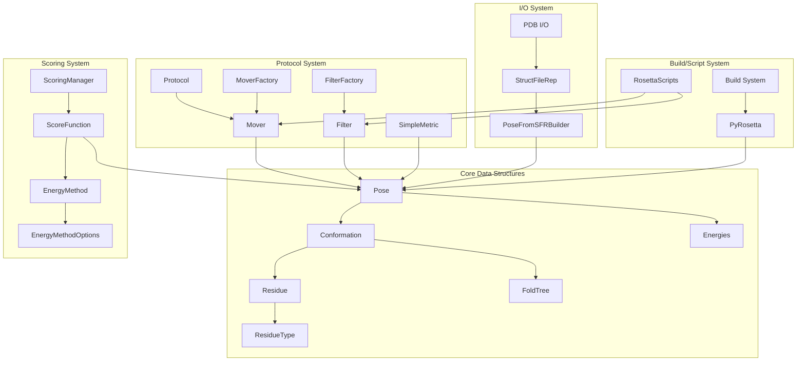

Sources: [source/src/core/conformation/Conformation.hh](), [source/src/core/pose/Pose.cc](), [source/src/core/chemical/ResidueType.hh](), [source/src/core/scoring/ScoreType.hh]()

## Core Data Structures

The central data structure in Rosetta is the `Pose` class, which represents a complete molecular structure.

### Pose and Conformation

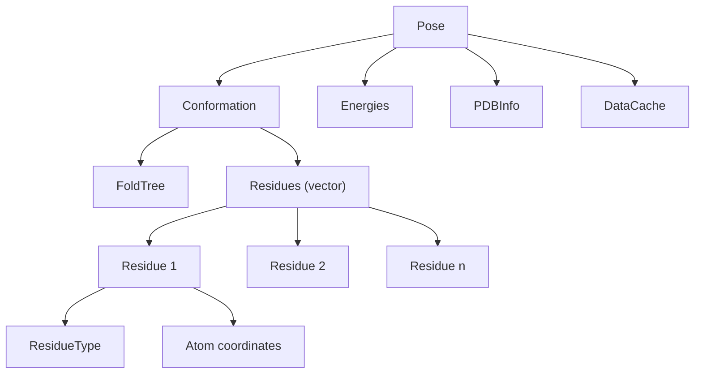

The `Pose` class contains:
- A `Conformation` object that stores 3D coordinates and connectivity
- An `Energies` object that stores energy values
- `PDBInfo` that contains metadata about the structure
- A `DataCache` for storing auxiliary data

The `Conformation` class manages:
- A collection of `Residue` objects
- A `FoldTree` that defines the kinematic connectivity between residues

Sources: [source/src/core/pose/Pose.cc](), [source/src/core/conformation/Conformation.cc](), [source/src/core/pose/util.cc]()

### Residue and ResidueType

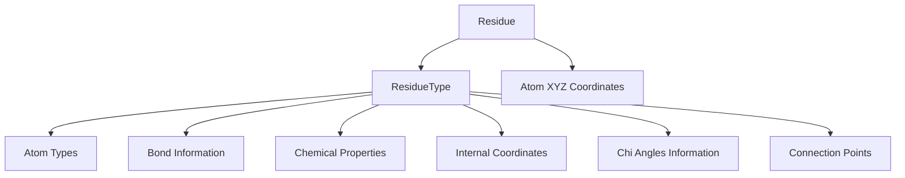

The `Residue` class represents a single residue (amino acid, nucleotide, ligand, etc.) and contains:
- A reference to a `ResidueType` that defines chemical properties
- The 3D coordinates of all atoms in the residue

The `ResidueType` class is immutable and defines:
- The chemical composition of a residue
- Atom types and properties
- Bond information
- Internal coordinate system
- Torsion angle (chi) definitions
- Connection points to other residues

Sources: [source/src/core/conformation/Residue.cc](), [source/src/core/chemical/ResidueType.cc]()

## Scoring System

The scoring system calculates the energy of a molecular structure through a collection of energy terms.

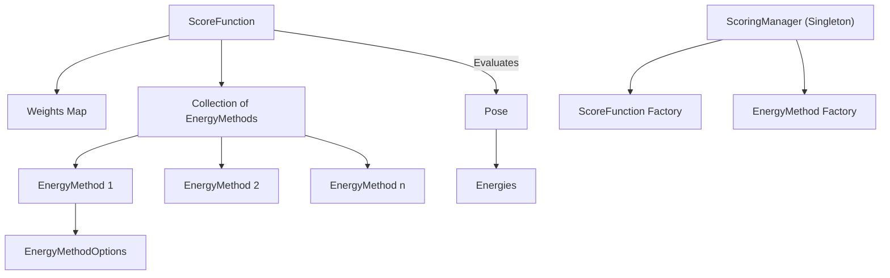

The scoring system consists of:
- The `ScoreFunction` class that holds weights for different energy terms
- The `Energies` class that stores calculated energy values
- Various `EnergyMethod` implementations that calculate specific energy terms
- The `ScoringManager` singleton that manages the creation of energy methods

Energy methods are registered at initialization time through the `EnergyMethodRegistrator` system, allowing for easy extension of the scoring system.

Sources: [source/src/core/scoring/ScoreTypeManager.cc](), [source/src/core/scoring/ScoreType.hh](), [source/src/core/scoring/methods/EnergyMethodOptions.cc](), [source/src/core/init/init.cc]()

## Protocol System

The protocol system provides a framework for applying operations to molecular structures.

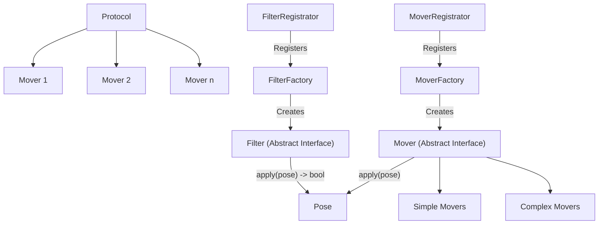

The protocol system consists of:
- `Mover` objects that perform operations on `Pose` objects
- `Filter` objects that evaluate whether a `Pose` meets certain criteria
- `Protocol` objects that combine multiple movers and filters
- Factory classes that create movers and filters based on names
- Registration systems that populate the factories

The registration system enables a plug-in architecture where new movers and filters can be added without modifying existing code.

Sources: [source/src/protocols/init/init.MoverRegistrators.ihh](), [source/src/protocols/init/init.MoverCreators.ihh](), [source/src/protocols/init/init.FilterRegistrators.ihh](), [source/src/protocols/init/init.FilterCreators.ihh]()

## I/O System

The I/O system handles reading and writing molecular structures in various formats.

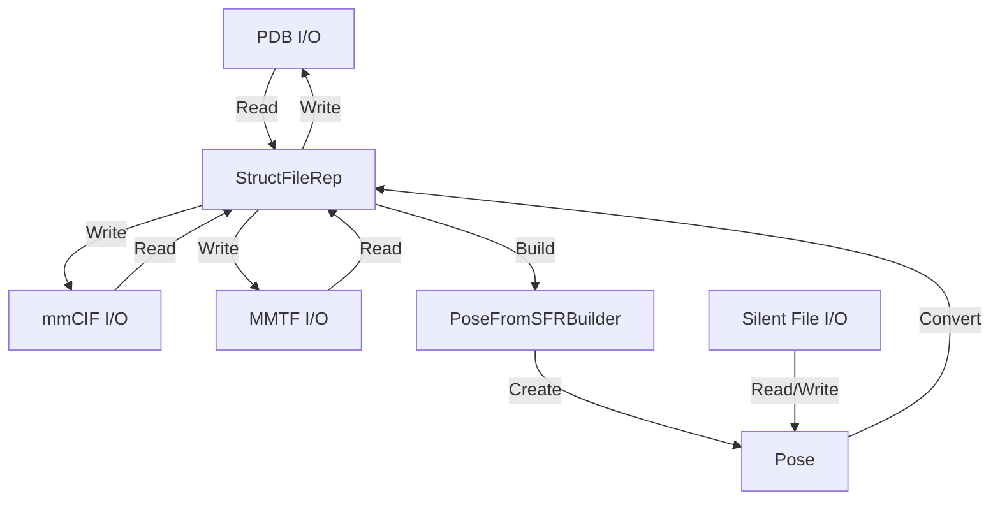

The I/O system includes:
- Readers and writers for various file formats (PDB, mmCIF, MMTF, etc.)
- The `StructFileRep` class that serves as an intermediate representation
- The `PoseFromSFRBuilder` class that converts file data to a `Pose`
- A silent file format for efficient storage of many structures

Sources: [source/src/core/io/pdb/pdb_reader.cc](), [source/src/core/io/pose_from_sfr/PoseFromSFRBuilder.cc](), [source/test/core.test.settings:131-154]()

## Registration and Factory System

Rosetta uses a factory pattern extensively to create objects at runtime based on their names.

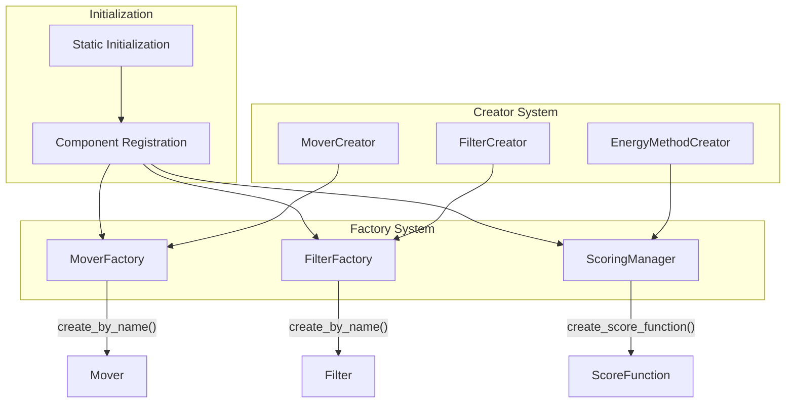

The registration and factory system consists of:
- Factory classes that maintain mappings from names to creator functions
- Creator classes that implement the creation logic for specific types
- Registrator classes that register creators with factories
- Static initialization that ensures registration happens at program startup

This system enables a modular architecture where new components can be added by simply including new source files in the build.

Sources: [source/src/core/init/init.cc](), [source/src/protocols/init/init.MoverRegistrators.ihh](), [source/src/protocols/init/init.FilterRegistrators.ihh]()

## RosettaScripts Interface

RosettaScripts is an XML-based interface to Rosetta's functionality, allowing users to combine movers and filters without writing C++ code.

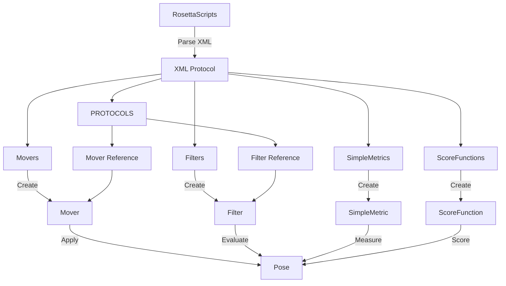

RosettaScripts:
- Parses XML input to create and configure Rosetta components
- Uses the factory system to instantiate movers, filters, and score functions
- Assembles these components into a protocol
- Executes the protocol on input structures

The XML interface allows users to access Rosetta's functionality without writing C++ code, making complex protocols more accessible.

Sources: [source/src/protocols.3.src.settings:702-705](), [source/src/protocols/init/init.MoverCreators.ihh]()

## PyRosetta Interface

PyRosetta provides Python bindings to Rosetta, allowing scripting and interactive use of Rosetta functionality.

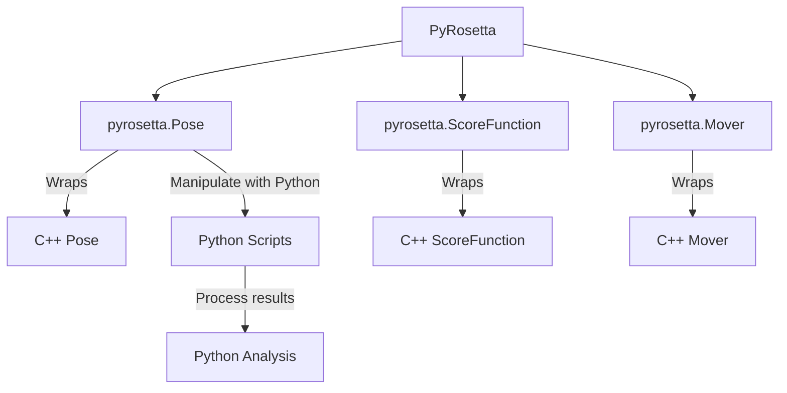

PyRosetta:
- Provides Python classes that wrap C++ Rosetta classes
- Enables interactive use of Rosetta in Python scripts and notebooks
- Allows integration with Python's scientific computing ecosystem
- Facilitates rapid prototyping and development of new protocols

Sources: [source/pilot_apps.src.settings:427-433]()

## Build System

Rosetta uses a custom build system based on CMake and Ninja, configured through specialized settings files.

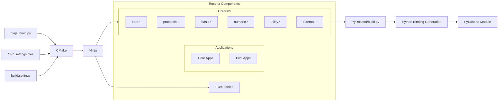

The build system:
- Uses `.src.settings` files to define which source files to compile
- Utilizes CMake to generate build files for different platforms
- Uses Ninja as the underlying build system for efficiency
- Organizes code into multiple libraries (core, protocols, etc.)
- Supports both compiled applications and Python bindings

Sources: [source/pilot_apps.src.settings.all](), [source/src/devel.src.settings]()

## Application Ecosystem

Rosetta includes a wide range of applications for various molecular modeling tasks, organized into public (stable) and pilot (experimental) categories.

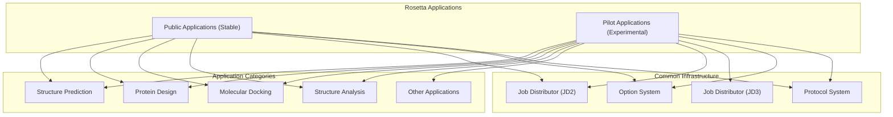

The application ecosystem:
- Provides specialized tools for different molecular modeling tasks
- Uses common infrastructure like job distributors and option parsing
- Organizes applications into public (stable) and pilot (experimental) categories
- Allows for both command-line and scripting interfaces

Sources: [source/src/apps.src.settings](), [source/pilot_apps.src.settings.all]()

## Testing Framework

Rosetta includes a comprehensive testing framework to ensure correctness and prevent regressions.

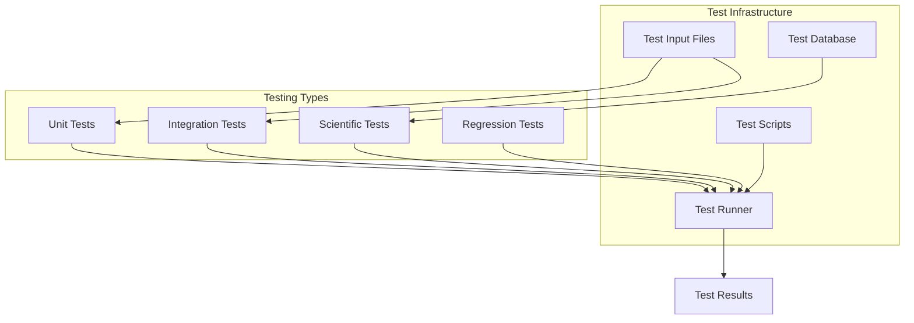

The testing framework:
- Includes unit tests for individual components
- Provides integration tests for complex interactions between components
- Includes scientific tests that validate biological accuracy
- Uses regression tests to prevent functionality changes

Sources: [source/test/core.test.settings](), [source/test/protocols.test.settings]()

## Summary

The Rosetta software suite employs a modular, object-oriented architecture with several key components:

1. **Core Data Structures**: `Pose`, `Conformation`, `Residue`, and `ResidueType` form the foundation for representing molecular structures.

2. **Scoring System**: The `ScoreFunction`, `EnergyMethod`, and `Energies` classes evaluate the energy of molecular structures.

3. **Protocol System**: `Mover`s transform structures, `Filter`s evaluate them, and factories create these components.

4. **I/O System**: Handles reading and writing structures in various formats.

5. **Registration System**: Allows extension of functionality through component registration.

6. **Interfaces**: RosettaScripts (XML) and PyRosetta (Python) provide accessible interfaces to Rosetta functionality.

7. **Build System**: Manages compilation of components and creation of applications.

The architecture emphasizes modularity, extensibility, and reusability, allowing for easy addition of new functionality without modifying existing code.

Sources: [source/src/core/chemical/ResidueType.cc](), [source/src/core/pose/Pose.cc](), [source/src/core/conformation/Conformation.cc](), [source/src/core/scoring/ScoreTypeManager.cc](), [source/src/protocols/init/init.MoverRegistrators.ihh]()

---