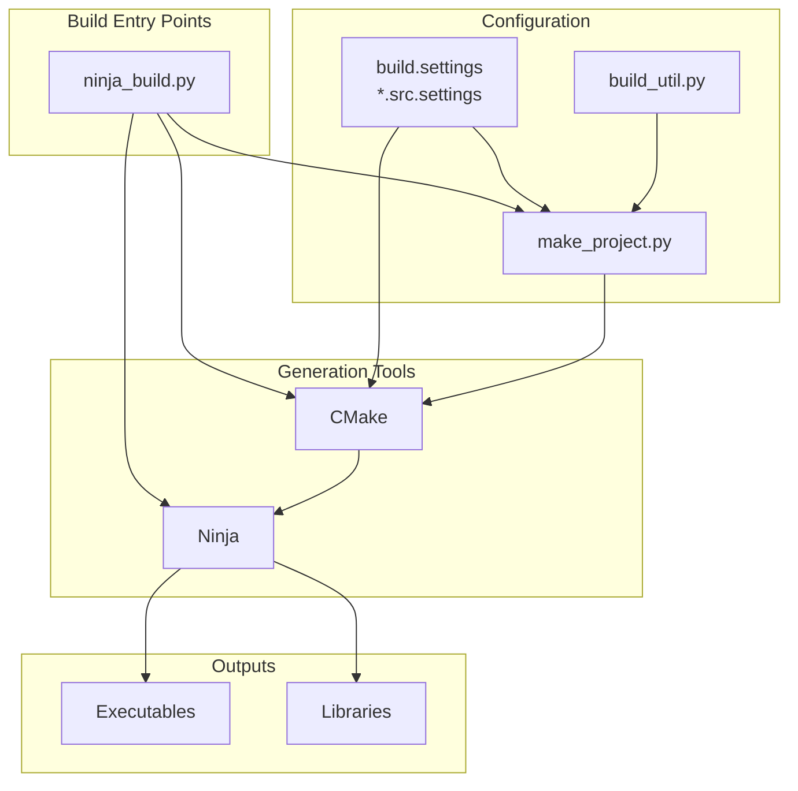
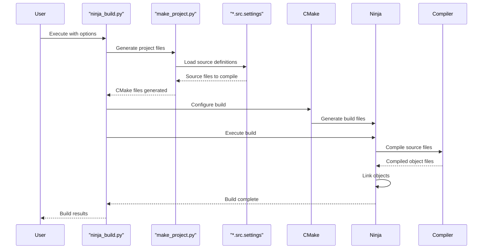
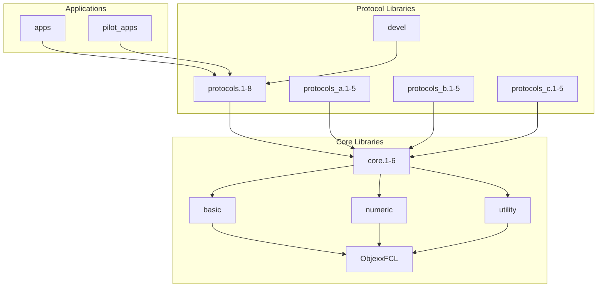
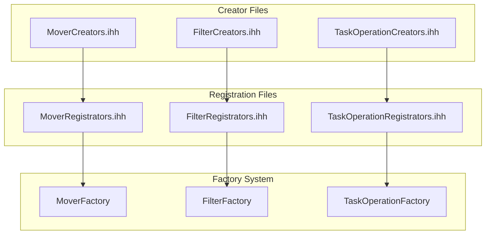

# Build System

<details>
<summary>Relevant source files</summary>

The following files were used as context for generating this wiki page:

- [.benchmark-signature](.benchmark-signature)
- [database/citations/rosetta_citations.txt](database/citations/rosetta_citations.txt)
- [source/cmake/README](source/cmake/README)
- [source/cmake/build/build.post.cmake](source/cmake/build/build.post.cmake)
- [source/cmake/build/build.test.cmake](source/cmake/build/build.test.cmake)
- [source/cmake/build_util.py](source/cmake/build_util.py)
- [source/cmake/gen_cmake_build.py](source/cmake/gen_cmake_build.py)
- [source/cmake/make_new_build.py](source/cmake/make_new_build.py)
- [source/cmake/make_project.py](source/cmake/make_project.py)
- [source/cmake/smart_symlink.py](source/cmake/smart_symlink.py)
- [source/external/cxxtest/cxxtestgen.py](source/external/cxxtest/cxxtestgen.py)
- [source/external/libxml2/trio.c](source/external/libxml2/trio.c)
- [source/ninja_build.py](source/ninja_build.py)
- [source/src/apps.src.settings](source/src/apps.src.settings)
- [source/src/core/chemical/ElementSet.cc](source/src/core/chemical/ElementSet.cc)
- [source/src/core/simple_metrics/PerResidueProbabilitiesMetric.cc](source/src/core/simple_metrics/PerResidueProbabilitiesMetric.cc)
- [source/src/core/simple_metrics/PerResidueProbabilitiesMetric.hh](source/src/core/simple_metrics/PerResidueProbabilitiesMetric.hh)
- [source/src/devel.src.settings](source/src/devel.src.settings)
- [source/src/devel/denovo_design/ConnectJumps.cc](source/src/devel/denovo_design/ConnectJumps.cc)
- [source/src/devel/denovo_design/ConnectJumps.hh](source/src/devel/denovo_design/ConnectJumps.hh)
- [source/src/devel/denovo_design/filters/FoldabilityFilter.cc](source/src/devel/denovo_design/filters/FoldabilityFilter.cc)
- [source/src/devel/denovo_design/filters/FoldabilityFilter.hh](source/src/devel/denovo_design/filters/FoldabilityFilter.hh)
- [source/src/devel/denovo_design/task_operations/HighestEnergyRegion.cc](source/src/devel/denovo_design/task_operations/HighestEnergyRegion.cc)
- [source/src/devel/denovo_design/task_operations/HighestEnergyRegion.hh](source/src/devel/denovo_design/task_operations/HighestEnergyRegion.hh)
- [source/src/devel/denovo_design/task_operations/HighestEnergyRegionCreator.hh](source/src/devel/denovo_design/task_operations/HighestEnergyRegionCreator.hh)
- [source/src/devel/init.cc](source/src/devel/init.cc)
- [source/src/pilot_apps.src.settings.all](source/src/pilot_apps.src.settings.all)
- [source/src/protocols.3.src.settings](source/src/protocols.3.src.settings)
- [source/src/protocols.4.src.settings](source/src/protocols.4.src.settings)
- [source/src/protocols.7.src.settings](source/src/protocols.7.src.settings)
- [source/src/protocols/carbohydrates/RingPlaneFlipMover.cc](source/src/protocols/carbohydrates/RingPlaneFlipMover.cc)
- [source/src/protocols/carbohydrates/RingPlaneFlipMover.hh](source/src/protocols/carbohydrates/RingPlaneFlipMover.hh)
- [source/src/protocols/carbohydrates/RingPlaneFlipMoverCreator.hh](source/src/protocols/carbohydrates/RingPlaneFlipMoverCreator.hh)
- [source/src/protocols/carbohydrates/TautomerizeAnomerMover.cc](source/src/protocols/carbohydrates/TautomerizeAnomerMover.cc)
- [source/src/protocols/carbohydrates/TautomerizeAnomerMover.fwd.hh](source/src/protocols/carbohydrates/TautomerizeAnomerMover.fwd.hh)
- [source/src/protocols/carbohydrates/TautomerizeAnomerMover.hh](source/src/protocols/carbohydrates/TautomerizeAnomerMover.hh)
- [source/src/protocols/carbohydrates/TautomerizeAnomerMoverCreator.hh](source/src/protocols/carbohydrates/TautomerizeAnomerMoverCreator.hh)
- [source/src/protocols/denovo_design/calculators/CavityCalculator.cc](source/src/protocols/denovo_design/calculators/CavityCalculator.cc)
- [source/src/protocols/denovo_design/calculators/CavityCalculator.hh](source/src/protocols/denovo_design/calculators/CavityCalculator.hh)
- [source/src/protocols/denovo_design/filters/CavityVolumeFilter.cc](source/src/protocols/denovo_design/filters/CavityVolumeFilter.cc)
- [source/src/protocols/denovo_design/filters/CavityVolumeFilter.fwd.hh](source/src/protocols/denovo_design/filters/CavityVolumeFilter.fwd.hh)
- [source/src/protocols/denovo_design/filters/CavityVolumeFilter.hh](source/src/protocols/denovo_design/filters/CavityVolumeFilter.hh)
- [source/src/protocols/denovo_design/filters/CavityVolumeFilterCreator.hh](source/src/protocols/denovo_design/filters/CavityVolumeFilterCreator.hh)
- [source/src/protocols/esm_perplexity/EsmPerplexityTensorflowProtocol.cc](source/src/protocols/esm_perplexity/EsmPerplexityTensorflowProtocol.cc)
- [source/src/protocols/esm_perplexity/EsmPerplexityTensorflowProtocol.hh](source/src/protocols/esm_perplexity/EsmPerplexityTensorflowProtocol.hh)
- [source/src/protocols/esm_perplexity/PerResidueEsmProbabilitiesMetric.cc](source/src/protocols/esm_perplexity/PerResidueEsmProbabilitiesMetric.cc)
- [source/src/protocols/esm_perplexity/PseudoPerplexityMetric.cc](source/src/protocols/esm_perplexity/PseudoPerplexityMetric.cc)
- [source/src/protocols/esm_perplexity/PseudoPerplexityMetric.fwd.hh](source/src/protocols/esm_perplexity/PseudoPerplexityMetric.fwd.hh)
- [source/src/protocols/esm_perplexity/PseudoPerplexityMetric.hh](source/src/protocols/esm_perplexity/PseudoPerplexityMetric.hh)
- [source/src/protocols/esm_perplexity/PseudoPerplexityMetricCreator.hh](source/src/protocols/esm_perplexity/PseudoPerplexityMetricCreator.hh)
- [source/src/protocols/init/init.FilterCreators.ihh](source/src/protocols/init/init.FilterCreators.ihh)
- [source/src/protocols/init/init.FilterRegistrators.ihh](source/src/protocols/init/init.FilterRegistrators.ihh)
- [source/src/protocols/init/init.MoverCreators.ihh](source/src/protocols/init/init.MoverCreators.ihh)
- [source/src/protocols/init/init.MoverRegistrators.ihh](source/src/protocols/init/init.MoverRegistrators.ihh)
- [source/src/protocols/inverse_folding/MIFST.cc](source/src/protocols/inverse_folding/MIFST.cc)
- [source/src/protocols/inverse_folding/MIFST.hh](source/src/protocols/inverse_folding/MIFST.hh)
- [source/src/protocols/inverse_folding/MIFSTProbabilitiesMetric.cc](source/src/protocols/inverse_folding/MIFSTProbabilitiesMetric.cc)
- [source/src/protocols/inverse_folding/util.cc](source/src/protocols/inverse_folding/util.cc)
- [source/src/protocols/inverse_folding/util.hh](source/src/protocols/inverse_folding/util.hh)
- [source/src/protocols/protein_interface_design/movers/SecretionOptimizationMover.cc](source/src/protocols/protein_interface_design/movers/SecretionOptimizationMover.cc)
- [source/src/protocols/protein_interface_design/movers/SecretionOptimizationMover.fwd.hh](source/src/protocols/protein_interface_design/movers/SecretionOptimizationMover.fwd.hh)
- [source/src/protocols/protein_interface_design/movers/SecretionOptimizationMover.hh](source/src/protocols/protein_interface_design/movers/SecretionOptimizationMover.hh)
- [source/src/protocols/protein_interface_design/movers/SecretionOptimizationMoverCreator.hh](source/src/protocols/protein_interface_design/movers/SecretionOptimizationMoverCreator.hh)
- [source/src/protocols/protein_mpnn/ProteinMPNN.cc](source/src/protocols/protein_mpnn/ProteinMPNN.cc)
- [source/src/protocols/protein_mpnn/ProteinMPNN.hh](source/src/protocols/protein_mpnn/ProteinMPNN.hh)
- [source/src/protocols/protein_mpnn/ProteinMPNNMover.cc](source/src/protocols/protein_mpnn/ProteinMPNNMover.cc)
- [source/src/protocols/protein_mpnn/ProteinMPNNProbabilitiesMetric.cc](source/src/protocols/protein_mpnn/ProteinMPNNProbabilitiesMetric.cc)
- [source/src/protocols/protein_mpnn/ProteinMPNNProbabilitiesMetric.hh](source/src/protocols/protein_mpnn/ProteinMPNNProbabilitiesMetric.hh)
- [source/src/protocols/protein_mpnn/util.cc](source/src/protocols/protein_mpnn/util.cc)
- [source/src/protocols/protein_mpnn/util.hh](source/src/protocols/protein_mpnn/util.hh)
- [source/src/protocols/simple_filters/SecretionPredictionFilter.cc](source/src/protocols/simple_filters/SecretionPredictionFilter.cc)
- [source/src/protocols/simple_moves/AddCavitiesMover.cc](source/src/protocols/simple_moves/AddCavitiesMover.cc)
- [source/src/protocols/simple_moves/SampleSequenceFromProbabilities.cc](source/src/protocols/simple_moves/SampleSequenceFromProbabilities.cc)
- [source/src/protocols/simple_moves/SampleSequenceFromProbabilities.hh](source/src/protocols/simple_moves/SampleSequenceFromProbabilities.hh)
- [source/src/protocols_a.5.src.settings](source/src/protocols_a.5.src.settings)
- [source/src/protocols_f.5.src.settings](source/src/protocols_f.5.src.settings)
- [source/test/devel.test.settings](source/test/devel.test.settings)
- [source/test/devel/denovo_design/C5_Z.sym](source/test/devel/denovo_design/C5_Z.sym)
- [source/test/devel/denovo_design/FoldabilityFilter.cxxtest.hh](source/test/devel/denovo_design/FoldabilityFilter.cxxtest.hh)
- [source/test/devel/denovo_design/test_foldability.pdb](source/test/devel/denovo_design/test_foldability.pdb)
- [source/test/devel/init/filter_creators.cxxtest.hh](source/test/devel/init/filter_creators.cxxtest.hh)
- [source/test/protocols.test.settings](source/test/protocols.test.settings)
- [source/test/protocols/esm_perplexity/EsmPerplexity.cxxtest.hh](source/test/protocols/esm_perplexity/EsmPerplexity.cxxtest.hh)
- [source/test/protocols/init/mover_creators.cxxtest.hh](source/test/protocols/init/mover_creators.cxxtest.hh)
- [source/tools/build/basic.settings](source/tools/build/basic.settings)
- [source/tools/build/options.settings](source/tools/build/options.settings)
- [tests/integration/tests/esm_model_perplexity/command.tensorflow](tests/integration/tests/esm_model_perplexity/command.tensorflow)
- [tests/integration/tests/esm_model_perplexity/simple_test.xml](tests/integration/tests/esm_model_perplexity/simple_test.xml)
- [tests/integration/tests/test_degreaser/README.txt](tests/integration/tests/test_degreaser/README.txt)
- [tests/integration/tests/test_degreaser/asym_flags](tests/integration/tests/test_degreaser/asym_flags)

</details>


## Purpose and Scope

This document describes the Rosetta build system, which is responsible for compiling the Rosetta codebase into executable programs and libraries. It explains the main components, configuration options, and process for building Rosetta from source code. The build system is based on CMake and Ninja, with Python scripts that orchestrate the build process.

For information about organizing code and creating new source files, see the [Architecture Overview](#1.1). For testing frameworks, see [Testing and Development](#6).

Sources: [source/ninja_build.py](), [source/cmake/build_util.py](), [source/cmake/make_project.py]()

## Build System Architecture

The Rosetta build system employs a multi-layer architecture to transform source code into executable programs and libraries. The system leverages CMake for configuration and Ninja for efficient parallel compilation.

### Key Components Diagram



- **ninja_build.py**: The main entry point script that coordinates the build process
- **build.settings/src.settings files**: Define which source files to compile and how
- **make_project.py**: Processes source settings and generates project files
- **CMake**: Configures the build environment and generates Ninja build files
- **Ninja**: The build tool that actually compiles the code in parallel

Sources: [source/ninja_build.py](), [source/cmake/make_project.py:30-66]()

## Build Process Workflow

The build process involves several steps, as illustrated in the following diagram:



1. User invokes `ninja_build.py` with desired build options
2. The script processes configuration and calls `make_project.py`
3. `make_project.py` processes the source settings files to determine what to build
4. CMake is invoked to configure the build environment and generate Ninja build files
5. Ninja compiles the source files and links them into executables and libraries
6. Results are returned to the user

Sources: [source/ninja_build.py:42-70](), [source/cmake/make_project.py:33-61]()

## Source Settings Files

The Rosetta build system uses `.src.settings` files to define which source files should be compiled. These files are Python scripts that define dictionaries of sources organized by directory.

### Structure and Format

Source settings files follow this general format:

```python
sources = {
    "directory_path": [
        "source_file1",
        "source_file2",
        # more source files
    ],
    # more directories
}
```

The `sources` dictionary maps directory paths to lists of source files. For example, in `protocols.3.src.settings`:

```python
sources = {
    "protocols/simple_pose_metric_calculators": [
        "BuriedUnsatisfiedPolarsCalculator",
        "NumberHBondsCalculator",
    ],
    "protocols/aa_composition": [
        "AddCompositionConstraintMover",
        "AddMHCEpitopeConstraintMover",
        # more files
    ],
    # more directories
}
```

Each project in Rosetta has its own `.src.settings` file that defines the sources for that project.

Sources: [source/src/protocols.3.src.settings:12-37](), [source/src/pilot_apps.src.settings.all:27-184]()

## Project Organization

Rosetta's codebase is organized into multiple projects, with dependencies between them:



Each project is defined by its own `.src.settings` file and is compiled into a separate library or set of executables. The subprojects list in the settings files defines the dependencies between projects.

Sources: [source/src/pilot_apps.src.settings.all:1190-1226](), [source/test/protocols.test.settings:890-924]()

## Build Configuration Options

The build system supports various configuration options that control how Rosetta is built:

### Compilers

Rosetta supports multiple compilers, including:
- GCC
- Clang
- ICC (Intel Compiler)
- MSVC (Microsoft Visual C++)

### Build Modes

Different build modes optimize for different purposes:

| Build Mode | Description |
|------------|-------------|
| debug | Includes debugging symbols, minimal optimization |
| release | Optimized for performance, no debugging symbols |
| release_debug | Performance optimizations with debugging symbols |
| release_symbols | Like release, but with debugging symbols |
| profile | Includes profiling information |
| addsan | Address sanitizer for memory error detection |
| tsan | Thread sanitizer for detecting thread safety issues |
| ubsan | Undefined behavior sanitizer |

### Platform Options

The build system supports multiple platforms:
- Linux
- macOS
- Windows (including Cygwin)

### Additional Options

Extra configuration options include:
- cxx14/cxx17/cxx20: C++ standard to use
- mpi: Enable Message Passing Interface for parallelization
- static: Build using static linking
- python: Link to Python interpreter
- openmp: Enable OpenMP for parallel processing
- tensorflow/tensorflow_gpu: Build with TensorFlow support

Sources: [source/tools/build/options.settings:9-210](), [source/tools/build/basic.settings:58-686]()

## Build Commands

### Basic Build Commands

To build Rosetta with default settings:

```bash
./ninja_build.py
```

### Building with Specific Options

To build with a specific compiler and build mode:

```bash
./ninja_build.py --compiler clang --mode release
```

### Building Specific Targets

To build only certain applications:

```bash
./ninja_build.py --target AbinitioRelax score_jd2
```

### Cleaning the Build Directory

To clean the build directory before building:

```bash
./ninja_build.py --clean
```

### Getting Help

To see all available options:

```bash
./ninja_build.py --help
```

Sources: [source/ninja_build.py:44-95](), [source/ninja_build.py:151-226]()

## Component Registration System

Rosetta uses a registration system to make components discoverable at runtime. This is handled during the build process:



During compilation, registrator objects are instantiated as static objects. When the program starts, these objects register their corresponding creator classes with the appropriate factories, making components available through the factory system.

Sources: [source/src/protocols/init/init.MoverRegistrators.ihh:19-41](), [source/src/protocols/init/init.MoverCreators.ihh:15-61](), [source/src/protocols/init/init.FilterRegistrators.ihh:17-80]()

## Versioning and Updating

The build system includes scripts for updating version information and other dependencies:

- `update_version.py`: Updates version information
- `update_options.sh`: Updates build options
- `update_submodules.sh`: Updates Git submodules
- `update_ResidueType_enum_files.sh`: Updates residue type enumeration files

These scripts are automatically called as needed during the build process.

Sources: [source/cmake/make_project.py:17-30]()

## Common Build Issues

### Missing Dependencies

If external dependencies are missing, the build will fail. Ensure all required libraries are installed.

### Compiler Version Compatibility

Different compilers and versions may have different behaviors. The build system supports specific compiler versions listed in the options settings.

### Build Performance

For faster builds:
- Use the Ninja build system (default)
- Enable parallel builds with multiple cores
- Build only the targets you need
- Use ccache if available

Sources: [source/tools/build/options.settings:11-17](), [source/ninja_build.py:151-175]()

## Summary

The Rosetta build system provides a flexible, platform-independent way to compile the Rosetta codebase. It leverages CMake and Ninja for configuration and compilation, with Python scripts that orchestrate the build process. The system supports multiple compilers, build modes, and platforms, allowing users to tailor the build to their specific needs.

---