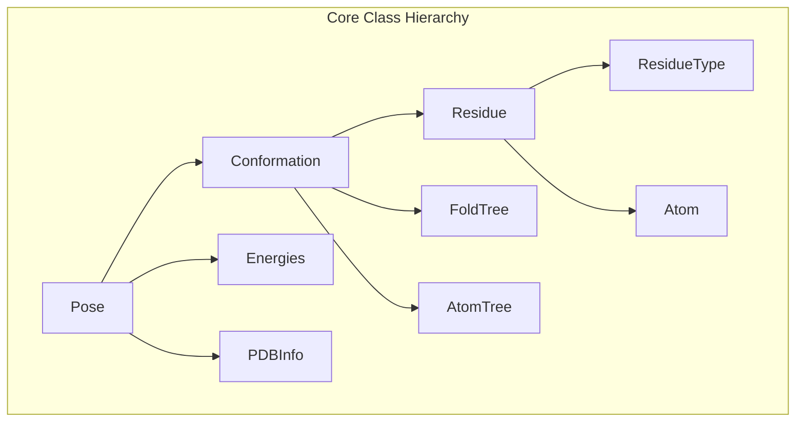
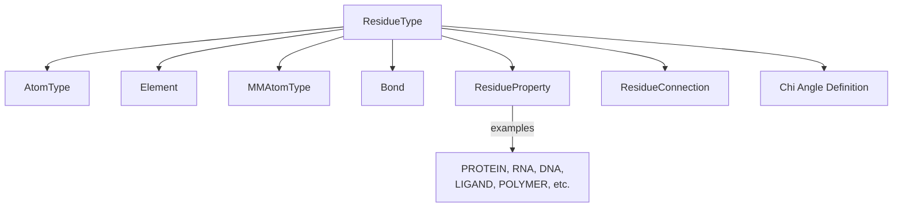
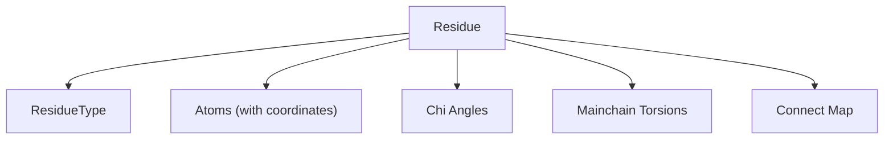
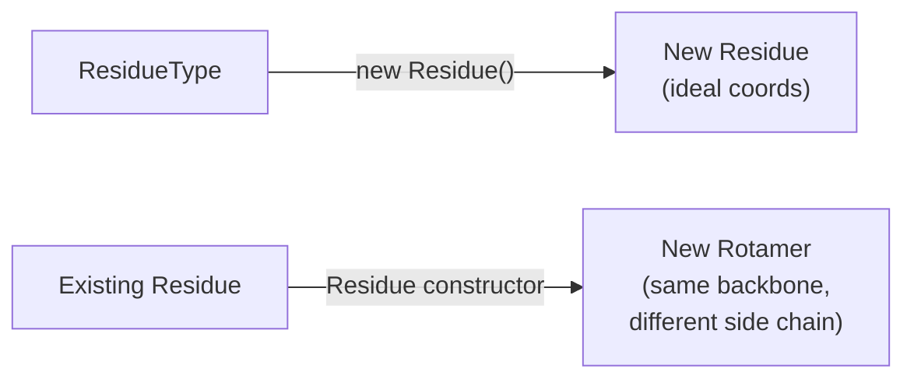
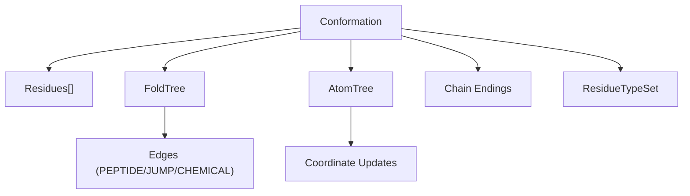
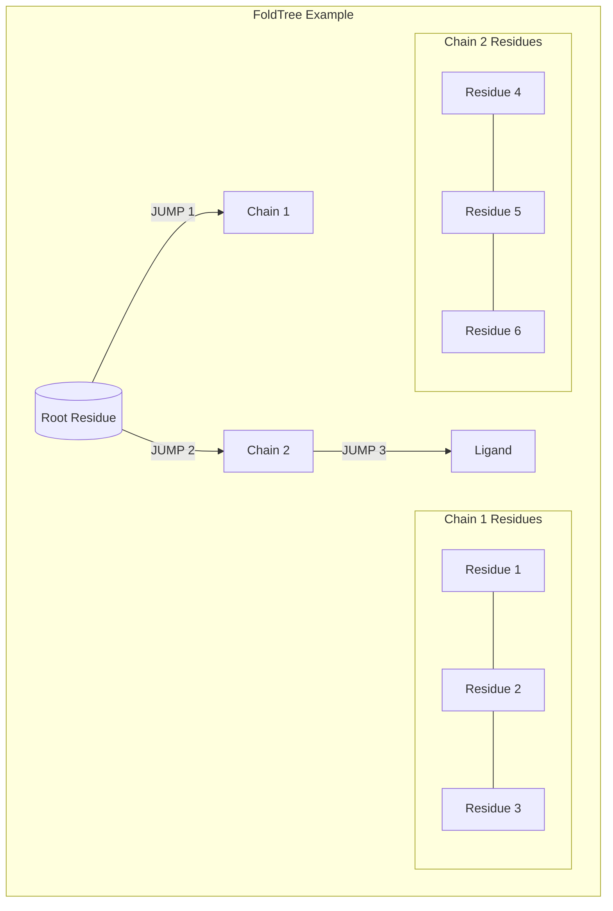
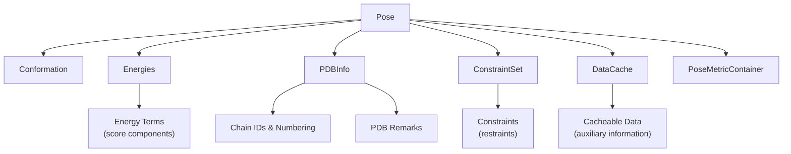
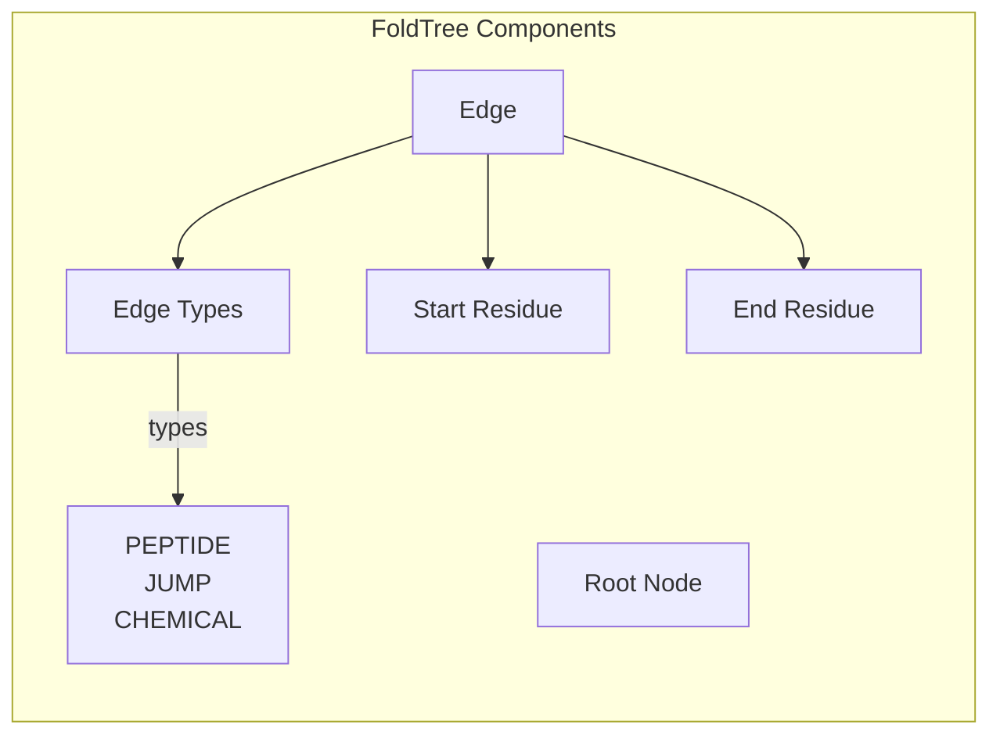
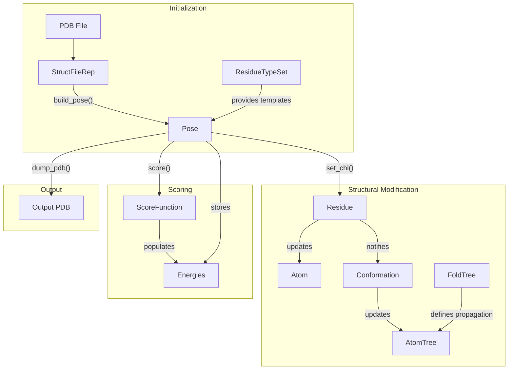

# Core Data Structures

<details>
<summary>Relevant source files</summary>

The following files were used as context for generating this wiki page:

- [source/src/apps/pilot/rhiju/pack_phosphates.cc](source/src/apps/pilot/rhiju/pack_phosphates.cc)
- [source/src/apps/pilot/rhiju/rna_test.cc](source/src/apps/pilot/rhiju/rna_test.cc)
- [source/src/apps/public/rna/util/rna_minimize.cc](source/src/apps/public/rna/util/rna_minimize.cc)
- [source/src/apps/public/rna/util/rna_score.cc](source/src/apps/public/rna/util/rna_score.cc)
- [source/src/core/chemical/AA.cc](source/src/core/chemical/AA.cc)
- [source/src/core/chemical/AA.hh](source/src/core/chemical/AA.hh)
- [source/src/core/chemical/Atom.cc](source/src/core/chemical/Atom.cc)
- [source/src/core/chemical/Atom.fwd.hh](source/src/core/chemical/Atom.fwd.hh)
- [source/src/core/chemical/Atom.hh](source/src/core/chemical/Atom.hh)
- [source/src/core/chemical/ResidueType.cc](source/src/core/chemical/ResidueType.cc)
- [source/src/core/chemical/ResidueType.hh](source/src/core/chemical/ResidueType.hh)
- [source/src/core/chemical/residue_io.cc](source/src/core/chemical/residue_io.cc)
- [source/src/core/chemical/residue_io.hh](source/src/core/chemical/residue_io.hh)
- [source/src/core/chemical/rings/RingConformerSet.cc](source/src/core/chemical/rings/RingConformerSet.cc)
- [source/src/core/chemical/rings/RingConformerSet.hh](source/src/core/chemical/rings/RingConformerSet.hh)
- [source/src/core/chemical/rings/ring_conformer_io.cc](source/src/core/chemical/rings/ring_conformer_io.cc)
- [source/src/core/conformation/Atom.cc](source/src/core/conformation/Atom.cc)
- [source/src/core/conformation/Atom.fwd.hh](source/src/core/conformation/Atom.fwd.hh)
- [source/src/core/conformation/Atom.hh](source/src/core/conformation/Atom.hh)
- [source/src/core/conformation/Conformation.cc](source/src/core/conformation/Conformation.cc)
- [source/src/core/conformation/Conformation.hh](source/src/core/conformation/Conformation.hh)
- [source/src/core/conformation/Residue.cc](source/src/core/conformation/Residue.cc)
- [source/src/core/conformation/Residue.hh](source/src/core/conformation/Residue.hh)
- [source/src/core/conformation/symmetry/MirrorSymmetricConformation.cc](source/src/core/conformation/symmetry/MirrorSymmetricConformation.cc)
- [source/src/core/conformation/symmetry/MirrorSymmetricConformation.hh](source/src/core/conformation/symmetry/MirrorSymmetricConformation.hh)
- [source/src/core/conformation/symmetry/SymmData.cc](source/src/core/conformation/symmetry/SymmData.cc)
- [source/src/core/conformation/symmetry/SymmData.hh](source/src/core/conformation/symmetry/SymmData.hh)
- [source/src/core/conformation/symmetry/SymmetricConformation.cc](source/src/core/conformation/symmetry/SymmetricConformation.cc)
- [source/src/core/conformation/symmetry/SymmetricConformation.hh](source/src/core/conformation/symmetry/SymmetricConformation.hh)
- [source/src/core/conformation/symmetry/SymmetryInfo.cc](source/src/core/conformation/symmetry/SymmetryInfo.cc)
- [source/src/core/conformation/symmetry/SymmetryInfo.hh](source/src/core/conformation/symmetry/SymmetryInfo.hh)
- [source/src/core/conformation/util.cc](source/src/core/conformation/util.cc)
- [source/src/core/conformation/util.hh](source/src/core/conformation/util.hh)
- [source/src/core/energy_methods/D2H_SA_Energy.cc](source/src/core/energy_methods/D2H_SA_Energy.cc)
- [source/src/core/energy_methods/LK_hack.cc](source/src/core/energy_methods/LK_hack.cc)
- [source/src/core/energy_methods/ProQ_Energy.cc](source/src/core/energy_methods/ProQ_Energy.cc)
- [source/src/core/import_pose/libraries/RNA_ChunkLibrary.cc](source/src/core/import_pose/libraries/RNA_ChunkLibrary.cc)
- [source/src/core/io/HeaderInformation.cc](source/src/core/io/HeaderInformation.cc)
- [source/src/core/io/HeaderInformation.fwd.hh](source/src/core/io/HeaderInformation.fwd.hh)
- [source/src/core/io/HeaderInformation.hh](source/src/core/io/HeaderInformation.hh)
- [source/src/core/io/StructFileRep.hh](source/src/core/io/StructFileRep.hh)
- [source/src/core/io/StructFileRepOptions.cc](source/src/core/io/StructFileRepOptions.cc)
- [source/src/core/io/StructFileRepOptions.hh](source/src/core/io/StructFileRepOptions.hh)
- [source/src/core/io/mmcif/cif_writer.cc](source/src/core/io/mmcif/cif_writer.cc)
- [source/src/core/io/pdb/pdb_writer.cc](source/src/core/io/pdb/pdb_writer.cc)
- [source/src/core/io/pdb/pdb_writer.hh](source/src/core/io/pdb/pdb_writer.hh)
- [source/src/core/io/pose_from_sfr/PoseFromSFRBuilder.cc](source/src/core/io/pose_from_sfr/PoseFromSFRBuilder.cc)
- [source/src/core/io/pose_from_sfr/PoseFromSFRBuilder.hh](source/src/core/io/pose_from_sfr/PoseFromSFRBuilder.hh)
- [source/src/core/io/pose_to_sfr/PoseToStructFileRepConverter.cc](source/src/core/io/pose_to_sfr/PoseToStructFileRepConverter.cc)
- [source/src/core/io/pose_to_sfr/PoseToStructFileRepConverter.hh](source/src/core/io/pose_to_sfr/PoseToStructFileRepConverter.hh)
- [source/src/core/io/raw_data/ScoreMap.cc](source/src/core/io/raw_data/ScoreMap.cc)
- [source/src/core/io/rcsb/ExperimentalTechnique.cc](source/src/core/io/rcsb/ExperimentalTechnique.cc)
- [source/src/core/io/util.cc](source/src/core/io/util.cc)
- [source/src/core/io/util.hh](source/src/core/io/util.hh)
- [source/src/core/pose/Pose.cc](source/src/core/pose/Pose.cc)
- [source/src/core/pose/Pose.hh](source/src/core/pose/Pose.hh)
- [source/src/core/pose/rna/RNA_BaseDoubletClasses.hh](source/src/core/pose/rna/RNA_BaseDoubletClasses.hh)
- [source/src/core/pose/rna/util.cc](source/src/core/pose/rna/util.cc)
- [source/src/core/pose/rna/util.hh](source/src/core/pose/rna/util.hh)
- [source/src/core/pose/util.cc](source/src/core/pose/util.cc)
- [source/src/core/pose/util.hh](source/src/core/pose/util.hh)
- [source/src/core/scoring/APBSWrapper.cc](source/src/core/scoring/APBSWrapper.cc)
- [source/src/core/scoring/MembranePotential.cc](source/src/core/scoring/MembranePotential.cc)
- [source/src/core/scoring/SecondaryStructurePotential.cc](source/src/core/scoring/SecondaryStructurePotential.cc)
- [source/src/core/scoring/hbonds/hbonds_geom.cc](source/src/core/scoring/hbonds/hbonds_geom.cc)
- [source/src/core/scoring/hbonds/hbonds_geom.hh](source/src/core/scoring/hbonds/hbonds_geom.hh)
- [source/src/core/simple_metrics/PerResidueProbabilitiesMetric.fwd.hh](source/src/core/simple_metrics/PerResidueProbabilitiesMetric.fwd.hh)
- [source/src/core/simple_metrics/PerResidueProbabilitiesMetricCreator.fwd.hh](source/src/core/simple_metrics/PerResidueProbabilitiesMetricCreator.fwd.hh)
- [source/src/core/simple_metrics/SimpleMetricData.cc](source/src/core/simple_metrics/SimpleMetricData.cc)
- [source/src/core/simple_metrics/SimpleMetricData.hh](source/src/core/simple_metrics/SimpleMetricData.hh)
- [source/src/core/simple_metrics/SimpleMetricStruct.hh](source/src/core/simple_metrics/SimpleMetricStruct.hh)
- [source/src/numeric/HomogeneousTransform.hh](source/src/numeric/HomogeneousTransform.hh)
- [source/src/protocols/jumping/DisulfPairingLibrary.cc](source/src/protocols/jumping/DisulfPairingLibrary.cc)
- [source/src/protocols/jumping/PairingLibrary.cc](source/src/protocols/jumping/PairingLibrary.cc)
- [source/src/protocols/ncbb/oop/OopCreatorMover.hh](source/src/protocols/ncbb/oop/OopCreatorMover.hh)
- [source/src/python/PyRosetta/src/test/T010_LoadPDB.py](source/src/python/PyRosetta/src/test/T010_LoadPDB.py)
- [source/src/python/PyRosetta/src/test/data/test_in.silent](source/src/python/PyRosetta/src/test/data/test_in.silent)
- [source/test/core/chemical/residue_io.cxxtest.hh](source/test/core/chemical/residue_io.cxxtest.hh)
- [source/test/core/chemical/rings/ring_conformer_io.cxxtest.hh](source/test/core/chemical/rings/ring_conformer_io.cxxtest.hh)
- [source/test/core/chemical/rings/util.cxxtest.hh](source/test/core/chemical/rings/util.cxxtest.hh)
- [source/test/core/conformation/util.cxxtest.hh](source/test/core/conformation/util.cxxtest.hh)
- [source/test/core/io/StructFileRep.cxxtest.hh](source/test/core/io/StructFileRep.cxxtest.hh)
- [source/test/core/io/pose_from_sfr/1IJ3_cleaned.pdb](source/test/core/io/pose_from_sfr/1IJ3_cleaned.pdb)
- [source/test/core/io/pose_from_sfr/PoseFromSFRBuilder.cxxtest.hh](source/test/core/io/pose_from_sfr/PoseFromSFRBuilder.cxxtest.hh)
- [source/test/core/io/pose_to_sfr/PoseToStructFileRepConverter.cxxtest.hh](source/test/core/io/pose_to_sfr/PoseToStructFileRepConverter.cxxtest.hh)
- [source/test/core/pose/util.cxxtest.hh](source/test/core/pose/util.cxxtest.hh)
- [source/test/core/scoring/hbonds/HBondDerivTest.cxxtest.hh](source/test/core/scoring/hbonds/HBondDerivTest.cxxtest.hh)
- [source/test/protocols/optimize_weights/DDGBindOptEData.cxxtest.hh](source/test/protocols/optimize_weights/DDGBindOptEData.cxxtest.hh)
- [tests/integration/tests/secondary_structure_output/auto_options](tests/integration/tests/secondary_structure_output/auto_options)
- [tests/integration/tests/secondary_structure_output/options](tests/integration/tests/secondary_structure_output/options)

</details>


This page describes the foundational data structures used throughout the Rosetta molecular modeling suite. These structures represent biomolecular systems and their components, from individual atoms to complete macromolecules. Understanding these core structures is essential for working with Rosetta, as they form the basis for all simulations, analyses, and manipulations of molecular structures.

For information about the scoring system that evaluates these structures, see [Scoring System](#3). For details on protocols that manipulate these structures, see [Protocol System](#4).

## Hierarchical Organization

Rosetta's core data structures follow a hierarchical organization, where smaller components are combined to create more complex structures. At the highest level is the `Pose`, which represents an entire molecular structure. A `Pose` contains a `Conformation`, which in turn is composed of `Residue` objects. Each `Residue` references a specific `ResidueType` that defines its chemical identity.



Sources: [source/src/core/pose/Pose.hh:135-147](), [source/src/core/conformation/Conformation.hh:91-125](), [source/src/core/conformation/Residue.hh:84-133](), [source/src/core/chemical/ResidueType.hh:96-124]()

## ResidueType

`ResidueType` defines the chemical properties of a residue (e.g., amino acid, nucleotide, ligand) without specifying its spatial coordinates in a particular molecular context. It serves as a template from which individual `Residue` instances are created.

### Key Properties

- **Atoms**: Defines the composition, atom types, and ideal geometry
- **Bonds**: Specifies connectivity between atoms
- **Torsion Angles**: Defines rotatable bonds (chi angles)
- **Connectivity**: Defines how residues can connect to others (e.g., peptide bonds)
- **Properties**: Indicates characteristics like polarity, charge, aromaticity

### Chemical Information

`ResidueType` maintains references to several important data structures:

- **AtomType**: Defines chemical properties of atoms
- **Element**: Specifies the chemical element of each atom
- **MMAtomType**: For molecular mechanics force field typing
- **Atomic Charges**: Both formal and partial charges
- **Orbital Information**: For specialized calculations involving electrons



Sources: [source/src/core/chemical/ResidueType.hh:124-177](), [source/src/core/chemical/ResidueType.cc:90-177]()

### Creation and Immutability

`ResidueType` is immutable once created. It is typically loaded from a params file using the `MutableResidueType` intermediate class:


Sources: [source/src/core/chemical/ResidueType.cc:96-126](), [source/src/core/chemical/residue_io.cc:80-200]()

## Residue

`Residue` represents an instance of a `ResidueType` positioned in 3D space. It combines the chemical definition from `ResidueType` with specific spatial coordinates. It also stores instance-specific information such as sequence position and chain ID.

### Key Properties

- **Coordinates**: 3D positions of all atoms
- **Torsion Angles**: Current values of phi, psi, omega, and chi angles
- **Sequence Information**: Position and chain ID
- **Residue Connections**: Actual connections to other residues



Sources: [source/src/core/conformation/Residue.hh:84-120](), [source/src/core/conformation/Residue.cc:92-149]()

### Creation and Modification

Residues can be created directly from a `ResidueType` or by copying another `Residue`. When creating a rotamer (alternative side-chain conformation), a new `Residue` is created with the same backbone but different chi angles:



Sources: [source/src/core/conformation/Residue.cc:92-246]()

## Conformation

`Conformation` is a container for a collection of `Residue` objects that form a complete molecular structure. It manages residue-residue relationships and handles the kinematics (how movement of one part affects others) through the `FoldTree` and `AtomTree` classes.

### Key Properties

- **Residue Collection**: Container of all residues
- **FoldTree**: Defines kinematic connectivity
- **AtomTree**: Implements coordinate calculations
- **Chain Information**: Manages chain breaks and IDs



Sources: [source/src/core/conformation/Conformation.hh:91-125](), [source/src/core/conformation/Conformation.cc:109-196]()

### Kinematic Control with FoldTree

The `FoldTree` defines how movements propagate through the structure. It consists of edges that can be:

- **PEPTIDE**: Standard peptide bond connection
- **JUMP**: Connection between non-bonded residues (e.g., between chains)
- **CHEMICAL**: Non-standard chemical connection (e.g., disulfide bonds)



Sources: [source/src/core/conformation/Conformation.cc:813-847](), [source/src/core/pose/util.cc:153-315]()

## Pose

`Pose` is the top-level container that represents a complete molecular structure. It combines a `Conformation` with scoring information (`Energies`), constraints, and data needed for mapping to PDB files (`PDBInfo`).

### Key Components

- **Conformation**: Contains residues and kinematics
- **Energies**: Stores energy terms and values
- **PDBInfo**: Maps to PDB file information
- **Constraints**: Restraints applied during scoring/modeling
- **Data Cache**: Additional data associated with the pose



Sources: [source/src/core/pose/Pose.hh:125-150](), [source/src/core/pose/Pose.cc:108-142]()

### Creation and Manipulation

Poses are typically created by reading external files (PDB, mmCIF) using a conversion pipeline:


Sources: [source/src/core/io/pose_from_sfr/PoseFromSFRBuilder.cc:115-140](), [source/src/core/pose/Pose.cc:169-195]()

## Key Support Classes

### FoldTree

`FoldTree` defines the kinematic connectivity of residues in a molecular structure. It's a directed graph where:

- Nodes represent residues
- Edges represent connections between residues
- Edge types can be PEPTIDE, JUMP, or CHEMICAL
- A root node is defined as the reference point



Sources: [source/src/core/pose/util.cc:152-315](), [source/src/core/conformation/Conformation.cc:813-833]()

### AtomTree

`AtomTree` implements the actual coordinate calculations based on the `FoldTree`. It:

- Tracks atom coordinates
- Updates coordinates when torsion angles change
- Propagates changes according to the FoldTree

Sources: [source/src/core/conformation/Conformation.cc:126-137](), [source/src/core/conformation/Conformation.hh:744-780]()

## Data Flow Between Core Structures

This diagram illustrates how information flows between core data structures during typical operations:



Sources: [source/src/core/io/pose_from_sfr/PoseFromSFRBuilder.cc:115-140](), [source/src/core/pose/Pose.cc:325-425]()

## Common Operations

Below are some common operations that utilize the core data structures:

### Creating a Pose from a PDB file

```
core::pose::Pose pose;
core::import_pose::pose_from_file(pose, "input.pdb");
```

### Retrieving Atom Coordinates

```
// Get atom coordinates from a Pose
core::Vector const & xyz = pose.residue(residue_index).atom(atom_index).xyz();

// Get coordinates via an AtomID
core::id::AtomID atom_id(atom_index, residue_index);
core::Vector const & xyz = pose.xyz(atom_id);
```

### Modifying Torsion Angles

```
// Set a chi angle
pose.set_chi(chi_index, residue_index, new_angle_degrees);

// Set phi/psi
pose.set_phi(residue_index, new_phi_degrees);
pose.set_psi(residue_index, new_psi_degrees);
```

### Adding a Residue

```
// Append residue via peptide bond
core::conformation::ResidueOP new_residue = core::conformation::ResidueFactory::create_residue(residue_type);
pose.append_residue_by_bond(*new_residue);

// Add residue by jump (non-bonded)
pose.append_residue_by_jump(*new_residue, anchor_residue);
```

Sources: [source/src/core/pose/util.cc:315-440](), [source/src/core/pose/Pose.cc:652-750]()

## Related Systems

The core data structures described here are used by many other systems in Rosetta:

- **Scoring System**: Evaluates energies based on these structures
- **Protocol System**: Modifies these structures to perform modeling tasks
- **I/O System**: Reads/writes these structures from/to external files
- **Symmetry System**: Extends these structures to handle molecular symmetry

For more information on these systems, refer to their respective wiki pages.

---