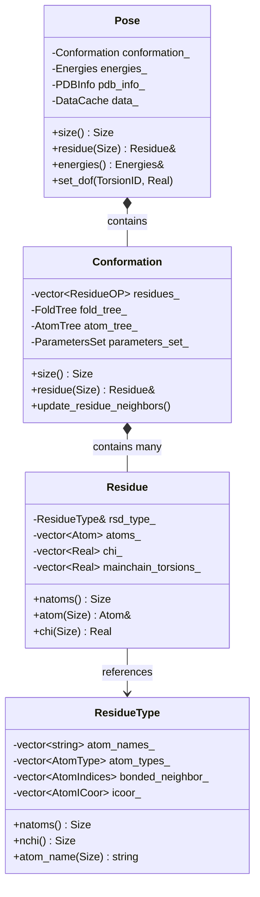
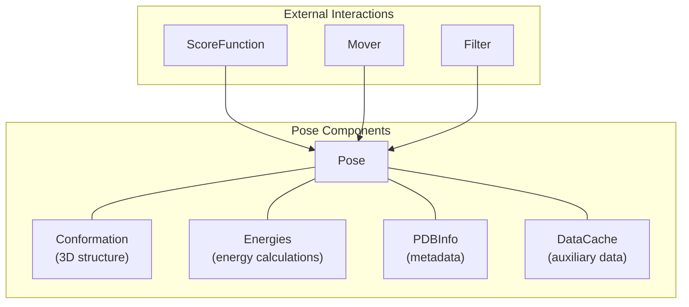
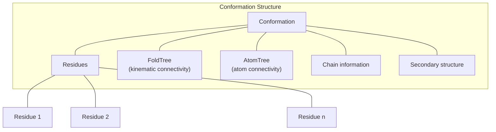
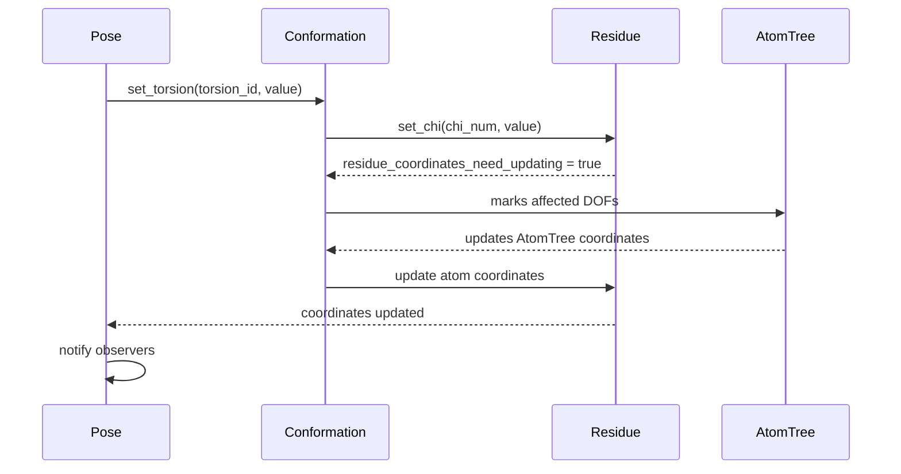
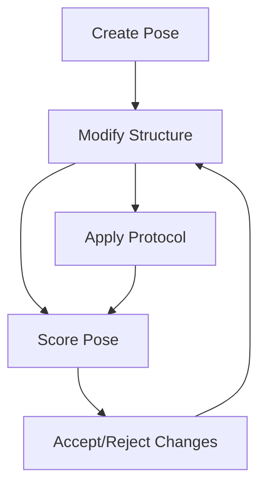
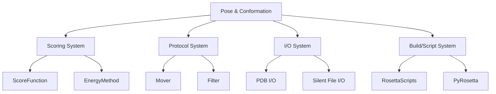

# Pose and Conformation

Relevant source files

The following files were used as context for generating this wiki page:

- [source/src/apps.src.settings](source/src/apps.src.settings)
- [source/src/core/chemical/Atom.cc](source/src/core/chemical/Atom.cc)
- [source/src/core/chemical/Atom.fwd.hh](source/src/core/chemical/Atom.fwd.hh)
- [source/src/core/chemical/Atom.hh](source/src/core/chemical/Atom.hh)
- [source/src/core/chemical/ResidueType.cc](source/src/core/chemical/ResidueType.cc)
- [source/src/core/chemical/ResidueType.hh](source/src/core/chemical/ResidueType.hh)
- [source/src/core/chemical/residue_io.cc](source/src/core/chemical/residue_io.cc)
- [source/src/core/chemical/residue_io.hh](source/src/core/chemical/residue_io.hh)
- [source/src/core/conformation/Atom.cc](source/src/core/conformation/Atom.cc)
- [source/src/core/conformation/Atom.fwd.hh](source/src/core/conformation/Atom.fwd.hh)
- [source/src/core/conformation/Atom.hh](source/src/core/conformation/Atom.hh)
- [source/src/core/conformation/Conformation.cc](source/src/core/conformation/Conformation.cc)
- [source/src/core/conformation/Conformation.hh](source/src/core/conformation/Conformation.hh)
- [source/src/core/conformation/Residue.cc](source/src/core/conformation/Residue.cc)
- [source/src/core/conformation/Residue.hh](source/src/core/conformation/Residue.hh)
- [source/src/core/conformation/symmetry/MirrorSymmetricConformation.cc](source/src/core/conformation/symmetry/MirrorSymmetricConformation.cc)
- [source/src/core/conformation/symmetry/MirrorSymmetricConformation.hh](source/src/core/conformation/symmetry/MirrorSymmetricConformation.hh)
- [source/src/core/conformation/symmetry/SymmData.cc](source/src/core/conformation/symmetry/SymmData.cc)
- [source/src/core/conformation/symmetry/SymmData.hh](source/src/core/conformation/symmetry/SymmData.hh)
- [source/src/core/conformation/symmetry/SymmetricConformation.cc](source/src/core/conformation/symmetry/SymmetricConformation.cc)
- [source/src/core/conformation/symmetry/SymmetricConformation.hh](source/src/core/conformation/symmetry/SymmetricConformation.hh)
- [source/src/core/conformation/symmetry/SymmetryInfo.cc](source/src/core/conformation/symmetry/SymmetryInfo.cc)
- [source/src/core/conformation/symmetry/SymmetryInfo.hh](source/src/core/conformation/symmetry/SymmetryInfo.hh)
- [source/src/core/conformation/util.cc](source/src/core/conformation/util.cc)
- [source/src/core/conformation/util.hh](source/src/core/conformation/util.hh)
- [source/src/core/energy_methods/D2H_SA_Energy.cc](source/src/core/energy_methods/D2H_SA_Energy.cc)
- [source/src/core/energy_methods/LK_hack.cc](source/src/core/energy_methods/LK_hack.cc)
- [source/src/core/energy_methods/ProQ_Energy.cc](source/src/core/energy_methods/ProQ_Energy.cc)
- [source/src/core/import_pose/libraries/RNA_ChunkLibrary.cc](source/src/core/import_pose/libraries/RNA_ChunkLibrary.cc)
- [source/src/core/pose/Pose.cc](source/src/core/pose/Pose.cc)
- [source/src/core/pose/Pose.hh](source/src/core/pose/Pose.hh)
- [source/src/core/pose/util.cc](source/src/core/pose/util.cc)
- [source/src/core/pose/util.hh](source/src/core/pose/util.hh)
- [source/src/core/scoring/APBSWrapper.cc](source/src/core/scoring/APBSWrapper.cc)
- [source/src/core/scoring/SecondaryStructurePotential.cc](source/src/core/scoring/SecondaryStructurePotential.cc)
- [source/src/devel.src.settings](source/src/devel.src.settings)
- [source/src/devel/denovo_design/ConnectJumps.cc](source/src/devel/denovo_design/ConnectJumps.cc)
- [source/src/devel/denovo_design/ConnectJumps.hh](source/src/devel/denovo_design/ConnectJumps.hh)
- [source/src/devel/denovo_design/filters/FoldabilityFilter.cc](source/src/devel/denovo_design/filters/FoldabilityFilter.cc)
- [source/src/devel/denovo_design/filters/FoldabilityFilter.hh](source/src/devel/denovo_design/filters/FoldabilityFilter.hh)
- [source/src/devel/denovo_design/task_operations/HighestEnergyRegion.cc](source/src/devel/denovo_design/task_operations/HighestEnergyRegion.cc)
- [source/src/devel/denovo_design/task_operations/HighestEnergyRegion.hh](source/src/devel/denovo_design/task_operations/HighestEnergyRegion.hh)
- [source/src/devel/denovo_design/task_operations/HighestEnergyRegionCreator.hh](source/src/devel/denovo_design/task_operations/HighestEnergyRegionCreator.hh)
- [source/src/devel/init.cc](source/src/devel/init.cc)
- [source/src/numeric/HomogeneousTransform.hh](source/src/numeric/HomogeneousTransform.hh)
- [source/src/pilot_apps.src.settings.all](source/src/pilot_apps.src.settings.all)
- [source/src/protocols.3.src.settings](source/src/protocols.3.src.settings)
- [source/src/protocols.4.src.settings](source/src/protocols.4.src.settings)
- [source/src/protocols.7.src.settings](source/src/protocols.7.src.settings)
- [source/src/protocols/carbohydrates/RingPlaneFlipMover.cc](source/src/protocols/carbohydrates/RingPlaneFlipMover.cc)
- [source/src/protocols/carbohydrates/RingPlaneFlipMover.hh](source/src/protocols/carbohydrates/RingPlaneFlipMover.hh)
- [source/src/protocols/carbohydrates/RingPlaneFlipMoverCreator.hh](source/src/protocols/carbohydrates/RingPlaneFlipMoverCreator.hh)
- [source/src/protocols/carbohydrates/TautomerizeAnomerMover.cc](source/src/protocols/carbohydrates/TautomerizeAnomerMover.cc)
- [source/src/protocols/carbohydrates/TautomerizeAnomerMover.fwd.hh](source/src/protocols/carbohydrates/TautomerizeAnomerMover.fwd.hh)
- [source/src/protocols/carbohydrates/TautomerizeAnomerMover.hh](source/src/protocols/carbohydrates/TautomerizeAnomerMover.hh)
- [source/src/protocols/carbohydrates/TautomerizeAnomerMoverCreator.hh](source/src/protocols/carbohydrates/TautomerizeAnomerMoverCreator.hh)
- [source/src/protocols/denovo_design/calculators/CavityCalculator.cc](source/src/protocols/denovo_design/calculators/CavityCalculator.cc)
- [source/src/protocols/denovo_design/calculators/CavityCalculator.hh](source/src/protocols/denovo_design/calculators/CavityCalculator.hh)
- [source/src/protocols/denovo_design/filters/CavityVolumeFilter.cc](source/src/protocols/denovo_design/filters/CavityVolumeFilter.cc)
- [source/src/protocols/denovo_design/filters/CavityVolumeFilter.fwd.hh](source/src/protocols/denovo_design/filters/CavityVolumeFilter.fwd.hh)
- [source/src/protocols/denovo_design/filters/CavityVolumeFilter.hh](source/src/protocols/denovo_design/filters/CavityVolumeFilter.hh)
- [source/src/protocols/denovo_design/filters/CavityVolumeFilterCreator.hh](source/src/protocols/denovo_design/filters/CavityVolumeFilterCreator.hh)
- [source/src/protocols/init/init.FilterCreators.ihh](source/src/protocols/init/init.FilterCreators.ihh)
- [source/src/protocols/init/init.FilterRegistrators.ihh](source/src/protocols/init/init.FilterRegistrators.ihh)
- [source/src/protocols/init/init.MoverCreators.ihh](source/src/protocols/init/init.MoverCreators.ihh)
- [source/src/protocols/init/init.MoverRegistrators.ihh](source/src/protocols/init/init.MoverRegistrators.ihh)
- [source/src/protocols/jumping/DisulfPairingLibrary.cc](source/src/protocols/jumping/DisulfPairingLibrary.cc)
- [source/src/protocols/jumping/PairingLibrary.cc](source/src/protocols/jumping/PairingLibrary.cc)
- [source/src/protocols/protein_interface_design/movers/SecretionOptimizationMover.cc](source/src/protocols/protein_interface_design/movers/SecretionOptimizationMover.cc)
- [source/src/protocols/protein_interface_design/movers/SecretionOptimizationMover.fwd.hh](source/src/protocols/protein_interface_design/movers/SecretionOptimizationMover.fwd.hh)
- [source/src/protocols/protein_interface_design/movers/SecretionOptimizationMover.hh](source/src/protocols/protein_interface_design/movers/SecretionOptimizationMover.hh)
- [source/src/protocols/protein_interface_design/movers/SecretionOptimizationMoverCreator.hh](source/src/protocols/protein_interface_design/movers/SecretionOptimizationMoverCreator.hh)
- [source/src/protocols/simple_filters/SecretionPredictionFilter.cc](source/src/protocols/simple_filters/SecretionPredictionFilter.cc)
- [source/src/protocols/simple_moves/AddCavitiesMover.cc](source/src/protocols/simple_moves/AddCavitiesMover.cc)
- [source/src/protocols_a.5.src.settings](source/src/protocols_a.5.src.settings)
- [source/src/protocols_f.5.src.settings](source/src/protocols_f.5.src.settings)
- [source/test/core/chemical/residue_io.cxxtest.hh](source/test/core/chemical/residue_io.cxxtest.hh)
- [source/test/core/chemical/rings/util.cxxtest.hh](source/test/core/chemical/rings/util.cxxtest.hh)
- [source/test/core/conformation/util.cxxtest.hh](source/test/core/conformation/util.cxxtest.hh)
- [source/test/core/pose/util.cxxtest.hh](source/test/core/pose/util.cxxtest.hh)
- [source/test/devel.test.settings](source/test/devel.test.settings)
- [source/test/devel/denovo_design/C5_Z.sym](source/test/devel/denovo_design/C5_Z.sym)
- [source/test/devel/denovo_design/FoldabilityFilter.cxxtest.hh](source/test/devel/denovo_design/FoldabilityFilter.cxxtest.hh)
- [source/test/devel/denovo_design/test_foldability.pdb](source/test/devel/denovo_design/test_foldability.pdb)
- [source/test/devel/init/filter_creators.cxxtest.hh](source/test/devel/init/filter_creators.cxxtest.hh)
- [source/test/protocols.test.settings](source/test/protocols.test.settings)
- [source/test/protocols/init/mover_creators.cxxtest.hh](source/test/protocols/init/mover_creators.cxxtest.hh)
- [tests/integration/tests/test_degreaser/README.txt](tests/integration/tests/test_degreaser/README.txt)
- [tests/integration/tests/test_degreaser/asym_flags](tests/integration/tests/test_degreaser/asym_flags)

This document explains the Pose and Conformation system, which forms the core data representation in the Rosetta molecular modeling suite. Understanding these components is essential for working with Rosetta's codebase and developing new protocols within the framework. For information about the Residue and ResidueType components that work closely with Pose and Conformation, see [Residue and ResidueType](#2.2).

## System Overview

The Pose and Conformation system provides a hierarchical data structure representing molecular structures with their 3D coordinates, chemical properties, connectivity, and energetics. This hierarchy forms the backbone of all structural manipulation and energy calculations in Rosetta.

Sources:
- [source/src/core/pose/Pose.hh]()
- [source/src/core/conformation/Conformation.hh]()
- [source/src/core/conformation/Residue.hh]()
- [source/src/core/chemical/ResidueType.hh]()

## The Pose Object

The Pose is the central data structure representing a complete molecular model in Rosetta. It's the primary object that protocols (usually implemented as Movers) manipulate.

### Core Components

A Pose contains several key components:

1. **Conformation** (`conformation_`): Manages 3D coordinates and molecular connectivity
2. **Energies** (`energies_`): Stores energy calculations for the structure 
3. **PDBInfo** (`pdb_info_`): Contains PDB-specific information like chain IDs and numbering
4. **DataCache** (`data_`): Stores additional data associated with the pose

Sources:
- [source/src/core/pose/Pose.cc:108-127]() - Default initialization function
- [source/src/core/pose/Pose.cc:130-193]() - Copy constructor

### Primary Functionality

The Pose class provides methods for:

- Accessing residues: `residue(Size)` returns a particular residue
- Managing energies: `energies()` accesses the energy calculations
- Setting degrees of freedom: `set_dof(TorsionID, value)` changes torsion angles
- Handling constraints: `add_constraint(Constraint)` adds constraints
- Structural manipulation: Internally manages coordinate updates

## The Conformation Object

The Conformation class is contained within a Pose and manages the 3D structure of the molecular model. It's responsible for the geometric representation and coordinates of all atoms.

### Core Components

A Conformation contains:

1. **Residues** (`residues_`): A vector of Residue objects that make up the molecule
2. **FoldTree** (`fold_tree_`): Defines the kinematic connectivity between residues
3. **AtomTree** (`atom_tree_`): Manages atom-level connectivity and coordinate updates
4. **Chain information** (`chain_endings_`): Records where protein chains begin and end
5. **Secondary structure** (`secstruct_`): Records secondary structure assignments

Sources:
- [source/src/core/conformation/Conformation.cc:116-127]() - Default constructor
- [source/src/core/conformation/Conformation.cc:130-193]() - Copy constructor
- [source/src/core/conformation/Conformation.hh:116-193]() - Class definition

### Primary Functionality

The Conformation class provides methods for:

- Accessing residues: `residue(Size)` returns a reference to a residue
- Managing the fold tree: `fold_tree()` accesses the kinematic connectivity
- Updating coordinates: `update_residue_coordinates()` updates atom positions
- Handling connectivity: `connect_residues()` creates chemical bonds between residues
- Detecting clashes: `detect_self_clash()` checks for atomic overlaps

## Coordinate Update Mechanism

When a degree of freedom (DOF) in a Pose is modified, a cascade of coordinate updates occurs:

Sources:
- [source/src/core/pose/util.cc:93-127]() - Torsion setting functionality
- [source/src/core/conformation/Conformation.cc:200-300]() - Coordinate update methods

## Key Operations

The Pose and Conformation system enables several crucial operations for molecular modeling:

### Common Operations

1. **Creating a Pose**: 
   - From a PDB file using `core::import_pose::pose_from_file()`
   - Programmatically building a Pose residue by residue

2. **Modifying a Pose**:
   - Setting torsion angles: `pose.set_phi()`, `pose.set_psi()`, `pose.set_chi()`
   - Replacing residues: `pose.replace_residue()`
   - Connecting residues: `core::pose::add_variant_type_to_pose_residue()`

3. **Scoring a Pose**:
   - Applying a ScoreFunction: `scorefxn(pose)`
   - Accessing energies: `pose.energies().total_energy()`

4. **Applying Protocols**:
   - Using Movers to make complex changes: `mover.apply(pose)`
   - Common movers include `FastRelax`, `PackRotamersMover`, and `MinMover`

Sources:
- [source/src/core/pose/util.cc]() - Pose utility functions
- [source/src/protocols/init/init.MoverRegistrators.ihh]() - Available Movers
- [source/src/protocols/init/init.FilterRegistrators.ihh]() - Available Filters

## Relationship to Other Systems

The Pose and Conformation system interacts with several other key systems in Rosetta:

Sources:
- [source/src/protocols/init/init.MoverCreators.ihh]() - Integration with protocols system
- [source/src/protocols/init/init.FilterCreators.ihh]() - Integration with filters system

## Conclusion

The Pose and Conformation system serves as the foundation for molecular representation in Rosetta. The Pose provides a high-level interface for structural manipulation and energy calculations, while the Conformation manages the geometric representation and coordinates. Together, they enable the powerful molecular modeling capabilities that Rosetta is known for.

Sources:
- [source/src/core/pose/Pose.cc]() 
- [source/src/core/conformation/Conformation.cc]()
- [source/src/core/conformation/Residue.cc]()
- [source/src/core/chemical/ResidueType.cc]()

---