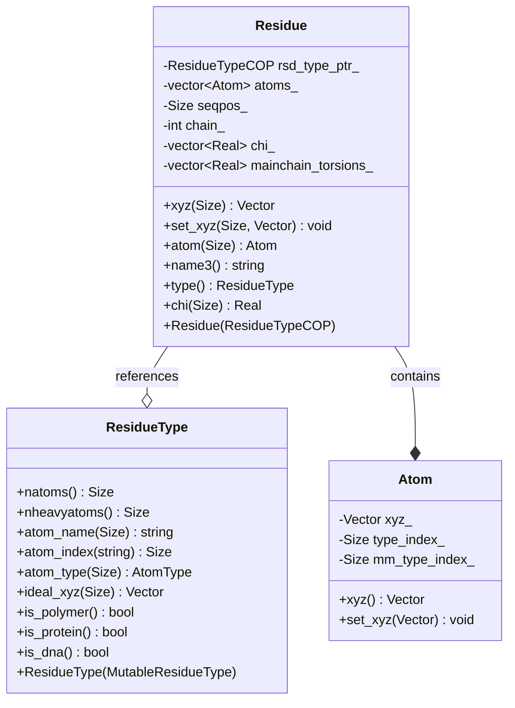
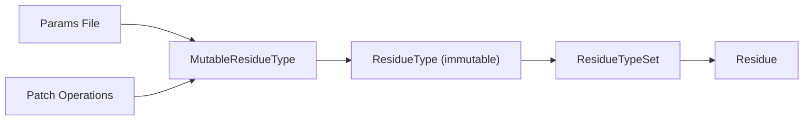
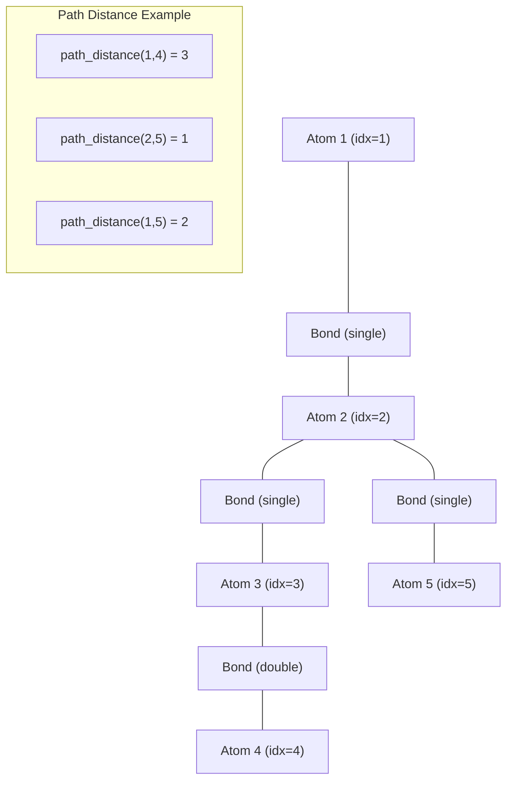
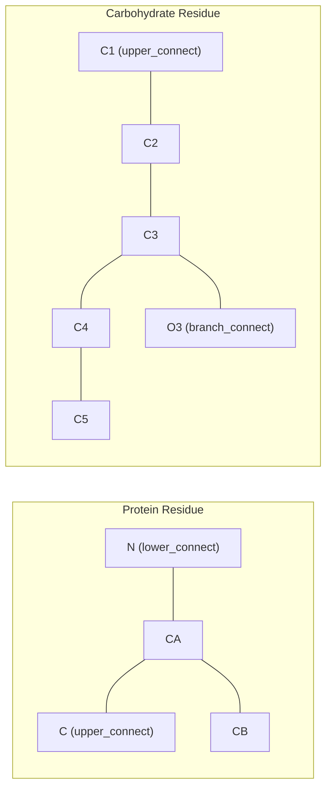
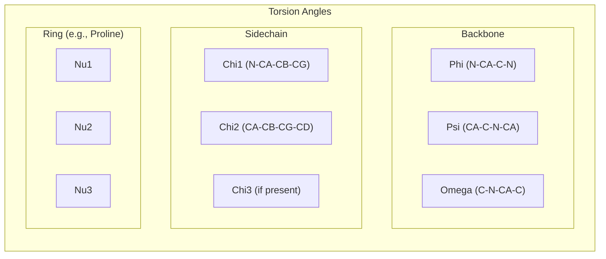
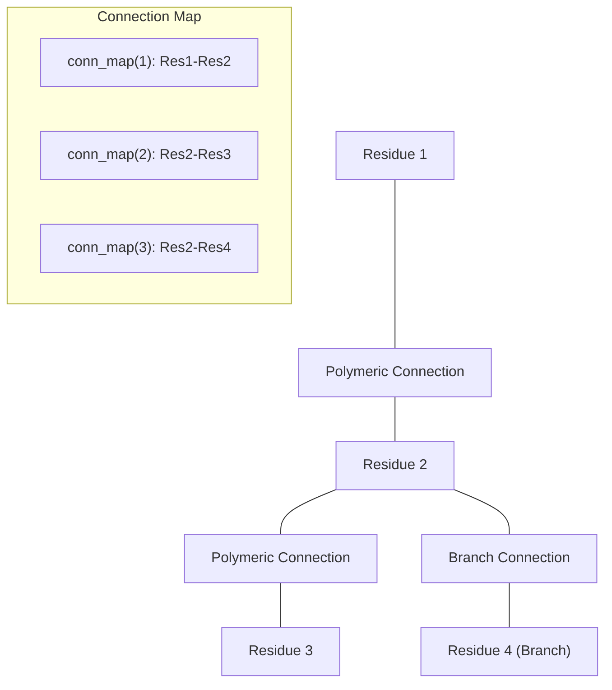
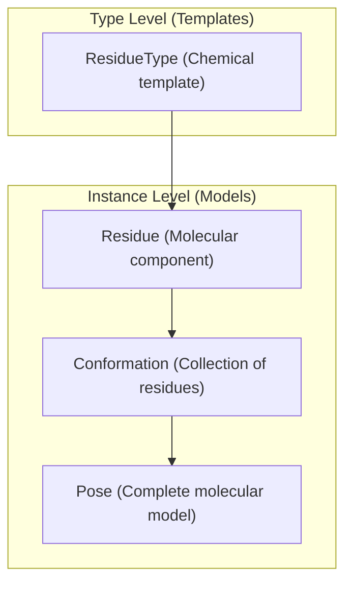
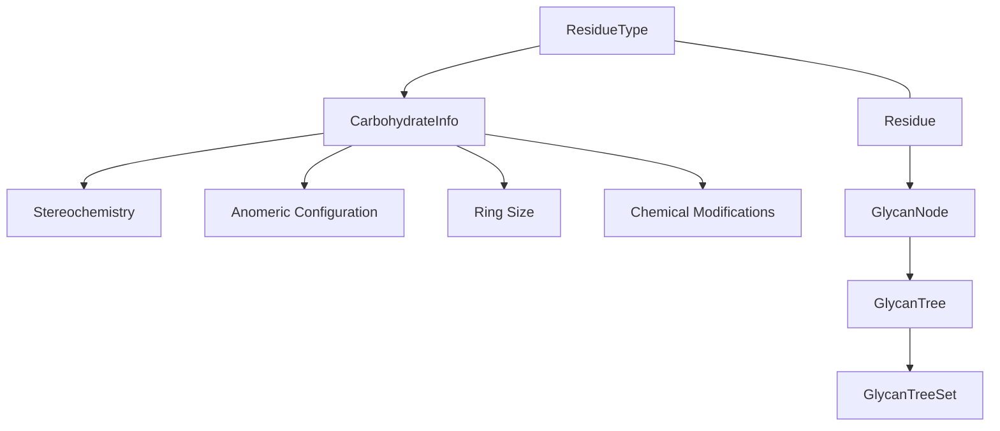
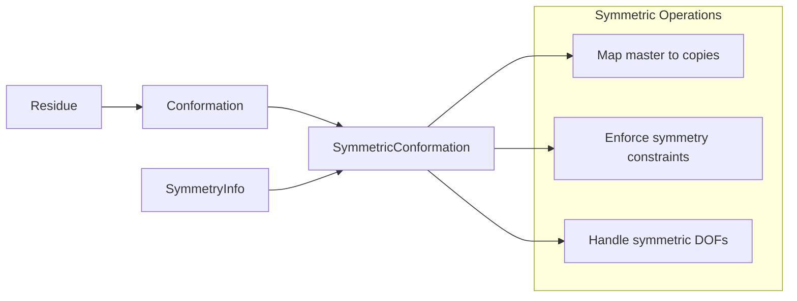

# Residue and ResidueType

<details>
<summary>Relevant source files</summary>

The following files were used as context for generating this wiki page:

- [database/chemical/carbohydrates/sugar_modifications.table](database/chemical/carbohydrates/sugar_modifications.table)
- [database/chemical/residue_type_sets/centroid/patches.txt](database/chemical/residue_type_sets/centroid/patches.txt)
- [database/chemical/residue_type_sets/fa_standard/patches.txt](database/chemical/residue_type_sets/fa_standard/patches.txt)
- [database/chemical/residue_type_sets/fa_standard/patches/carbohydrates/upper_terminus.txt](database/chemical/residue_type_sets/fa_standard/patches/carbohydrates/upper_terminus.txt)
- [source/src/apps/tests/test_CarbohydrateInfo.cc](source/src/apps/tests/test_CarbohydrateInfo.cc)
- [source/src/core/chemical/Atom.cc](source/src/core/chemical/Atom.cc)
- [source/src/core/chemical/Atom.fwd.hh](source/src/core/chemical/Atom.fwd.hh)
- [source/src/core/chemical/Atom.hh](source/src/core/chemical/Atom.hh)
- [source/src/core/chemical/ResidueType.cc](source/src/core/chemical/ResidueType.cc)
- [source/src/core/chemical/ResidueType.hh](source/src/core/chemical/ResidueType.hh)
- [source/src/core/chemical/carbohydrates/CarbohydrateInfo.cc](source/src/core/chemical/carbohydrates/CarbohydrateInfo.cc)
- [source/src/core/chemical/carbohydrates/CarbohydrateInfo.hh](source/src/core/chemical/carbohydrates/CarbohydrateInfo.hh)
- [source/src/core/chemical/carbohydrates/CarbohydrateInfoManager.cc](source/src/core/chemical/carbohydrates/CarbohydrateInfoManager.cc)
- [source/src/core/chemical/carbohydrates/CarbohydrateInfoManager.hh](source/src/core/chemical/carbohydrates/CarbohydrateInfoManager.hh)
- [source/src/core/chemical/carbohydrates/database_io.cc](source/src/core/chemical/carbohydrates/database_io.cc)
- [source/src/core/chemical/carbohydrates/database_io.hh](source/src/core/chemical/carbohydrates/database_io.hh)
- [source/src/core/chemical/residue_io.cc](source/src/core/chemical/residue_io.cc)
- [source/src/core/chemical/residue_io.hh](source/src/core/chemical/residue_io.hh)
- [source/src/core/chemical/residue_properties/general_properties.list](source/src/core/chemical/residue_properties/general_properties.list)
- [source/src/core/chemical/residue_properties/variant_types.list](source/src/core/chemical/residue_properties/variant_types.list)
- [source/src/core/conformation/Atom.cc](source/src/core/conformation/Atom.cc)
- [source/src/core/conformation/Atom.fwd.hh](source/src/core/conformation/Atom.fwd.hh)
- [source/src/core/conformation/Atom.hh](source/src/core/conformation/Atom.hh)
- [source/src/core/conformation/Conformation.cc](source/src/core/conformation/Conformation.cc)
- [source/src/core/conformation/Conformation.hh](source/src/core/conformation/Conformation.hh)
- [source/src/core/conformation/Residue.cc](source/src/core/conformation/Residue.cc)
- [source/src/core/conformation/Residue.hh](source/src/core/conformation/Residue.hh)
- [source/src/core/conformation/symmetry/MirrorSymmetricConformation.cc](source/src/core/conformation/symmetry/MirrorSymmetricConformation.cc)
- [source/src/core/conformation/symmetry/MirrorSymmetricConformation.hh](source/src/core/conformation/symmetry/MirrorSymmetricConformation.hh)
- [source/src/core/conformation/symmetry/SymmData.cc](source/src/core/conformation/symmetry/SymmData.cc)
- [source/src/core/conformation/symmetry/SymmData.hh](source/src/core/conformation/symmetry/SymmData.hh)
- [source/src/core/conformation/symmetry/SymmetricConformation.cc](source/src/core/conformation/symmetry/SymmetricConformation.cc)
- [source/src/core/conformation/symmetry/SymmetricConformation.hh](source/src/core/conformation/symmetry/SymmetricConformation.hh)
- [source/src/core/conformation/symmetry/SymmetryInfo.cc](source/src/core/conformation/symmetry/SymmetryInfo.cc)
- [source/src/core/conformation/symmetry/SymmetryInfo.hh](source/src/core/conformation/symmetry/SymmetryInfo.hh)
- [source/src/core/conformation/util.cc](source/src/core/conformation/util.cc)
- [source/src/core/conformation/util.hh](source/src/core/conformation/util.hh)
- [source/src/core/energy_methods/D2H_SA_Energy.cc](source/src/core/energy_methods/D2H_SA_Energy.cc)
- [source/src/core/energy_methods/LK_hack.cc](source/src/core/energy_methods/LK_hack.cc)
- [source/src/core/energy_methods/ProQ_Energy.cc](source/src/core/energy_methods/ProQ_Energy.cc)
- [source/src/core/import_pose/libraries/RNA_ChunkLibrary.cc](source/src/core/import_pose/libraries/RNA_ChunkLibrary.cc)
- [source/src/core/io/carbohydrates/pose_io.cc](source/src/core/io/carbohydrates/pose_io.cc)
- [source/src/core/pose/Pose.cc](source/src/core/pose/Pose.cc)
- [source/src/core/pose/Pose.hh](source/src/core/pose/Pose.hh)
- [source/src/core/pose/annotated_sequence.cc](source/src/core/pose/annotated_sequence.cc)
- [source/src/core/pose/annotated_sequence.hh](source/src/core/pose/annotated_sequence.hh)
- [source/src/core/pose/carbohydrates/util.cc](source/src/core/pose/carbohydrates/util.cc)
- [source/src/core/pose/carbohydrates/util.hh](source/src/core/pose/carbohydrates/util.hh)
- [source/src/core/pose/util.cc](source/src/core/pose/util.cc)
- [source/src/core/pose/util.hh](source/src/core/pose/util.hh)
- [source/src/core/scoring/APBSWrapper.cc](source/src/core/scoring/APBSWrapper.cc)
- [source/src/core/scoring/SecondaryStructurePotential.cc](source/src/core/scoring/SecondaryStructurePotential.cc)
- [source/src/core/select/jump_selector/JumpIndexSelector.cc](source/src/core/select/jump_selector/JumpIndexSelector.cc)
- [source/src/core/select/jump_selector/JumpIndexSelector.hh](source/src/core/select/jump_selector/JumpIndexSelector.hh)
- [source/src/core/select/movemap/MoveMapFactory.cc](source/src/core/select/movemap/MoveMapFactory.cc)
- [source/src/core/select/movemap/MoveMapFactory.hh](source/src/core/select/movemap/MoveMapFactory.hh)
- [source/src/numeric/HomogeneousTransform.hh](source/src/numeric/HomogeneousTransform.hh)
- [source/src/protocols/jumping/DisulfPairingLibrary.cc](source/src/protocols/jumping/DisulfPairingLibrary.cc)
- [source/src/protocols/jumping/PairingLibrary.cc](source/src/protocols/jumping/PairingLibrary.cc)
- [source/test/core/chemical/carbohydrates/CarbohydrateInfo.cxxtest.hh](source/test/core/chemical/carbohydrates/CarbohydrateInfo.cxxtest.hh)
- [source/test/core/chemical/carbohydrates/codes_to_roots.map](source/test/core/chemical/carbohydrates/codes_to_roots.map)
- [source/test/core/chemical/carbohydrates/database_io.cxxtest.hh](source/test/core/chemical/carbohydrates/database_io.cxxtest.hh)
- [source/test/core/chemical/residue_io.cxxtest.hh](source/test/core/chemical/residue_io.cxxtest.hh)
- [source/test/core/chemical/rings/util.cxxtest.hh](source/test/core/chemical/rings/util.cxxtest.hh)
- [source/test/core/conformation/util.cxxtest.hh](source/test/core/conformation/util.cxxtest.hh)
- [source/test/core/pose/util.cxxtest.hh](source/test/core/pose/util.cxxtest.hh)

</details>


This page documents the `Residue` and `ResidueType` classes in Rosetta, which serve as the fundamental data structures for representing molecular components. Together, they form a type-instance relationship where `ResidueType` defines the chemical template and `Residue` represents a specific instance with position-specific data. For information about the higher-level containers that work with residues, see [Pose and Conformation](#2.1).

## Overview

The Residue-ResidueType relationship follows a type-instance pattern:

- **ResidueType**: A constant, immutable template that defines the chemical properties, ideal geometry, and connectivity of a particular molecular component (like an amino acid, nucleotide, carbohydrate, or ligand).
- **Residue**: A specific instance of a ResidueType with unique coordinates, sequence position, and conformation.



Sources: [source/src/core/chemical/ResidueType.hh:95-124](source/src/core/chemical/ResidueType.hh:95-124), [source/src/core/conformation/Residue.hh:63-85](source/src/core/conformation/Residue.hh:63-85)

## ResidueType

A `ResidueType` defines the chemical identity and properties of a molecular component. These objects are immutable once created and contain all the information needed to create specific instances of residues.

### Creation and Origin

ResidueTypes are created in two primary ways:

1. **From parameter files**: Most ResidueTypes are generated from parameter files (`.params`) stored in the Rosetta database.
2. **From MutableResidueType**: ResidueTypes are constructed from MutableResidueType objects, which are modifiable versions used during initialization and patching.



Sources: [source/src/core/chemical/ResidueType.cc:100-113](source/src/core/chemical/ResidueType.cc:100-113), [source/src/core/chemical/residue_io.cc](source/src/core/chemical/residue_io.cc)

### Atom Representation

ResidueType stores atom information in a well-defined order to optimize performance and facilitate look-up operations:

1. Heavy backbone atoms
2. Heavy sidechain atoms
3. Backbone hydrogens
4. Sidechain hydrogens

```
AtomInfo storage order:
1-N_backbone_heavyatoms_: Heavy backbone atoms
N_backbone_heavyatoms_+1 to nheavyatoms_: Heavy sidechain atoms
nheavyatoms_+1 to first_sidechain_hydrogen_-1: Backbone hydrogens
first_sidechain_hydrogen_ to natoms_: Sidechain hydrogens
```

Each atom is identified by:
- Name (e.g., "CA", "N", "O")
- Index (numerical position in the atom array)
- Type (pointer to an AtomType object)
- Properties (element, charge, connectivity)

Methods for atom access:
- `atom_name(Size index)`: Get atom name by index
- `atom_index(string name)`: Get index by atom name
- `natoms()`: Get total number of atoms
- `nheavyatoms()`: Get number of heavy atoms (non-hydrogen)

Sources: [source/src/core/chemical/ResidueType.hh:384-422](source/src/core/chemical/ResidueType.hh:384-422), [source/src/core/chemical/ResidueType.cc:1099-1132](source/src/core/chemical/ResidueType.cc:1099-1132)

### Bond Representation

ResidueType stores bond information to define the connectivity between atoms:

- Bonds between atoms
- Bond types (single, double, triple, etc.)
- Path distances between atoms (number of bonds that separate them)

Methods for bond access:
- `bonded_neighbor(Size atom_index)`: Get indices of atoms bonded to a given atom
- `atoms_are_bonded(Size atom1, Size atom2)`: Check if two atoms are bonded
- `bond_type(Size atom1, Size atom2)`: Get the type of bond between two atoms
- `path_distance(Size atom1, Size atom2)`: Get the number of bonds in the shortest path between atoms



Sources: [source/src/core/chemical/ResidueType.hh:584-633](source/src/core/chemical/ResidueType.hh:584-633), [source/src/core/chemical/ResidueType.cc:243-293](source/src/core/chemical/ResidueType.cc:243-293)

### Properties

ResidueTypes have various properties that characterize their chemical and physical nature. These properties are defined in the parameter files and are used throughout Rosetta to determine how residues should be treated.

Common properties include:
- `POLYMER`: Indicates the residue can form polymer chains
- `PROTEIN`, `DNA`, `RNA`, `CARBOHYDRATE`: Indicates the molecule type
- `CHARGED`, `POLAR`, `AROMATIC`: Describes chemical characteristics
- `CANONICAL_AA`, `CANONICAL_NUCLEIC`: Indicates if it's a standard building block

Methods to check properties:
- `is_protein()`: Is this a protein residue?
- `is_dna()`: Is this a DNA residue?
- `is_polymer()`: Can this residue form polymer chains?
- `is_charged()`: Does this residue have a net charge?

Sources: [source/src/core/chemical/ResidueType.hh:556-773](source/src/core/chemical/ResidueType.hh:556-773), [source/src/core/chemical/residue_properties/general_properties.list:17-200](source/src/core/chemical/residue_properties/general_properties.list:17-200)

### Connections

ResidueTypes define connection points that determine how residues can link to one another. These are especially important for polymers and branched structures.

Types of connections:
- **Polymeric connections**: Lower and upper connecting atoms for forming polymer chains
- **Non-polymeric connections**: Branch points for tree-like structures

Methods for connections:
- `lower_connect()`: Get the lower polymer connection (e.g., N-terminus in proteins)
- `upper_connect()`: Get the upper polymer connection (e.g., C-terminus in proteins)
- `branch_connect_atoms()`: Get atoms that can form branch connections



Sources: [source/src/core/chemical/ResidueType.hh:426-539](source/src/core/chemical/ResidueType.hh:426-539), [source/src/core/chemical/ResidueType.cc:428-539](source/src/core/chemical/ResidueType.cc:428-539)

## Residue

A `Residue` represents a specific instance of a `ResidueType` with unique coordinates, sequence position, and conformation. Residues are the building blocks used to construct molecular models in Rosetta.

### Creation and Structure

Residues are created in several ways:

1. **From a ResidueType**: Basic instantiation with ideal geometry
2. **From another Residue**: Copy construction or template-based creation (e.g., for rotamers)
3. **From input files**: PDB files, silent files, etc.

Basic structure of a Residue:
- Reference to its ResidueType
- Vector of Atom objects (with coordinates)
- Sequence position and chain ID
- Torsion angles (chi, mainchain, etc.)
- Connection maps to other residues

```cpp
// Typical creation of a Residue
ResidueTypeCOP my_restype = chemical_manager->residue_type_set()->name_map("ALA");
ResidueOP my_residue = conformation::ResidueFactory::create_residue(*my_restype);
```

Sources: [source/src/core/conformation/Residue.cc:92-118](source/src/core/conformation/Residue.cc:92-118), [source/src/core/conformation/Residue.cc:162-206](source/src/core/conformation/Residue.cc:162-206)

### Atom Access and Manipulation

Unlike ResidueType, which provides information about ideal atom positions, Residue stores the actual coordinates of atoms in a specific molecular model.

Methods for atom access:
- `xyz(Size atom_index)`: Get coordinates of an atom by index
- `set_xyz(Size atom_index, Vector coords)`: Set coordinates of an atom
- `atom(Size atom_index)`: Get an Atom object by index
- `atom(string atom_name)`: Get an Atom object by name

```cpp
// Example operations
Vector ca_coords = residue.xyz(residue.atom_index("CA"));  // Get CA coordinates
residue.set_xyz(residue.atom_index("CA"), new_coords);     // Move CA atom
```

Sources: [source/src/core/conformation/Residue.hh:772-829](source/src/core/conformation/Residue.hh:772-829)

### Torsion Angles

Residues store and manipulate torsion angles that define their conformation. These include backbone torsions (phi, psi), sidechain torsions (chi angles), and ring torsions for cyclic structures.

Types of torsion angles:
- **Backbone torsions**: Define the protein backbone conformation
- **Chi angles**: Define the sidechain conformation
- **Nu angles**: Define internal ring conformations

Methods for torsion angles:
- `chi(Size chi_index)`: Get a chi angle value
- `set_chi(Size chi_index, Real value)`: Set a chi angle value
- `mainchain_torsion(Size index)`: Get a backbone torsion angle
- `update_chi_atoms()`: Update atom positions based on chi angles



Sources: [source/src/core/conformation/Residue.hh:931-1000](source/src/core/conformation/Residue.hh:931-1000)

### Residue Connections

Residues maintain connection information that describes how they're linked to other residues in a model. These connections are essential for building complex molecular structures.

Types of connections:
- **Polymeric connections**: Connect residues in a linear chain (protein backbone, DNA backbone)
- **Non-polymeric connections**: Connect residues in branched structures (glycans, modified amino acids)
- **Pseudo-bonds**: Special connections not derived from ResidueType (disulfide bonds, etc.)

Methods for connections:
- `connect_map(Size conn_index)`: Get information about a connection
- `is_bonded(Size other_residue)`: Check if this residue is connected to another
- `connections_to_residue(Size other_residue)`: Get all connections to another residue



Sources: [source/src/core/conformation/Residue.hh:1163-1240](source/src/core/conformation/Residue.hh:1163-1240)

## RelationChain to Higher-Level Structures

Residues don't exist in isolation - they are organized into higher-level structures in Rosetta:



- **Residue** is a single molecular component (amino acid, nucleotide, etc.)
- **Conformation** is a collection of residues with defined spatial relationships
- **Pose** is a complete molecular model that includes a Conformation and additional information (energies, PDB info, etc.)

Sources: [source/src/core/pose/Pose.cc:135-142](source/src/core/pose/Pose.cc:135-142), [source/src/core/conformation/Conformation.cc:126-132](source/src/core/conformation/Conformation.cc:126-132)

## Special Cases and Extensions

Rosetta extends the basic Residue/ResidueType system to handle special cases and more complex molecular structures.

### Carbohydrates

Carbohydrates require special handling due to their complex branching structure and unique chemical properties.



The CarbohydrateInfo class extends ResidueType with carbohydrate-specific information:
- Anomeric configuration (α/β)
- Ring size (furanose/pyranose)
- Stereochemistry (D/L)
- Chemical modifications

Sources: [source/src/core/chemical/carbohydrates/CarbohydrateInfo.cc](source/src/core/chemical/carbohydrates/CarbohydrateInfo.cc), [source/src/core/pose/carbohydrates/util.cc](source/src/core/pose/carbohydrates/util.cc)

### Symmetric Structures

Rosetta handles symmetric structures (proteins with multiple identical subunits) using specialized classes:

- **SymmetricConformation**: An extension of Conformation that enforces symmetry
- **SymmetryInfo**: Stores information about symmetry operations



Sources: [source/src/core/conformation/symmetry/SymmetricConformation.cc](source/src/core/conformation/symmetry/SymmetricConformation.cc), [source/src/core/conformation/symmetry/SymmetryInfo.cc](source/src/core/conformation/symmetry/SymmetryInfo.cc)

## Conclusion

The Residue and ResidueType classes form the foundation of Rosetta's molecular representation system. ResidueType defines the chemical properties and ideal geometry of a molecular component, while Residue represents a specific instance with unique coordinates and conformation. Together, they enable Rosetta to model a wide range of molecular structures, from simple peptides to complex macromolecular assemblies.

Understanding these classes is essential for working with Rosetta, whether you're developing new functionality or using existing tools to model and design biomolecules.

---