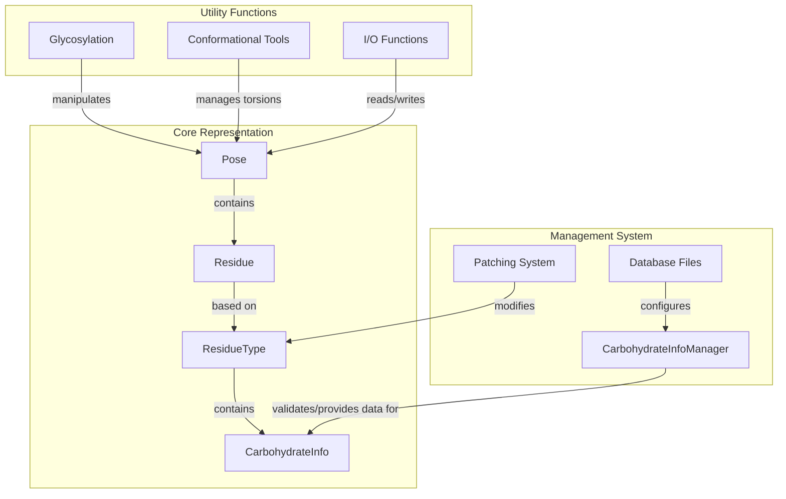
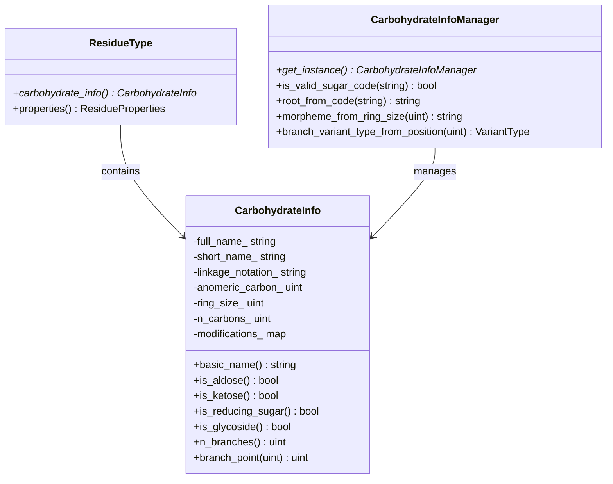
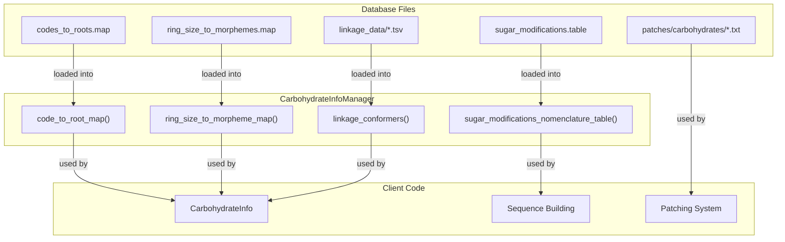
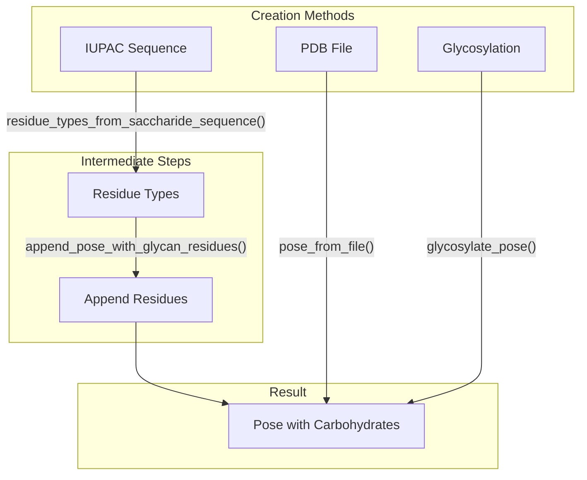
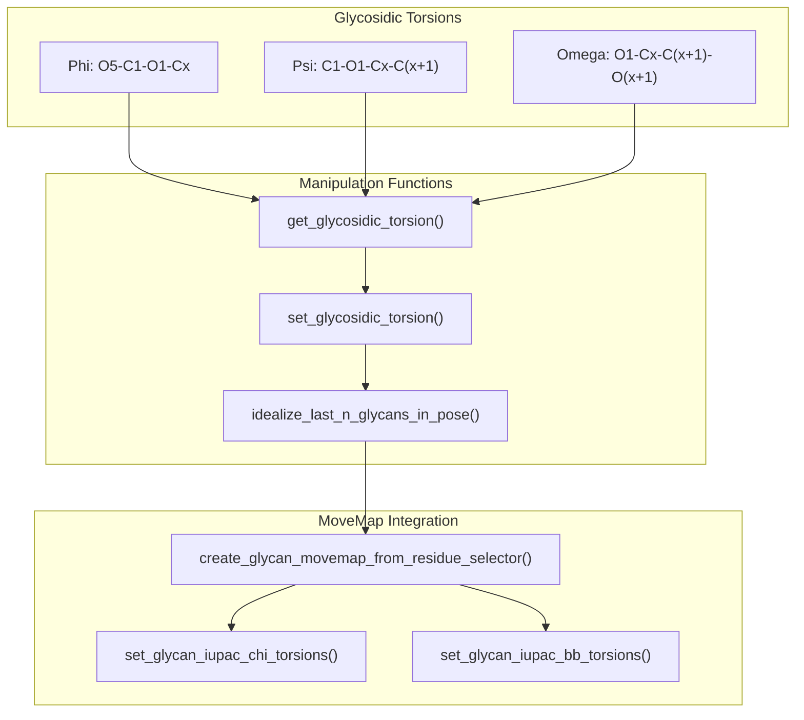
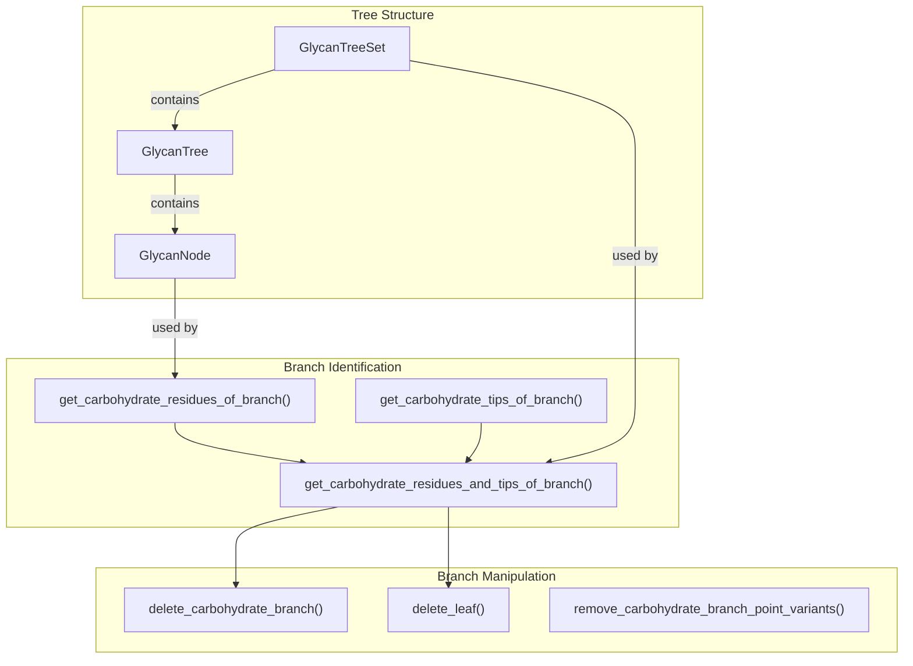
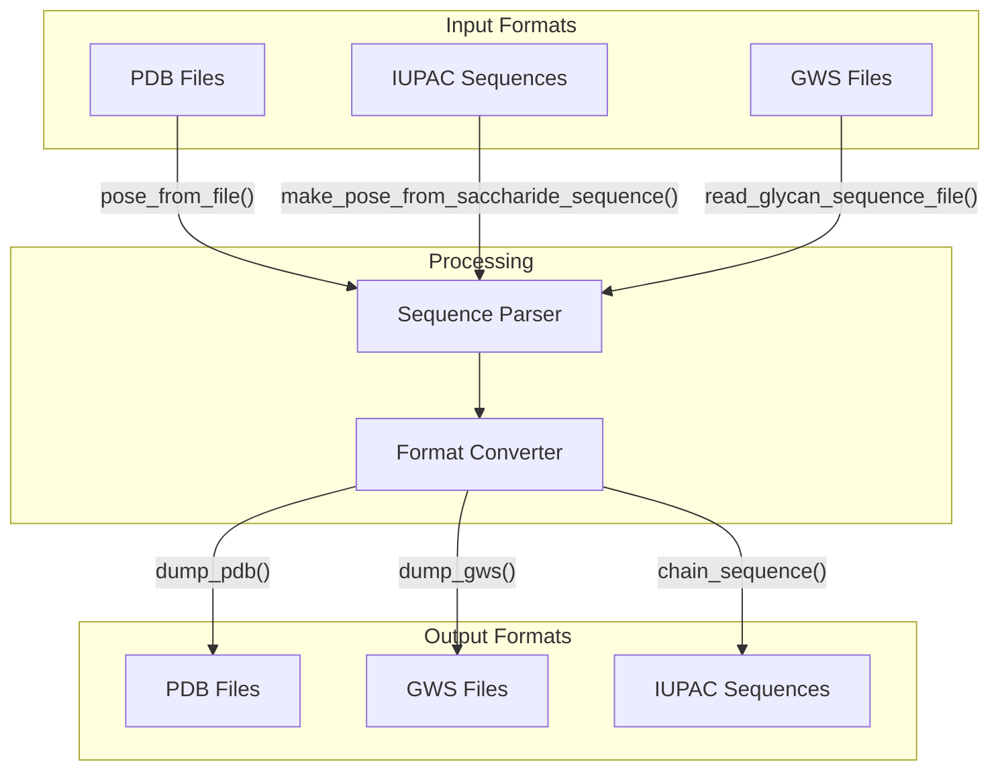

# Carbohydrate Handling

<details>
<summary>Relevant source files</summary>

The following files were used as context for generating this wiki page:

- [database/chemical/carbohydrates/sugar_modifications.table](database/chemical/carbohydrates/sugar_modifications.table)
- [database/chemical/residue_type_sets/centroid/patches.txt](database/chemical/residue_type_sets/centroid/patches.txt)
- [database/chemical/residue_type_sets/fa_standard/patches.txt](database/chemical/residue_type_sets/fa_standard/patches.txt)
- [database/chemical/residue_type_sets/fa_standard/patches/carbohydrates/upper_terminus.txt](database/chemical/residue_type_sets/fa_standard/patches/carbohydrates/upper_terminus.txt)
- [source/src/apps/tests/test_CarbohydrateInfo.cc](source/src/apps/tests/test_CarbohydrateInfo.cc)
- [source/src/core/chemical/carbohydrates/CarbohydrateInfo.cc](source/src/core/chemical/carbohydrates/CarbohydrateInfo.cc)
- [source/src/core/chemical/carbohydrates/CarbohydrateInfo.hh](source/src/core/chemical/carbohydrates/CarbohydrateInfo.hh)
- [source/src/core/chemical/carbohydrates/CarbohydrateInfoManager.cc](source/src/core/chemical/carbohydrates/CarbohydrateInfoManager.cc)
- [source/src/core/chemical/carbohydrates/CarbohydrateInfoManager.hh](source/src/core/chemical/carbohydrates/CarbohydrateInfoManager.hh)
- [source/src/core/chemical/carbohydrates/database_io.cc](source/src/core/chemical/carbohydrates/database_io.cc)
- [source/src/core/chemical/carbohydrates/database_io.hh](source/src/core/chemical/carbohydrates/database_io.hh)
- [source/src/core/chemical/residue_properties/general_properties.list](source/src/core/chemical/residue_properties/general_properties.list)
- [source/src/core/chemical/residue_properties/variant_types.list](source/src/core/chemical/residue_properties/variant_types.list)
- [source/src/core/io/carbohydrates/pose_io.cc](source/src/core/io/carbohydrates/pose_io.cc)
- [source/src/core/pose/annotated_sequence.cc](source/src/core/pose/annotated_sequence.cc)
- [source/src/core/pose/annotated_sequence.hh](source/src/core/pose/annotated_sequence.hh)
- [source/src/core/pose/carbohydrates/util.cc](source/src/core/pose/carbohydrates/util.cc)
- [source/src/core/pose/carbohydrates/util.hh](source/src/core/pose/carbohydrates/util.hh)
- [source/src/core/select/jump_selector/JumpIndexSelector.cc](source/src/core/select/jump_selector/JumpIndexSelector.cc)
- [source/src/core/select/jump_selector/JumpIndexSelector.hh](source/src/core/select/jump_selector/JumpIndexSelector.hh)
- [source/src/core/select/movemap/MoveMapFactory.cc](source/src/core/select/movemap/MoveMapFactory.cc)
- [source/src/core/select/movemap/MoveMapFactory.hh](source/src/core/select/movemap/MoveMapFactory.hh)
- [source/test/core/chemical/carbohydrates/CarbohydrateInfo.cxxtest.hh](source/test/core/chemical/carbohydrates/CarbohydrateInfo.cxxtest.hh)
- [source/test/core/chemical/carbohydrates/codes_to_roots.map](source/test/core/chemical/carbohydrates/codes_to_roots.map)
- [source/test/core/chemical/carbohydrates/database_io.cxxtest.hh](source/test/core/chemical/carbohydrates/database_io.cxxtest.hh)

</details>


This page documents Rosetta's system for representing, manipulating, and modeling carbohydrates (sugars). Carbohydrates play important roles in many biological systems, serving structural and functional purposes. Rosetta provides specialized tools for building, modifying, and analyzing carbohydrate structures both as individual molecules and attached to proteins or other biomolecules.

## Overview of Carbohydrate Representation

Rosetta implements a comprehensive system for handling carbohydrate structures through dedicated classes, utilities, and database files. The system supports creation of monosaccharides, oligosaccharides, and glycosylated proteins, following IUPAC carbohydrate nomenclature and conventions.



Sources: [source/src/core/chemical/carbohydrates/CarbohydrateInfo.hh](). [source/src/core/chemical/carbohydrates/CarbohydrateInfoManager.hh](). [source/src/core/pose/carbohydrates/util.hh]().

## Carbohydrate Information Architecture

The foundation of carbohydrate representation in Rosetta is the `CarbohydrateInfo` class, which stores detailed information about a carbohydrate residue, including its structural and chemical properties. Every carbohydrate `ResidueType` in Rosetta contains a `CarbohydrateInfo` instance.



Sources: [source/src/core/chemical/carbohydrates/CarbohydrateInfo.hh:39-591](). [source/src/core/chemical/carbohydrates/CarbohydrateInfoManager.hh:55-285]().

### Key Properties and Classifications

Carbohydrates in Rosetta are classified by several properties:

| Property Type | Examples | Description |
|---------------|----------|-------------|
| Size | TRIOSE, TETROSE, PENTOSE, HEXOSE, etc. | Number of carbon atoms (3-9) |
| Oxidation | ALDOSE, KETOSE | Whether the sugar has an aldehyde or ketone group |
| Ring Form | FURANOSE, PYRANOSE, etc. | Ring size (5-atom ring, 6-atom ring, etc.) |
| Stereochemistry | L_SUGAR, D_SUGAR | L or D configuration |
| Anomeric Form | ALPHA_SUGAR, BETA_SUGAR | Stereoconfiguration at the anomeric carbon |
| Modifications | AMINO_SUGAR, ACETYLAMINO_SUGAR, etc. | Chemical modifications to the base sugar |

Sources: [source/src/core/chemical/residue_properties/general_properties.list:134-193](). [source/src/core/chemical/carbohydrates/CarbohydrateInfo.hh:92-159]().

## Carbohydrate Database System

Rosetta uses a comprehensive database to manage carbohydrate information. The `CarbohydrateInfoManager` singleton serves as the interface to this database.



Sources: [source/src/core/chemical/carbohydrates/database_io.cc:45-340](). [source/src/core/chemical/carbohydrates/CarbohydrateInfoManager.cc:38-76]().

### Modification System

Rosetta supports a wide range of carbohydrate modifications through its patching system:

| Modification Type | Description | Example Variant Type |
|-------------------|-------------|----------------------|
| Oxidation | Oxidation of specific positions | URONIC_ACID_VARIANT |
| Reduction | Removal of oxygen (deoxy sugars) | C2_DEOXY_SUGAR |
| Amination | Addition of amino groups | C2_AMINO_SUGAR |
| Acetylation | Addition of acetyl groups | O6_ACETYL_SUGAR |
| Phosphorylation | Addition of phosphate groups | C6_PHOSPHORYLATED_SUGAR |
| Sulfation | Addition of sulfate groups | C6_SULFATED_SUGAR |
| Methylation | Addition of methyl groups | O2_METHYL_SUGAR |

These modifications are applied through a patching system, where patches modify the base sugar residue types.

Sources: [database/chemical/residue_type_sets/fa_standard/patches.txt:166-226](). [source/src/core/chemical/residue_properties/variant_types.list:222-388]().

## Building Carbohydrate Structures

Rosetta provides multiple ways to create carbohydrate structures:

1. From IUPAC-style saccharide sequences
2. By loading PDB files containing carbohydrates
3. By glycosylating existing protein structures



Sources: [source/src/core/pose/annotated_sequence.cc:249-604](). [source/src/core/pose/carbohydrates/util.cc:374-535]().

### Creating from IUPAC Sequences

Rosetta supports creation of carbohydrate structures from IUPAC-style sequences:

```
make_pose_from_saccharide_sequence(pose, "alpha-D-Glcp-(1->4)-alpha-D-Glcp-(1->4)-D-Glcp");
```

The sequence format follows carbohydrate naming conventions:
- Anomer specification: `alpha-` or `beta-`
- Stereochemistry: `L-` or `D-`
- Base name: Three-letter code (e.g., `Glc` for glucose)
- Ring form: `p` for pyranose, `f` for furanose
- Linkage: `(1->4)` indicates a glycosidic bond from C1 of one residue to O4 of the next
- Branches use square brackets: `[alpha-L-Fucp-(1->3)]-` indicates a branch

Sources: [source/src/core/pose/annotated_sequence.cc:226-246](). [source/src/core/pose/annotated_sequence.cc:292-342]().

### Glycosylation

Rosetta can add carbohydrate structures to proteins through glycosylation:

```cpp
// Glycosylate at position 2 with a specific sugar
glycosylate_pose(pose, 2, "ND2", "alpha-D-Glcp-(1->4)-beta-D-GlcpNAc", true);

// Use a shorthand for common glycosylation sites
glycosylate_pose(pose, 2, "alpha-D-Glcp-(1->4)-beta-D-GlcpNAc");

// Load a glycan from a predefined file
glycosylate_pose_by_file(pose, 2, "core_5_O-glycan");
```

The system supports:
- N-linked glycosylation (to Asn residues)
- O-linked glycosylation (to Ser/Thr residues)
- C-linked glycosylation (to Trp residues)
- Custom glycosylation to arbitrary atoms

Sources: [source/src/core/pose/carbohydrates/util.cc:374-489](). [source/src/core/pose/carbohydrates/util.cc:507-585]().

## Manipulating Carbohydrate Structures

Rosetta provides tools for manipulating the conformation of carbohydrate structures, particularly focused on the glycosidic linkages between residues.



Sources: [source/src/core/pose/carbohydrates/util.cc:219-264](). [source/src/core/pose/carbohydrates/util.hh:222-236]().

### Glycosidic Torsion Angles

Glycosidic linkages between sugars are described by specific torsion angles:

1. **Phi (φ)**: The torsion angle around the C1-O1 bond (typically O5-C1-O1-Cx)
2. **Psi (ψ)**: The torsion angle around the O1-Cx bond (typically C1-O1-Cx-C(x+1))
3. **Omega (ω)**: For 1→6 linkages, additional torsions around C5-C6 (O1-C6-C5-O5)

These can be accessed and modified using:
```cpp
// Get torsion value
Angle phi = get_glycosidic_torsion(phi_dihedral, pose, residue_num);

// Set torsion value
set_glycosidic_torsion(phi_dihedral, pose, residue_num, 60.0);
```

Sources: [source/src/core/pose/carbohydrates/util.cc:161-192](). [source/src/core/pose/carbohydrates/util.cc:227-236]().

### MoveMap Integration

Carbohydrate-specific MoveMaps can be created to control which degrees of freedom are allowed to move during minimization or other conformational changes:

```cpp
// Create a MoveMap for selected carbohydrate residues
MoveMapOP movemap = create_glycan_movemap_from_residue_selector(
    pose, selector, true /*chi*/, false /*ring*/, true /*bb*/);
```

The system distinguishes between:
- IUPAC chi torsions (rotatable hydroxyl groups)
- IUPAC glycosidic torsions (linkages between sugars)
- Ring torsions (sugar pucker conformations)

Sources: [source/src/core/pose/carbohydrates/util.cc:291-344](). [source/src/core/select/movemap/MoveMapFactory.cc:157-180]().

## Working with Carbohydrate Branches

Carbohydrates often have branched structures, which Rosetta handles through special utility functions.



Sources: [source/src/core/pose/carbohydrates/util.hh:243-262](). [source/src/core/pose/carbohydrates/util.hh:309-381]().

### Branch Traversal

Functions for traversing carbohydrate branches:

```cpp
// Get all residues in a branch starting from a specific residue
utility::vector1<core::Size> residues = get_carbohydrate_residues_of_branch(pose, start_res);

// Get just the terminal residues ("tips") of branches
utility::vector1<core::Size> tips = get_carbohydrate_tips_of_branch(pose, start_res);

// Get both residues and tips as a pair
auto result = get_carbohydrate_residues_and_tips_of_branch(pose, start_res);
utility::vector1<core::Size> all_residues = result.first;
utility::vector1<core::Size> branch_tips = result.second;
```

Sources: [source/src/core/pose/carbohydrates/util.hh:243-262](). [source/src/core/pose/carbohydrates/util.cc:243-262]().

### Branch Manipulation

Functions for modifying branch structures:

```cpp
// Delete an entire branch starting from a specific residue
delete_carbohydrate_branch(pose, branch_start);

// Delete a specific leaf (linear segment ending in a tip)
delete_leaf(pose, leaf_residues);

// Remove branch point variants from a residue
remove_carbohydrate_branch_point_variants(pose, res_num);
```

Sources: [source/src/core/pose/carbohydrates/util.hh:313-381](). [source/src/core/pose/carbohydrates/util.cc:313-381]().

## Carbohydrate Property System

Rosetta has an extensive property system for representing the various characteristics of carbohydrates.

```mermaid
graph TD
    subgraph "Core Properties"
        size["Size (TRIOSE, TETROSE, etc.)"]
        type["Type (ALDOSE, KETOSE)"]
        stereo["Stereochemistry (L_SUGAR, D_SUGAR)"]
        ring["Ring Form (FURANOSE, PYRANOSE)"]
        anomer["Anomeric Form (ALPHA_SUGAR, BETA_SUGAR)"]
    end
    
    subgraph "Modification Properties"
        amination["AMINO_SUGAR"]
        acetylation["ACETYLAMINO_SUGAR"]
        oxidation["URONIC_ACID"]
        phosphorylation["PHOSPHORYLATED_SUGAR"]
        methylation["METHYL_SUGAR"]
        other["Other Modifications"]
    end
    
    subgraph "Position-Specific Properties"
        c1_mod["C1_MODIFIED"]
        c2_mod["C2_MODIFIED"]
        c3_mod["C3_MODIFIED"]
        c4_mod["C4_MODIFIED"]
        c5_mod["C5_MODIFIED"]
        c6_mod["C6_MODIFIED"]
    end
    
    size -->|"classifies"| ResidueType
    type -->|"classifies"| ResidueType
    stereo -->|"classifies"| ResidueType
    ring -->|"classifies"| ResidueType
    anomer -->|"classifies"| ResidueType
    
    amination -->|"modifies"| ResidueType
    acetylation -->|"modifies"| ResidueType
    oxidation -->|"modifies"| ResidueType
    phosphorylation -->|"modifies"| ResidueType
    methylation -->|"modifies"| ResidueType
    other -->|"modifies"| ResidueType
    
    c1_mod -->|"indicates"| ResidueType
    c2_mod -->|"indicates"| ResidueType
    c3_mod -->|"indicates"| ResidueType
    c4_mod -->|"indicates"| ResidueType
    c5_mod -->|"indicates"| ResidueType
    c6_mod -->|"indicates"| ResidueType
```



Sources: [source/src/core/chemical/residue_properties/general_properties.list:134-193](). [source/src/core/chemical/residue_properties/variant_types.list:222-388]().

The properties can be accessed through the `CarbohydrateInfo` class:

```cpp
// Basic sugar classification
bool is_aldose = sugar_residue.carbohydrate_info()->is_aldose();
bool is_hexose = sugar_residue.carbohydrate_info()->is_hexose();
bool is_pyranose = sugar_residue.carbohydrate_info()->is_pyranose();

// Modifications
bool is_amino = sugar_residue.carbohydrate_info()->is_amino_sugar();
bool is_acetylated = sugar_residue.carbohydrate_info()->is_N_acetylated();
bool is_uronic = sugar_residue.carbohydrate_info()->is_uronic_acid();
```

Sources: [source/src/core/chemical/carbohydrates/CarbohydrateInfo.cc:163-274](). [source/src/core/chemical/carbohydrates/CarbohydrateInfo.hh:109-141]().

## Carbohydrate I/O

Rosetta provides specialized I/O functionality for carbohydrates to support various file formats and naming conventions.



Sources: [source/src/core/io/carbohydrates/pose_io.cc:52-83](). [source/src/apps/tests/test_CarbohydrateInfo.cc:97-104]().

### Parsing Modifications

When interpreting carbohydrate names with modifications, Rosetta parses complex modification patterns:

```cpp
// Parse "GlcpNAc" into glucose with an N-acetyl group at position 2
utility::vector1<std::pair<core::uint, std::string>> modifications = 
    sugar_modifications_from_suffix("NAc");
// Result: [(2, "NAc")] - position 2, N-acetyl modification
```

The system uses a database table that maps modification codes to their meanings:

| Code | Full Name | Position | Patch Name |
|------|-----------|----------|------------|
| N    | amino     | 2        | NH3+       |
| NAc  | acetylamino | 2      | AcNH       |
| A    | uronic acid | 6      | uronic_acid |
| P    | phosphate | 6        | OPO32-     |
| S    | sulfate  | 6         | OSO3-      |

Sources: [source/src/core/io/carbohydrates/pose_io.cc:55-101](). [database/chemical/carbohydrates/sugar_modifications.table]().

## Conclusion

Rosetta's carbohydrate handling system provides a comprehensive framework for modeling, building, and analyzing carbohydrate structures. The system integrates with Rosetta's core modeling capabilities while providing specialized functionality for the unique properties of carbohydrates.

For working with carbohydrates attached to proteins in scoring functions, see [Scoring System](#3). For manipulating carbohydrates with movers and protocols, see [Protocol System](#4).

---