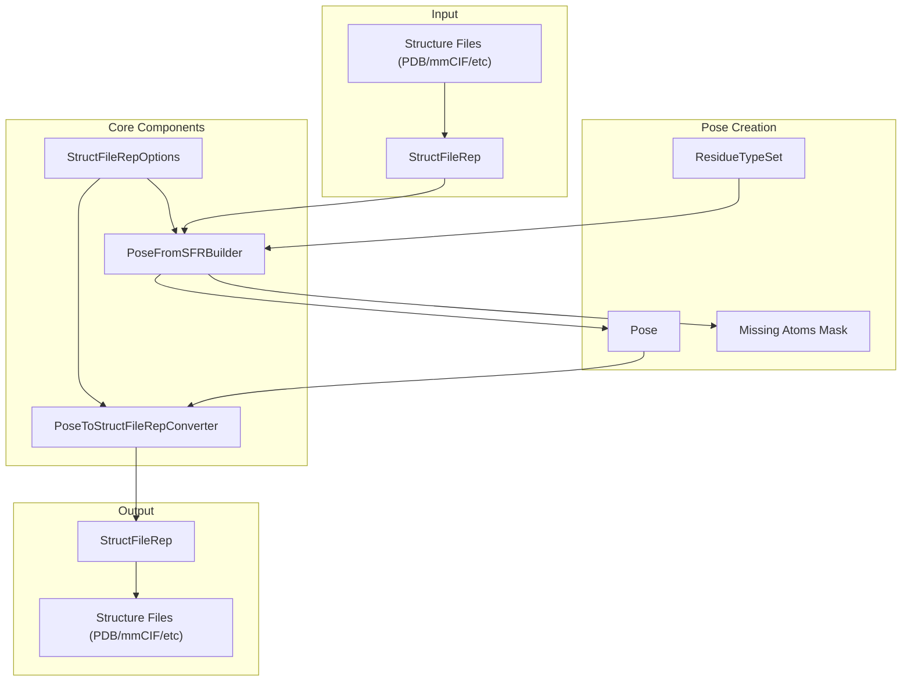
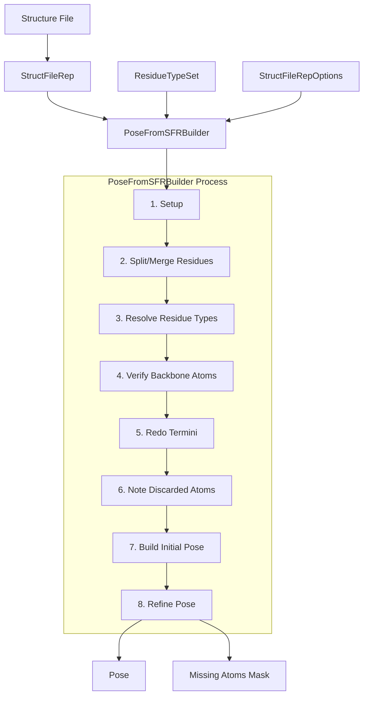
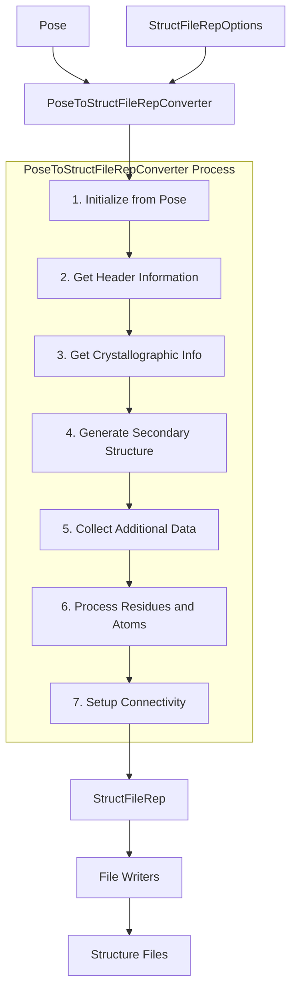
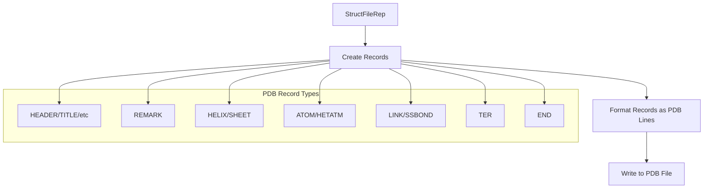

# I/O System

<details>
<summary>Relevant source files</summary>

The following files were used as context for generating this wiki page:

- [source/src/apps/pilot/rhiju/pack_phosphates.cc](source/src/apps/pilot/rhiju/pack_phosphates.cc)
- [source/src/apps/pilot/rhiju/rna_test.cc](source/src/apps/pilot/rhiju/rna_test.cc)
- [source/src/apps/public/rna/util/rna_minimize.cc](source/src/apps/public/rna/util/rna_minimize.cc)
- [source/src/apps/public/rna/util/rna_score.cc](source/src/apps/public/rna/util/rna_score.cc)
- [source/src/core/chemical/AA.cc](source/src/core/chemical/AA.cc)
- [source/src/core/chemical/AA.hh](source/src/core/chemical/AA.hh)
- [source/src/core/chemical/rings/RingConformerSet.cc](source/src/core/chemical/rings/RingConformerSet.cc)
- [source/src/core/chemical/rings/RingConformerSet.hh](source/src/core/chemical/rings/RingConformerSet.hh)
- [source/src/core/chemical/rings/ring_conformer_io.cc](source/src/core/chemical/rings/ring_conformer_io.cc)
- [source/src/core/io/HeaderInformation.cc](source/src/core/io/HeaderInformation.cc)
- [source/src/core/io/HeaderInformation.fwd.hh](source/src/core/io/HeaderInformation.fwd.hh)
- [source/src/core/io/HeaderInformation.hh](source/src/core/io/HeaderInformation.hh)
- [source/src/core/io/StructFileRep.hh](source/src/core/io/StructFileRep.hh)
- [source/src/core/io/StructFileRepOptions.cc](source/src/core/io/StructFileRepOptions.cc)
- [source/src/core/io/StructFileRepOptions.hh](source/src/core/io/StructFileRepOptions.hh)
- [source/src/core/io/mmcif/cif_writer.cc](source/src/core/io/mmcif/cif_writer.cc)
- [source/src/core/io/pdb/pdb_writer.cc](source/src/core/io/pdb/pdb_writer.cc)
- [source/src/core/io/pdb/pdb_writer.hh](source/src/core/io/pdb/pdb_writer.hh)
- [source/src/core/io/pose_from_sfr/PoseFromSFRBuilder.cc](source/src/core/io/pose_from_sfr/PoseFromSFRBuilder.cc)
- [source/src/core/io/pose_from_sfr/PoseFromSFRBuilder.hh](source/src/core/io/pose_from_sfr/PoseFromSFRBuilder.hh)
- [source/src/core/io/pose_to_sfr/PoseToStructFileRepConverter.cc](source/src/core/io/pose_to_sfr/PoseToStructFileRepConverter.cc)
- [source/src/core/io/pose_to_sfr/PoseToStructFileRepConverter.hh](source/src/core/io/pose_to_sfr/PoseToStructFileRepConverter.hh)
- [source/src/core/io/raw_data/ScoreMap.cc](source/src/core/io/raw_data/ScoreMap.cc)
- [source/src/core/io/rcsb/ExperimentalTechnique.cc](source/src/core/io/rcsb/ExperimentalTechnique.cc)
- [source/src/core/io/util.cc](source/src/core/io/util.cc)
- [source/src/core/io/util.hh](source/src/core/io/util.hh)
- [source/src/core/pose/rna/RNA_BaseDoubletClasses.hh](source/src/core/pose/rna/RNA_BaseDoubletClasses.hh)
- [source/src/core/pose/rna/util.cc](source/src/core/pose/rna/util.cc)
- [source/src/core/pose/rna/util.hh](source/src/core/pose/rna/util.hh)
- [source/src/core/scoring/MembranePotential.cc](source/src/core/scoring/MembranePotential.cc)
- [source/src/core/scoring/hbonds/hbonds_geom.cc](source/src/core/scoring/hbonds/hbonds_geom.cc)
- [source/src/core/scoring/hbonds/hbonds_geom.hh](source/src/core/scoring/hbonds/hbonds_geom.hh)
- [source/src/core/simple_metrics/PerResidueProbabilitiesMetric.fwd.hh](source/src/core/simple_metrics/PerResidueProbabilitiesMetric.fwd.hh)
- [source/src/core/simple_metrics/PerResidueProbabilitiesMetricCreator.fwd.hh](source/src/core/simple_metrics/PerResidueProbabilitiesMetricCreator.fwd.hh)
- [source/src/core/simple_metrics/SimpleMetricData.cc](source/src/core/simple_metrics/SimpleMetricData.cc)
- [source/src/core/simple_metrics/SimpleMetricData.hh](source/src/core/simple_metrics/SimpleMetricData.hh)
- [source/src/core/simple_metrics/SimpleMetricStruct.hh](source/src/core/simple_metrics/SimpleMetricStruct.hh)
- [source/src/protocols/ncbb/oop/OopCreatorMover.hh](source/src/protocols/ncbb/oop/OopCreatorMover.hh)
- [source/src/python/PyRosetta/src/test/T010_LoadPDB.py](source/src/python/PyRosetta/src/test/T010_LoadPDB.py)
- [source/src/python/PyRosetta/src/test/data/test_in.silent](source/src/python/PyRosetta/src/test/data/test_in.silent)
- [source/test/core/chemical/rings/ring_conformer_io.cxxtest.hh](source/test/core/chemical/rings/ring_conformer_io.cxxtest.hh)
- [source/test/core/io/StructFileRep.cxxtest.hh](source/test/core/io/StructFileRep.cxxtest.hh)
- [source/test/core/io/pose_from_sfr/1IJ3_cleaned.pdb](source/test/core/io/pose_from_sfr/1IJ3_cleaned.pdb)
- [source/test/core/io/pose_from_sfr/PoseFromSFRBuilder.cxxtest.hh](source/test/core/io/pose_from_sfr/PoseFromSFRBuilder.cxxtest.hh)
- [source/test/core/io/pose_to_sfr/PoseToStructFileRepConverter.cxxtest.hh](source/test/core/io/pose_to_sfr/PoseToStructFileRepConverter.cxxtest.hh)
- [source/test/core/scoring/hbonds/HBondDerivTest.cxxtest.hh](source/test/core/scoring/hbonds/HBondDerivTest.cxxtest.hh)
- [source/test/protocols/optimize_weights/DDGBindOptEData.cxxtest.hh](source/test/protocols/optimize_weights/DDGBindOptEData.cxxtest.hh)
- [tests/integration/tests/secondary_structure_output/auto_options](tests/integration/tests/secondary_structure_output/auto_options)
- [tests/integration/tests/secondary_structure_output/options](tests/integration/tests/secondary_structure_output/options)

</details>


The Rosetta I/O System is responsible for reading molecular structure data from files into Pose objects and writing Pose objects back to files. It includes mechanisms for handling various file formats (primarily PDB and mmCIF), processing structural information, resolving residue types, and managing chain connectivity. This document covers the core components of the I/O system and how data flows through it when reading and writing molecular structures.

## Overview

The I/O system serves as a bridge between external file formats and Rosetta's internal representation (Pose objects). The system is designed to handle the complexities of biomolecular structure files, including residue naming, chain identification, atom connectivity, and special molecular features.



Sources:
- [source/src/core/io/StructFileRep.hh]()
- [source/src/core/io/StructFileRepOptions.hh]()
- [source/src/core/io/pose_from_sfr/PoseFromSFRBuilder.hh]()
- [source/src/core/io/pose_to_sfr/PoseToStructFileRepConverter.hh]()

## Core Components

### StructFileRep

`StructFileRep` is an intermediate representation of structural data from files. It stores:

- Atom coordinates and properties
- Residue information
- Chain organization
- Header information
- Crystallographic data
- Connectivity information (LINK records)
- Secondary structure annotations

This class serves as a bridge between external file formats and Rosetta's internal data structures, enabling platform-independent storage of structure information.

### StructFileRepOptions

`StructFileRepOptions` controls how structural data is read and written. It provides numerous configuration options:

| Category | Options | Description |
|----------|---------|-------------|
| Chain Handling | `check_if_residues_are_Ntermini`, `check_if_residues_are_Ctermini` | Control which chains have termini |
| Molecule Processing | `ignore_waters`, `ignore_sugars` | Filter out specific molecule types |
| Residue Processing | `fast_restyping`, `ignore_unrecognized_res` | Control residue type assignment |
| Special Features | `auto_detect_glycan_connections` | Handle specialized molecule types |
| Output Controls | `output_virtual`, `output_secondary_structure` | Control what data is included in output |
| File Format | `use_pdb_format_HETNAM_records` | Control format-specific features |

These options allow fine-grained control over how Rosetta reads and writes structural data.

Sources:
- [source/src/core/io/StructFileRepOptions.cc:135-192]()
- [source/src/core/io/StructFileRepOptions.hh:62-122]()

## Reading Structures: Input Flow

When reading a structure file into Rosetta, the data flows through several processing steps:



The key steps in this process are:

1. **Setup**: Extract all residue information from the `StructFileRep` and prepare for building the Pose.

2. **Split/Merge Residues**: Handle special cases where residues need to be split (e.g., a residue that should be represented as multiple residues in Rosetta) or merged (e.g., ACE caps being merged with the next residue).

3. **Resolve Residue Types**: Match each residue to the appropriate `ResidueType` in Rosetta's database, handling standard and non-standard residues.

4. **Verify Backbone Atoms**: Ensure that essential backbone atoms are present for proper molecular representation.

5. **Redo Termini**: Process chain termini and ensure they have the correct terminal variants.

6. **Note Discarded Atoms**: Keep track of atoms present in the input file but not included in the Pose.

7. **Build Initial Pose**: Construct the Pose object with the processed residue information.

8. **Refine Pose**: Finalize the Pose, setting up additional information like PDBInfo.

Sources:
- [source/src/core/io/pose_from_sfr/PoseFromSFRBuilder.cc:116-140]()
- [source/src/core/io/pose_from_sfr/PoseFromSFRBuilder.hh:85-98]()

### Special Handling in Reading

#### Nucleic Acid Processing

The I/O system includes special handling for nucleic acids, including:

- Converting PDB-style atom names (with asterisks) to Rosetta-style names (with primes)
- Detecting and handling DNA vs. RNA
- Processing virtual phosphates for 5' terminal residues

```cpp
// Example of nucleic acid name conversion
if ( atom_info.name.size() >= 1 && atom_info.name[atom_info.name.size()-1] == '*' ) {
    std::string new_atom_name = atom_info.name.substr(0,atom_info.name.size()-1) + "\'";
    rinfo.rename_atom( original_atom_name, new_atom_name );
}
```

#### Chain Breaks and Connectivity

The system automatically detects chain breaks based on:
- Different chain IDs
- Missing connecting atoms
- Atom distances exceeding expected bond lengths
- Presence of `CUTPOINT_LOWER` and `CUTPOINT_UPPER` variants

Sources:
- [source/src/core/io/pose_from_sfr/PoseFromSFRBuilder.cc:158-213]()
- [source/src/core/pose/rna/util.cc:246-313]()

## Writing Structures: Output Flow

When writing a Pose to a structure file, the data flows through these steps:



The steps in this process are:

1. **Initialize from Pose**: Extract basic data from the Pose and create a new `StructFileRep`.

2. **Get Header Information**: Set up title section records (HEADER, TITLE, AUTHOR, etc.).

3. **Get Crystallographic Info**: Set up crystallographic information if available.

4. **Generate Secondary Structure**: Create HELIX and SHEET records if required.

5. **Collect Additional Data**: Gather extra information like membrane topology or energy terms.

6. **Process Residues and Atoms**: Convert each residue and atom from the Pose to the appropriate representation in `StructFileRep`.

7. **Setup Connectivity**: Add LINK and SSBOND records based on residue connectivity.

Sources:
- [source/src/core/io/pose_to_sfr/PoseToStructFileRepConverter.cc:199-309]()
- [source/src/core/io/pose_to_sfr/PoseToStructFileRepConverter.hh:112-113]()

### Atom and Residue Processing

For each residue and atom in the Pose, the converter:

1. Creates a `ResidueInformation` object with chain ID, residue number, name, etc.
2. For each atom, creates an `AtomInformation` object with coordinates, name, element, etc.
3. Handles special properties like alternate conformations, occupancy, and temperature factors
4. Determines whether atoms should be represented as ATOM or HETATM records

```cpp
// Simplified atom processing logic
AtomInformation ai;
ai.isHet = !rsd.type().has_property(CANONICAL_AA);
ai.chainID = res_info.chainID();
ai.resSeq = res_info.resSeq();
ai.name = rsd.atom_name(atom_index);
ai.x = atom.xyz()(1);
ai.y = atom.xyz()(2);
ai.z = atom.xyz()(3);
```

Sources:
- [source/src/core/io/pose_to_sfr/PoseToStructFileRepConverter.cc:461-516]()

## File Format Support

Rosetta's I/O system primarily supports three file formats:

### PDB Format

The Protein Data Bank (PDB) format is the most widely used format. The `pdb_writer` module:

- Creates proper PDB record types (ATOM, HETATM, LINK, etc.)
- Formats coordinates and atom information according to PDB specifications
- Handles special features like multiple models and biological assemblies



Sources:
- [source/src/core/io/pdb/pdb_writer.cc:297-342]()

### mmCIF Format

The macromolecular Crystallographic Information File (mmCIF) format is a more structured alternative to PDB:

- Uses tag-value pairs organized into data categories
- Has fewer limitations than PDB (no atom name/residue number size restrictions)
- Stores more comprehensive metadata

### Silent File Format

Rosetta's native "silent file" format is a compact binary format designed for storing multiple structures efficiently:

- More space-efficient than PDB for storing many structures
- Preserves Rosetta-specific information (scores, sequence mapping, etc.)
- Used extensively for large-scale simulations and analysis

## Special Features

### Chain and Terminus Management

The I/O system includes sophisticated chain detection and terminus management:

- Automatically identifies chain breaks based on connectivity and chain IDs
- Controls which chains have N- and C-termini via options
- Handles special cases like circular peptides and non-standard termini

```cpp
// Simplified terminus detection logic
bool is_lower_terminus = (i == 1 || !same_chain_prev) && 
    check_Ntermini_for_this_chain && 
    !lower_terminus_is_occupied_according_to_link_map(resid);
bool is_upper_terminus = (i == nres_pdb || !same_chain_next) && 
    check_Ctermini_for_this_chain && 
    !upper_terminus_is_occupied_according_to_link_map(resid);
```

Sources:
- [source/src/core/io/pose_from_sfr/PoseFromSFRBuilder.cc:446-448]()

### Missing Atom Handling

When atoms are missing in the input file, the system:

1. Tracks which atoms are missing using an `AtomID_Mask`
2. Can build coordinates for missing atoms based on ideal geometry
3. Can randomize coordinates for missing atoms if requested

### Specialized Residue Handling

The system includes specialized handling for:

- Nucleic acids (RNA/DNA)
- Non-canonical amino acids (D-amino acids, beta-amino acids)
- Carbohydrates and glycans
- Modified residues (phosphorylated, acetylated, etc.)
- Ligands and non-standard residues

Sources:
- [source/src/core/io/pose_from_sfr/PoseFromSFRBuilder.cc:158-213]()
- [source/src/core/chemical/AA.cc:36-129]()

## Summary

The Rosetta I/O System provides a flexible and extensible framework for reading and writing molecular structures in various formats. It handles the complexities of biomolecular representation, residue typing, chain connectivity, and special features. The system's modular design separates concerns between file parsing, data representation, and Pose construction, making it adaptable to different file formats and structural features.

The primary workflow involves:
1. Reading structure files into the intermediate `StructFileRep` representation
2. Converting between `StructFileRep` and Pose objects using the builder and converter classes
3. Writing Pose objects back to various file formats

This architecture allows Rosetta to support a wide range of structural biology applications, from reading experimental structures to writing simulation results and designs.

---