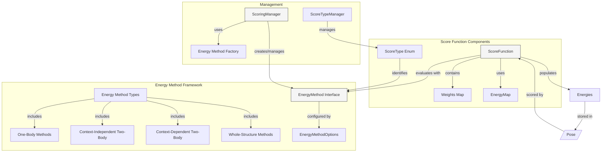
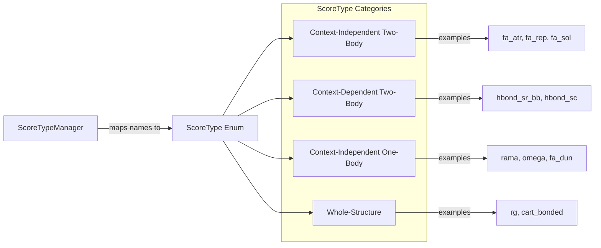
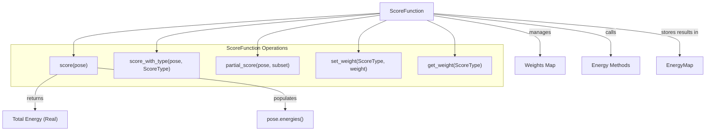
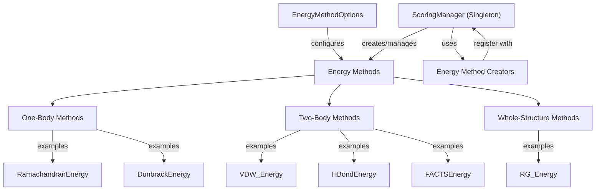
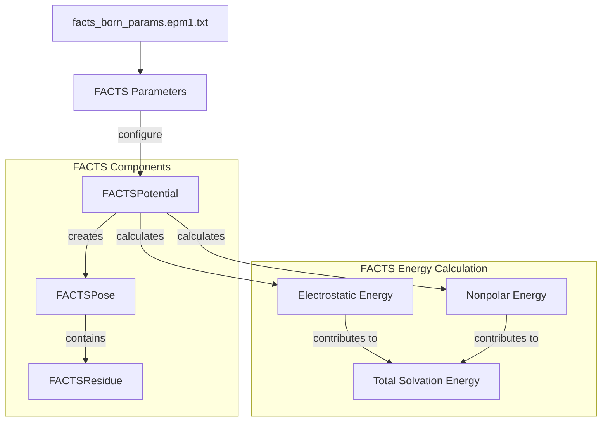
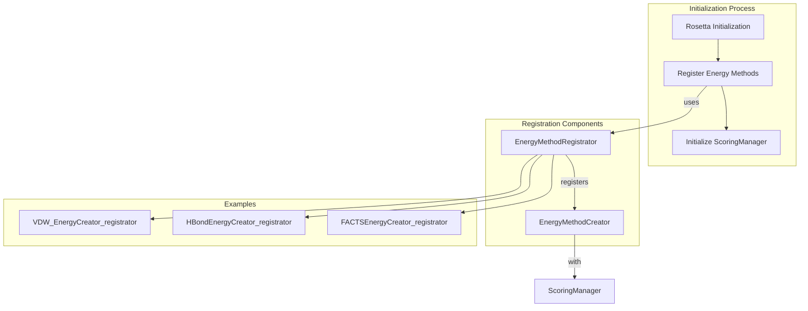
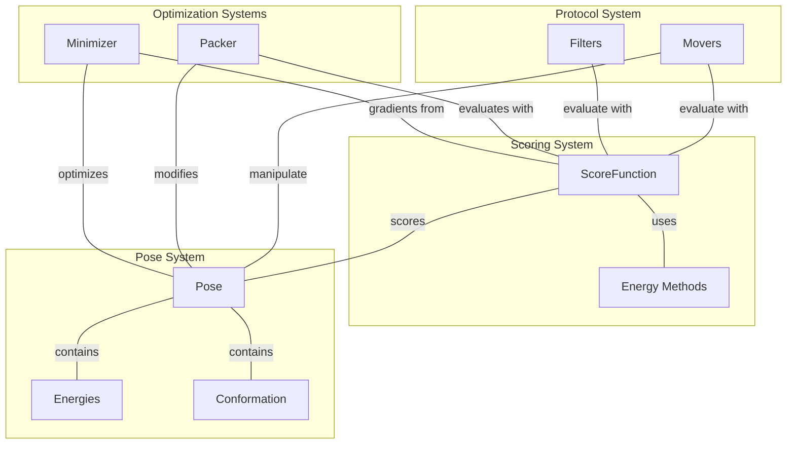

# Scoring System

<details>
<summary>Relevant source files</summary>

The following files were used as context for generating this wiki page:

- [database/chemical/atom_type_sets/fa_standard/extras/facts_born_params.epm1.txt](database/chemical/atom_type_sets/fa_standard/extras/facts_born_params.epm1.txt)
- [database/scoring/weights/scorefacts_cart.wts](database/scoring/weights/scorefacts_cart.wts)
- [source/doc/options.dox](source/doc/options.dox)
- [source/src/basic/options/options_rosetta.py](source/src/basic/options/options_rosetta.py)
- [source/src/core.3.src.settings](source/src/core.3.src.settings)
- [source/src/core.4.src.settings](source/src/core.4.src.settings)
- [source/src/core/init/init.cc](source/src/core/init/init.cc)
- [source/src/core/pose/datacache/CacheableDataType.cc](source/src/core/pose/datacache/CacheableDataType.cc)
- [source/src/core/pose/datacache/CacheableDataType.hh](source/src/core/pose/datacache/CacheableDataType.hh)
- [source/src/core/scoring/ScoreType.hh](source/src/core/scoring/ScoreType.hh)
- [source/src/core/scoring/ScoreTypeManager.cc](source/src/core/scoring/ScoreTypeManager.cc)
- [source/src/core/scoring/ScoringManager.cc](source/src/core/scoring/ScoringManager.cc)
- [source/src/core/scoring/ScoringManager.hh](source/src/core/scoring/ScoringManager.hh)
- [source/src/core/scoring/facts/FACTSPotential.cc](source/src/core/scoring/facts/FACTSPotential.cc)
- [source/src/core/scoring/facts/FACTSPotential.hh](source/src/core/scoring/facts/FACTSPotential.hh)
- [source/src/core/scoring/facts/FACTSResidue.cc](source/src/core/scoring/facts/FACTSResidue.cc)
- [source/src/core/scoring/methods/EnergyMethodOptions.cc](source/src/core/scoring/methods/EnergyMethodOptions.cc)
- [source/src/core/scoring/methods/EnergyMethodOptions.hh](source/src/core/scoring/methods/EnergyMethodOptions.hh)
- [source/src/core/select/residue_selector/ResidueSelectorCreators.hh](source/src/core/select/residue_selector/ResidueSelectorCreators.hh)
- [source/src/core/simple_metrics/per_residue_metrics/PerResidueBfactorMetric.cc](source/src/core/simple_metrics/per_residue_metrics/PerResidueBfactorMetric.cc)
- [source/src/core/simple_metrics/per_residue_metrics/PerResidueBfactorMetric.fwd.hh](source/src/core/simple_metrics/per_residue_metrics/PerResidueBfactorMetric.fwd.hh)
- [source/src/core/simple_metrics/per_residue_metrics/PerResidueBfactorMetric.hh](source/src/core/simple_metrics/per_residue_metrics/PerResidueBfactorMetric.hh)
- [source/src/core/simple_metrics/per_residue_metrics/PerResidueBfactorMetricCreator.hh](source/src/core/simple_metrics/per_residue_metrics/PerResidueBfactorMetricCreator.hh)
- [source/src/protocols/carbohydrates/IdealizeAnomericHydrogens.cc](source/src/protocols/carbohydrates/IdealizeAnomericHydrogens.cc)
- [source/src/protocols/init/init.SimpleMetricCreators.ihh](source/src/protocols/init/init.SimpleMetricCreators.ihh)
- [source/src/protocols/init/init.SimpleMetricRegistrators.ihh](source/src/protocols/init/init.SimpleMetricRegistrators.ihh)
- [source/src/protocols/parser/ScoreFunctionLoader.cc](source/src/protocols/parser/ScoreFunctionLoader.cc)
- [source/test/core.test.settings](source/test/core.test.settings)
- [source/test/core/pose/datacache/CacheableDataType.cxxtest.hh](source/test/core/pose/datacache/CacheableDataType.cxxtest.hh)
- [tests/integration/tests/simple_metrics_b_factor/README.txt](tests/integration/tests/simple_metrics_b_factor/README.txt)
- [tests/integration/tests/simple_metrics_b_factor/command](tests/integration/tests/simple_metrics_b_factor/command)
- [tests/integration/tests/simple_metrics_b_factor/inputs/3gml.pdb](tests/integration/tests/simple_metrics_b_factor/inputs/3gml.pdb)
- [tests/integration/tests/simple_metrics_b_factor/inputs/rosetta.flags](tests/integration/tests/simple_metrics_b_factor/inputs/rosetta.flags)

</details>


The Rosetta Scoring System evaluates the energy (or "score") of molecular structures by combining weighted energy terms that model various physical interactions. This system is central to virtually all Rosetta applications including structure prediction, protein design, and molecular docking, as it provides the energetic evaluation that guides conformational sampling toward physically realistic structures.

## Scoring System Architecture

The scoring system combines multiple weighted energy terms to evaluate the energy of a molecular structure represented as a Pose. The architecture consists of several key components that work together to calculate and manage energy evaluations.



Sources: [source/src/core/scoring/ScoreFunction.hh](), [source/src/core/scoring/methods/EnergyMethod.hh](), [source/src/core/scoring/ScoringManager.hh](), [source/src/core/scoring/ScoreType.hh]()

## Core Components

### ScoreType and ScoreTypeManager

`ScoreType` is an enum that defines all possible energy terms in Rosetta. These terms represent different physical interactions such as van der Waals forces, electrostatics, hydrogen bonding, etc.

The `ScoreTypeManager` handles the mapping between string names (e.g., "fa_atr") and the corresponding `ScoreType` enum values, allowing for convenient access through string identifiers.



Sources: [source/src/core/scoring/ScoreType.hh](), [source/src/core/scoring/ScoreTypeManager.cc]()

The score types are organized into categories based on their computational characteristics:

1. **Context-Independent Two-Body Terms**: Interactions between pairs of atoms/residues that don't depend on the surrounding environment (e.g., van der Waals)
2. **Context-Dependent Two-Body Terms**: Interactions that depend on the surrounding environment (e.g., hydrogen bonds)
3. **Context-Independent One-Body Terms**: Properties of individual residues (e.g., torsional preferences)
4. **Whole-Structure Terms**: Properties of the entire structure (e.g., radius of gyration)

### ScoreFunction

The `ScoreFunction` class combines multiple energy terms with weights to calculate a total energy score. It maintains a map of weights for each score term and coordinates the evaluation of all energy terms.

Common predefined score functions include:
- **REF2015**: The standard full-atom score function for protein structure prediction and design
- **beta_nov16**: A variant of REF2015 with optimized parameters for beta-sheet proteins
- **talaris2014**: An older score function that preceded REF2015



Sources: [source/src/core/scoring/ScoreFunction.hh](), [source/src/core/scoring/ScoreFunctionFactory.hh]()

### ScoringManager and Energy Methods

The `ScoringManager` is the central singleton that handles creation and management of energy methods. It uses lazy loading to create energy methods on-demand, ensuring thread-safety for parallel computation.

`EnergyMethod` is the base interface for all energy calculation implementations. Different energy terms are implemented as derived classes of this interface. The `EnergyMethodOptions` class provides configuration options for energy methods.



Sources: [source/src/core/scoring/ScoringManager.hh](), [source/src/core/scoring/methods/EnergyMethod.hh](), [source/src/core/scoring/methods/EnergyMethodOptions.hh](), [source/src/core/init/init.cc]()

## Common Energy Terms

The Rosetta scoring system includes numerous energy terms modeling different physical phenomena:

| Term Category | Common Terms | Description |
|---------------|--------------|-------------|
| Van der Waals | fa_atr, fa_rep | Attractive and repulsive components of van der Waals interactions |
| Solvation | fa_sol, lk_ball | Implicit solvation models for water interactions |
| Electrostatics | fa_elec | Electrostatic interactions between charged atoms |
| Hydrogen Bonding | hbond_sr_bb, hbond_lr_bb, hbond_sc | Hydrogen bond interactions with different geometric configurations |
| Torsional | rama, omega, fa_dun | Preferences for backbone and sidechain torsion angles |
| Reference | ref | Per-residue reference energies to balance amino acid preferences |
| Specialized | membrane, carbohydrate, RNA terms | Terms specific to certain molecular types |

Sources: [source/src/core/scoring/ScoreType.hh](), [source/src/core/scoring/ScoreTypeManager.cc]()

## FACTS Solvation Model

The Fast Analytical Continuum Treatment of Solvation (FACTS) is an important implicit solvation model in Rosetta. It calculates solvation energies by analytically approximating the continuum solvent model without expensive numerical solutions of the Poisson-Boltzmann equation.



Sources: [source/src/core/scoring/facts/FACTSPotential.cc](), [source/src/core/scoring/facts/FACTSResidue.cc](), [database/chemical/atom_type_sets/fa_standard/extras/facts_born_params.epm1.txt]()

## Energy Method Registration and Initialization

Energy methods are registered during Rosetta startup. The registration process uses a factory pattern to allow the system to create energy methods on demand.



Sources: [source/src/core/init/init.cc](), [source/src/core/scoring/methods/EnergyMethodRegistrator.hh]()

## Using the Scoring System

### Creating and Accessing ScoreFunctions

```cpp
// Create a score function using a predefined type
core::scoring::ScoreFunctionOP scorefxn = core::scoring::get_score_function();  // Default (REF2015)
core::scoring::ScoreFunctionOP custom_scorefxn = core::scoring::ScoreFunctionFactory::create_score_function("ref2015");

// Modify weights
custom_scorefxn->set_weight(core::scoring::fa_atr, 1.0);
custom_scorefxn->set_weight(core::scoring::fa_rep, 0.55);

// Get a weight
double atr_weight = custom_scorefxn->get_weight(core::scoring::fa_atr);
```

### Scoring a Pose

```cpp
// Score an entire pose
double total_energy = scorefxn->score(pose);

// Access energies stored in the pose
core::scoring::Energies const & energies = pose.energies();
double fa_atr_energy = energies.total_energies()[core::scoring::fa_atr];

// Score only a subset of residues
utility::vector1<core::Size> residues_to_score;
residues_to_score.push_back(5);
residues_to_score.push_back(6);
double partial_energy = scorefxn->eval_ci_2b(pose, residues_to_score);
```

Sources: [source/src/core/scoring/ScoreFunction.hh](), [source/src/core/scoring/ScoreFunctionFactory.hh]()

## Integration with Other Systems

The scoring system integrates with other Rosetta components including:

1. **Pose System**: Scores are calculated for Pose objects and stored in their Energies component
2. **Protocol System**: Protocols use scoring to evaluate and select conformations
3. **Packing System**: During sidechain packing, scorefunctions guide optimal rotamer selection
4. **Minimization**: Gradient-based minimization uses the scoring system to find local energy minima



Sources: [source/src/core/scoring/ScoreFunction.hh](), [source/src/core/pose/Pose.hh]()

## Extending the Scoring System

New energy terms can be added to Rosetta by:

1. Adding a new ScoreType enum value in [core/scoring/ScoreType.hh]()
2. Registering the name in [core/scoring/ScoreTypeManager.cc]()
3. Implementing a new EnergyMethod derived class
4. Creating an EnergyMethodCreator for the new method
5. Registering the creator with ScoringManager during initialization

Custom energy terms can also be implemented through PyRosetta using the Python interface.

Sources: [source/src/core/scoring/methods/EnergyMethod.hh](), [source/src/core/init/init.cc]()

---