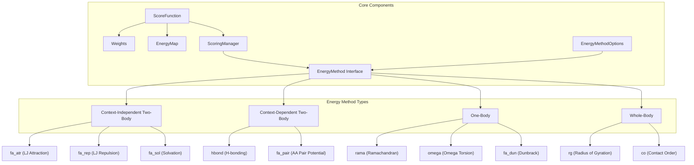
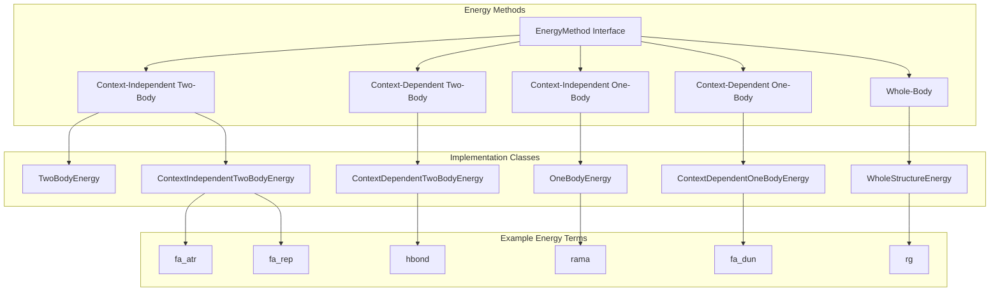
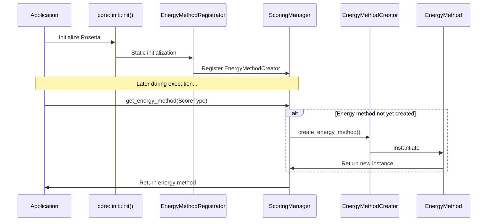

# Score Function and Energy Methods

<details>
<summary>Relevant source files</summary>

The following files were used as context for generating this wiki page:

- [source/src/core.3.src.settings](source/src/core.3.src.settings)
- [source/src/core.4.src.settings](source/src/core.4.src.settings)
- [source/src/core/init/init.cc](source/src/core/init/init.cc)
- [source/src/core/pose/datacache/CacheableDataType.cc](source/src/core/pose/datacache/CacheableDataType.cc)
- [source/src/core/pose/datacache/CacheableDataType.hh](source/src/core/pose/datacache/CacheableDataType.hh)
- [source/src/core/scoring/ScoreType.hh](source/src/core/scoring/ScoreType.hh)
- [source/src/core/scoring/ScoreTypeManager.cc](source/src/core/scoring/ScoreTypeManager.cc)
- [source/src/core/scoring/ScoringManager.cc](source/src/core/scoring/ScoringManager.cc)
- [source/src/core/scoring/ScoringManager.hh](source/src/core/scoring/ScoringManager.hh)
- [source/src/core/scoring/methods/EnergyMethodOptions.cc](source/src/core/scoring/methods/EnergyMethodOptions.cc)
- [source/src/core/scoring/methods/EnergyMethodOptions.hh](source/src/core/scoring/methods/EnergyMethodOptions.hh)
- [source/src/core/select/residue_selector/ResidueSelectorCreators.hh](source/src/core/select/residue_selector/ResidueSelectorCreators.hh)
- [source/src/core/simple_metrics/per_residue_metrics/PerResidueBfactorMetric.cc](source/src/core/simple_metrics/per_residue_metrics/PerResidueBfactorMetric.cc)
- [source/src/core/simple_metrics/per_residue_metrics/PerResidueBfactorMetric.fwd.hh](source/src/core/simple_metrics/per_residue_metrics/PerResidueBfactorMetric.fwd.hh)
- [source/src/core/simple_metrics/per_residue_metrics/PerResidueBfactorMetric.hh](source/src/core/simple_metrics/per_residue_metrics/PerResidueBfactorMetric.hh)
- [source/src/core/simple_metrics/per_residue_metrics/PerResidueBfactorMetricCreator.hh](source/src/core/simple_metrics/per_residue_metrics/PerResidueBfactorMetricCreator.hh)
- [source/src/protocols/carbohydrates/IdealizeAnomericHydrogens.cc](source/src/protocols/carbohydrates/IdealizeAnomericHydrogens.cc)
- [source/src/protocols/init/init.SimpleMetricCreators.ihh](source/src/protocols/init/init.SimpleMetricCreators.ihh)
- [source/src/protocols/init/init.SimpleMetricRegistrators.ihh](source/src/protocols/init/init.SimpleMetricRegistrators.ihh)
- [source/src/protocols/parser/ScoreFunctionLoader.cc](source/src/protocols/parser/ScoreFunctionLoader.cc)
- [source/test/core.test.settings](source/test/core.test.settings)
- [source/test/core/pose/datacache/CacheableDataType.cxxtest.hh](source/test/core/pose/datacache/CacheableDataType.cxxtest.hh)
- [tests/integration/tests/simple_metrics_b_factor/README.txt](tests/integration/tests/simple_metrics_b_factor/README.txt)
- [tests/integration/tests/simple_metrics_b_factor/command](tests/integration/tests/simple_metrics_b_factor/command)
- [tests/integration/tests/simple_metrics_b_factor/inputs/3gml.pdb](tests/integration/tests/simple_metrics_b_factor/inputs/3gml.pdb)
- [tests/integration/tests/simple_metrics_b_factor/inputs/rosetta.flags](tests/integration/tests/simple_metrics_b_factor/inputs/rosetta.flags)

</details>


This page documents Rosetta's scoring system, which is responsible for evaluating the energy of molecular structures. The scoring system is a fundamental component that enables Rosetta to discriminate between good and bad structures during modeling, design, and analysis processes.

## Scoring System Overview

Rosetta's scoring system revolves around the `ScoreFunction` class, which combines multiple weighted energy terms to calculate the total energy of a molecular structure. Each energy term (referred to as an "Energy Method") models a different physical or chemical aspect of the molecule, such as van der Waals interactions, hydrogen bonding, or electrostatic forces.



Sources: [source/src/core/scoring/ScoreFunction.hh], [source/src/core/scoring/ScoreType.hh], [source/src/core/scoring/ScoringManager.hh], [source/src/core/scoring/methods/EnergyMethodOptions.hh]

## Core Components

### ScoreFunction

The `ScoreFunction` class is the central component that manages the collection of energy terms and their weights. It provides methods to:

- Evaluate the energy of a molecular structure (Pose)
- Apply different weights to various energy terms
- Calculate energy derivatives for optimization
- Display the energy breakdown by term

The `ScoreFunction` uses the `ScoringManager` to access specific energy methods and an `EnergyMap` to store the calculated energy values.

### ScoreType

Rosetta defines a comprehensive enumeration of all possible energy terms in the `ScoreType` enum. Some of the most commonly used terms include:

| ScoreType | Description | Category |
|-----------|-------------|----------|
| fa_atr | Lennard-Jones attractive | Context-Independent Two-Body |
| fa_rep | Lennard-Jones repulsive | Context-Independent Two-Body |
| fa_sol | Lazaridis-Karplus solvation | Context-Independent Two-Body |
| fa_elec | Coulombic electrostatics | Context-Independent Two-Body |
| hbond_sr_bb | Short-range backbone H-bonds | Context-Dependent Two-Body |
| hbond_lr_bb | Long-range backbone H-bonds | Context-Dependent Two-Body |
| hbond_bb_sc | Backbone-sidechain H-bonds | Context-Dependent Two-Body |
| hbond_sc | Sidechain-sidechain H-bonds | Context-Dependent Two-Body |
| rama | Ramachandran preferences | One-Body |
| p_aa_pp | Probability of amino acid given phi/psi | One-Body |
| fa_dun | Dunbrack rotamer library energy | One-Body |
| ref | Reference energy for amino acids | One-Body |

Sources: [source/src/core/scoring/ScoreType.hh:35-760]

### EnergyMethod

The `EnergyMethod` interface defines how energy terms calculate their contributions. All energy terms in Rosetta are implemented as classes that inherit from this interface. Key methods include:

- `evaluate_energy(pose, energies)`: Calculates the energy contribution for a given pose
- `finalize_total_energy(pose, energies)`: Performs post-processing after all energies are calculated

Energy methods are categorized by their context-dependency and the number of bodies they consider.

### EnergyMethodOptions

The `EnergyMethodOptions` class provides a centralized collection of parameters that control how energy methods calculate their energies. These options include:

- Electrostatics parameters (dielectric constant, cutoffs)
- Van der Waals parameters
- Hydrogen bonding criteria
- Solvation model settings
- Many other specialized parameters

Options can be set programmatically or via command-line flags.

Sources: [source/src/core/scoring/methods/EnergyMethodOptions.hh], [source/src/core/scoring/methods/EnergyMethodOptions.cc:72-202]

### ScoringManager

The `ScoringManager` is a singleton class that manages the registration and creation of energy methods. It handles:

- Creating energy methods on demand
- Lazy loading of data required by energy methods
- Managing shared resources between energy methods

The `ScoringManager` uses a factory pattern where each energy term has a corresponding `EnergyMethodCreator` class that knows how to instantiate the energy method.

Sources: [source/src/core/scoring/ScoringManager.cc:142-799], [source/src/core/scoring/ScoringManager.hh]

## Energy Method Types

Energy methods in Rosetta are categorized based on how they calculate energy:



Sources: [source/src/core/scoring/ScoreType.hh:35-760], [source/src/core/scoring/methods/EnergyMethod.hh]

### Context-Independent Two-Body Energy Methods

These methods calculate energy between pairs of atoms or residues without considering the broader molecular context. They are typically used for basic physical interactions like:

- `fa_atr`: Lennard-Jones attraction
- `fa_rep`: Lennard-Jones repulsion
- `fa_sol`: Lazaridis-Karplus solvation
- `fa_elec`: Coulombic electrostatics

### Context-Dependent Two-Body Energy Methods

These methods take into account the surrounding molecular environment when calculating pair interactions. Examples include:

- `hbond_sc`: Sidechain-sidechain hydrogen bonds
- `fa_pair`: Knowledge-based pair potential
- `ch_bond`: Carbon-hydrogen bonds

### One-Body Energy Methods

These methods calculate energy based on individual residues:

- `rama`: Ramachandran preferences
- `fa_dun`: Dunbrack rotamer energy
- `p_aa_pp`: Probability of amino acid given phi/psi
- `omega`: Omega torsion potential

### Whole-Body Energy Methods

These methods consider the entire structure to calculate their energy contribution:

- `rg`: Radius of gyration
- `co`: Contact order
- `holes`: Packing quality

Sources: [source/src/core/scoring/ScoreType.hh:35-357], [source/src/core/energy_methods/]

## Initialization and Registration Process

Energy methods in Rosetta are registered with the `ScoringManager` using a factory pattern. This process starts at application initialization:



The registration process happens through static initialization in `core/init/init.cc`, where each energy method creator is registered with the `ScoringManager` through an `EnergyMethodRegistrator`.

Sources: [source/src/core/init/init.cc:440-510], [source/src/core/scoring/ScoringManager.cc:442-509]

## Common Usage Patterns

### Creating a ScoreFunction

```cpp
// Get the default score function
ScoreFunctionOP score_function = core::scoring::get_score_function();

// Get a specific named score function
ScoreFunctionOP score_function = core::scoring::get_score_function("ref2015");
```

### Evaluating Energy

```cpp
// Score an entire pose
Real energy = score_function->score(pose);

// Get the breakdown of energy terms
EnergyMap energies = pose.energies().total_energies();
```

### Setting Weights

```cpp
// Set the weight for a specific energy term
score_function->set_weight(fa_atr, 0.8);

// Zero the weight for an energy term
score_function->set_weight(fa_elec, 0.0);
```

### Creating Custom Score Functions

```cpp
// Create an empty score function
ScoreFunctionOP score_function = utility::pointer::make_shared<ScoreFunction>();

// Add energy terms with weights
score_function->set_weight(fa_atr, 1.0);
score_function->set_weight(fa_rep, 0.55);
score_function->set_weight(fa_sol, 1.0);
score_function->set_weight(hbond_sr_bb, 1.0);
```

## Advanced Topics

### Adding Custom Energy Methods

To add a custom energy method to Rosetta:

1. Create a new class that inherits from the appropriate `EnergyMethod` base class
2. Implement the `evaluate_energy` and `finalize_total_energy` methods
3. Create an `EnergyMethodCreator` class for your energy method
4. Register your creator with the `ScoringManager` using an `EnergyMethodRegistrator`

### Energy Method Options

The `EnergyMethodOptions` class provides extensive customization of energy calculation parameters. Some examples include:

- Electrostatics parameters:
  ```cpp
  options.exclude_protein_protein_fa_elec(true);
  options.elec_max_dis(5.5);
  options.elec_min_dis(1.6);
  options.elec_die(10.0);
  ```

- Hydrogen bonding parameters:
  ```cpp
  options.hbond_options()->exclude_bb_bb(false);
  options.hbond_options()->smooth_hb_potential(true);
  ```

Sources: [source/src/core/scoring/methods/EnergyMethodOptions.cc:72-202], [source/src/core/scoring/methods/EnergyMethodOptions.hh]

## Related Pages

For more information about related topics, see:
- [Scoring System Overview](#3) - General overview of the scoring system
- [FACTS Solvation Model](#3.2) - Details about the FACTS solvation model
- [Electron Density Scoring](#3.3) - Information about electron density scoring

---