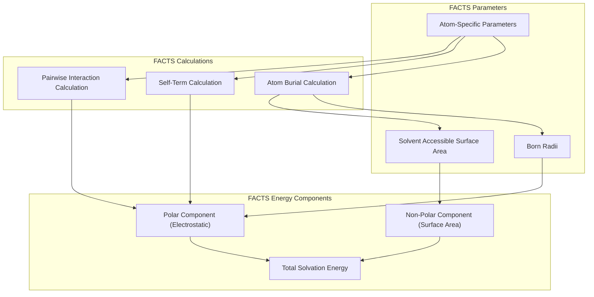
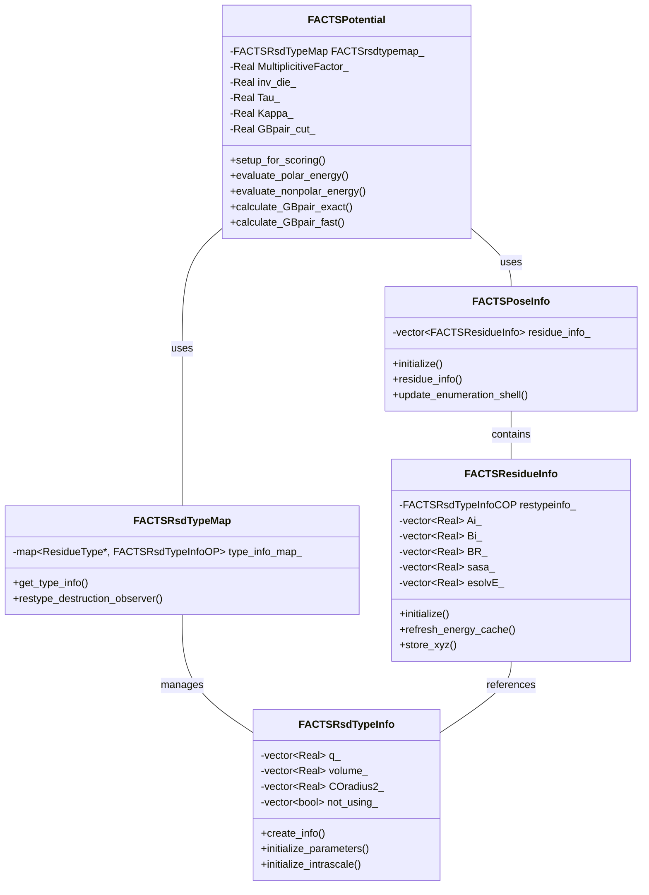
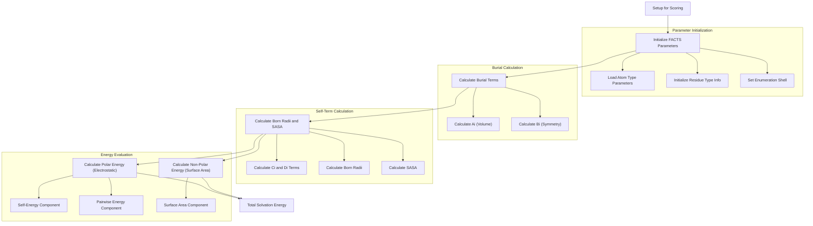

# FACTS Solvation Model

<details>
<summary>Relevant source files</summary>

The following files were used as context for generating this wiki page:

- [database/chemical/atom_type_sets/fa_standard/extras/facts_born_params.epm1.txt](database/chemical/atom_type_sets/fa_standard/extras/facts_born_params.epm1.txt)
- [database/scoring/weights/scorefacts_cart.wts](database/scoring/weights/scorefacts_cart.wts)
- [source/doc/options.dox](source/doc/options.dox)
- [source/src/basic/options/options_rosetta.py](source/src/basic/options/options_rosetta.py)
- [source/src/core/scoring/facts/FACTSPotential.cc](source/src/core/scoring/facts/FACTSPotential.cc)
- [source/src/core/scoring/facts/FACTSPotential.hh](source/src/core/scoring/facts/FACTSPotential.hh)
- [source/src/core/scoring/facts/FACTSResidue.cc](source/src/core/scoring/facts/FACTSResidue.cc)

</details>


## Purpose and Scope

This document describes the FACTS (Fast Analytical Continuum Treatment of Solvation) model implemented in Rosetta. FACTS is an implicit solvent model used to efficiently calculate the solvation free energy of biomolecules. It provides an analytical approximation for both polar (electrostatic) and non-polar (surface area) contributions to solvation. 

The FACTS model is a critical component of Rosetta's scoring system when considering solvent effects during protein modeling, design, and energy calculations. For more information about the general scoring systems in Rosetta, see [Score Function and Energy Methods](#3.1).

## Overview

FACTS uses an analytical approach to calculate solvation energies without explicitly representing water molecules, making it computationally efficient compared to explicit solvent models. It approximates the Born radii for each atom and calculates solvation free energies based on these radii and solvent accessible surface areas (SASA).



Sources: [source/src/core/scoring/facts/FACTSPotential.cc](), [source/src/core/scoring/facts/FACTSResidue.cc]()

## Architecture and Class Hierarchy

The FACTS model implementation in Rosetta consists of several interrelated classes that handle different aspects of the solvation calculation.



Sources: [source/src/core/scoring/facts/FACTSPotential.hh:47-260](), [source/src/core/scoring/facts/FACTSResidue.cc:64-475]()

### Core Classes

1. **FACTSPotential**: The main class that provides methods for calculating solvation energies. It handles the setup of the FACTS model for scoring and contains the core algorithms for energy evaluation.

2. **FACTSPoseInfo**: Stores FACTS-related information for an entire pose (molecular structure). It manages a collection of FACTSResidueInfo objects.

3. **FACTSResidueInfo**: Contains FACTS-specific data for individual residues, including calculated values such as Born radii, SASA, and energy components.

4. **FACTSRsdTypeInfo**: Provides residue type-specific parameters and constants needed for FACTS calculations.

5. **FACTSRsdTypeMap**: A database that maps residue types to their corresponding FACTS parameter sets (FACTSRsdTypeInfo).

Sources: [source/src/core/scoring/facts/FACTSPotential.hh:47-260](), [source/src/core/scoring/facts/FACTSResidue.cc:64-475](), [source/src/core/scoring/facts/FACTSResidue.cc:479-507]()

## Calculation Workflow

The FACTS calculation follows a systematic procedure to compute solvation energies:



Sources: [source/src/core/scoring/facts/FACTSPotential.cc:138-277](), [source/src/core/scoring/facts/FACTSPotential.cc:439-503]()

### 1. Setup Phase

When setting up FACTS for scoring, the system follows these steps:

1. **Initialize FACTS Parameters**: Load atom-specific parameters from database files
2. **Set Enumeration Shell**: Determine which residues need recalculation
3. **Store Current Coordinates**: Save the current atomic positions for reference

The setup phase is handled by the `setup_for_scoring` method in the `FACTSPotential` class:

```cpp
void FACTSPotential::setup_for_scoring(pose::Pose & pose, bool const & packing) const
```

Sources: [source/src/core/scoring/facts/FACTSPotential.cc:138-277]()

### 2. Burial Calculation

The burial calculation determines how buried each atom is within the molecular structure:

1. **Calculate Volume (Ai)**: Compute the volume occupied by surrounding atoms
2. **Calculate Symmetry (Bi)**: Measure the symmetry of the surrounding environment

This is performed by the `res_res_burial_for_scoring` method:

```cpp
void FACTSPotential::res_res_burial_for_scoring(
    conformation::Residue const & rsd1,
    FACTSResidueInfo & facts1,
    conformation::Residue const & rsd2,
    FACTSResidueInfo & facts2
) const
```

Sources: [source/src/core/scoring/facts/FACTSPotential.cc:348-436]()

### 3. Self-Term Calculation

After burial calculation, the system computes:

1. **Ci Terms**: Combined volume and symmetry terms
2. **Born Radii**: Effective radii for electrostatic calculations
3. **SASA**: Solvent accessible surface area for each atom

This is handled by the `get_self_terms` method:

```cpp
void FACTSPotential::get_self_terms(
    FACTSRsdTypeInfoCOP factstype1,
    FACTSResidueInfo & facts1,
    bool const packing
) const
```

Sources: [source/src/core/scoring/facts/FACTSPotential.cc:439-503]()

### 4. Energy Calculation

Finally, the system calculates the energy components:

1. **Polar Energy**: Electrostatic interaction with solvent
2. **Non-Polar Energy**: Surface area-based energy contribution

This is performed by `evaluate_polar_energy` and `evaluate_nonpolar_energy` methods.

Sources: [source/src/core/scoring/facts/FACTSPotential.cc:616-801]()

## Mathematical Model

The FACTS model is based on analytical approximations for calculating solvation energies. The key equations implement:

### Born Radii Calculation

The Born radius represents the effective distance from an atom to the solvent. It is calculated using:

1. **Volume Term (Ai)**: Represents the volume occupied by surrounding atoms
   ```
   Ai = Σj≠i Vj * θij
   ```

2. **Symmetry Term (Bi)**: Measures the asymmetry of the surrounding environment
   ```
   Bi = |Σj≠i (Vj/rij²) * (ri - rj)| / Σj≠i (Vj/rij)
   ```

3. **Combined Term (Ci)**: 
   ```
   Ci = Ai + b1 * Bi + b2 * Ai * Bi
   ```

4. **Born Radius (BR)**: 
   ```
   BR = -0.5 * τ * MultiplicativeFactor / esolvE
   ```

Sources: [source/src/core/scoring/facts/FACTSPotential.cc:282-345](), [source/src/core/scoring/facts/FACTSPotential.cc:439-503]()

### Solvent Accessible Surface Area (SASA)

The SASA is calculated using a similar approach:

1. **Combined Term (Di)**:
   ```
   Di = Ai + d1 * Bi + d2 * Ai * Bi
   ```

2. **SASA Calculation**:
   ```
   SASA = c0 + c1/(1 + exp(-c2 * (Di - c3)))
   ```

Sources: [source/src/core/scoring/facts/FACTSPotential.cc:439-503]()

## Parameter System

FACTS relies on a comprehensive set of parameters for different atom types. These parameters are stored in database files and loaded at runtime.

### Parameter Categories

The main parameter file is `facts_born_params.epm1.txt`, which contains parameters for different atom types:

| Parameter | Description |
|-----------|-------------|
| FACTS_RADIUS | Van der Waals radius for the atom |
| FACTS_CUT | Cutoff radius for calculations |
| FACTS_ALPHA | Parameter related to atom polarizability |
| FACTS_B1, FACTS_B2 | Parameters for the Bi term |
| FACTS_D1, FACTS_D2 | Parameters for the Di term |
| FACTS_A0-A3 | Parameters for Born radii calculation |
| FACTS_C0-C3 | Parameters for SASA calculation |

Sources: [database/chemical/atom_type_sets/fa_standard/extras/facts_born_params.epm1.txt:1-57]()

### Parameter Initialization

Parameters are loaded and initialized in the `initialize_parameters` method of `FACTSRsdTypeInfo`:

```cpp
void FACTSRsdTypeInfo::initialize_parameters(chemical::ResidueType const & rsd)
```

This method reads parameters from the atom type set's extra parameters and assigns them to each atom in the residue.

Sources: [source/src/core/scoring/facts/FACTSResidue.cc:77-266]()

## Configuration Options

FACTS behavior can be customized through several configuration options:

| Option | Description |
|--------|-------------|
| facts_kappa | Debye-Hückel screening parameter |
| facts_die | Dielectric constant |
| facts_GBpair_cut | Cutoff for GB pair calculations |
| facts_eq_type | Equation type ("exact", "apprx", "v1trunk") |
| facts_asp_patch | ASP patch version (1, 2, or 3) |
| facts_charge_dir | Directory containing charge parameters |
| facts_saltbridge_correction | Correction factor for salt bridges |

Sources: [source/src/core/scoring/facts/FACTSPotential.cc:93-135](), [source/src/core/scoring/facts/FACTSResidue.cc:102-111]()

## Performance Optimizations

FACTS implements several optimizations to improve computational efficiency:

### Multiple Calculation Methods

The system provides three methods for calculating GB pair interactions:

1. **Exact**: Most accurate but computationally expensive
   ```cpp
   void FACTSPotential::calculate_GBpair_exact(...)
   ```

2. **Fast Approximation**: Less accurate but faster
   ```cpp
   void FACTSPotential::calculate_GBpair_fast(...)
   ```

3. **V1 Truncation**: Intermediate approach
   ```cpp
   void FACTSPotential::calculate_GBpair_v1trunk(...)
   ```

The method can be selected using the `facts_eq_type` option.

Sources: [source/src/core/scoring/facts/FACTSPotential.cc:233-239]()

### Enumeration Shell

FACTS uses an "enumeration shell" concept to avoid recalculating energies for residues that haven't changed:

```cpp
// Set enumeration shell / store current coordinate
for (res1 = 1; res1 <= nres; ++res1) {
    FACTSResidueInfo & facts1(facts_info->residue_info(res1));
    
    if (packing) { // Nothing to take care of; just do full enumeration
        facts1.set_enumeration_shell(true);
    } else { // Scoring, minimizing; refresh energy cache for enumeration shell
        if (facts1.enumeration_shell()) {
            facts1.refresh_energy_cache(nres);
            TR.Debug << " " << res1;
            nshell++;
        }
        facts1.store_xyz(pose.residue(res1));
    }
}
```

Sources: [source/src/core/scoring/facts/FACTSPotential.cc:162-181]()

## Integration with Scoring System

FACTS is integrated into Rosetta's scoring system as an energy method. It contributes two main terms to the overall score:

1. **facts_elec**: The polar (electrostatic) component
2. **facts_solv**: The polar solvation component 
3. **facts_sasa**: The non-polar (surface area) component

These terms can be weighted in score functions, as shown in the `scorefacts_cart.wts` file:

```
facts_elec 0.25
facts_solv 0.25
facts_sasa 1.0
```

Sources: [database/scoring/weights/scorefacts_cart.wts:5-7]()

## Usage Example

To use FACTS in a Rosetta protocol, you need to:

1. Ensure a score function that includes FACTS terms is selected
2. Configure FACTS-specific options if needed

For example, to use FACTS with a custom dielectric constant:

```
-score:facts_die 20.0
-score:facts_eq_type exact
-score:weights scorefacts_cart
```

## Limitations and Special Cases

The FACTS implementation includes special handling for certain cases:

1. **Charged Hydrogens**: Scaled differently for salt bridges
   ```cpp
   if (factstype1->is_chargedH(atm1)) facts1.BR_[atm1] *= saltbridge_correction_;
   ```

2. **Special Residue Types**: ARG, HIS, TYR, TRP, GLN, ASN have special handling for certain atom pairs
   ```cpp
   if (plane_to_self && rsd.aa() == core::chemical::aa_arg) {
       // Special handling for ARG
   }
   ```

Sources: [source/src/core/scoring/facts/FACTSPotential.cc:471](), [source/src/core/scoring/facts/FACTSResidue.cc:397-426]()

## Summary

The FACTS Solvation Model provides Rosetta with an efficient and accurate method for calculating solvation energies. It uses analytical approximations to compute Born radii and SASA values, which are then used to calculate polar and non-polar components of the solvation free energy. The implementation is highly optimized and configurable, with special handling for various atom and residue types.

---