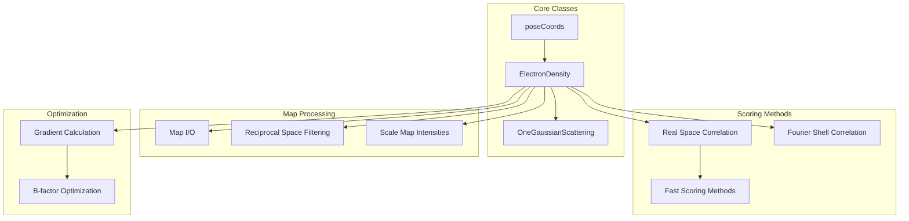
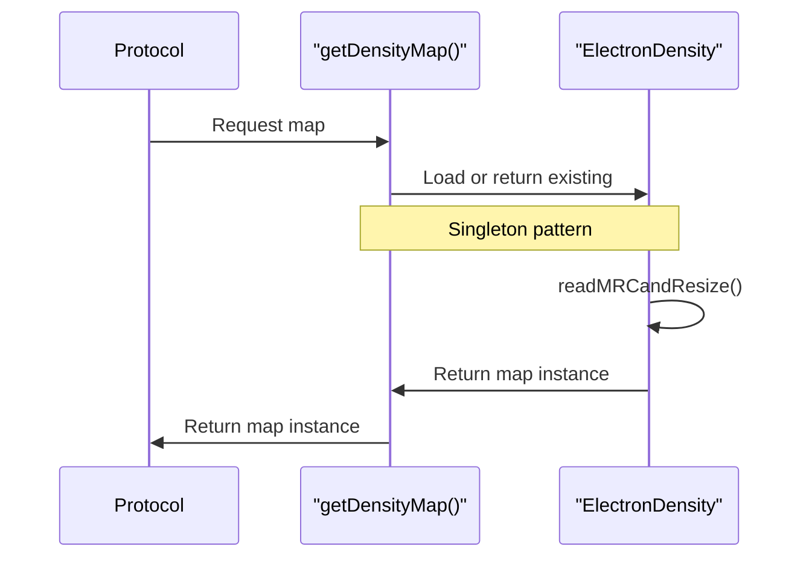
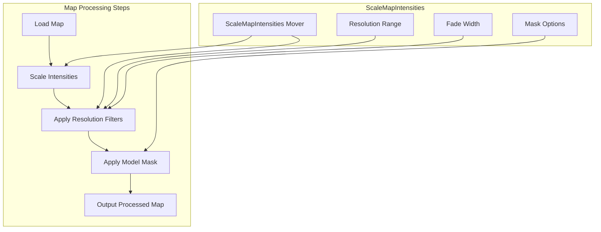
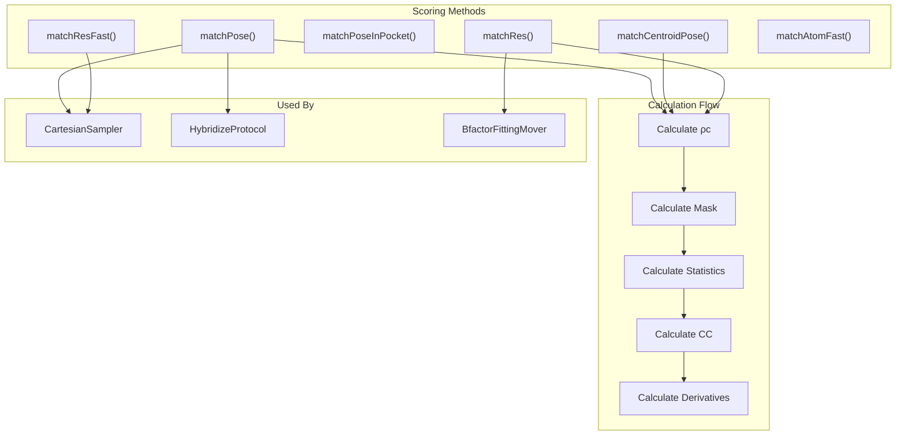
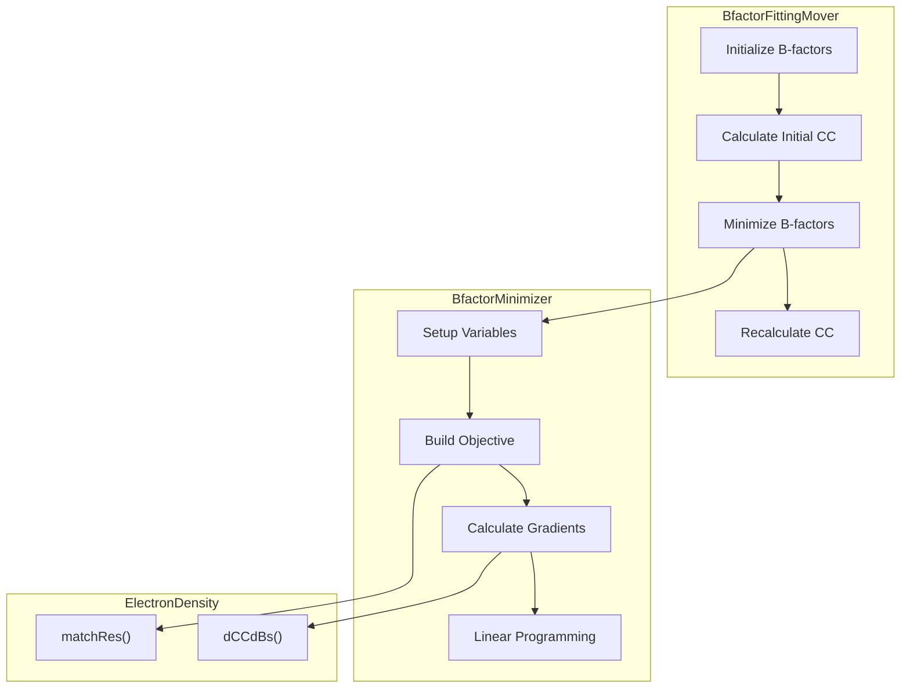
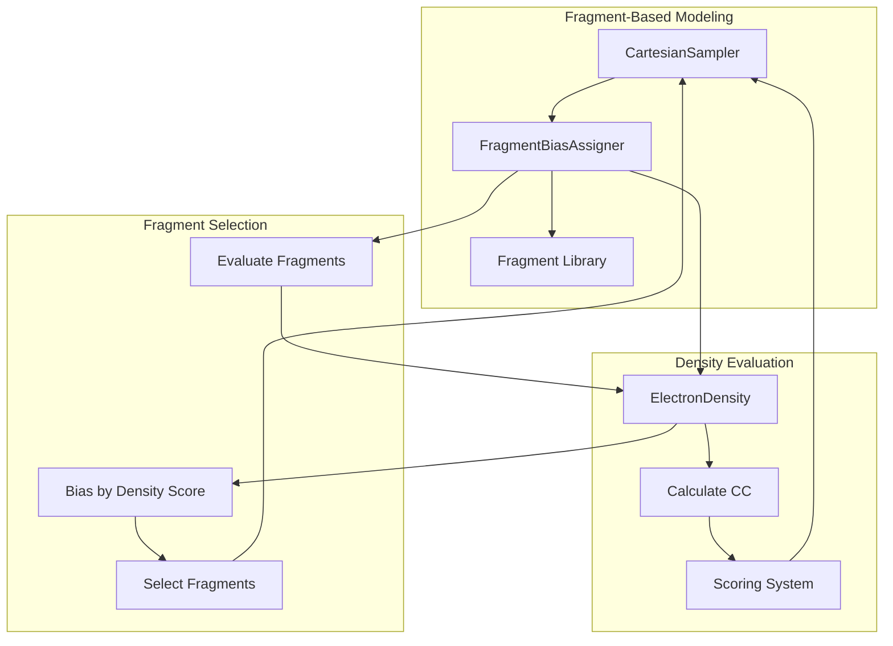
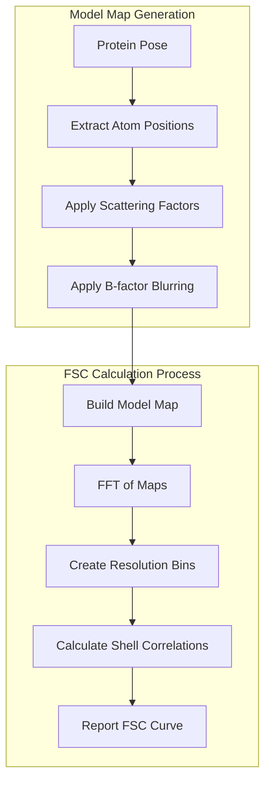

# Electron Density Scoring

<details>
<summary>Relevant source files</summary>

The following files were used as context for generating this wiki page:

- [source/src/apps/pilot/frank/pdb_to_map.cc](source/src/apps/pilot/frank/pdb_to_map.cc)
- [source/src/apps/public/electron_density/density_tools.cc](source/src/apps/public/electron_density/density_tools.cc)
- [source/src/core/scoring/electron_density/ElectronDensity.cc](source/src/core/scoring/electron_density/ElectronDensity.cc)
- [source/src/core/scoring/electron_density/ElectronDensity.hh](source/src/core/scoring/electron_density/ElectronDensity.hh)
- [source/src/core/scoring/electron_density/SplineInterp.cc](source/src/core/scoring/electron_density/SplineInterp.cc)
- [source/src/core/scoring/electron_density/util.cc](source/src/core/scoring/electron_density/util.cc)
- [source/src/core/scoring/electron_density/util.hh](source/src/core/scoring/electron_density/util.hh)
- [source/src/core/scoring/electron_density/xray_scattering.cc](source/src/core/scoring/electron_density/xray_scattering.cc)
- [source/src/core/scoring/electron_density/xray_scattering.hh](source/src/core/scoring/electron_density/xray_scattering.hh)
- [source/src/core/select/residue_selector/DensityFitResidueSelector.cc](source/src/core/select/residue_selector/DensityFitResidueSelector.cc)
- [source/src/core/select/residue_selector/DensityFitResidueSelector.hh](source/src/core/select/residue_selector/DensityFitResidueSelector.hh)
- [source/src/numeric/zscores.cc](source/src/numeric/zscores.cc)
- [source/src/protocols/electron_density/BfactorFittingMover.cc](source/src/protocols/electron_density/BfactorFittingMover.cc)
- [source/src/protocols/electron_density/BfactorFittingMover.hh](source/src/protocols/electron_density/BfactorFittingMover.hh)
- [source/src/protocols/electron_density/ReportFSC.cc](source/src/protocols/electron_density/ReportFSC.cc)
- [source/src/protocols/electron_density/ReportFSC.hh](source/src/protocols/electron_density/ReportFSC.hh)
- [source/src/protocols/electron_density/ScaleMapIntensities.cc](source/src/protocols/electron_density/ScaleMapIntensities.cc)
- [source/src/protocols/electron_density/ScaleMapIntensities.hh](source/src/protocols/electron_density/ScaleMapIntensities.hh)
- [source/src/protocols/electron_density/util.cc](source/src/protocols/electron_density/util.cc)
- [source/src/protocols/hybridization/CartesianHybridize.cc](source/src/protocols/hybridization/CartesianHybridize.cc)
- [source/src/protocols/hybridization/CartesianHybridize.hh](source/src/protocols/hybridization/CartesianHybridize.hh)
- [source/src/protocols/hybridization/CartesianSampler.cc](source/src/protocols/hybridization/CartesianSampler.cc)
- [source/src/protocols/hybridization/CartesianSampler.hh](source/src/protocols/hybridization/CartesianSampler.hh)
- [source/src/protocols/hybridization/ChunkTrialMover.cc](source/src/protocols/hybridization/ChunkTrialMover.cc)
- [source/src/protocols/hybridization/ChunkTrialMover.hh](source/src/protocols/hybridization/ChunkTrialMover.hh)
- [source/src/protocols/hybridization/FoldTreeHybridize.cc](source/src/protocols/hybridization/FoldTreeHybridize.cc)
- [source/src/protocols/hybridization/FoldTreeHybridize.hh](source/src/protocols/hybridization/FoldTreeHybridize.hh)
- [source/src/protocols/hybridization/FragmentBiasAssigner.cc](source/src/protocols/hybridization/FragmentBiasAssigner.cc)
- [source/src/protocols/hybridization/FragmentBiasAssigner.hh](source/src/protocols/hybridization/FragmentBiasAssigner.hh)
- [source/src/protocols/hybridization/HybridizeProtocol.cc](source/src/protocols/hybridization/HybridizeProtocol.cc)
- [source/src/protocols/hybridization/HybridizeProtocol.hh](source/src/protocols/hybridization/HybridizeProtocol.hh)
- [source/src/protocols/hybridization/InsertChunkMover.cc](source/src/protocols/hybridization/InsertChunkMover.cc)
- [source/src/protocols/hybridization/InsertChunkMover.hh](source/src/protocols/hybridization/InsertChunkMover.hh)
- [source/src/protocols/hybridization/util.cc](source/src/protocols/hybridization/util.cc)
- [source/src/protocols/hybridization/util.hh](source/src/protocols/hybridization/util.hh)
- [source/test/protocols/hybridization/HybridizeProtocolTests.cxxtest.hh](source/test/protocols/hybridization/HybridizeProtocolTests.cxxtest.hh)

</details>


This document describes the electron density scoring system in Rosetta, which enables structure modeling and refinement against experimental electron density maps from X-ray crystallography or cryo-electron microscopy (cryo-EM). For information about setting up density scoring in protocols, see the SetupForDensityScoring mover documentation.

## Overview

The electron density scoring system in Rosetta provides functionality to:

1. Load and manipulate electron density maps
2. Score protein models against these maps
3. Calculate derivatives for optimization
4. Analyze map-model agreement

The core of this functionality is implemented in the `ElectronDensity` class, which handles density map I/O, interpolation, scoring, and gradient calculations.



Sources: [source/src/core/scoring/electron_density/ElectronDensity.hh:54-665](), [source/src/core/scoring/electron_density/ElectronDensity.cc:76-307]()

## Map Representation and Management

### Loading and Accessing Maps

Electron density maps are typically loaded from MRC/CCP4 format files. A singleton pattern is used to maintain a global map instance that can be accessed throughout Rosetta.



Sources: [source/src/core/scoring/electron_density/ElectronDensity.cc:127-181](), [source/src/core/scoring/electron_density/ElectronDensity.hh:646-649]()

Key methods for accessing the map:

- `getDensityMap()` - Returns the globally accessible map singleton
- `readMRCandResize()` - Loads a map from disk and optionally resizes it
- `get()` - Retrieves the interpolated density value at a specific point

Once loaded, the map can be accessed and manipulated through the `ElectronDensity` instance. Map data is stored in a 3D array (`ObjexxFCL::FArray3D<float>`) along with metadata about grid dimensions, origin, cell parameters, and resolution.

### Map Processing

Several tools are available for map processing:

- **Scaling**: Adjust map intensities to match theoretical intensities from a model
- **Filtering**: Apply low-pass or high-pass filters in reciprocal space
- **Masking**: Create masks around models for local scoring



Sources: [source/src/protocols/electron_density/ScaleMapIntensities.cc:46-175](), [source/src/core/scoring/electron_density/ElectronDensity.cc:210-216]()

## Scoring Methods

The electron density module provides several methods to score protein models against density maps, each suited for different use cases.

### Real Space Correlation Calculations

The primary metric used for scoring is the real-space correlation coefficient (CC) between the observed density map and a calculated map generated from the model:

```
CC = (∑ρo·ρc - ∑ρo·∑ρc/n) / √[(∑ρo² - (∑ρo)²/n) · (∑ρc² - (∑ρc)²/n)]
```

Where:
- ρo is the observed density
- ρc is the calculated density
- n is the number of grid points

This calculation is implemented in the `getRSCC()` method.

Sources: [source/src/core/scoring/electron_density/ElectronDensity.cc:593-615]()

### Scoring Granularity

The system supports scoring at different levels of granularity:

1. **Whole Structure Scoring**:
   - `matchPose()` - Scores an entire protein against the map
   - `matchCentroidPose()` - Simplified scoring for centroid models

2. **Residue-level Scoring**:
   - `matchRes()` - Scores a specific residue
   - `matchResFast()` - Fast approximation for residue scoring

3. **Atom-level Scoring**:
   - `matchAtomFast()` - Scores a specific atom



Sources: [source/src/core/scoring/electron_density/ElectronDensity.cc:467-670](), [source/src/core/scoring/electron_density/ElectronDensity.cc:676-923](), [source/src/core/scoring/electron_density/ElectronDensity.cc:928-1066]()

### Fast Scoring Methods

For efficiency in iterative optimization, the system includes fast approximations of density scoring:

- Precomputed lookup tables for density values
- Binned B-factor representations
- Spline interpolation for density values

Sources: [source/src/core/scoring/electron_density/ElectronDensity.cc:264-425](), [source/src/core/scoring/electron_density/ElectronDensity.hh:582-587]()

## Optimization with Electron Density

### Gradient Calculations

The `ElectronDensity` class provides methods to calculate derivatives of the correlation coefficient with respect to atom positions and B-factors. These derivatives enable optimization of models against the density map.

Key gradient calculation methods:

- `dCCdx_res()` - Calculates CC derivatives with respect to atom positions
- `dCCdx_fastRes()` - Fast approximation of position derivatives
- `dCCdB_fastRes()` - Calculates derivatives with respect to B-factors

The derivatives are used in various minimization protocols to refine structures against experimental density.

Sources: [source/src/core/scoring/electron_density/ElectronDensity.cc:276-298](), [source/src/core/scoring/electron_density/ElectronDensity.hh:276-324]()

### B-factor Optimization

The `BfactorFittingMover` is a specialized mover that optimizes B-factors to improve the fit to the electron density:



Sources: [source/src/protocols/electron_density/BfactorFittingMover.cc:58-322]()

## Integration with Rosetta Protocols

The electron density scoring functionality is integrated into various Rosetta protocols for structure determination and refinement.

### Setup for Density Scoring

The `SetupForDensityScoringMover` configures a pose for density scoring by:
1. Loading the experimental map
2. Setting up scoring weights
3. Configuring necessary scorefunctions

### Fragment-Based Modeling with Density

The `FragmentBiasAssigner` and `CartesianSampler` classes incorporate density scoring into fragment-based modeling:



Sources: [source/src/protocols/hybridization/CartesianSampler.cc:132-186](), [source/src/protocols/hybridization/FragmentBiasAssigner.cc:52-95]()

### Hybridize Protocol

The `HybridizeProtocol` integrates density scoring for template-based modeling:

1. Uses density to evaluate fragments and templates
2. Guides the hybridization of fragments from different templates
3. Optimizes the final model against the density

Sources: [source/src/protocols/hybridization/HybridizeProtocol.cc:467-671]()

## Map Analysis and Validation

### Fourier Shell Correlation (FSC)

FSC is a standard validation method for assessing map-model agreement. The `ReportFSC` mover calculates FSC between the model and the experimental map:



Sources: [source/src/protocols/electron_density/ReportFSC.cc:62-114]()

## Technical Implementation Details

### Map Storage and Representation

The electron density map is stored as a 3D array (`ObjexxFCL::FArray3D<float>`) with methods for interpolation, transformation, and gradient calculation. Additional arrays store spline coefficients for fast interpolation.

Key member variables of the `ElectronDensity` class:

```
// Map data
ObjexxFCL::FArray3D< float > density;
ObjexxFCL::FArray3D< core::Real > coeffs_density_;

// Map metadata
numeric::xyzVector< int > grid_;
numeric::xyzVector< core::Real > origin_;
core::Real reso_;
```

Sources: [source/src/core/scoring/electron_density/ElectronDensity.hh:566-635]()

### X-ray Scattering Factors

The `OneGaussianScattering` class provides scattering factors for different atom types, which are used to calculate the theoretical density from a model.

Sources: [source/src/core/scoring/electron_density/xray_scattering.hh:1-150]()

### Cached Scoring Data

For efficiency, the `ElectronDensity` class maintains various caches:

- Precomputed correlation coefficients
- Per-atom derivatives
- Fast-lookup tables for density values
- Fourier transforms of the map

Sources: [source/src/core/scoring/electron_density/ElectronDensity.hh:594-607]()

## Examples and Usage

### Basic Map Loading and Scoring

```
// Access the global map instance
ElectronDensity& map = core::scoring::electron_density::getDensityMap();

// Load a map
map.readMRCandResize("my_map.mrc", 3.0, 1.0);  // 3.0 Å resolution, 1.0 Å grid spacing

// Score a pose against the map
core::Real cc = map.matchPose(pose);
```

### Optimization with Density

```
// Set up scoring with density
core::scoring::ScoreFunctionOP scorefxn = core::scoring::ScoreFunctionFactory::create_score_function("ref2015");
scorefxn->set_weight(core::scoring::elec_dens_fast, 25.0);

// Using CartesianSampler with density scoring
CartesianSampler sampler(fragments);
sampler.set_selection_bias("density");
sampler.apply(pose);

// B-factor fitting
BfactorFittingMover bfac_mover;
bfac_mover.apply(pose);
```

### Map Processing

```
// Scale map intensities
ScaleMapIntensities scale_mover;
scale_mover.set_res_high(3.0);  // High-resolution cutoff
scale_mover.set_res_low(15.0);  // Low-resolution cutoff
scale_mover.apply(pose);

// Calculate FSC
ReportFSC fsc_mover;
fsc_mover.apply(pose);
```

## Summary

The electron density scoring system in Rosetta provides a comprehensive set of tools for working with experimental electron density data. It enables structure modeling, refinement, and validation against these data through a combination of correlation-based scoring, gradient calculations, and specialized movers. The system is integrated with Rosetta's broader modeling and design capabilities, allowing for density-guided structure prediction and design.

Key components include:
1. The `ElectronDensity` class for map representation and scoring
2. Gradient calculations for optimization
3. Specialized movers for map processing and B-factor fitting
4. Integration with fragment-based modeling and hybridization protocols

---