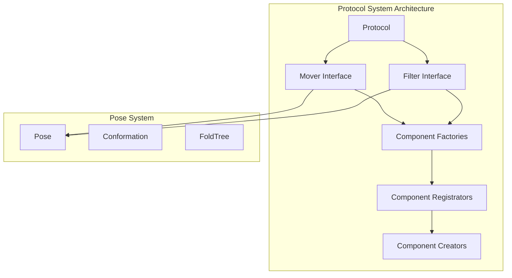
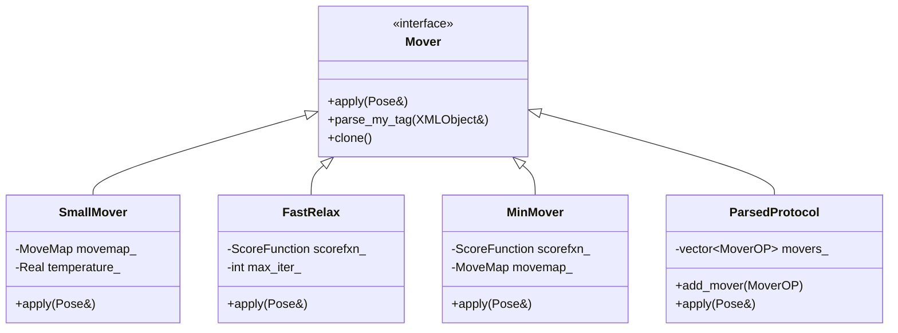
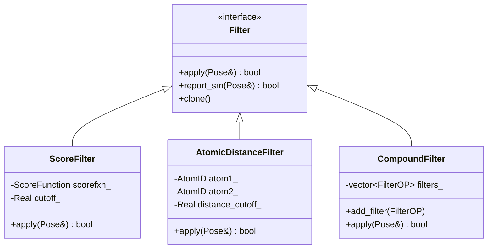
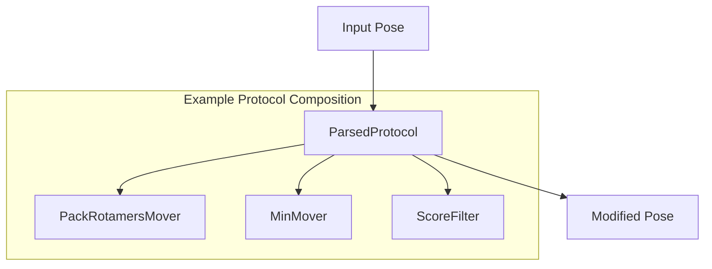
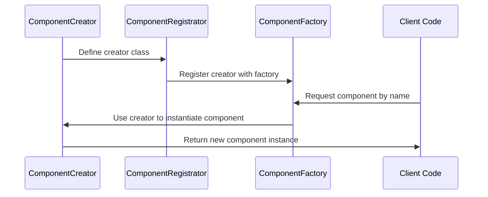
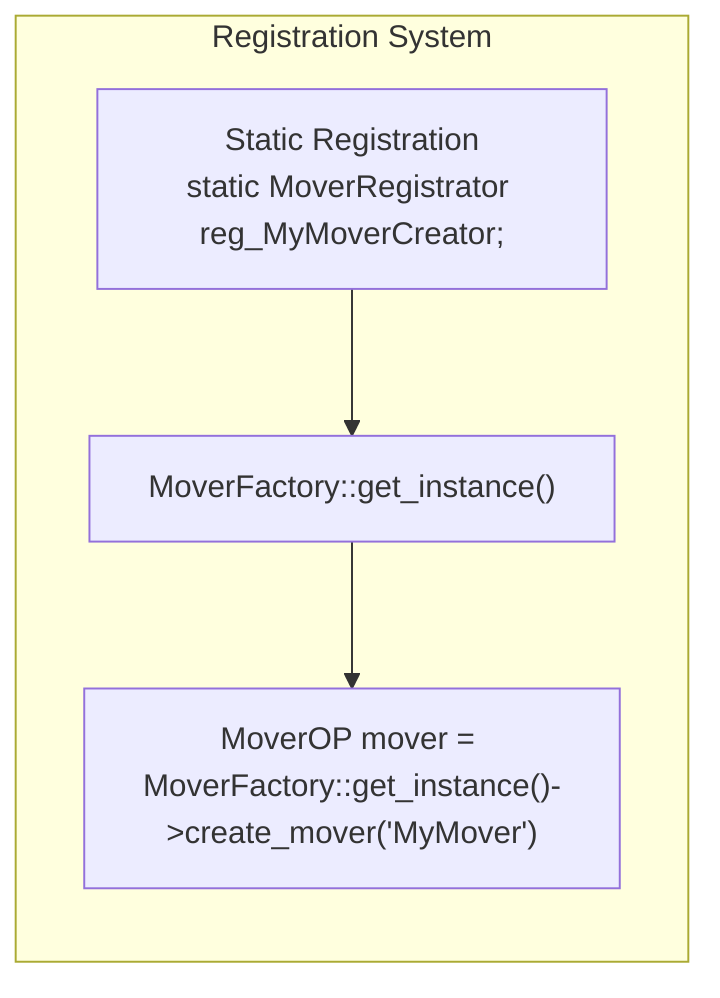
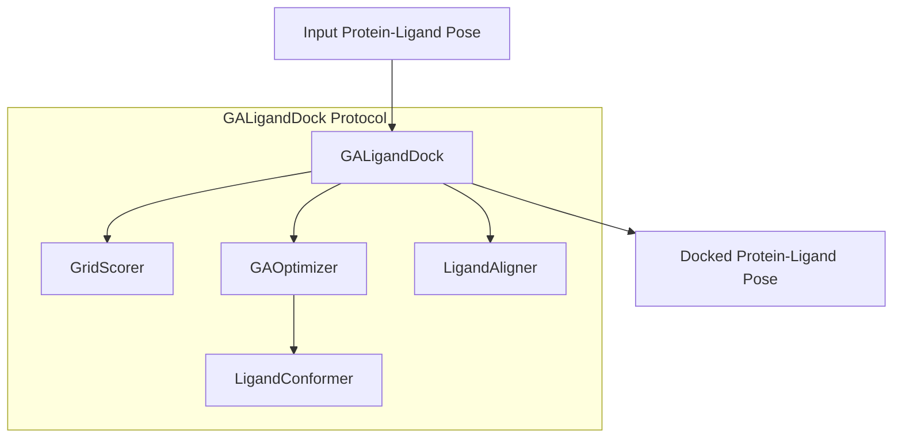
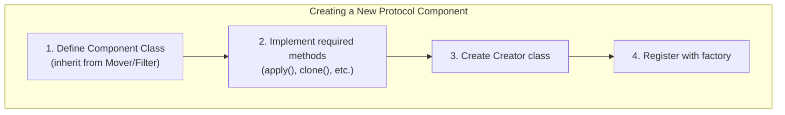
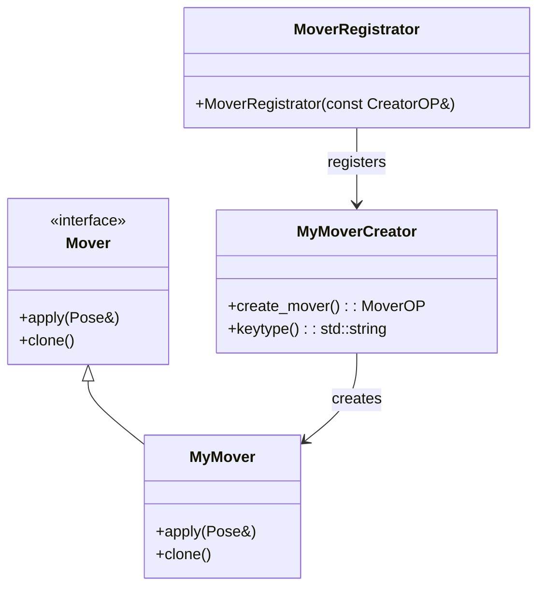
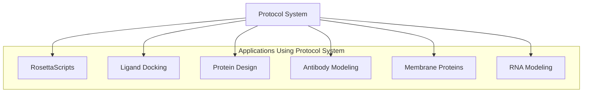

# Protocol System

Relevant source files

The following files were used as context for generating this wiki page:

- [source/external/rdkit.external.settings](source/external/rdkit.external.settings)
- [source/external/rdkit/update_rdkit.py](source/external/rdkit/update_rdkit.py)
- [source/src/apps.src.settings](source/src/apps.src.settings)
- [source/src/apps/pilot/guangfeng/align_substructure.cc](source/src/apps/pilot/guangfeng/align_substructure.cc)
- [source/src/core/chemical/rdkit/RestypeToRDMol.cc](source/src/core/chemical/rdkit/RestypeToRDMol.cc)
- [source/src/core/chemical/rdkit/RestypeToRDMol.hh](source/src/core/chemical/rdkit/RestypeToRDMol.hh)
- [source/src/core/chemical/rdkit/util.cc](source/src/core/chemical/rdkit/util.cc)
- [source/src/core/chemical/rdkit/util.hh](source/src/core/chemical/rdkit/util.hh)
- [source/src/devel.src.settings](source/src/devel.src.settings)
- [source/src/devel/denovo_design/ConnectJumps.cc](source/src/devel/denovo_design/ConnectJumps.cc)
- [source/src/devel/denovo_design/ConnectJumps.hh](source/src/devel/denovo_design/ConnectJumps.hh)
- [source/src/devel/denovo_design/filters/FoldabilityFilter.cc](source/src/devel/denovo_design/filters/FoldabilityFilter.cc)
- [source/src/devel/denovo_design/filters/FoldabilityFilter.hh](source/src/devel/denovo_design/filters/FoldabilityFilter.hh)
- [source/src/devel/denovo_design/task_operations/HighestEnergyRegion.cc](source/src/devel/denovo_design/task_operations/HighestEnergyRegion.cc)
- [source/src/devel/denovo_design/task_operations/HighestEnergyRegion.hh](source/src/devel/denovo_design/task_operations/HighestEnergyRegion.hh)
- [source/src/devel/denovo_design/task_operations/HighestEnergyRegionCreator.hh](source/src/devel/denovo_design/task_operations/HighestEnergyRegionCreator.hh)
- [source/src/devel/init.cc](source/src/devel/init.cc)
- [source/src/pilot_apps.src.settings.all](source/src/pilot_apps.src.settings.all)
- [source/src/protocols.3.src.settings](source/src/protocols.3.src.settings)
- [source/src/protocols.4.src.settings](source/src/protocols.4.src.settings)
- [source/src/protocols.7.src.settings](source/src/protocols.7.src.settings)
- [source/src/protocols/carbohydrates/RingPlaneFlipMover.cc](source/src/protocols/carbohydrates/RingPlaneFlipMover.cc)
- [source/src/protocols/carbohydrates/RingPlaneFlipMover.hh](source/src/protocols/carbohydrates/RingPlaneFlipMover.hh)
- [source/src/protocols/carbohydrates/RingPlaneFlipMoverCreator.hh](source/src/protocols/carbohydrates/RingPlaneFlipMoverCreator.hh)
- [source/src/protocols/carbohydrates/TautomerizeAnomerMover.cc](source/src/protocols/carbohydrates/TautomerizeAnomerMover.cc)
- [source/src/protocols/carbohydrates/TautomerizeAnomerMover.fwd.hh](source/src/protocols/carbohydrates/TautomerizeAnomerMover.fwd.hh)
- [source/src/protocols/carbohydrates/TautomerizeAnomerMover.hh](source/src/protocols/carbohydrates/TautomerizeAnomerMover.hh)
- [source/src/protocols/carbohydrates/TautomerizeAnomerMoverCreator.hh](source/src/protocols/carbohydrates/TautomerizeAnomerMoverCreator.hh)
- [source/src/protocols/denovo_design/calculators/CavityCalculator.cc](source/src/protocols/denovo_design/calculators/CavityCalculator.cc)
- [source/src/protocols/denovo_design/calculators/CavityCalculator.hh](source/src/protocols/denovo_design/calculators/CavityCalculator.hh)
- [source/src/protocols/denovo_design/filters/CavityVolumeFilter.cc](source/src/protocols/denovo_design/filters/CavityVolumeFilter.cc)
- [source/src/protocols/denovo_design/filters/CavityVolumeFilter.fwd.hh](source/src/protocols/denovo_design/filters/CavityVolumeFilter.fwd.hh)
- [source/src/protocols/denovo_design/filters/CavityVolumeFilter.hh](source/src/protocols/denovo_design/filters/CavityVolumeFilter.hh)
- [source/src/protocols/denovo_design/filters/CavityVolumeFilterCreator.hh](source/src/protocols/denovo_design/filters/CavityVolumeFilterCreator.hh)
- [source/src/protocols/drug_design/ConformationSelectionToRDMol.cc](source/src/protocols/drug_design/ConformationSelectionToRDMol.cc)
- [source/src/protocols/drug_design/ConformationSelectionToRDMol.hh](source/src/protocols/drug_design/ConformationSelectionToRDMol.hh)
- [source/src/protocols/drug_design/RDKitMetric.cc](source/src/protocols/drug_design/RDKitMetric.cc)
- [source/src/protocols/init/init.FilterCreators.ihh](source/src/protocols/init/init.FilterCreators.ihh)
- [source/src/protocols/init/init.FilterRegistrators.ihh](source/src/protocols/init/init.FilterRegistrators.ihh)
- [source/src/protocols/init/init.MoverCreators.ihh](source/src/protocols/init/init.MoverCreators.ihh)
- [source/src/protocols/init/init.MoverRegistrators.ihh](source/src/protocols/init/init.MoverRegistrators.ihh)
- [source/src/protocols/ligand_docking/GALigandDock/EntropyEstimator.cc](source/src/protocols/ligand_docking/GALigandDock/EntropyEstimator.cc)
- [source/src/protocols/ligand_docking/GALigandDock/EntropyEstimator.hh](source/src/protocols/ligand_docking/GALigandDock/EntropyEstimator.hh)
- [source/src/protocols/ligand_docking/GALigandDock/GALigandDock.cc](source/src/protocols/ligand_docking/GALigandDock/GALigandDock.cc)
- [source/src/protocols/ligand_docking/GALigandDock/GALigandDock.hh](source/src/protocols/ligand_docking/GALigandDock/GALigandDock.hh)
- [source/src/protocols/ligand_docking/GALigandDock/GAOptimizer.cc](source/src/protocols/ligand_docking/GALigandDock/GAOptimizer.cc)
- [source/src/protocols/ligand_docking/GALigandDock/GAOptimizer.hh](source/src/protocols/ligand_docking/GALigandDock/GAOptimizer.hh)
- [source/src/protocols/ligand_docking/GALigandDock/GridHash3D.hh](source/src/protocols/ligand_docking/GALigandDock/GridHash3D.hh)
- [source/src/protocols/ligand_docking/GALigandDock/GridScorer.cc](source/src/protocols/ligand_docking/GALigandDock/GridScorer.cc)
- [source/src/protocols/ligand_docking/GALigandDock/GridScorer.hh](source/src/protocols/ligand_docking/GALigandDock/GridScorer.hh)
- [source/src/protocols/ligand_docking/GALigandDock/LigandAligner.cc](source/src/protocols/ligand_docking/GALigandDock/LigandAligner.cc)
- [source/src/protocols/ligand_docking/GALigandDock/LigandAligner.hh](source/src/protocols/ligand_docking/GALigandDock/LigandAligner.hh)
- [source/src/protocols/ligand_docking/GALigandDock/LigandConformer.cc](source/src/protocols/ligand_docking/GALigandDock/LigandConformer.cc)
- [source/src/protocols/ligand_docking/GALigandDock/LigandConformer.hh](source/src/protocols/ligand_docking/GALigandDock/LigandConformer.hh)
- [source/src/protocols/ligand_docking/GALigandDock/util.cc](source/src/protocols/ligand_docking/GALigandDock/util.cc)
- [source/src/protocols/ligand_docking/GALigandDock/util.hh](source/src/protocols/ligand_docking/GALigandDock/util.hh)
- [source/src/protocols/protein_interface_design/movers/SecretionOptimizationMover.cc](source/src/protocols/protein_interface_design/movers/SecretionOptimizationMover.cc)
- [source/src/protocols/protein_interface_design/movers/SecretionOptimizationMover.fwd.hh](source/src/protocols/protein_interface_design/movers/SecretionOptimizationMover.fwd.hh)
- [source/src/protocols/protein_interface_design/movers/SecretionOptimizationMover.hh](source/src/protocols/protein_interface_design/movers/SecretionOptimizationMover.hh)
- [source/src/protocols/protein_interface_design/movers/SecretionOptimizationMoverCreator.hh](source/src/protocols/protein_interface_design/movers/SecretionOptimizationMoverCreator.hh)
- [source/src/protocols/simple_filters/SecretionPredictionFilter.cc](source/src/protocols/simple_filters/SecretionPredictionFilter.cc)
- [source/src/protocols/simple_moves/AddCavitiesMover.cc](source/src/protocols/simple_moves/AddCavitiesMover.cc)
- [source/src/protocols_a.5.src.settings](source/src/protocols_a.5.src.settings)
- [source/src/protocols_f.5.src.settings](source/src/protocols_f.5.src.settings)
- [source/src/protocols_h.5.src.settings](source/src/protocols_h.5.src.settings)
- [source/test/devel.test.settings](source/test/devel.test.settings)
- [source/test/devel/denovo_design/C5_Z.sym](source/test/devel/denovo_design/C5_Z.sym)
- [source/test/devel/denovo_design/FoldabilityFilter.cxxtest.hh](source/test/devel/denovo_design/FoldabilityFilter.cxxtest.hh)
- [source/test/devel/denovo_design/test_foldability.pdb](source/test/devel/denovo_design/test_foldability.pdb)
- [source/test/devel/init/filter_creators.cxxtest.hh](source/test/devel/init/filter_creators.cxxtest.hh)
- [source/test/protocols.test.settings](source/test/protocols.test.settings)
- [source/test/protocols/init/mover_creators.cxxtest.hh](source/test/protocols/init/mover_creators.cxxtest.hh)
- [tests/integration/tests/cycpep_rdkit_metric/command](tests/integration/tests/cycpep_rdkit_metric/command)
- [tests/integration/tests/cycpep_rdkit_metric/description.md](tests/integration/tests/cycpep_rdkit_metric/description.md)
- [tests/integration/tests/cycpep_rdkit_metric/inputs/d_res.txt](tests/integration/tests/cycpep_rdkit_metric/inputs/d_res.txt)
- [tests/integration/tests/cycpep_rdkit_metric/inputs/desired_makeup.comp](tests/integration/tests/cycpep_rdkit_metric/inputs/desired_makeup.comp)
- [tests/integration/tests/ga_ligand_dock/command](tests/integration/tests/ga_ligand_dock/command)
- [tests/integration/tests/test_degreaser/README.txt](tests/integration/tests/test_degreaser/README.txt)
- [tests/integration/tests/test_degreaser/asym_flags](tests/integration/tests/test_degreaser/asym_flags)
- [tests/sfxn_fingerprint/scores/gen_potential/flags](tests/sfxn_fingerprint/scores/gen_potential/flags)

## Purpose and Overview

The Protocol System is the core architecture in Rosetta that enables molecular modeling algorithms to be constructed, composed, and executed. This system provides a modular framework where different operations on molecular structures can be defined, combined, and applied in a structured way. For information about related systems that interact with protocols, see [Core Data Structures](#2).

## Architecture Overview

The Protocol System is built around several key concepts:

1. **Movers**: Components that modify molecular structures (Poses)
2. **Filters**: Components that evaluate properties of structures
3. **Protocol Composition**: Methods for combining multiple components
4. **Component Registration**: A factory-based system for registering and creating components

Sources: [source/src/protocols/init/init.MoverRegistrators.ihh](), [source/src/protocols/init/init.FilterRegistrators.ihh]()

## Core Components

### Movers

Movers are the fundamental units of computation in the Protocol System. Each Mover implements the `apply()` method which can modify a molecular structure (represented as a `Pose` object). Movers can range from simple operations (like rotating a single residue) to complex algorithms (like a full protein design protocol).

Sources: [source/src/protocols/init/init.MoverCreators.ihh](), [source/src/protocols/ligand_docking/GALigandDock/GALigandDock.hh:223-228]()

### Filters

Filters evaluate structures based on specific criteria and return whether the structure passes the filter. Filters can be used to accept or reject structures during protocol execution, making them essential for selective sampling or filtering of results.

Sources: [source/src/protocols/init/init.FilterCreators.ihh](), [source/src/protocols/simple_filters/BuriedUnsatHbondFilter.hh]()

### Composite Protocols

The Protocol System allows complex protocols to be built by combining multiple Movers and Filters. This is often done using composite Movers like `ParsedProtocol` which can contain and execute a sequence of other Movers.

Sources: [source/src/protocols/rosetta_scripts/util.hh](), [source/src/protocols/ligand_docking/GALigandDock/GALigandDock.cc:228-246]()

## Registration System

The Protocol System uses a factory pattern for component registration and creation. This allows components to be created dynamically by name, which is particularly useful for XML-based interfaces like RosettaScripts.

### Component Registration Flow

Sources: [source/src/protocols/init/init.MoverRegistrators.ihh](), [source/src/protocols/init/init.FilterRegistrators.ihh]()

### Registration Implementation

Components are registered at program initialization using static Registrator objects. For example, Movers are registered using the `MoverRegistrator` class:

Sources: [source/src/protocols/init/init.MoverRegistrators.ihh:20-26](), [source/src/devel/init.cc:14-42]()

## Example: Genetic Algorithm Ligand Docking Protocol

The `GALigandDock` class demonstrates a complete Protocol implementation that uses many aspects of the Protocol System. This protocol implements a genetic algorithm for ligand docking using pre-computed grids.

Sources: [source/src/protocols/ligand_docking/GALigandDock/GALigandDock.hh:223-228](), [source/src/protocols/ligand_docking/GALigandDock/GALigandDock.cc:105-218]()

## Creating New Protocol Components

### Component Creation Process

To create a new Protocol component, you typically need to:

1. Define a new class that inherits from the appropriate base class (e.g., `Mover` for a new Mover)
2. Implement the required methods (e.g., `apply()` for Movers)
3. Create a Creator class for your component
4. Register your component with the appropriate factory using a Registrator

Sources: [source/src/protocols/ligand_docking/GALigandDock/GALigandDockCreator.hh](), [source/src/protocols/init/init.MoverCreators.ihh:16-20]()

### Component Registration Example

Here's an example structure of how a component might be registered:

Sources: [source/src/protocols/init/init.MoverRegistrators.ihh:20-26](), [source/src/devel/init.cc:28-46]()

## Protocol System Integration Points

The Protocol System integrates with other key systems in Rosetta:

| System | Integration Point | Purpose |
|--------|-------------------|---------|
| Pose System | Movers and Filters operate on Pose objects | Protocols modify and evaluate molecular structures |
| Scoring System | Protocols use ScoreFunction objects | Energy evaluation and optimization |
| Task System | TaskOperations modify packing tasks | Control of design and optimization behavior |
| I/O System | PoseInputters and PoseOutputters | Reading and writing structures during protocol execution |
| Job Distribution | JobDistributors and JobQueens | Parallel execution of protocols |

Sources: [source/src/protocols/jd3/job_distributors/MPIWorkPoolJobDistributor.hh](), [source/src/protocols/rosetta_scripts/RosettaScriptsParser.hh]()

## Protocol System in Applications

The Protocol System is used extensively throughout Rosetta's applications:

Sources: [source/src/apps.src.settings:61-394](), [source/src/pilot_apps.src.settings.all:27-195]()

## Best Practices

When working with the Protocol System, consider these best practices:

1. **Modularity**: Design protocols to be modular with clear separation of concerns
2. **Reusability**: Create components that can be reused in different contexts
3. **Configuration**: Make protocols configurable through parameters
4. **Error Handling**: Implement proper error handling and validation
5. **Documentation**: Document protocols thoroughly, including requirements and limitations

Sources: [source/src/protocols/ligand_docking/GALigandDock/GALigandDock.hh:223-228](), [source/src/protocols/ligand_docking/GALigandDock/GALigandDock.cc:105-218]()

---