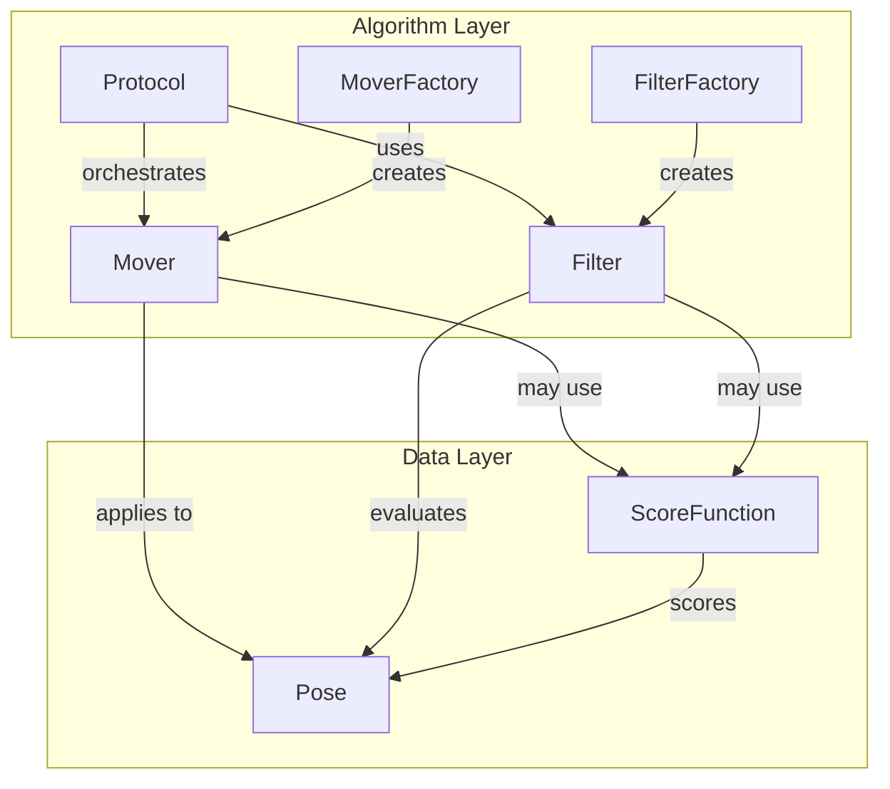
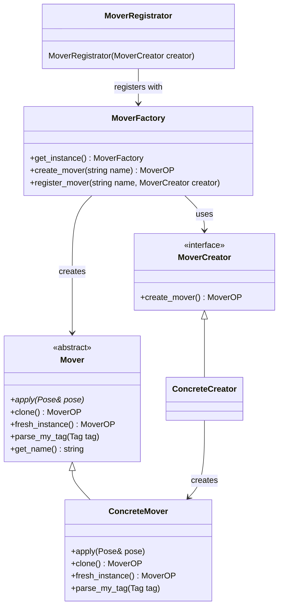
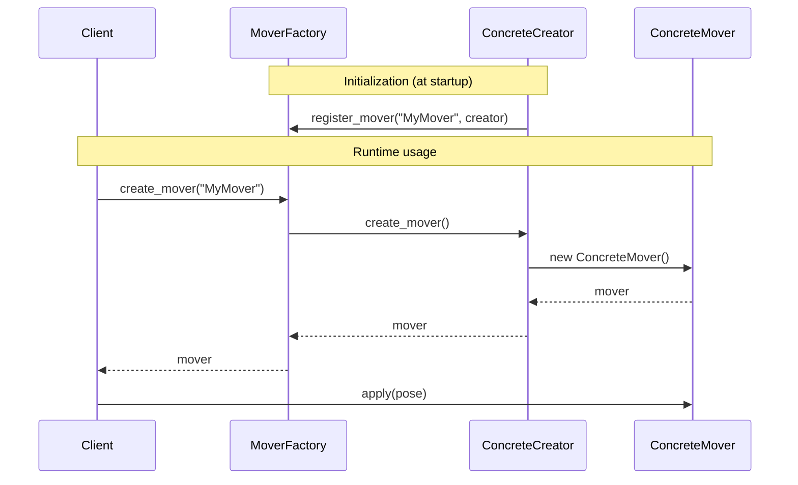
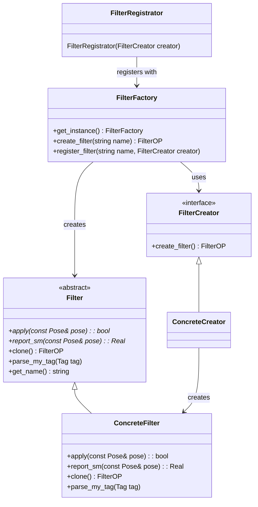
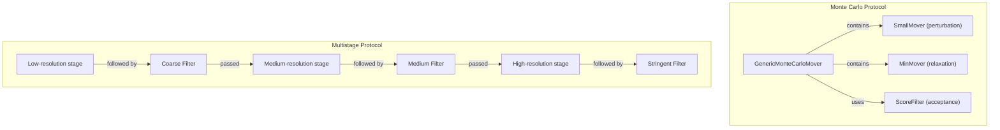

# Movers and Filters

<details>
<summary>Relevant source files</summary>

The following files were used as context for generating this wiki page:

- [source/src/apps.src.settings](source/src/apps.src.settings)
- [source/src/core/chemical/orbitals/ICoorOrbitalData.hh](source/src/core/chemical/orbitals/ICoorOrbitalData.hh)
- [source/src/devel.src.settings](source/src/devel.src.settings)
- [source/src/devel/denovo_design/ConnectJumps.cc](source/src/devel/denovo_design/ConnectJumps.cc)
- [source/src/devel/denovo_design/ConnectJumps.hh](source/src/devel/denovo_design/ConnectJumps.hh)
- [source/src/devel/denovo_design/filters/FoldabilityFilter.cc](source/src/devel/denovo_design/filters/FoldabilityFilter.cc)
- [source/src/devel/denovo_design/filters/FoldabilityFilter.hh](source/src/devel/denovo_design/filters/FoldabilityFilter.hh)
- [source/src/devel/denovo_design/task_operations/HighestEnergyRegion.cc](source/src/devel/denovo_design/task_operations/HighestEnergyRegion.cc)
- [source/src/devel/denovo_design/task_operations/HighestEnergyRegion.hh](source/src/devel/denovo_design/task_operations/HighestEnergyRegion.hh)
- [source/src/devel/denovo_design/task_operations/HighestEnergyRegionCreator.hh](source/src/devel/denovo_design/task_operations/HighestEnergyRegionCreator.hh)
- [source/src/devel/init.cc](source/src/devel/init.cc)
- [source/src/pilot_apps.src.settings.all](source/src/pilot_apps.src.settings.all)
- [source/src/protocols.3.src.settings](source/src/protocols.3.src.settings)
- [source/src/protocols.4.src.settings](source/src/protocols.4.src.settings)
- [source/src/protocols.7.src.settings](source/src/protocols.7.src.settings)
- [source/src/protocols/carbohydrates/RingPlaneFlipMover.cc](source/src/protocols/carbohydrates/RingPlaneFlipMover.cc)
- [source/src/protocols/carbohydrates/RingPlaneFlipMover.hh](source/src/protocols/carbohydrates/RingPlaneFlipMover.hh)
- [source/src/protocols/carbohydrates/RingPlaneFlipMoverCreator.hh](source/src/protocols/carbohydrates/RingPlaneFlipMoverCreator.hh)
- [source/src/protocols/carbohydrates/TautomerizeAnomerMover.cc](source/src/protocols/carbohydrates/TautomerizeAnomerMover.cc)
- [source/src/protocols/carbohydrates/TautomerizeAnomerMover.fwd.hh](source/src/protocols/carbohydrates/TautomerizeAnomerMover.fwd.hh)
- [source/src/protocols/carbohydrates/TautomerizeAnomerMover.hh](source/src/protocols/carbohydrates/TautomerizeAnomerMover.hh)
- [source/src/protocols/carbohydrates/TautomerizeAnomerMoverCreator.hh](source/src/protocols/carbohydrates/TautomerizeAnomerMoverCreator.hh)
- [source/src/protocols/denovo_design/calculators/CavityCalculator.cc](source/src/protocols/denovo_design/calculators/CavityCalculator.cc)
- [source/src/protocols/denovo_design/calculators/CavityCalculator.hh](source/src/protocols/denovo_design/calculators/CavityCalculator.hh)
- [source/src/protocols/denovo_design/filters/CavityVolumeFilter.cc](source/src/protocols/denovo_design/filters/CavityVolumeFilter.cc)
- [source/src/protocols/denovo_design/filters/CavityVolumeFilter.fwd.hh](source/src/protocols/denovo_design/filters/CavityVolumeFilter.fwd.hh)
- [source/src/protocols/denovo_design/filters/CavityVolumeFilter.hh](source/src/protocols/denovo_design/filters/CavityVolumeFilter.hh)
- [source/src/protocols/denovo_design/filters/CavityVolumeFilterCreator.hh](source/src/protocols/denovo_design/filters/CavityVolumeFilterCreator.hh)
- [source/src/protocols/init/init.FilterCreators.ihh](source/src/protocols/init/init.FilterCreators.ihh)
- [source/src/protocols/init/init.FilterRegistrators.ihh](source/src/protocols/init/init.FilterRegistrators.ihh)
- [source/src/protocols/init/init.MoverCreators.ihh](source/src/protocols/init/init.MoverCreators.ihh)
- [source/src/protocols/init/init.MoverRegistrators.ihh](source/src/protocols/init/init.MoverRegistrators.ihh)
- [source/src/protocols/protein_interface_design/movers/LoopLengthChange.cc](source/src/protocols/protein_interface_design/movers/LoopLengthChange.cc)
- [source/src/protocols/protein_interface_design/movers/LoopLengthChange.hh](source/src/protocols/protein_interface_design/movers/LoopLengthChange.hh)
- [source/src/protocols/protein_interface_design/movers/SaveAndRetrieveSidechains.cc](source/src/protocols/protein_interface_design/movers/SaveAndRetrieveSidechains.cc)
- [source/src/protocols/protein_interface_design/movers/SaveAndRetrieveSidechains.hh](source/src/protocols/protein_interface_design/movers/SaveAndRetrieveSidechains.hh)
- [source/src/protocols/protein_interface_design/movers/SecretionOptimizationMover.cc](source/src/protocols/protein_interface_design/movers/SecretionOptimizationMover.cc)
- [source/src/protocols/protein_interface_design/movers/SecretionOptimizationMover.fwd.hh](source/src/protocols/protein_interface_design/movers/SecretionOptimizationMover.fwd.hh)
- [source/src/protocols/protein_interface_design/movers/SecretionOptimizationMover.hh](source/src/protocols/protein_interface_design/movers/SecretionOptimizationMover.hh)
- [source/src/protocols/protein_interface_design/movers/SecretionOptimizationMoverCreator.hh](source/src/protocols/protein_interface_design/movers/SecretionOptimizationMoverCreator.hh)
- [source/src/protocols/simple_filters/SecretionPredictionFilter.cc](source/src/protocols/simple_filters/SecretionPredictionFilter.cc)
- [source/src/protocols/simple_moves/AddCavitiesMover.cc](source/src/protocols/simple_moves/AddCavitiesMover.cc)
- [source/src/protocols/simple_moves/AddChainMover.cc](source/src/protocols/simple_moves/AddChainMover.cc)
- [source/src/protocols/simple_moves/AddChainMover.hh](source/src/protocols/simple_moves/AddChainMover.hh)
- [source/src/protocols/simple_moves/ContingentAcceptMover.cc](source/src/protocols/simple_moves/ContingentAcceptMover.cc)
- [source/src/protocols/simple_moves/ContingentAcceptMover.hh](source/src/protocols/simple_moves/ContingentAcceptMover.hh)
- [source/src/protocols/simple_moves/CutChainMover.cc](source/src/protocols/simple_moves/CutChainMover.cc)
- [source/src/protocols/simple_moves/CutChainMover.hh](source/src/protocols/simple_moves/CutChainMover.hh)
- [source/src/protocols_a.5.src.settings](source/src/protocols_a.5.src.settings)
- [source/src/protocols_f.5.src.settings](source/src/protocols_f.5.src.settings)
- [source/test/devel.test.settings](source/test/devel.test.settings)
- [source/test/devel/denovo_design/C5_Z.sym](source/test/devel/denovo_design/C5_Z.sym)
- [source/test/devel/denovo_design/FoldabilityFilter.cxxtest.hh](source/test/devel/denovo_design/FoldabilityFilter.cxxtest.hh)
- [source/test/devel/denovo_design/test_foldability.pdb](source/test/devel/denovo_design/test_foldability.pdb)
- [source/test/devel/init/filter_creators.cxxtest.hh](source/test/devel/init/filter_creators.cxxtest.hh)
- [source/test/protocols.test.settings](source/test/protocols.test.settings)
- [source/test/protocols/init/mover_creators.cxxtest.hh](source/test/protocols/init/mover_creators.cxxtest.hh)
- [tests/integration/tests/test_degreaser/README.txt](tests/integration/tests/test_degreaser/README.txt)
- [tests/integration/tests/test_degreaser/asym_flags](tests/integration/tests/test_degreaser/asym_flags)

</details>


## Purpose and Scope

This page documents the Mover and Filter systems in Rosetta, which form the foundation of Rosetta's modular protocol framework. Movers are components that modify molecular structures (Poses), while Filters evaluate Poses against specific criteria. Together, they allow for the construction of complex protocols through composition. This document covers the design of these systems, their integration with the broader Rosetta architecture, and how to use them effectively.

For information about specific protocols built using Movers and Filters, see the [Protocol System](#4) page. For details about the underlying Pose data structure that Movers operate on, see the [Pose and Conformation](#2.1) page.

## Overview

Movers and Filters form the core building blocks of the modular protocol system in Rosetta. They follow a plugin architecture that allows for easy extension and customization of Rosetta's functionality without modifying core components.



Sources: [source/src/protocols/init/init.MoverRegistrators.ihh](), [source/src/protocols/init/init.FilterRegistrators.ihh]()

## Mover System

Movers are the workhorses of the Rosetta protocol system, encapsulating operations that transform molecular structures in various ways. They follow a simple interface that makes them easily composable.

### Mover Interface

All Movers inherit from the base `protocols::moves::Mover` class and implement the following key methods:

- `apply(Pose & pose)`: Performs the actual modification to the Pose
- `clone()`: Creates a deep copy of the Mover
- `fresh_instance()`: Creates a new instance with the same parameters
- `parse_my_tag(Tag)`: Configures the Mover from XML (used with RosettaScripts)



Sources: [source/src/protocols/simple_moves/AddChainMover.hh:26-35](), [source/src/protocols/simple_moves/AddChainMover.cc:46-68]()

### Mover Categories

Movers can be categorized based on their functionality:

| Category | Description | Examples |
|----------|-------------|----------|
| Structure Manipulation | Modify the basic structure of a Pose | AddChainMover, DeleteRegionMover, ReplaceRegionMover |
| Backbone Movement | Perturb backbone conformations | SmallMover, ShearMover, BackrubMover |
| Loop Modeling | Model and refine protein loops | LoopMover, KicMover, LoopRelaxMover |
| Design | Change amino acid identities | DesignRepackMover, MutateResidue, PackRotamersMover |
| Minimization | Perform energy minimization | MinMover, FastRelaxMover, TaskAwareMinMover |
| Docking | Sample protein-protein or protein-ligand interactions | DockingProtocol, HighResDocker, SnugDock |
| Domain-Specific | Handle specialized domains | AntibodyDesignMover, GlycanSampler, AddMembraneMover |
| Meta-Movers | Combine or modify other Movers | ParsedProtocol, IfMover, GenericMonteCarloMover |

Sources: [source/src/protocols/init/init.MoverCreators.ihh:14-72](), [source/src/protocols/init/init.MoverRegistrators.ihh:25-69]()

### Mover Factory System

Movers are created using a factory pattern, which allows dynamic creation of Movers by name:

1. Each Mover has a corresponding Creator class that knows how to instantiate it
2. Creators are registered with the MoverFactory at startup
3. The MoverFactory can create Movers by name at runtime
4. This registration happens in `init.MoverRegistrators.ihh` through static initialization



Sources: [source/src/protocols/init/init.MoverRegistrators.ihh:25-100]()

## Filter System

Filters evaluate Poses against specific criteria, returning a boolean result (pass/fail) and often a numerical score. They are used to reject unsuitable structures in protocols.

### Filter Interface

All Filters inherit from the base `protocols::filters::Filter` class and implement:

- `apply(Pose const & pose)`: Returns true if the Pose passes the filter
- `report_sm(Pose const & pose)`: Returns a numerical score (higher is better)
- `clone()`: Creates a deep copy of the Filter
- `parse_my_tag(Tag)`: Configures the Filter from XML



Sources: [source/src/protocols/init/init.FilterCreators.ihh:14-42](), [source/src/protocols/init/init.FilterRegistrators.ihh:21-80]()

### Filter Categories

Filters can be categorized based on the criteria they evaluate:

| Category | Description | Examples |
|----------|-------------|----------|
| Energy-based | Evaluate energy scores | ScoreFilter, DdgFilter, InteractionEnergyFilter |
| Structure-based | Evaluate structural properties | RmsdFilter, ShapeComplementarityFilter, ClashFilter |
| Chemical | Evaluate chemical properties | BuriedUnsatHbondFilter, HydrophobicResidueFilter |
| Composition | Evaluate amino acid composition | ResidueCountFilter, SequenceRecoveryFilter |
| Interface | Evaluate protein-protein interfaces | InterfaceHbondsFilter, InterfaceSasaFilter |
| Meta-Filters | Combine or modify other Filters | CombinedFilter, CompoundFilter, ReplicateFilter |
| Domain-Specific | Handle specialized domains | AntibodyFilter, MembraneFilter, LigandFilter |

Sources: [source/src/protocols/init/init.FilterCreators.ihh:127-170](), [source/src/protocols/init/init.FilterRegistrators.ihh:53-135]()

### Filter Factory System

Filters use the same factory pattern as Movers:

1. Each Filter has a corresponding Creator class
2. Creators are registered with the FilterFactory at startup
3. The FilterFactory can create Filters by name at runtime
4. Registration happens in `init.FilterRegistrators.ihh`

## Integration with Protocols

Movers and Filters are typically used together in protocols to generate and evaluate structures. This section shows common patterns of integration.

### Common Protocol Patterns

1. **Generate and Filter**:
   - Apply a Mover to generate a new structure
   - Use a Filter to evaluate the structure
   - Accept or reject based on the Filter result

2. **Monte Carlo with Filters**:
   - Use GenericMonteCarloMover to wrap other Movers
   - Apply a Filter as the acceptance criterion
   - Gradually improve structures through iterations

3. **Multi-stage Protocols**:
   - Use different Movers for different stages (e.g., low-res then high-res)
   - Apply increasingly stringent Filters at each stage
   - Use ParsedProtocol to orchestrate the stages



Sources: [source/src/protocols.4.src.settings:30-38](), [source/src/protocols.3.src.settings:54-77]()

### Example: Combining Movers and Filters in RosettaScripts

```xml
<ROSETTASCRIPTS>
    <SCOREFXNS>
        <ScoreFunction name="sc" weights="ref2015"/>
    </SCOREFXNS>
    <FILTERS>
        <ScoreFilter name="score_filter" scorefxn="sc" threshold="-100"/>
        <BuriedUnsatHbondFilter name="buns_filter" cutoff="5"/>
    </FILTERS>
    <MOVERS>
        <FastRelax name="relax" scorefxn="sc"/>
        <PackRotamersMover name="design" scorefxn="sc"/>
    </MOVERS>
    <PROTOCOLS>
        <Add mover="relax"/>
        <Add mover="design"/>
        <Add filter="score_filter" confidence="0.5"/>
        <Add filter="buns_filter"/>
    </PROTOCOLS>
</ROSETTASCRIPTS>
```

## Creating Custom Movers and Filters

To extend Rosetta with custom functionality, you can create your own Movers and Filters. The process involves:

### Creating a Custom Mover

1. Create a header and implementation file for your Mover
2. Inherit from the `protocols::moves::Mover` base class
3. Implement the required methods (`apply`, `clone`, etc.)
4. Create a Creator class that inherits from `protocols::moves::MoverCreator`
5. Register your Creator with the MoverFactory

### Creating a Custom Filter

1. Create a header and implementation file for your Filter
2. Inherit from the `protocols::filters::Filter` base class
3. Implement the required methods (`apply`, `report_sm`, etc.)
4. Create a Creator class that inherits from `protocols::filters::FilterCreator`
5. Register your Creator with the FilterFactory

### Registration Process

For both Movers and Filters, registration happens at startup through static initialization:

```cpp
// For Movers
static protocols::moves::MoverRegistrator<MyMoverCreator> reg_MyMoverCreator;

// For Filters
static protocols::filters::FilterRegistrator<MyFilterCreator> reg_MyFilterCreator;
```

Sources: [source/src/protocols/init/init.MoverRegistrators.ihh:26-31](), [source/src/protocols/init/init.FilterRegistrators.ihh:21-30](), [source/src/devel/init.cc:81-88]()

## Best Practices

1. **Modularity**: Keep Movers and Filters focused on a single responsibility
2. **Reusability**: Design Movers and Filters to be reusable in different contexts
3. **Configurability**: Make Movers and Filters configurable through XML tags
4. **Documentation**: Document the purpose, parameters, and behavior of your components
5. **Testing**: Write tests for your Movers and Filters to ensure they behave as expected
6. **Error Handling**: Provide clear error messages when invalid inputs are provided
7. **Consistency**: Follow the naming and coding conventions of existing components

Sources: [source/src/protocols/simple_moves/AddChainMover.cc:46-78](), [source/src/protocols/simple_moves/AddChainMover.hh:26-91]()

---