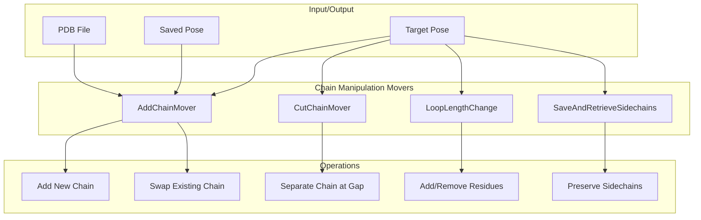
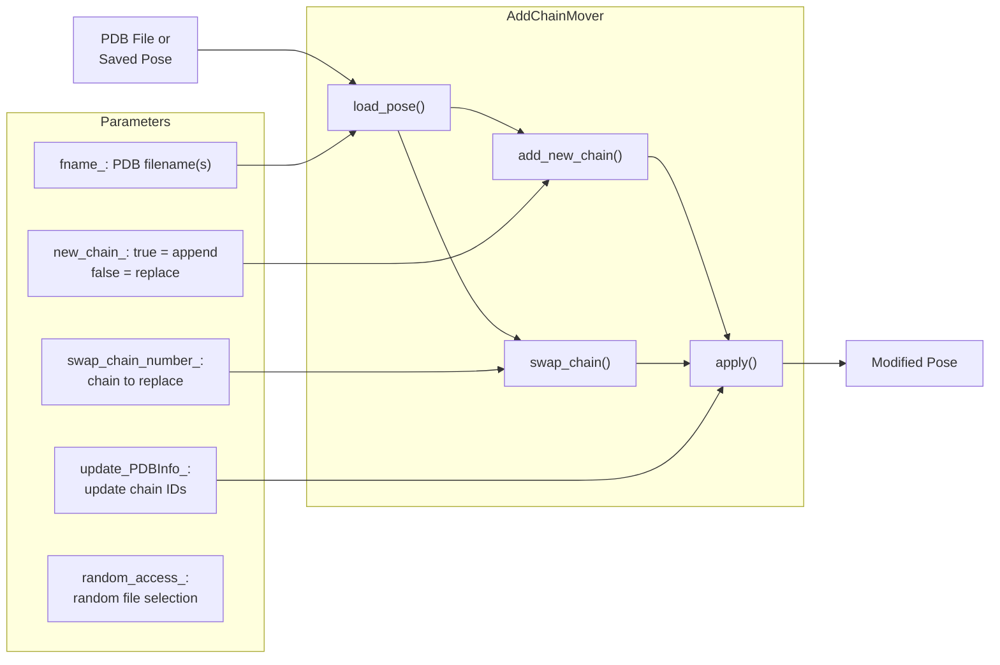
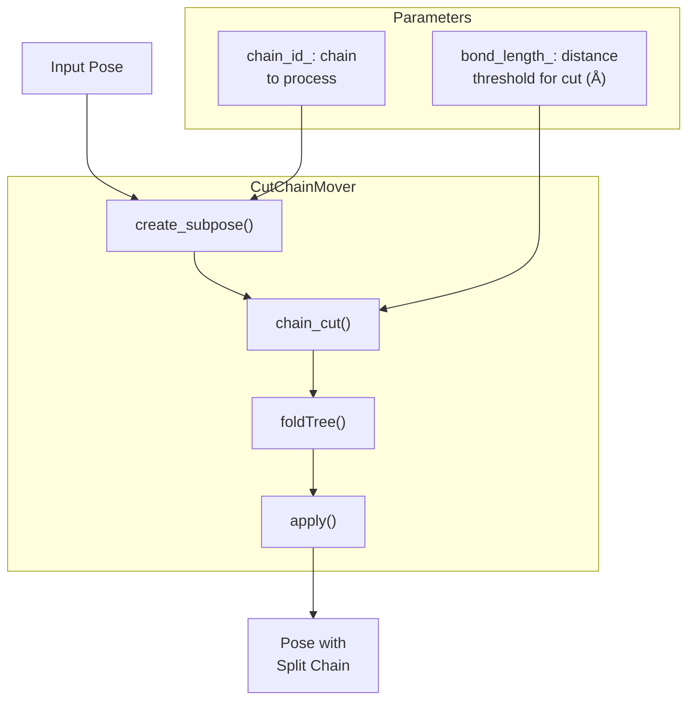
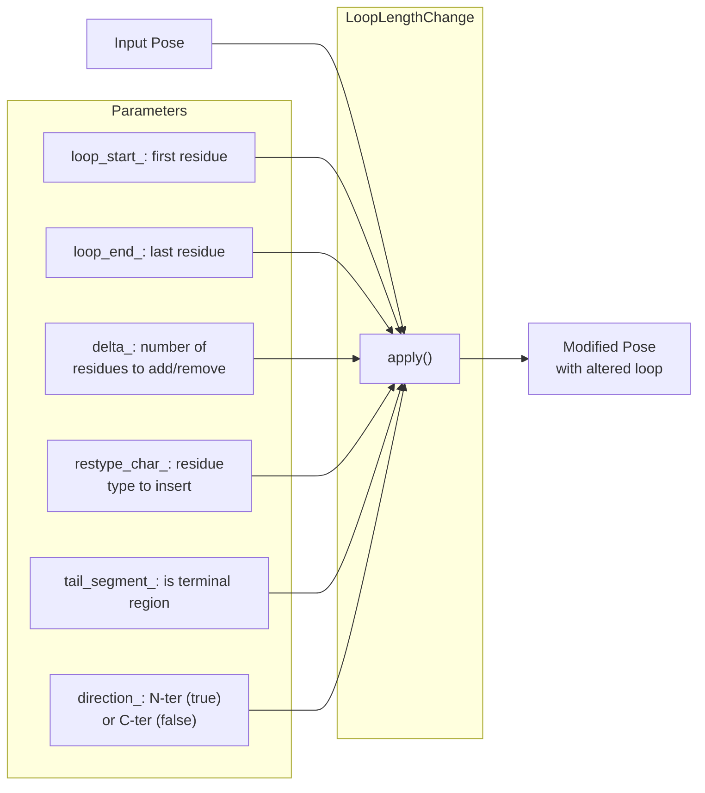
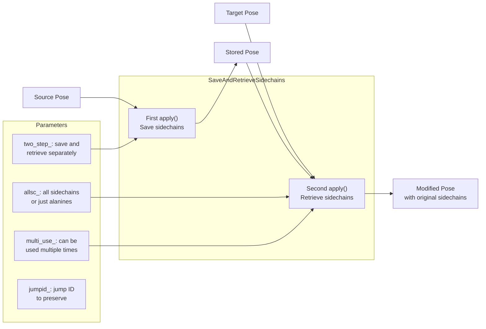
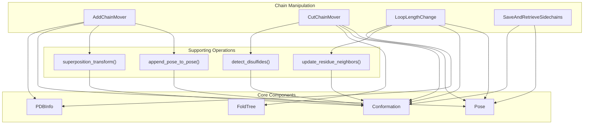

# Chain Manipulation

<details>
<summary>Relevant source files</summary>

The following files were used as context for generating this wiki page:

- [source/src/core/chemical/orbitals/ICoorOrbitalData.hh](source/src/core/chemical/orbitals/ICoorOrbitalData.hh)
- [source/src/protocols/protein_interface_design/movers/LoopLengthChange.cc](source/src/protocols/protein_interface_design/movers/LoopLengthChange.cc)
- [source/src/protocols/protein_interface_design/movers/LoopLengthChange.hh](source/src/protocols/protein_interface_design/movers/LoopLengthChange.hh)
- [source/src/protocols/protein_interface_design/movers/SaveAndRetrieveSidechains.cc](source/src/protocols/protein_interface_design/movers/SaveAndRetrieveSidechains.cc)
- [source/src/protocols/protein_interface_design/movers/SaveAndRetrieveSidechains.hh](source/src/protocols/protein_interface_design/movers/SaveAndRetrieveSidechains.hh)
- [source/src/protocols/simple_moves/AddChainMover.cc](source/src/protocols/simple_moves/AddChainMover.cc)
- [source/src/protocols/simple_moves/AddChainMover.hh](source/src/protocols/simple_moves/AddChainMover.hh)
- [source/src/protocols/simple_moves/ContingentAcceptMover.cc](source/src/protocols/simple_moves/ContingentAcceptMover.cc)
- [source/src/protocols/simple_moves/ContingentAcceptMover.hh](source/src/protocols/simple_moves/ContingentAcceptMover.hh)
- [source/src/protocols/simple_moves/CutChainMover.cc](source/src/protocols/simple_moves/CutChainMover.cc)
- [source/src/protocols/simple_moves/CutChainMover.hh](source/src/protocols/simple_moves/CutChainMover.hh)

</details>


This document describes the chain manipulation utilities available in Rosetta, which allow for modifying protein chain structures by adding, cutting, swapping, and modifying their components. These tools are essential for structural modeling applications like protein interface design, loop modeling, and multi-domain protein assembly.

For information about designing protein interfaces, see [Movers and Filters](#4.1), and for information about general protein structure modeling, see [Pose and Conformation](#2.1).

## Overview of Chain Manipulation Components

Rosetta provides several specialized Movers for chain manipulation tasks that allow researchers to modify protein structures at the chain level:



Sources: [protocols/simple_moves/AddChainMover.hh](), [protocols/simple_moves/CutChainMover.hh](), [protocols/protein_interface_design/movers/LoopLengthChange.hh](), [protocols/protein_interface_design/movers/SaveAndRetrieveSidechains.hh]()

## Adding and Swapping Chains

The `AddChainMover` is a versatile tool for incorporating new chains into a pose, either by adding a chain or swapping an existing chain.

### Functionality



Sources: [protocols/simple_moves/AddChainMover.cc:89-123](), [protocols/simple_moves/AddChainMover.cc:125-195]()

### Key Options

- **file_name**: Path to PDB file(s) to add or use as replacement (can be a comma-separated list)
- **spm_reference_name**: Reference to a pose saved with SavePoseMover (alternative to file_name)
- **new_chain**: When true (default), the new structure is added as a separate chain
- **swap_chain_number**: When specified, replaces the chain with that number with the loaded chain
- **update_PDBInfo**: When true (default), resets chain IDs and residue numbering

### Implementation Details

The `AddChainMover` has two primary operations:

1. **Adding a new chain** - Implemented in the `add_new_chain()` method, which:
   - Loads a new pose from a PDB file or saved reference
   - Appends it to the target pose using `append_pose_to_pose()`
   - Updates chain information and residue neighbors

2. **Swapping a chain** - Implemented in the `swap_chain()` method, which:
   - Loads the new chain from a PDB file or saved reference
   - Aligns it to the chain being replaced using superposition
   - Rebuilds the pose with all original chains except the one being replaced, plus the new chain

Sources: [protocols/simple_moves/AddChainMover.cc:69-86](), [protocols/simple_moves/AddChainMover.cc:198-213]()

### Example XML Usage

```xml
<AddChain name="add_ligand" file_name="ligand.pdb" new_chain="true" />

<AddChain name="swap_domain" spm_reference_name="my_domain" swap_chain_number="2" />

<AddChain name="random_peptide" file_name="pep1.pdb,pep2.pdb,pep3.pdb" random_access="true" />
```

## Cutting Chains

The `CutChainMover` identifies and breaks a chain at points where there is a gap between residues, creating separate chains connected by a jump.

### Functionality



Sources: [protocols/simple_moves/CutChainMover.cc:120-186]()

### Key Options

- **bond_length**: Distance threshold (in Å) that defines a chain break (default: 4.0)
- **chain_id**: ID of the chain to process (default: 1)

### Implementation Details

The `CutChainMover` operates in three steps:

1. **Extract the target chain** - The `create_subpose()` method extracts only the specified chain from the pose
2. **Find the cut point** - The `chain_cut()` method scans for gaps between residues where the distance between C and N atoms exceeds the specified threshold
3. **Create a new fold tree** - The `foldTree()` method creates a new fold tree with a jump at the cut point

The fold tree is restructured to have three edges:
- From the first residue to the cut point (stub)
- A jump connecting the cut point to the next residue
- From the residue after the cut point to the end of the chain (stub)

Sources: [protocols/simple_moves/CutChainMover.cc:128-158](), [protocols/simple_moves/CutChainMover.cc:160-171](), [protocols/simple_moves/CutChainMover.cc:173-186]()

### Example XML Usage

```xml
<CutChain name="split_at_gap" bond_length="3.8" chain_id="2" />
```

## Changing Loop Length

The `LoopLengthChange` mover allows adding or removing residues in a specified loop region, which is useful for loop modeling and structure refinement.

### Functionality



Sources: [protocols/protein_interface_design/movers/LoopLengthChange.cc:74-155]()

### Key Options

- **loop_start**: Starting residue number of the loop
- **loop_end**: Ending residue number of the loop
- **delta**: Number of residues to add (positive) or remove (negative)
- **restype**: One-letter code for the residue type to insert (default: 'A' for alanine)
- **tail_segment**: When true, indicates the loop is at a terminal region (N or C)
- **direction**: When true, indicates N-terminal; when false, indicates C-terminal

### Implementation Details

The `LoopLengthChange` mover has two main operations:

1. **Removing residues** (delta < 0):
   - For tail segments, residues are removed from either the N-terminus or C-terminus
   - For internal loops, residues are removed starting from the end of the loop, avoiding jump points

2. **Adding residues** (delta > 0):
   - For tail segments, residues are either prepended to the N-terminus or appended to the C-terminus
   - For internal loops, residues are inserted at the end of the loop
   - New residues are created using the specified residue type

The mover updates residue neighbors and the PDB information after modifications.

Sources: [protocols/protein_interface_design/movers/LoopLengthChange.cc:83-112](), [protocols/protein_interface_design/movers/LoopLengthChange.cc:113-152]()

### Example XML Usage

```xml
<LoopLengthChange name="extend_loop" loop_start="45" loop_end="52" delta="3" restype="G" />

<LoopLengthChange name="shorten_loop" loop_start="45" loop_end="52" delta="-2" />
```

## Preserving Sidechains

The `SaveAndRetrieveSidechains` mover preserves sidechains from a pose and applies them to another pose later, which is useful during operations that might otherwise alter sidechains.

### Functionality



Sources: [protocols/protein_interface_design/movers/SaveAndRetrieveSidechains.cc:92-156]()

### Key Options

- **allsc**: When true, saves and retrieves all sidechains; when false (default), only saves alanine positions
- **two_step**: When true, operates in two phases (first call saves, second call retrieves)
- **multi_use**: When true, can be used multiple times (resets after each use)
- **jumpid**: Jump ID to track and preserve (default: 1)

### Implementation Details

The `SaveAndRetrieveSidechains` mover operates in two modes:

1. **Saving sidechains**: 
   - In two-step mode, the first call to `apply()` saves the input pose
   - Otherwise, the pose specified during construction or in XML is used as the source

2. **Retrieving sidechains**:
   - Loops through each residue in the target pose
   - If `allsc` is true, replaces all sidechains with those from the saved pose
   - If `allsc` is false, only replaces alanine positions
   - Optionally ensures variant types match between poses
   - Preserves the specified jump if needed

Sources: [protocols/protein_interface_design/movers/SaveAndRetrieveSidechains.cc:93-106](), [protocols/protein_interface_design/movers/SaveAndRetrieveSidechains.cc:107-155]()

### Example XML Usage

```xml
<!-- Two-step usage -->
<SaveAndRetrieveSidechains name="save_sc" two_step="true" />

<!-- Reference to saved pose -->
<SaveAndRetrieveSidechains name="retrieve_sc" reference_name="starting_pose" allsc="true" />
```

## Relationships Between Chain Manipulation Components

The following diagram illustrates how the different chain manipulation components relate to each other and the overall Rosetta architecture:



Sources: [protocols/simple_moves/AddChainMover.cc](), [protocols/simple_moves/CutChainMover.cc](), [protocols/protein_interface_design/movers/LoopLengthChange.cc](), [protocols/protein_interface_design/movers/SaveAndRetrieveSidechains.cc]()

## Common Use Cases

The following table summarizes common use cases for chain manipulation:

| Task | Mover | Key Parameters |
|------|-------|---------------|
| Add a ligand to a protein | AddChainMover | `file_name="ligand.pdb"`, `new_chain="true"` |
| Replace a domain in a multi-domain protein | AddChainMover | `file_name="domain.pdb"`, `swap_chain_number="2"` |
| Split a protein at a linker region | CutChainMover | `bond_length="4.0"`, `chain_id="1"` |
| Extend a loop by 3 residues | LoopLengthChange | `loop_start="45"`, `loop_end="52"`, `delta="3"` |
| Shorten a loop by 2 residues | LoopLengthChange | `loop_start="45"`, `loop_end="52"`, `delta="-2"` |
| Preserve sidechains during loop modeling | SaveAndRetrieveSidechains | `allsc="true"`, `two_step="true"` |

## Conclusion

The chain manipulation tools in Rosetta provide essential functionality for protein structural modeling and design. From adding new chains to modifying existing ones, these tools enable researchers to explore a wide range of structural modifications while maintaining physical realism. Understanding these components is crucial for advanced structural modeling tasks like protein-protein docking, loop design, and multi-domain protein engineering.

---