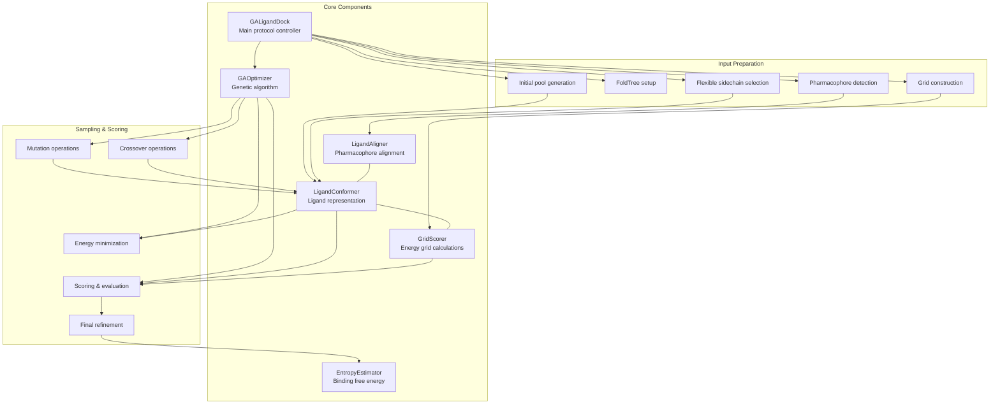
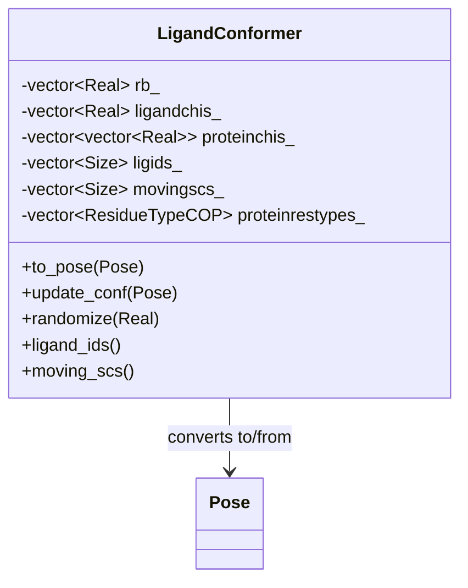
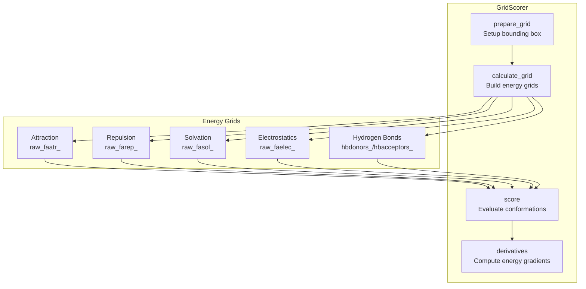
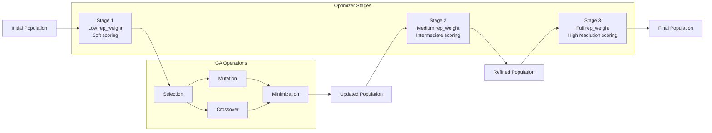
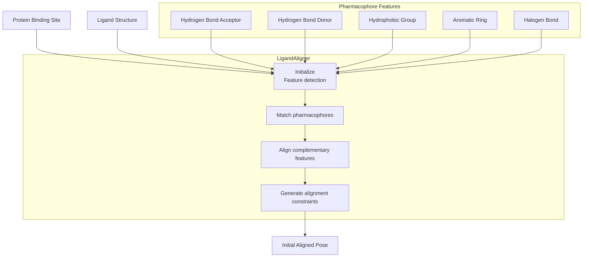
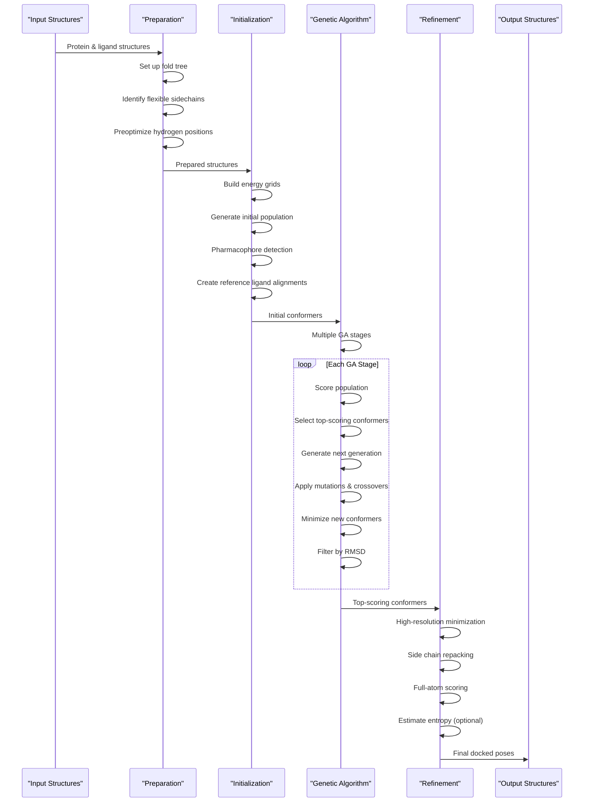
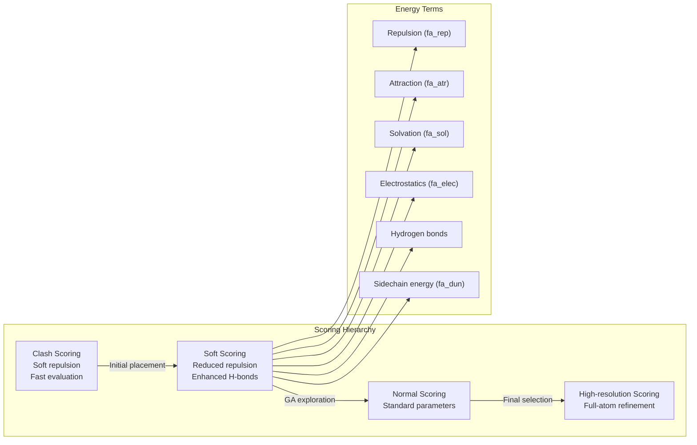
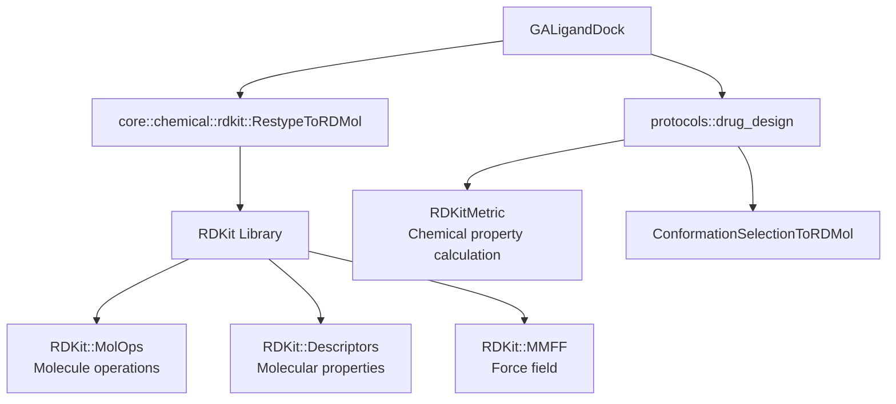

# Ligand Docking

Relevant source files

The following files were used as context for generating this wiki page:

- [source/external/rdkit.external.settings](source/external/rdkit.external.settings)
- [source/external/rdkit/update_rdkit.py](source/external/rdkit/update_rdkit.py)
- [source/src/apps/pilot/guangfeng/align_substructure.cc](source/src/apps/pilot/guangfeng/align_substructure.cc)
- [source/src/core/chemical/rdkit/RestypeToRDMol.cc](source/src/core/chemical/rdkit/RestypeToRDMol.cc)
- [source/src/core/chemical/rdkit/RestypeToRDMol.hh](source/src/core/chemical/rdkit/RestypeToRDMol.hh)
- [source/src/core/chemical/rdkit/util.cc](source/src/core/chemical/rdkit/util.cc)
- [source/src/core/chemical/rdkit/util.hh](source/src/core/chemical/rdkit/util.hh)
- [source/src/protocols/drug_design/ConformationSelectionToRDMol.cc](source/src/protocols/drug_design/ConformationSelectionToRDMol.cc)
- [source/src/protocols/drug_design/ConformationSelectionToRDMol.hh](source/src/protocols/drug_design/ConformationSelectionToRDMol.hh)
- [source/src/protocols/drug_design/RDKitMetric.cc](source/src/protocols/drug_design/RDKitMetric.cc)
- [source/src/protocols/ligand_docking/GALigandDock/EntropyEstimator.cc](source/src/protocols/ligand_docking/GALigandDock/EntropyEstimator.cc)
- [source/src/protocols/ligand_docking/GALigandDock/EntropyEstimator.hh](source/src/protocols/ligand_docking/GALigandDock/EntropyEstimator.hh)
- [source/src/protocols/ligand_docking/GALigandDock/GALigandDock.cc](source/src/protocols/ligand_docking/GALigandDock/GALigandDock.cc)
- [source/src/protocols/ligand_docking/GALigandDock/GALigandDock.hh](source/src/protocols/ligand_docking/GALigandDock/GALigandDock.hh)
- [source/src/protocols/ligand_docking/GALigandDock/GAOptimizer.cc](source/src/protocols/ligand_docking/GALigandDock/GAOptimizer.cc)
- [source/src/protocols/ligand_docking/GALigandDock/GAOptimizer.hh](source/src/protocols/ligand_docking/GALigandDock/GAOptimizer.hh)
- [source/src/protocols/ligand_docking/GALigandDock/GridHash3D.hh](source/src/protocols/ligand_docking/GALigandDock/GridHash3D.hh)
- [source/src/protocols/ligand_docking/GALigandDock/GridScorer.cc](source/src/protocols/ligand_docking/GALigandDock/GridScorer.cc)
- [source/src/protocols/ligand_docking/GALigandDock/GridScorer.hh](source/src/protocols/ligand_docking/GALigandDock/GridScorer.hh)
- [source/src/protocols/ligand_docking/GALigandDock/LigandAligner.cc](source/src/protocols/ligand_docking/GALigandDock/LigandAligner.cc)
- [source/src/protocols/ligand_docking/GALigandDock/LigandAligner.hh](source/src/protocols/ligand_docking/GALigandDock/LigandAligner.hh)
- [source/src/protocols/ligand_docking/GALigandDock/LigandConformer.cc](source/src/protocols/ligand_docking/GALigandDock/LigandConformer.cc)
- [source/src/protocols/ligand_docking/GALigandDock/LigandConformer.hh](source/src/protocols/ligand_docking/GALigandDock/LigandConformer.hh)
- [source/src/protocols/ligand_docking/GALigandDock/util.cc](source/src/protocols/ligand_docking/GALigandDock/util.cc)
- [source/src/protocols/ligand_docking/GALigandDock/util.hh](source/src/protocols/ligand_docking/GALigandDock/util.hh)
- [source/src/protocols_h.5.src.settings](source/src/protocols_h.5.src.settings)
- [tests/integration/tests/cycpep_rdkit_metric/command](tests/integration/tests/cycpep_rdkit_metric/command)
- [tests/integration/tests/cycpep_rdkit_metric/description.md](tests/integration/tests/cycpep_rdkit_metric/description.md)
- [tests/integration/tests/cycpep_rdkit_metric/inputs/d_res.txt](tests/integration/tests/cycpep_rdkit_metric/inputs/d_res.txt)
- [tests/integration/tests/cycpep_rdkit_metric/inputs/desired_makeup.comp](tests/integration/tests/cycpep_rdkit_metric/inputs/desired_makeup.comp)
- [tests/integration/tests/ga_ligand_dock/command](tests/integration/tests/ga_ligand_dock/command)
- [tests/sfxn_fingerprint/scores/gen_potential/flags](tests/sfxn_fingerprint/scores/gen_potential/flags)

This document describes the genetic algorithm-based ligand docking implementation in Rosetta (`GALigandDock`). It covers the architecture, key components, and workflows used for flexible ligand docking against protein receptors. For protein-protein docking, see [Docking Protocol](#4.1).

## Overview

The Rosetta ligand docking protocol provides a computational approach to predict the bound conformation of small molecules to proteins. The implementation uses a genetic algorithm (GA) coupled with energy grid-based scoring for efficient sampling of the ligand conformational space while allowing flexibility in both the ligand and receptor side chains.

Key features include:
- Grid-based energy calculations for efficiency
- Full ligand flexibility (translation, rotation, torsions, and ring conformers)
- Flexible side chains at the protein binding site
- Pharmacophore-based alignment
- Support for electron density data
- Multiple scoring refinement stages with full-atom scoring
- Support for estimating binding free energies

Sources: [source/src/protocols/ligand_docking/GALigandDock/GALigandDock.hh:214-222]()

## System Architecture

The ligand docking system consists of several interacting components that work together to sample and score ligand conformations.

Sources: [source/src/protocols/ligand_docking/GALigandDock/GALigandDock.cc:845-846](), [source/src/protocols/ligand_docking/GALigandDock/GALigandDock.hh:222-222]()

## Core Components

### LigandConformer

The `LigandConformer` class provides a compact representation of a ligand conformation along with protein side chain conformations. It represents:

- Rigid body transformation (translation and rotation quaternion)
- Internal ligand torsion angles (including backbone and sidechain)
- Flexible receptor side chain conformations
- Ring conformations (when enabled)

This class allows efficient manipulation of the ligand structure through mutation and crossover operations, as well as conversion between the internal representation and the Rosetta `Pose` object.

Sources: [source/src/protocols/ligand_docking/GALigandDock/LigandConformer.hh:59-89](), [source/src/protocols/ligand_docking/GALigandDock/LigandConformer.cc:60-83]()

### GridScorer

The `GridScorer` provides an efficient scoring mechanism by precomputing energy terms on a three-dimensional grid. This approach significantly accelerates scoring during the genetic algorithm search.

Key features:
- Creates grids for different energy terms (attraction, repulsion, solvation, electrostatics)
- Creates specialized grids for hydrogen bonding terms
- Supports implicit and explicit scoring modes
- Integrates with electron density scoring when available

The grid resolution, dimensions, and atom types are customizable parameters.

Sources: [source/src/protocols/ligand_docking/GALigandDock/GridScorer.hh:57-65](), [source/src/protocols/ligand_docking/GALigandDock/GridScorer.cc:118-228]()

### GAOptimizer

The `GAOptimizer` implements the genetic algorithm for sampling ligand conformations. It manages:

- Population creation and evolution
- Selection, mutation, and crossover operations
- Multi-stage optimization with different parameters
- Integration with scoring and minimization

The optimizer can be configured with different parameters for each stage, allowing for progressive refinement from coarse to fine sampling.

Sources: [source/src/protocols/ligand_docking/GALigandDock/GAOptimizer.cc:42-51](), [source/src/protocols/ligand_docking/GALigandDock/GAOptimizer.cc:103-125]()

### LigandAligner

The `LigandAligner` provides methods for aligning ligands based on:

1. **Pharmacophore matching**: Identifies complementary features between the ligand and binding site
2. **Reference-based alignment**: Aligns to a known ligand pose or starting position
3. **Density-based alignment**: Aligns to electron density features when available

This component helps generate diverse but meaningful starting positions for the genetic algorithm search.

Sources: [source/src/protocols/ligand_docking/GALigandDock/LigandAligner.cc:118-155](), [source/src/protocols/ligand_docking/GALigandDock/LigandAligner.cc:345-392]()

### EntropyEstimator

The `EntropyEstimator` component estimates the entropic contribution to binding free energy using Monte Carlo sampling approaches.

Key capabilities:
- Estimates translational, rotational, and conformational entropy
- Computes binding free energy components (ΔH-TΔS)
- Supports different sampling methods (MC-based, analytical approximations)

Sources: [source/src/protocols/ligand_docking/GALigandDock/EntropyEstimator.cc:42-55]()

## Docking Workflow

The overall workflow of ligand docking consists of several distinct phases:

Sources: [source/src/protocols/ligand_docking/GALigandDock/GALigandDock.cc:291-844]()

### 1. Preparation Phase

The workflow starts with input preparation:
1. Parse input receptor-ligand complex
2. Identify the ligand residue(s)
3. Determine which sidechains will be movable during docking
4. Optimize initial hydrogen positions (if enabled)
5. Set up fold tree for kinematic control

Sources: [source/src/protocols/ligand_docking/GALigandDock/GALigandDock.cc:291-313]()

### 2. Initialization Phase

Next, the system is initialized:
1. Calculate the bounding box for grid construction
2. Build energy grids for each relevant atom type
3. Generate the initial population of ligand conformers
   - Random initial positions
   - Reference-based positioning (if available)
   - Pharmacophore-based alignment
   - Torsional sampling (if enabled)

Sources: [source/src/protocols/ligand_docking/GALigandDock/GALigandDock.cc:360-405](), [source/src/protocols/ligand_docking/GALigandDock/GALigandDock.cc:836-843]()

### 3. Genetic Algorithm Search

The core of the docking process uses a genetic algorithm approach:
1. Score the initial population using grid-based scoring
2. Select top-scoring conformers as parents
3. Generate new conformers through:
   - Mutation (random perturbation of position, orientation, torsions)
   - Crossover (combining parts of two parent conformers)
4. Minimize new conformers (optional, based on stage settings)
5. Maintain diversity by RMSD-based filtering
6. Repeat for multiple generations with progressively refined scoring

The genetic algorithm typically runs in multiple stages with increasing accuracy and computational cost.

Sources: [source/src/protocols/ligand_docking/GALigandDock/GAOptimizer.cc:50-125]()

### 4. Final Refinement

The top-scoring poses undergo final refinement:
1. Full-atom, high-resolution scoring
2. Sidechain repacking at the binding interface
3. Cartesian minimization of the ligand and nearby sidechains
4. Final scoring with the high-resolution score function
5. Optional binding free energy estimation

Sources: [source/src/protocols/ligand_docking/GALigandDock/GALigandDock.cc:884-922]()

## Configuration Options

The `GALigandDock` protocol accepts numerous configuration options to control the docking behavior:

| Category | Parameter | Description | Default |
|----------|-----------|-------------|---------|
| **General** | `runmode` | Preset protocol mode | `"dockflex"` |
| | `output_ligand_only` | Output only the ligand | `false` |
| **Grid** | `grid` | Grid spacing (Å) | `0.25` |
| | `grid_radius` | Grid radius (Å, 0=auto) | `0.0` |
| | `padding` | Grid padding (Å) | `4.0` |
| | `smoothing` | Energy smoothing factor | `0.0` |
| **GA** | `ngen` | Number of generations | `20` |
| | `npool` | Population size | `50` |
| | `pmut` | Mutation probability | `0.2` |
| | `rmsdthreshold` | RMSD threshold for clustering | `1.0` |
| **Flexibility** | `sidechains` | Control over flexible side chains | `"none"` |
| | `sc_edge_buffer` | Distance for flexible side chain detection | `2.0` |
| | `sample_ring_conformers` | Sample ligand ring conformations | `true` |
| | `freeze_ligand_backbone` | Prevent ligand backbone movement | `false` |
| | `freeze_ligand` | Prevent all ligand movement | `false` |
| **Refinement** | `nrelax` | Number of poses to refine | `20` |
| | `final_exact_minimize` | Final minimization type (`"sc"`, `"bbsc"`, `"ligandonly"`) | `"sc"` |
| | `cartmin_lig` | Use Cartesian minimization | `true` |
| | `final_solvate` | Add explicit water in final step | `false` |
| **Analysis** | `estimate_dG` | Estimate binding free energy | `false` |
| | `estimate_buns` | Calculate buried unsatisfied H-bonds | `false` |
| | `nreport` | Number of poses to report | `20` |

Sources: [source/src/protocols/ligand_docking/GALigandDock/GALigandDock.cc:105-217](), [source/src/protocols/ligand_docking/GALigandDock/GALigandDock.hh:454-561]()

## Scoring

The protocol uses multiple scoring schemes throughout the docking process:

The GridScorer handles several scoring variations:
1. **Grid-based scoring**: Precomputed energy terms sampled from 3D grids for efficiency
2. **Soft scoring**: Reduced repulsive terms to allow initial clashes during exploration
3. **Full-atom scoring**: Complete energy calculation for final refinement
4. **Electron density correlation**: When density data is available

Sources: [source/src/protocols/ligand_docking/GALigandDock/GridScorer.cc:148-209]()

## Multiple Ligand Support

The protocol supports screening of multiple ligands:

1. **Sequential mode**: Process each ligand type in a separate docking run
2. **Common grid**: Use the same energy grid for all ligands (efficient)
3. **Automatic grid sizing**: Adapt grid dimensions based on ligand size statistics

For virtual screening, this allows efficient processing of ligand libraries using a single receptor preparation.

Sources: [source/src/protocols/ligand_docking/GALigandDock/GALigandDock.cc:347-454](), [source/src/protocols/ligand_docking/GALigandDock/GALigandDock.cc:533-622]()

## Integration with External Libraries

The ligand docking system integrates with RDKit for cheminformatics capabilities:

This integration enables:
- Computation of molecular properties
- Chemical substructure matching
- Conformer generation and validation
- Force field energy evaluation

Sources: [source/src/core/chemical/rdkit/RestypeToRDMol.cc:14-44](), [source/src/core/chemical/rdkit/util.cc:13-46]()

## Electron Density Integration

When electron density data is available, the protocol can use it to:

1. Guide initial placement in the density
2. Score ligand fit to density during optimization
3. Calculate final density correlation statistics
4. Improve pose selection through composite Z-scores

Sources: [source/src/protocols/ligand_docking/GALigandDock/GridScorer.cc:578-603](), [source/src/protocols/ligand_docking/GALigandDock/GALigandDock.cc:584-603]()

## Summary

The `GALigandDock` protocol in Rosetta provides a comprehensive approach to ligand docking with a focus on efficiency through grid-based scoring and effectiveness through genetic algorithm sampling. The system offers a balance between thorough conformational sampling and computational efficiency, along with extensive customization options for different use cases.

---