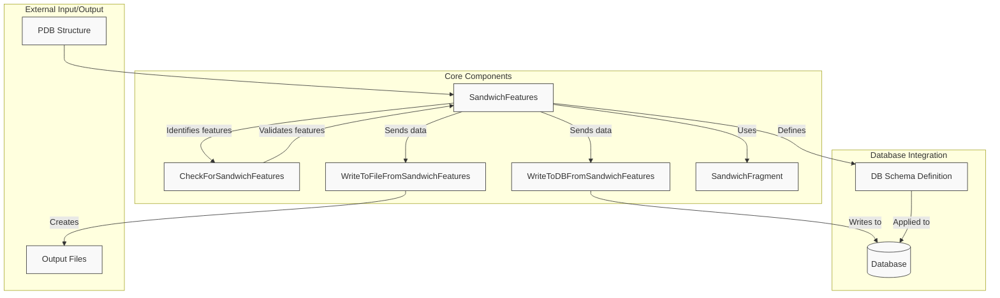
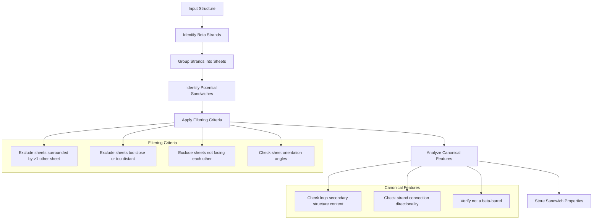
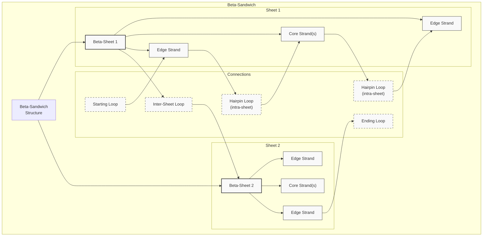
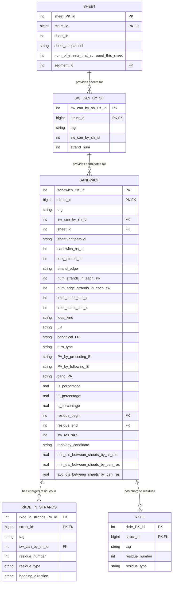

# Beta-Sandwich Analysis

Relevant source files

The following files were used as context for generating this wiki page:

- [source/external/dbio/sqlite3/sqlite3.c](source/external/dbio/sqlite3/sqlite3.c)
- [source/external/dbio/sqlite3/sqlite3.h](source/external/dbio/sqlite3/sqlite3.h)
- [source/src/protocols/features/SecondaryStructureSegmentFeatures.fwd.hh](source/src/protocols/features/SecondaryStructureSegmentFeatures.fwd.hh)
- [source/src/protocols/features/strand_assembly/CheckForSandwichFeatures.cc](source/src/protocols/features/strand_assembly/CheckForSandwichFeatures.cc)
- [source/src/protocols/features/strand_assembly/CheckForSandwichFeatures.hh](source/src/protocols/features/strand_assembly/CheckForSandwichFeatures.hh)
- [source/src/protocols/features/strand_assembly/SandwichFeatures.cc](source/src/protocols/features/strand_assembly/SandwichFeatures.cc)
- [source/src/protocols/features/strand_assembly/SandwichFeatures.hh](source/src/protocols/features/strand_assembly/SandwichFeatures.hh)
- [source/src/protocols/features/strand_assembly/SandwichFragment.cc](source/src/protocols/features/strand_assembly/SandwichFragment.cc)
- [source/src/protocols/features/strand_assembly/SandwichFragment.hh](source/src/protocols/features/strand_assembly/SandwichFragment.hh)
- [source/src/protocols/features/strand_assembly/StrandAssemblyCommon.hh](source/src/protocols/features/strand_assembly/StrandAssemblyCommon.hh)
- [source/src/protocols/features/strand_assembly/StrandBundleFeatures.cc](source/src/protocols/features/strand_assembly/StrandBundleFeatures.cc)
- [source/src/protocols/features/strand_assembly/StrandBundleFeatures.hh](source/src/protocols/features/strand_assembly/StrandBundleFeatures.hh)
- [source/src/protocols/features/strand_assembly/StrandFragment.cc](source/src/protocols/features/strand_assembly/StrandFragment.cc)
- [source/src/protocols/features/strand_assembly/StrandFragment.hh](source/src/protocols/features/strand_assembly/StrandFragment.hh)
- [source/src/protocols/features/strand_assembly/WriteToDBFromSandwichFeatures.cc](source/src/protocols/features/strand_assembly/WriteToDBFromSandwichFeatures.cc)
- [source/src/protocols/features/strand_assembly/WriteToDBFromSandwichFeatures.hh](source/src/protocols/features/strand_assembly/WriteToDBFromSandwichFeatures.hh)
- [source/src/protocols/features/strand_assembly/WriteToFileFromSandwichFeatures.cc](source/src/protocols/features/strand_assembly/WriteToFileFromSandwichFeatures.cc)
- [source/src/protocols/features/strand_assembly/WriteToFileFromSandwichFeatures.hh](source/src/protocols/features/strand_assembly/WriteToFileFromSandwichFeatures.hh)

## Purpose and Overview

This document details the Beta-Sandwich Analysis system within Rosetta, which identifies, analyzes, and catalogs beta-sandwich protein structures from protein models or PDB files. A beta-sandwich consists of two beta-sheets that face each other with a hydrophobic core between them. This module provides comprehensive tools for extracting geometric, sequence, and structural features from these motifs.

The system focuses on finding canonical beta-sandwiches, filtering them based on specific criteria (angle, distance, sheet arrangement), and analyzing their properties including amino acid distributions, loop characteristics, and inter-sheet relationships.

This analysis is part of Rosetta's structural analysis capabilities and is separate from the Beta-Strand Assembly system (which focuses on constructing beta structures) and the Ligand Docking system (for small molecule placement).

## System Architecture

The Beta-Sandwich Analysis system is organized into several interrelated components that handle different aspects of the identification and analysis process.

**Figure 1: Beta-Sandwich Analysis System Components**

Sources: [source/src/protocols/features/strand_assembly/SandwichFeatures.hh:37-130](), [source/src/protocols/features/strand_assembly/CheckForSandwichFeatures.hh:14-28](), [source/src/protocols/features/strand_assembly/WriteToDBFromSandwichFeatures.hh:14-29](), [source/src/protocols/features/strand_assembly/WriteToFileFromSandwichFeatures.hh:16-31]()

### Core Classes and Their Roles

1. **SandwichFeatures**: Main class that orchestrates the analysis process. It implements the `FeaturesReporter` interface for integration with Rosetta's features framework.

2. **CheckForSandwichFeatures**: Contains functions to verify geometric and structural properties of potential beta-sandwiches.

3. **WriteToDBFromSandwichFeatures**: Handles storing extracted features to a database, including sheet information, strand relationships, and amino acid distributions.

4. **WriteToFileFromSandwichFeatures**: Manages output of analysis results to various file formats for further analysis.

5. **SandwichFragment**: Helper class that stores information about strand segments that form part of beta-sandwich structures.

Table: Key Class Responsibilities

| Class | Primary Responsibilities |
|-------|--------------------------|
| SandwichFeatures | Identify beta-strands, sheets, and sandwiches; coordinate analysis process |
| CheckForSandwichFeatures | Validate geometric and structural criteria (angles, distances, orientations) |
| WriteToDBFromSandwichFeatures | Store analysis results in database tables (sheet properties, strand features) |
| WriteToFileFromSandwichFeatures | Output analysis data to text files for further processing |
| SandwichFragment | Store fragment information (sheet ID, strand ID, residue range) |

Sources: [source/src/protocols/features/strand_assembly/SandwichFeatures.hh:53-336](), [source/src/protocols/features/strand_assembly/SandwichFragment.hh:33-93]()

## Beta-Sandwich Identification Process

The system follows a hierarchical process to identify beta-sandwiches, starting from individual residues up to complete sandwich structures.

**Figure 2: Beta-Sandwich Identification Workflow**

Sources: [source/src/protocols/features/strand_assembly/SandwichFeatures.cc:14-34]()

### Identification Steps

1. **Strand Identification**: The system first identifies all beta-strands in the protein structure using DSSP secondary structure assignments.

2. **Sheet Formation**: Beta-strands are then grouped into sheets based on hydrogen-bonding patterns and geometric criteria.

3. **Sandwich Detection**: Potential beta-sandwiches are identified by looking for pairs of beta-sheets that satisfy specific distance and orientation requirements.

4. **Filtering**: Various criteria are applied to filter out structures that don't conform to a canonical beta-sandwich:
   - Excluding sheets that are surrounded by more than one other sheet
   - Excluding sheets that are too close or too distant from each other
   - Excluding sheets that do not face each other properly
   - Checking sheet angles and torsion

5. **Canonical Testing**: Additional tests ensure the structure is a proper beta-sandwich:
   - Checking that connecting loops don't contain excessive helix or strand residues
   - Verifying strands don't connect sheets in the same direction
   - Confirming the structure is not actually a beta-barrel

Sources: [source/src/protocols/features/strand_assembly/SandwichFeatures.cc:110-230](), [source/src/protocols/features/strand_assembly/CheckForSandwichFeatures.cc:50-139]()

## Beta-Sandwich Structure Components

The system analyzes beta-sandwiches in terms of their structural components and the relationships between them.

**Figure 3: Beta-Sandwich Components and Relationships**

Sources: [source/src/protocols/features/strand_assembly/SandwichFeatures.cc:14-35](), [source/src/protocols/features/strand_assembly/SandwichFeatures.hh:242-272]()

### Structure Components

1. **Sheets**: Two beta-sheets face each other to form the sandwich. Each sheet may be:
   - **Antiparallel**: All strands run in opposite directions (more common)
   - **Parallel or Mixed**: Strands run in the same direction or mixed orientations

2. **Strands**: Each sheet contains multiple beta-strands, which can be:
   - **Edge Strands**: Located at the edges of a sheet, often with different amino acid distributions
   - **Core Strands**: Located in the middle of a sheet, typically more hydrophobic

3. **Loops**: Various connecting segments:
   - **Hairpin Loops**: Connect consecutive strands within the same sheet
   - **Inter-sheet Loops**: Connect strands between different sheets
   - **Starting/Ending Loops**: Terminal segments

Sources: [source/src/protocols/features/strand_assembly/SandwichFeatures.cc:240-273](), [source/src/protocols/features/strand_assembly/WriteToDBFromSandwichFeatures.cc:196-321]()

## Feature Analysis and Properties

The system analyzes numerous properties of beta-sandwiches, which can be categorized into geometric, sequence, and structural features.

### Geometric Properties

1. **Sheet Distance**: The system measures distances between sheets:
   - Minimum distance between sheets using all residues
   - Minimum distance between sheets using central residues
   - Average distance between sheets using central residues

2. **Sheet Orientation**:
   - Dihedral angles between core strands across facing sheets
   - Angle tests to ensure sheets properly face each other

3. **Strand Relationships**:
   - Inter-strand distances within and between sheets
   - Strand torsion angles

Sources: [source/src/protocols/features/strand_assembly/CheckForSandwichFeatures.cc:141-317](), [source/src/protocols/features/strand_assembly/WriteToDBFromSandwichFeatures.cc:458-517]()

### Sequence Properties

The system analyzes amino acid distributions and characteristics across different parts of the sandwich:

1. **Amino Acid Distributions**:
   - Core-heading vs. surface-heading residues
   - Counts of each amino acid type in different structural regions
   - Hydrophobic/hydrophilic residue ratios
   - Charged residue distribution (R, K, D, E)

2. **Specialized Analyses**:
   - Aromatic residues (F, W, Y) distribution, particularly in core-heading positions
   - Proline distribution in loops
   - Electrostatic interactions between residues

Sources: [source/src/protocols/features/strand_assembly/WriteToFileFromSandwichFeatures.cc:49-106](), [source/src/protocols/features/strand_assembly/WriteToDBFromSandwichFeatures.cc:568-637]()

### Loop Analysis

Loops connecting beta-strands are analyzed for several characteristics:

1. **Loop Chirality (LR)**:
   - Left (L) or right (R) chirality of loops
   - Canonical vs. non-canonical chirality patterns

2. **Loop Direction Properties**:
   - PA (plane angle) by preceding and following strands
   - Heading direction (positive, negative, meeting)
   - Parallel/antiparallel strand orientation

3. **Loop Size and Composition**:
   - Residue count and composition
   - Secondary structure content within loops
   - Presence of specific residues (e.g., prolines) that may prevent aggregation

Sources: [source/src/protocols/features/strand_assembly/CheckForSandwichFeatures.cc:482-545](), [source/src/protocols/features/strand_assembly/WriteToDBFromSandwichFeatures.cc:573-634]()

## Database Schema and Data Storage

The system stores analyzed data in a comprehensive database schema with multiple tables.

**Figure 4: Database Schema for Beta-Sandwich Analysis**

Sources: [source/src/protocols/features/strand_assembly/SandwichFeatures.cc:114-603]()

### Main Database Tables

1. **sheet**: Stores information about beta-sheets
   - Sheet ID, antiparallel status, surrounding sheets

2. **sw_can_by_sh**: Documents sandwich candidates identified by their constituent sheets
   - Links sheets to potential sandwiches

3. **sandwich**: The main table containing comprehensive beta-sandwich information
   - Structural features: strand counts, edge strands, distances
   - Loop properties: LR chirality, turn types, PA angles
   - Sequence information: amino acid counts, distributions
   - Secondary structure content percentages

4. **rkde_in_strands** and **rkde**: Track charged residues (Arg, Lys, Asp, Glu) and their properties
   - Position, type, and heading direction

Sources: [source/src/protocols/features/strand_assembly/SandwichFeatures.cc:114-603](), [source/src/protocols/features/strand_assembly/WriteToDBFromSandwichFeatures.cc:40-123]()

## File Outputs

In addition to database storage, the system can generate various output files for further analysis:

1. **Amino Acid Distribution Files**:
   - Distribution of amino acids in strands with directional information
   - Distribution of amino acids in loops without directional information

2. **Property Analysis Files**:
   - Amino acid type distributions (positive, negative, polar, aromatic, hydrophobic)
   - Beta-sheet capping information
   - Electrostatic interactions between residues

3. **Structural Files**:
   - Phi/psi angles of residues
   - Ramachandran plot data
   - Chain and residue numbering information

4. **Resfiles**:
   - Automatically generated Rosetta resfiles for design purposes
   - Options to target specific properties (e.g., minimize hydrophobic surface exposure)

Sources: [source/src/protocols/features/strand_assembly/WriteToFileFromSandwichFeatures.cc:49-464](), [source/src/protocols/features/strand_assembly/WriteToFileFromSandwichFeatures.hh:33-163]()

## Integration with Rosetta

The Beta-Sandwich Analysis system integrates with the broader Rosetta framework through the FeaturesReporter interface and dependencies on other feature systems.

### Dependencies

The system depends on several other Rosetta features reporters:

1. **ResidueFeatures**: Basic residue information
2. **ResidueSecondaryStructureFeatures**: DSSP-assigned secondary structure
3. **SecondaryStructureSegmentFeatures**: Tracks secondary structure segments
4. **PoseConformationFeatures** and **ProteinResidueConformationFeatures**: Conformational details

Source: [source/src/protocols/features/strand_assembly/SandwichFeatures.cc:90-107]()

### Configuration Parameters

The system has numerous parameters that can be configured through XML tags:

- Minimum/maximum number of strands to analyze
- Strand size requirements
- Distance and angle thresholds for sheet detection
- Criteria for canonical sandwich validation
- Output file generation options

Sources: [source/src/protocols/features/strand_assembly/SandwichFeatures.hh:100-297](), [source/src/protocols/features/strand_assembly/SandwichFeatures.cc:686-703]()

## Practical Applications

The Beta-Sandwich Analysis system serves several purposes within protein modeling and design:

1. **Structure Analysis**: Characterizing existing beta-sandwich proteins in the PDB
2. **Knowledge-Based Design**: Extracting statistics to guide protein design efforts
3. **Feature Database Construction**: Building databases of beta-sandwich properties
4. **Resfile Generation**: Automatically creating design specifications for Rosetta design protocols

By analyzing the geometric and sequence patterns in natural beta-sandwiches, this system provides valuable insights for designing new proteins with similar structural motifs.

Sources: [source/src/protocols/features/strand_assembly/SandwichFeatures.cc:14-36](), [source/src/protocols/features/strand_assembly/WriteToFileFromSandwichFeatures.cc:140-178]()

---