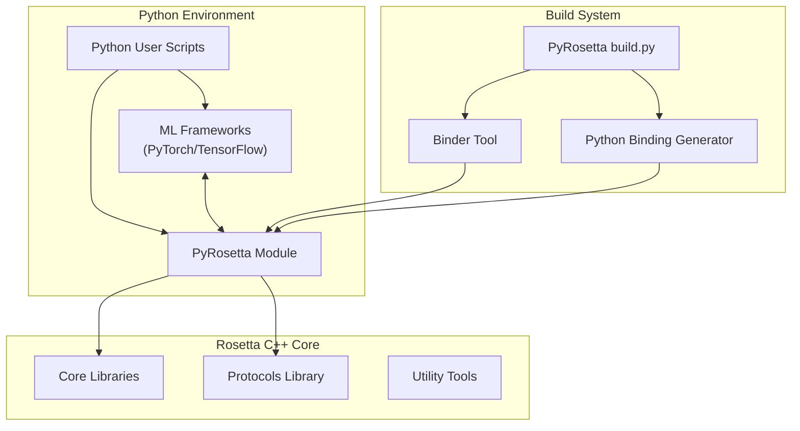
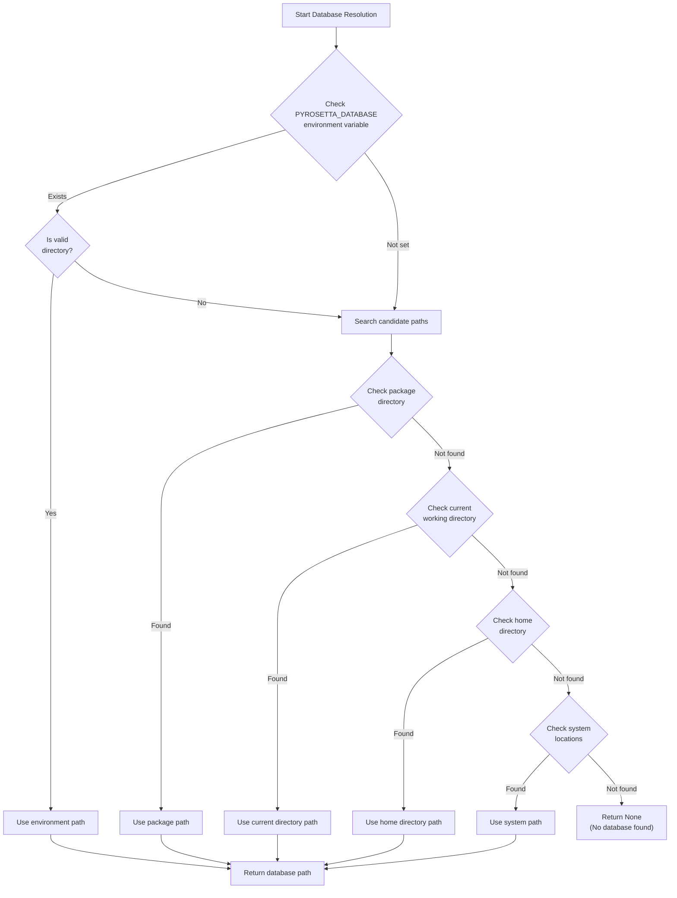
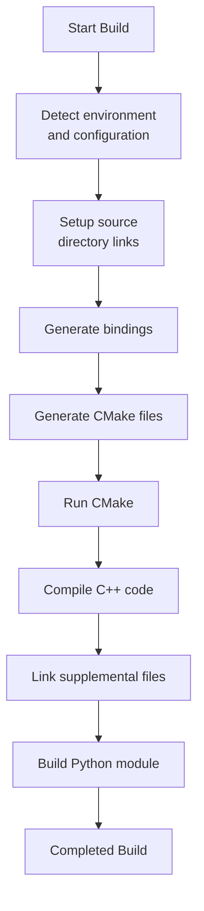
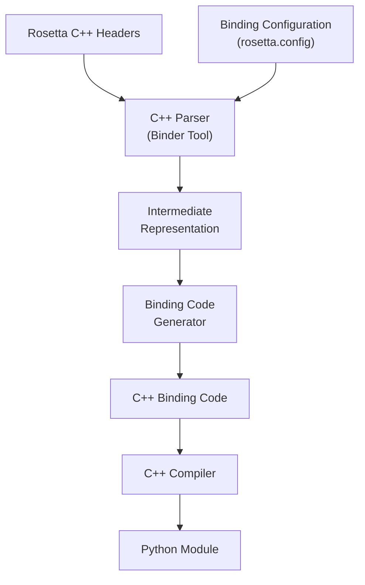
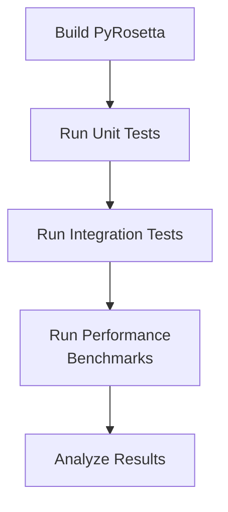
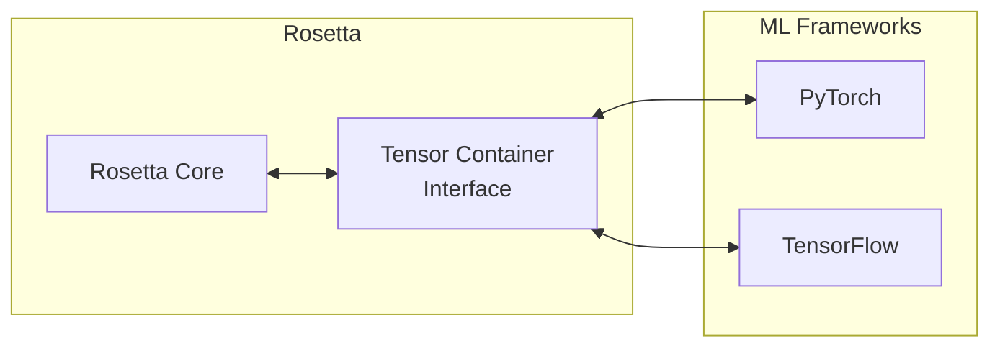

# Python Integration

<details>
<summary>Relevant source files</summary>

The following files were used as context for generating this wiki page:

- [LICENSE.PyRosetta.md](LICENSE.PyRosetta.md)
- [source/external/cxxtest/cxxtest/ErrorFormatter.h](source/external/cxxtest/cxxtest/ErrorFormatter.h)
- [source/src/apps/pilot/sergey/py_rosetta_test.cc](source/src/apps/pilot/sergey/py_rosetta_test.cc)
- [source/src/basic/gpu/GPU.cc](source/src/basic/gpu/GPU.cc)
- [source/src/basic/tensorflow_manager/RosettaTensorflowTensorContainer.tmpl.hh](source/src/basic/tensorflow_manager/RosettaTensorflowTensorContainer.tmpl.hh)
- [source/src/core/io/serialization/serialize_pose.hh](source/src/core/io/serialization/serialize_pose.hh)
- [source/src/core/pack/interaction_graph/DoubleLazyInteractionGraph.cc](source/src/core/pack/interaction_graph/DoubleLazyInteractionGraph.cc)
- [source/src/core/pack/interaction_graph/DoubleLazyInteractionGraph.hh](source/src/core/pack/interaction_graph/DoubleLazyInteractionGraph.hh)
- [source/src/core/pack/interaction_graph/HPatchInteractionGraph.hh](source/src/core/pack/interaction_graph/HPatchInteractionGraph.hh)
- [source/src/core/pack/interaction_graph/LinearMemoryInteractionGraph.hh](source/src/core/pack/interaction_graph/LinearMemoryInteractionGraph.hh)
- [source/src/core/pack/interaction_graph/OnTheFlyInteractionGraph.hh](source/src/core/pack/interaction_graph/OnTheFlyInteractionGraph.hh)
- [source/src/core/pack/interaction_graph/SurfaceInteractionGraph.hh](source/src/core/pack/interaction_graph/SurfaceInteractionGraph.hh)
- [source/src/devel/path_rover/pathrover.hh](source/src/devel/path_rover/pathrover.hh)
- [source/src/protocols/abinitio/IterativeCentroid.cc](source/src/protocols/abinitio/IterativeCentroid.cc)
- [source/src/protocols/dna/DnaInterfacePacker.cc](source/src/protocols/dna/DnaInterfacePacker.cc)
- [source/src/protocols/flxbb/FlxbbDesign.cc](source/src/protocols/flxbb/FlxbbDesign.cc)
- [source/src/protocols/indexed_structure_store/FragmentStore.cc](source/src/protocols/indexed_structure_store/FragmentStore.cc)
- [source/src/protocols/indexed_structure_store/FragmentStore.hh](source/src/protocols/indexed_structure_store/FragmentStore.hh)
- [source/src/protocols/relax/CentroidRelax.cc](source/src/protocols/relax/CentroidRelax.cc)
- [source/src/protocols/relax/ClassicRelax.cc](source/src/protocols/relax/ClassicRelax.cc)
- [source/src/protocols/simple_moves/FragmentMover.cc](source/src/protocols/simple_moves/FragmentMover.cc)
- [source/src/protocols/simple_moves/ResTypeFragmentMover.cc](source/src/protocols/simple_moves/ResTypeFragmentMover.cc)
- [source/src/python/PyRosetta/build.py](source/src/python/PyRosetta/build.py)
- [source/src/python/PyRosetta/include/rosetta_binders.hpp](source/src/python/PyRosetta/include/rosetta_binders.hpp)
- [source/src/python/PyRosetta/rosetta.cmake](source/src/python/PyRosetta/rosetta.cmake)
- [source/src/python/PyRosetta/rosetta.config](source/src/python/PyRosetta/rosetta.config)
- [source/src/python/PyRosetta/src/pyrosetta/__init__.py](source/src/python/PyRosetta/src/pyrosetta/__init__.py)
- [source/test/run.py](source/test/run.py)
- [source/version.py](source/version.py)
- [tests/benchmark/benchmark.py](tests/benchmark/benchmark.py)
- [tests/benchmark/hpc_drivers/base.py](tests/benchmark/hpc_drivers/base.py)
- [tests/benchmark/hpc_drivers/condor.py](tests/benchmark/hpc_drivers/condor.py)
- [tests/benchmark/hpc_drivers/multicore.py](tests/benchmark/hpc_drivers/multicore.py)
- [tests/benchmark/tests/PyRosetta.py](tests/benchmark/tests/PyRosetta.py)
- [tests/benchmark/tests/PyRosetta4.py](tests/benchmark/tests/PyRosetta4.py)
- [tests/benchmark/tests/__init__.py](tests/benchmark/tests/__init__.py)
- [tests/benchmark/tests/build.py](tests/benchmark/tests/build.py)
- [tests/benchmark/tests/integration.py](tests/benchmark/tests/integration.py)
- [tests/benchmark/tests/performance.py](tests/benchmark/tests/performance.py)
- [tests/benchmark/tests/profile.py](tests/benchmark/tests/profile.py)
- [tests/benchmark/tests/release.py](tests/benchmark/tests/release.py)
- [tests/benchmark/tests/score.py](tests/benchmark/tests/score.py)
- [tests/benchmark/tests/unit.py](tests/benchmark/tests/unit.py)
- [tests/integration/integration.py](tests/integration/integration.py)
- [tests/integration/tests/mmtfIO_score_test/command](tests/integration/tests/mmtfIO_score_test/command)
- [tests/sfxn_fingerprint/sfxn_fingerprint.py](tests/sfxn_fingerprint/sfxn_fingerprint.py)

</details>


This document provides an overview of Rosetta's Python interfaces and integration mechanisms. Rosetta, primarily a C++ codebase, offers robust Python interfaces to make its computational power accessible through Python's flexible and user-friendly environment. This page describes the architecture of Rosetta's Python integration, focusing on the overall system design and key components.

For detailed information about using PyRosetta specifically, see [PyRosetta](#5.1). For details on how Python bindings are generated from C++ code, see [Python Bindings](#5.2). For machine learning integration with Python, see [Machine Learning Integration](#5.3).

## Overview of Python Integration Architecture

Rosetta's Python integration consists of three main components:

1. **PyRosetta**: The primary Python interface to Rosetta functionality
2. **Binding Generation System**: The infrastructure that creates Python bindings for Rosetta's C++ code
3. **Machine Learning Integration**: Support for using ML frameworks like TensorFlow and PyTorch with Rosetta

The following diagram illustrates how these components fit together:



Sources: [source/src/python/PyRosetta/build.py:11-16](), [source/src/python/PyRosetta/src/pyrosetta/__init__.py:1-10]()

## PyRosetta

PyRosetta is a Python module that provides access to the Rosetta molecular modeling suite. It exposes Rosetta's functionality through a Python interface, allowing users to leverage Rosetta's powerful algorithms with Python's flexibility.

### Key Features

- Direct access to Rosetta's core functions from Python
- Support for protein structure manipulation, energy scoring, and protocol execution
- Seamless interoperability with Python scientific libraries (NumPy, SciPy, etc.)
- Built-in integration with visualization tools

### Initialization and Database Management

PyRosetta requires initialization before use, which sets up the Rosetta database and configures global options:

```python
import pyrosetta
pyrosetta.init()  # Default initialization
```

The initialization process automatically locates the Rosetta database by searching in standard locations or using environment variables, as shown in the following logic flow:



Sources: [source/src/python/PyRosetta/src/pyrosetta/__init__.py:74-122]()

## Building PyRosetta

PyRosetta is built using a sophisticated build system that handles multiple platforms and Python versions. The main build script (`build.py`) orchestrates the entire process.

### Build Process



The build.py script supports various options:

- Building for different platforms (Linux, macOS, Windows)
- Configuring threading support
- Enabling serialization
- Integrating with ML frameworks (TensorFlow, PyTorch)

Sources: [source/src/python/PyRosetta/build.py:611-634](), [source/src/python/PyRosetta/build.py:271-309]()

## Python Binding Generation

Rosetta uses a custom binding generation system to create Python interfaces for its C++ code. This system analyzes C++ headers and generates appropriate Python bindings.

### Binding System Architecture



The binding configuration (`rosetta.config`) controls what is exposed to Python:

- Specifies namespaces to include/exclude
- Defines return value policies for different types
- Configures custom binders for special types
- Sets up handling for STL containers and Rosetta-specific containers

Sources: [source/src/python/PyRosetta/rosetta.config:1-10](), [source/src/python/PyRosetta/build.py:638-700]()

## Testing Python Integration

Rosetta has extensive testing infrastructure for its Python integration:

### PyRosetta Test Framework

- Unit tests verify the functionality of individual components
- Integration tests ensure that Python and C++ components work together correctly
- Performance benchmarks monitor computational efficiency



Sources: [tests/benchmark/tests/PyRosetta.py:33-53](), [tests/benchmark/tests/PyRosetta.py:56-123]()

## Machine Learning Integration

Rosetta supports integration with machine learning frameworks like TensorFlow and PyTorch, enabling:

1. Direct interaction between Rosetta's molecular models and neural networks
2. Training ML models on Rosetta-generated data
3. Using ML predictions to guide Rosetta protocols

The integration is enabled through special build options and tensor container interfaces.



Sources: [source/src/basic/tensorflow_manager/RosettaTensorflowTensorContainer.tmpl.hh:1-5](), [source/src/python/PyRosetta/build.py:533-534]()

## Command-Line Interface Integration

Python is also integrated with Rosetta's command-line tools through:

1. Python scripts for preprocessing data
2. Automatic version information generation
3. Build system configuration and management

The `version.py` script, for example, generates version information for Rosetta builds, ensuring consistent versioning across Python and C++ components.

Sources: [source/version.py:76-113]()

## Conclusion

Rosetta's Python integration provides a powerful bridge between Python's accessibility and Rosetta's computational capabilities. Through PyRosetta, automatic binding generation, and ML framework integration, users can access Rosetta's molecular modeling algorithms using Python's flexible syntax and rich ecosystem of scientific libraries.

This documentation covered the high-level architecture of Rosetta's Python integration. For more specific information about PyRosetta usage, binding generation details, or machine learning integration, please refer to the dedicated pages linked at the beginning of this document.

---