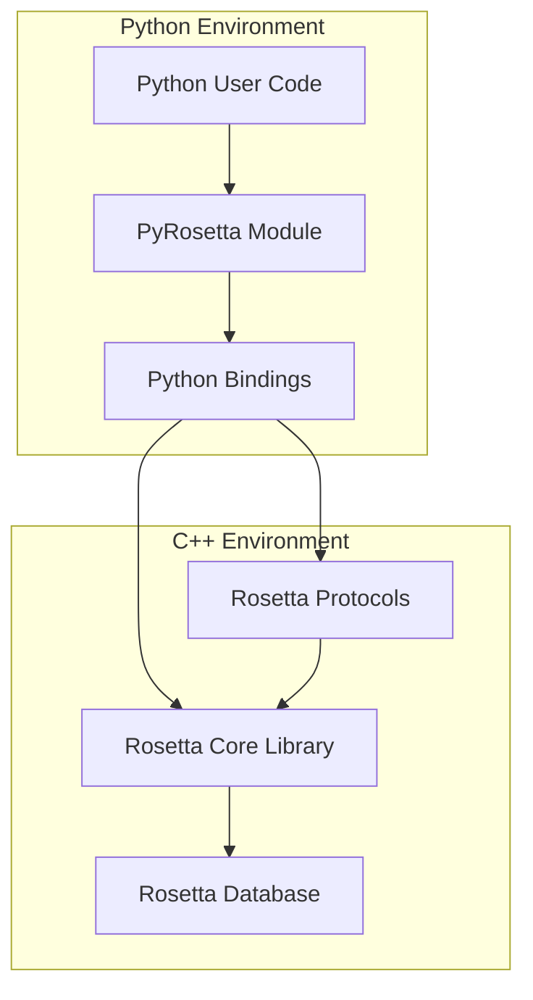
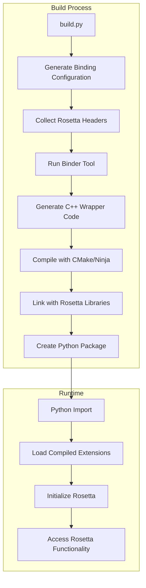
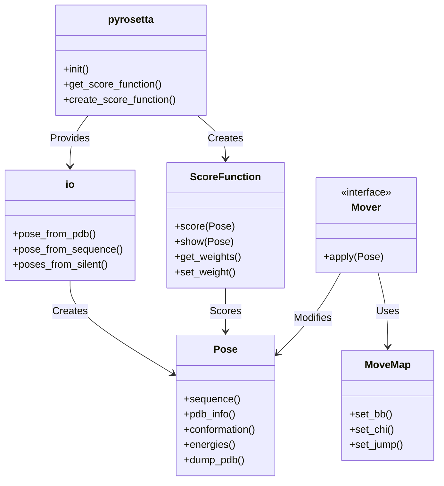
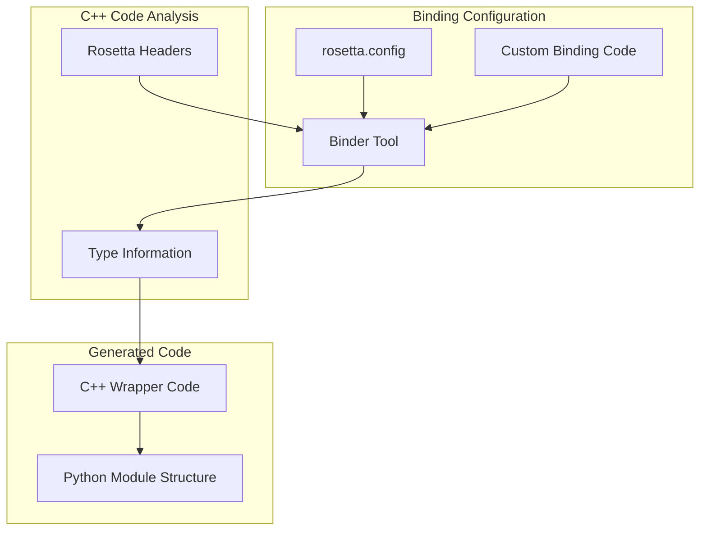

# PyRosetta

<details>
<summary>Relevant source files</summary>

The following files were used as context for generating this wiki page:

- [LICENSE.PyRosetta.md](LICENSE.PyRosetta.md)
- [source/external/cxxtest/cxxtest/ErrorFormatter.h](source/external/cxxtest/cxxtest/ErrorFormatter.h)
- [source/src/basic/tensorflow_manager/RosettaTensorflowTensorContainer.tmpl.hh](source/src/basic/tensorflow_manager/RosettaTensorflowTensorContainer.tmpl.hh)
- [source/src/protocols/indexed_structure_store/FragmentStore.cc](source/src/protocols/indexed_structure_store/FragmentStore.cc)
- [source/src/protocols/indexed_structure_store/FragmentStore.hh](source/src/protocols/indexed_structure_store/FragmentStore.hh)
- [source/src/python/PyRosetta/build.py](source/src/python/PyRosetta/build.py)
- [source/src/python/PyRosetta/include/rosetta_binders.hpp](source/src/python/PyRosetta/include/rosetta_binders.hpp)
- [source/src/python/PyRosetta/rosetta.cmake](source/src/python/PyRosetta/rosetta.cmake)
- [source/src/python/PyRosetta/rosetta.config](source/src/python/PyRosetta/rosetta.config)
- [source/src/python/PyRosetta/src/pyrosetta/__init__.py](source/src/python/PyRosetta/src/pyrosetta/__init__.py)
- [source/test/run.py](source/test/run.py)
- [source/version.py](source/version.py)
- [tests/benchmark/benchmark.py](tests/benchmark/benchmark.py)
- [tests/benchmark/hpc_drivers/base.py](tests/benchmark/hpc_drivers/base.py)
- [tests/benchmark/hpc_drivers/condor.py](tests/benchmark/hpc_drivers/condor.py)
- [tests/benchmark/hpc_drivers/multicore.py](tests/benchmark/hpc_drivers/multicore.py)
- [tests/benchmark/tests/PyRosetta.py](tests/benchmark/tests/PyRosetta.py)
- [tests/benchmark/tests/PyRosetta4.py](tests/benchmark/tests/PyRosetta4.py)
- [tests/benchmark/tests/__init__.py](tests/benchmark/tests/__init__.py)
- [tests/benchmark/tests/build.py](tests/benchmark/tests/build.py)
- [tests/benchmark/tests/integration.py](tests/benchmark/tests/integration.py)
- [tests/benchmark/tests/performance.py](tests/benchmark/tests/performance.py)
- [tests/benchmark/tests/profile.py](tests/benchmark/tests/profile.py)
- [tests/benchmark/tests/release.py](tests/benchmark/tests/release.py)
- [tests/benchmark/tests/score.py](tests/benchmark/tests/score.py)
- [tests/benchmark/tests/unit.py](tests/benchmark/tests/unit.py)
- [tests/integration/integration.py](tests/integration/integration.py)
- [tests/integration/tests/mmtfIO_score_test/command](tests/integration/tests/mmtfIO_score_test/command)
- [tests/sfxn_fingerprint/sfxn_fingerprint.py](tests/sfxn_fingerprint/sfxn_fingerprint.py)

</details>


PyRosetta is a Python-based interface to the Rosetta molecular modeling suite that enables users to access Rosetta's powerful algorithms and functionality through Python scripts. It provides a bridge between Rosetta's C++ core and the Python programming language, allowing for more flexible and interactive molecular modeling workflows.

## Purpose and Scope

This document covers the architecture, build system, and key components of PyRosetta, explaining how it interfaces with the Rosetta codebase and exposes functionality to Python users. It focuses on the technical aspects of PyRosetta rather than its usage for specific modeling tasks. For information about using PyRosetta for specific scientific applications, refer to the Rosetta documentation.

## Architecture Overview

PyRosetta uses a C++/Python binding system to expose Rosetta's functionality to Python. It relies on autogenerated binding code that wraps Rosetta's C++ classes and functions, making them accessible from Python while handling memory management and type conversions.



Sources: [source/src/python/PyRosetta/build.py:1-400](), [source/src/python/PyRosetta/src/pyrosetta/__init__.py:1-160]()

### Build and Binding System

PyRosetta uses a custom build system to generate bindings between Python and C++. The binding generation is handled by a tool called "binder" that analyzes Rosetta's C++ code and generates the appropriate Python wrapper code.



Sources: [source/src/python/PyRosetta/build.py:400-600](), [source/src/python/PyRosetta/build.py:600-800]()

## Core Components

PyRosetta exposes several key components from the Rosetta suite:

1. **Core Data Structures**: Like `Pose`, `Conformation`, `Residue`, and `ScoreFunction`
2. **Protocols**: Algorithms for structure prediction, design, and analysis
3. **Scoring**: Energy functions and scoring methods
4. **I/O**: File reading and writing functions
5. **Utility Functions**: Helper functions for common tasks

### Key Classes and Relationships



Sources: [source/src/python/PyRosetta/src/pyrosetta/__init__.py:40-55](), [source/src/python/PyRosetta/rosetta.config:10-80]()

## Initialization and Configuration

PyRosetta must be initialized before use with the `init()` function that sets up the Rosetta database and loads configuration parameters:

```python
import pyrosetta
pyrosetta.init(options='-ex1 -ex2aro', extra_options='-database path/to/database')
```

The initialization process:
1. Locates the Rosetta database
2. Processes command-line options
3. Sets up logging
4. Initializes core Rosetta components
5. Configures exception handling

Sources: [source/src/python/PyRosetta/src/pyrosetta/__init__.py:133-175](), [source/src/python/PyRosetta/src/pyrosetta/__init__.py:175-225]()

## Build System Details

PyRosetta's build system is complex due to the need to generate bindings for a large C++ codebase. The build process is managed by `build.py`, which:

1. Identifies the target platform and compiler
2. Sets up the source directory structure
3. Generates binding configuration
4. Processes header files to create binding declarations
5. Runs the binding generation tool
6. Compiles the generated code with CMake/Ninja
7. Links with Rosetta libraries
8. Assembles the final Python package

Key build configuration options include:
- Compiler selection
- Python version
- Build type (release, debug)
- Feature flags (serialization, multi-threading, etc.)
- External dependencies (PyTorch, TensorFlow)

Sources: [source/src/python/PyRosetta/build.py:80-200](), [source/src/python/PyRosetta/build.py:290-340](), [source/src/python/PyRosetta/build.py:600-650]()

## Bindings and Integration

PyRosetta binds Rosetta's C++ code to Python using a combination of custom binding code and the PyBind11 library. The binding process involves:

1. **Namespace Selection**: Configurations specify which C++ namespaces to expose
2. **Class/Function Selection**: Filter which classes and functions to bind
3. **Return Policy Configuration**: Set appropriate Python return value policies for C++ methods
4. **Type Conversions**: Define conversions between C++ and Python types
5. **Custom Binders**: Special handling for complex types like vectors, maps, etc.



Sources: [source/src/python/PyRosetta/rosetta.config:1-100](), [source/src/python/PyRosetta/include/rosetta_binders.hpp:1-50]()

## Testing Framework

PyRosetta is tested through several mechanisms:

1. **Build Tests**: Verify that PyRosetta builds correctly on different platforms
2. **Unit Tests**: Test individual components for correctness
3. **Integration Tests**: Test interactions between components
4. **Performance Tests**: Benchmark execution time and memory usage

The testing frameworks are built into the benchmark system, which executes tests and compares the results with reference values.

Sources: [tests/benchmark/tests/PyRosetta.py:1-100](), [tests/benchmark/tests/PyRosetta.py:100-200]()

## Python Ecosystem Integration

PyRosetta is designed to integrate well with the Python scientific ecosystem:

1. **NumPy Integration**: Supports conversion between Rosetta vectors and NumPy arrays
2. **Serialization Support**: Can serialize and deserialize Rosetta objects (when built with serialization support)
3. **Distributed Computing**: Provides tools for distributed computation
4. **Visualization**: Offers integration with visualization tools like PyMOL

PyRosetta can also be extended through Python subclassing, allowing users to create custom Movers, Filters, and other Rosetta components directly in Python.

Sources: [source/src/python/PyRosetta/src/pyrosetta/__init__.py:225-300](), [tests/benchmark/tests/__init__.py:400-450]()

## System Requirements

PyRosetta has several dependencies:

1. **Python**: Supports various Python versions (primarily 3.6+)
2. **C++ Compiler**: Requires a modern C++ compiler (GCC or Clang)
3. **Build Tools**: CMake, Ninja
4. **Optional Dependencies**: NumPy, SciPy, PyTorch, TensorFlow (depending on build options)

The exact requirements depend on the build configuration and enabled features.

Sources: [tests/benchmark/tests/__init__.py:400-490](), [source/src/python/PyRosetta/build.py:50-80]()

## Conclusion

PyRosetta serves as a powerful bridge between the Rosetta molecular modeling suite and the Python programming language. Through its sophisticated binding system, it exposes Rosetta's functionality to Python users while maintaining performance and compatibility with the Python scientific ecosystem. The build system ensures that PyRosetta can be compiled for different platforms and with various feature sets to meet users' needs.

---