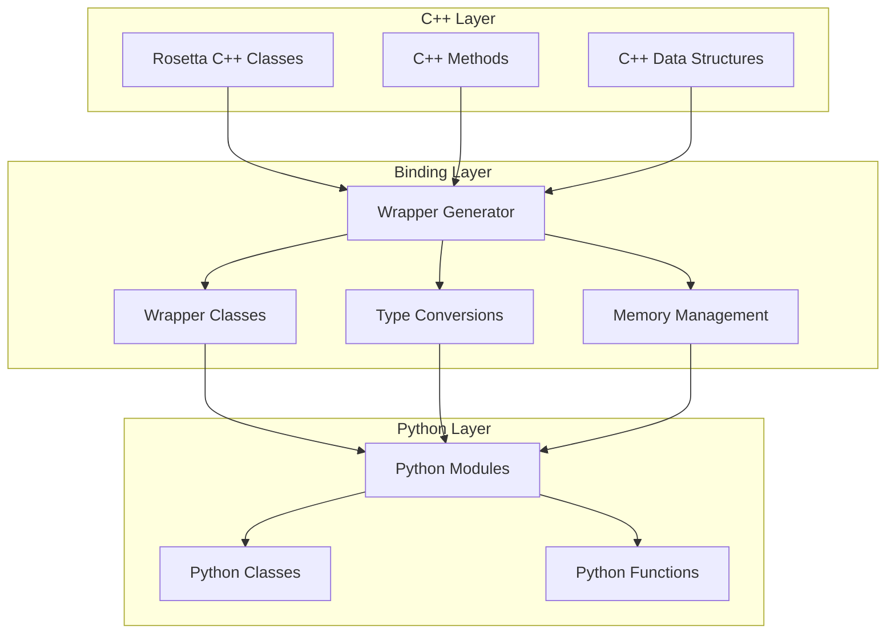
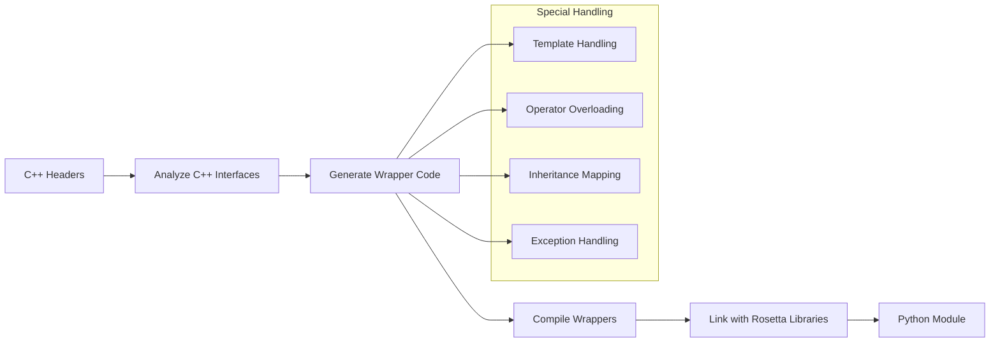
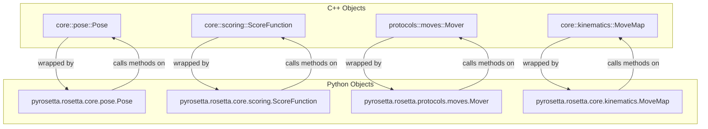
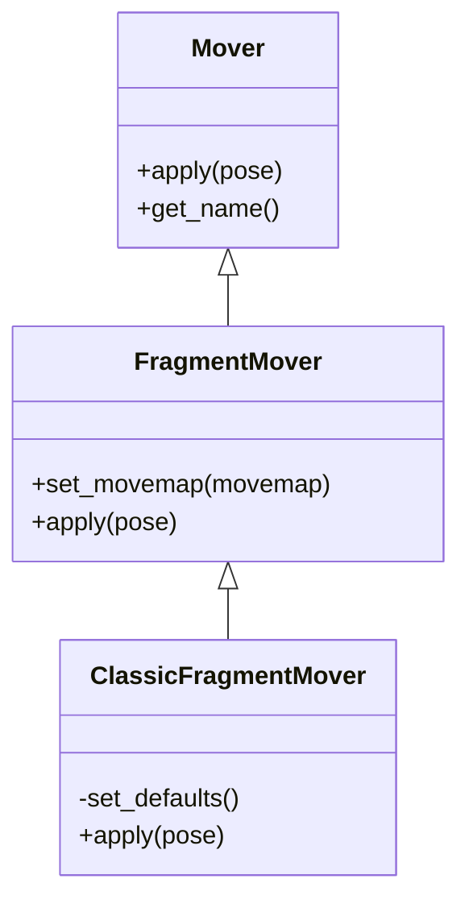
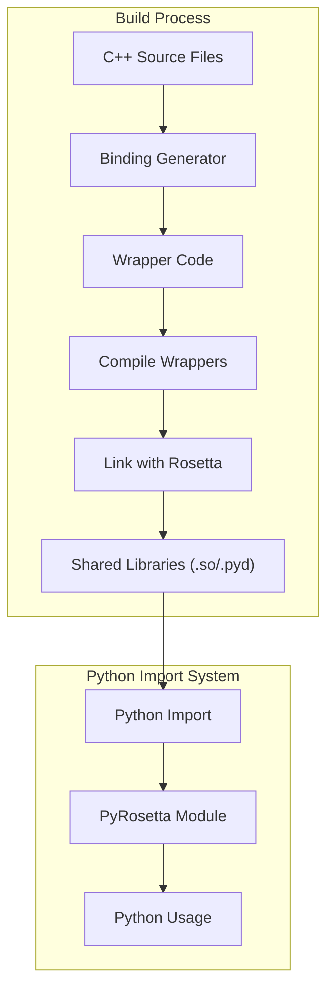
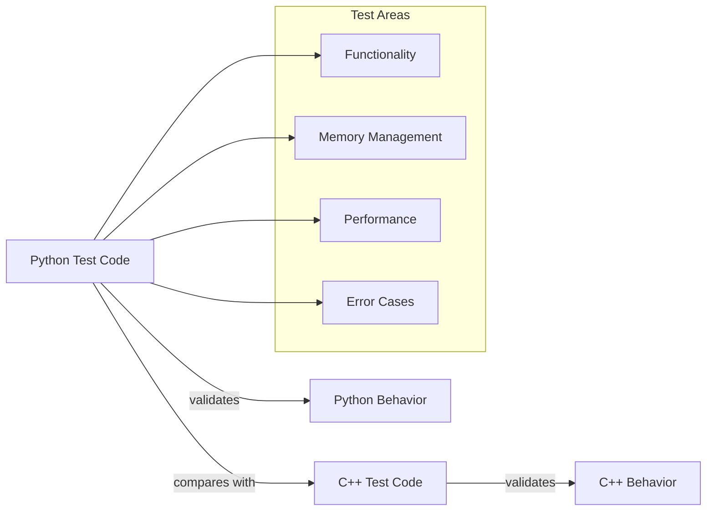

# Python Bindings

<details>
<summary>Relevant source files</summary>

The following files were used as context for generating this wiki page:

- [source/src/apps/pilot/sergey/py_rosetta_test.cc](source/src/apps/pilot/sergey/py_rosetta_test.cc)
- [source/src/basic/gpu/GPU.cc](source/src/basic/gpu/GPU.cc)
- [source/src/core/io/serialization/serialize_pose.hh](source/src/core/io/serialization/serialize_pose.hh)
- [source/src/core/pack/interaction_graph/DoubleLazyInteractionGraph.cc](source/src/core/pack/interaction_graph/DoubleLazyInteractionGraph.cc)
- [source/src/core/pack/interaction_graph/DoubleLazyInteractionGraph.hh](source/src/core/pack/interaction_graph/DoubleLazyInteractionGraph.hh)
- [source/src/core/pack/interaction_graph/HPatchInteractionGraph.hh](source/src/core/pack/interaction_graph/HPatchInteractionGraph.hh)
- [source/src/core/pack/interaction_graph/LinearMemoryInteractionGraph.hh](source/src/core/pack/interaction_graph/LinearMemoryInteractionGraph.hh)
- [source/src/core/pack/interaction_graph/OnTheFlyInteractionGraph.hh](source/src/core/pack/interaction_graph/OnTheFlyInteractionGraph.hh)
- [source/src/core/pack/interaction_graph/SurfaceInteractionGraph.hh](source/src/core/pack/interaction_graph/SurfaceInteractionGraph.hh)
- [source/src/devel/path_rover/pathrover.hh](source/src/devel/path_rover/pathrover.hh)
- [source/src/protocols/abinitio/IterativeCentroid.cc](source/src/protocols/abinitio/IterativeCentroid.cc)
- [source/src/protocols/dna/DnaInterfacePacker.cc](source/src/protocols/dna/DnaInterfacePacker.cc)
- [source/src/protocols/flxbb/FlxbbDesign.cc](source/src/protocols/flxbb/FlxbbDesign.cc)
- [source/src/protocols/relax/CentroidRelax.cc](source/src/protocols/relax/CentroidRelax.cc)
- [source/src/protocols/relax/ClassicRelax.cc](source/src/protocols/relax/ClassicRelax.cc)
- [source/src/protocols/simple_moves/FragmentMover.cc](source/src/protocols/simple_moves/FragmentMover.cc)
- [source/src/protocols/simple_moves/ResTypeFragmentMover.cc](source/src/protocols/simple_moves/ResTypeFragmentMover.cc)

</details>


This page documents how Rosetta's C++ code is made accessible to Python through automatically generated bindings. These bindings enable Python programmers to use Rosetta's molecular modeling capabilities via the PyRosetta interface. For information about using PyRosetta from a Python programmer's perspective, see [PyRosetta](#5.1).

## Introduction to Python Bindings in Rosetta

Python bindings serve as the connection layer between Rosetta's high-performance C++ codebase and the Python language. They allow developers to:

1. Access Rosetta functionality from Python scripts
2. Rapidly prototype new computational methods
3. Integrate Rosetta with Python's scientific computing ecosystem
4. Create custom analysis workflows

Rosetta's Python bindings are generated automatically from the C++ codebase, ensuring that Python users can access most of Rosetta's functionality without writing any C++ code themselves.

Sources:
- [source/src/apps/pilot/sergey/py_rosetta_test.cc:10-24]()

## Binding Architecture

Rosetta's Python bindings use a generated wrapper system to expose C++ functionality to Python. The binding architecture follows these key principles:



The C++ functionality is wrapped by automatically generated binding code, which handles type conversions, memory management, and method dispatch. These wrappers are then compiled into Python extension modules that can be imported and used from Python code.

Sources:
- [source/src/basic/gpu/GPU.cc:158-168]()
- [source/src/apps/pilot/sergey/py_rosetta_test.cc:69-73]()

## Binding Generation Process

Rosetta's Python bindings are generated through a multi-step process that translates C++ interfaces into Python-compatible code:



The process handles C++ features like:
- Classes and inheritance hierarchies
- Templates and complex data structures
- Operator overloading
- Exception handling
- Memory management with smart pointers

The binding generator likely uses SWIG (Simplified Wrapper and Interface Generator) or a similar tool to parse C++ headers and automatically create the binding code.

Sources:
- [source/src/protocols/relax/ClassicRelax.cc:142-184]()
- [source/src/core/io/serialization/serialize_pose.hh:92-94]()

## Core Binding Components

The binding system consists of several key components working together to provide a Python-friendly interface to Rosetta's functionality.

| Component | Purpose | Implementation |
|-----------|---------|----------------|
| Type Converters | Transform C++ types to Python | Handles primitive types, complex objects, vectors, and maps |
| Memory Management | Track object lifecycles | Manages ownership between Python and C++ |
| Exception Bridge | Convert C++ exceptions to Python | Maps Rosetta errors to Python exceptions |
| Method Wrappers | Adapt C++ method signatures | Handles overloaded methods, default arguments |
| Object Proxies | Represent C++ objects in Python | Maintain identity between languages |

These components ensure that Python code can interact naturally with Rosetta's C++ functionality while preserving the semantics of both languages.

Sources:
- [source/src/protocols/simple_moves/FragmentMover.cc:30-45]()
- [source/src/protocols/relax/ClassicRelax.cc:98-113]()

## Object Translation

The binding system needs to handle translation between C++ and Python representations of objects. This diagram illustrates how core Rosetta objects are exposed to Python:



When a Python method is called on a wrapped object, the binding layer:
1. Converts Python arguments to C++ types
2. Calls the corresponding C++ method
3. Converts the C++ return value to a Python object
4. Handles any exceptions that occur

Sources:
- [source/src/core/pack/interaction_graph/DoubleLazyInteractionGraph.hh:30-52]()
- [source/src/core/pack/interaction_graph/LinearMemoryInteractionGraph.hh:20-41]()

## Common Binding Patterns

The Python bindings follow several common patterns to make Rosetta's functionality available in a Pythonic way:

### Class Inheritance



C++ inheritance hierarchies are preserved in the Python bindings, allowing polymorphic behavior and subclassing in Python code.

### Reference Handling

Binding code must handle references carefully to prevent memory leaks or use-after-free errors:

1. **Owning References** - Python objects that own C++ resources
2. **Non-owning References** - Python objects that reference C++ objects owned elsewhere
3. **Shared Ownership** - Resources shared between C++ and Python with reference counting

### Method Overloading

C++ overloaded methods are exposed in Python using dispatch based on argument types:

```python
# Example of how C++ overloads might appear in Python
# C++ signatures:
# void apply(Pose & pose);
# void apply(Pose & pose, int position);

mover.apply(pose)           # Calls the first overload
mover.apply(pose, 10)       # Calls the second overload
```

Sources:
- [source/src/protocols/simple_moves/FragmentMover.cc:60-94]()
- [source/src/protocols/abinitio/IterativeCentroid.cc:55-66]()
- [source/src/protocols/simple_moves/ResTypeFragmentMover.cc:50-56]()

## Building and Loading Modules

Python modules containing Rosetta bindings are built and loaded in a specific way:



The compiled modules follow Python's import system conventions, allowing them to be imported like any other Python module:

```python
# Example of importing Rosetta functionality in Python
import pyrosetta
from pyrosetta import Pose, get_fa_scorefxn
from pyrosetta.rosetta.protocols.relax import FastRelax
```

Sources:
- [source/src/core/pack/interaction_graph/DoubleLazyInteractionGraph.cc:53-76]()
- [source/src/devel/path_rover/pathrover.hh:83-91]()

## Memory Management

Memory management is a critical aspect of the Python bindings, as Python and C++ have different memory models:

| C++ Concept | Python Equivalent | Binding Approach |
|-------------|-------------------|------------------|
| Stack allocation | N/A | Heap allocation in bindings |
| RAII (destructors) | `__del__` methods | Wrapped in Python finalizers |
| Smart pointers | Reference counting | Integrated with Python's GC |
| Manual memory | N/A | Hidden from Python users |
| Temporaries | N/A | Lifetime extended as needed |

The binding system uses smart pointers extensively to track ownership of objects and ensure proper cleanup when Python objects are garbage collected.

Sources:
- [source/src/protocols/flxbb/FlxbbDesign.cc:75-100]()
- [source/src/core/pack/interaction_graph/LinearMemoryInteractionGraph.hh:109-137]()

## Test Infrastructure

Rosetta includes a test infrastructure to ensure that Python bindings work correctly:



Tests ensure that:

1. All expected functionality is accessible from Python
2. Memory is managed correctly without leaks
3. Exceptions are properly translated
4. Performance is acceptable

Sources:
- [source/src/apps/pilot/sergey/py_rosetta_test.cc:38-52]()
- [source/src/protocols/relax/CentroidRelax.cc:86-112]()

## Extension and Customization

The binding system supports extension and customization:

1. **Adding New Bindings** - Process for exposing new C++ code to Python
2. **Customizing Existing Bindings** - Overriding default binding behavior
3. **Python Subclassing** - Extending C++ classes in Python code
4. **Callback Support** - Allowing Python functions as callbacks in C++ code

Developers can add new bindings by following Rosetta's binding conventions and rebuilding the Python modules.

Sources:
- [source/src/protocols/dna/DnaInterfacePacker.cc:112-158]()
- [source/src/core/pack/interaction_graph/SurfaceInteractionGraph.hh:75-103]()
- [source/src/core/pack/interaction_graph/HPatchInteractionGraph.hh:57-89]()

## Performance Considerations

Python bindings inevitably introduce some overhead compared to direct C++ code:

| Consideration | Impact | Mitigation |
|---------------|--------|------------|
| Function call overhead | Moderate | Keep high-frequency calls in C++ |
| Type conversion | Varies by type | Minimize conversions across boundary |
| Memory copies | Potentially high | Use views instead of copies when possible |
| Reference tracking | Low | Optimize for common cases |

For performance-critical code, it's best to keep algorithms within C++ and only expose the high-level interfaces to Python.

Sources:
- [source/src/protocols/relax/ClassicRelax.cc:482-570]()
- [source/src/basic/gpu/GPU.cc:596-661]()

## Common Usage Patterns

Python bindings are typically used in several common patterns:

1. **Script-based Workflows** - Using Python to orchestrate a series of Rosetta operations
2. **Interactive Analysis** - Analyzing Rosetta results in Python notebooks
3. **Custom Protocol Development** - Developing new protocols in Python
4. **Integration with Other Tools** - Combining Rosetta with other scientific Python libraries

These patterns leverage Python's strengths as a high-level language while accessing Rosetta's computational power.

Sources:
- [source/src/protocols/relax/CentroidRelax.cc:237-265]()
- [source/src/apps/pilot/sergey/py_rosetta_test.cc:54-77]()

## Conclusion

Rosetta's Python bindings provide a powerful interface between Rosetta's C++ code and Python, enabling scientific computing workflows that combine the performance of C++ with the flexibility and ease of use of Python. The binding system handles the complex task of translating between the two languages, allowing developers to focus on solving scientific problems rather than managing language interoperability.

For information on using the Python bindings from a user perspective, see the [PyRosetta](#5.1) documentation.

Sources:
- [source/src/protocols/flxbb/FlxbbDesign.cc:1-17]()
- [source/src/protocols/simple_moves/FragmentMover.cc:1-13]()

---