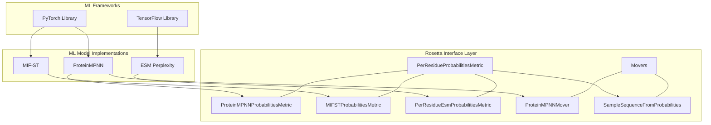
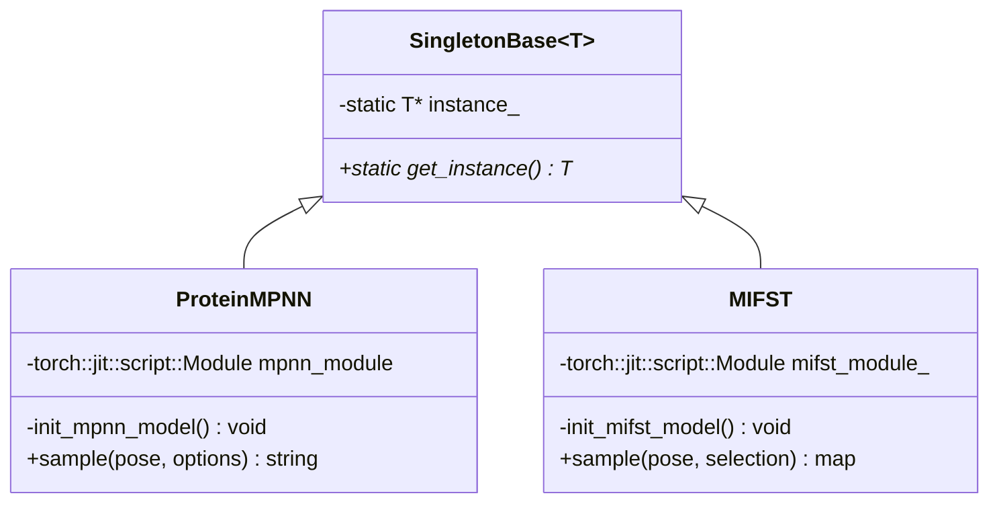
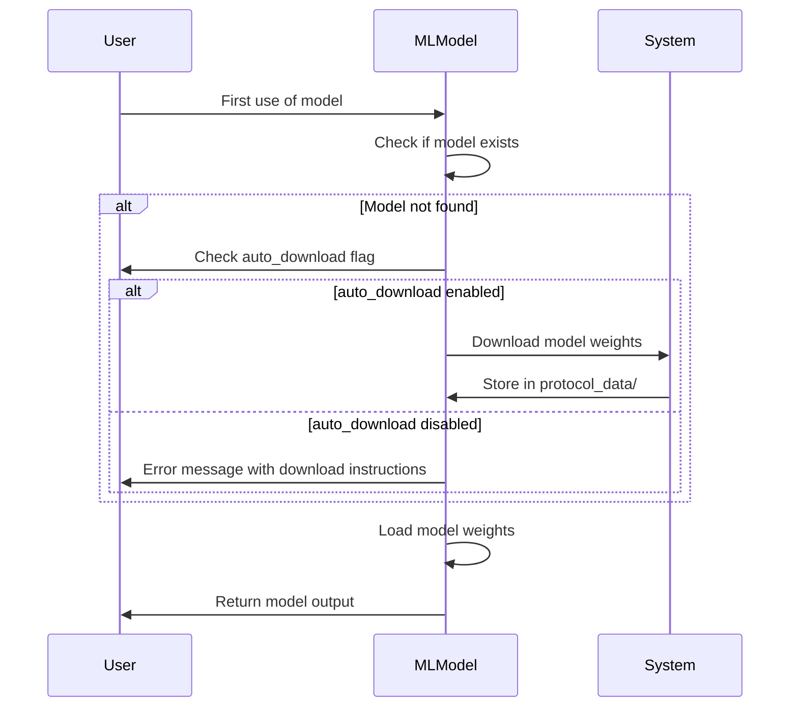
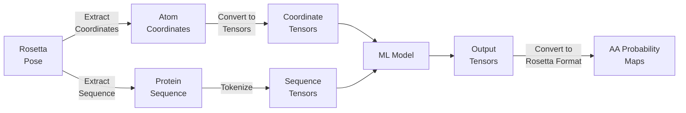
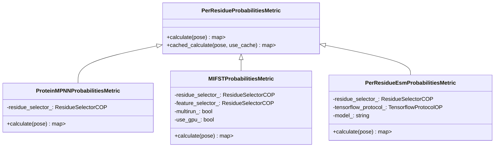
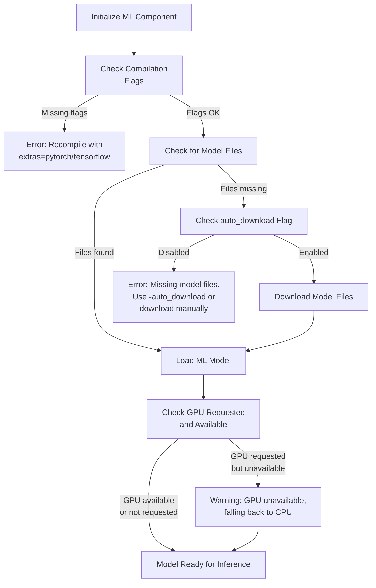

# Machine Learning Integration

<details>
<summary>Relevant source files</summary>

The following files were used as context for generating this wiki page:

- [database/citations/rosetta_citations.txt](database/citations/rosetta_citations.txt)
- [source/external/libxml2/trio.c](source/external/libxml2/trio.c)
- [source/src/core/chemical/ElementSet.cc](source/src/core/chemical/ElementSet.cc)
- [source/src/core/simple_metrics/PerResidueProbabilitiesMetric.cc](source/src/core/simple_metrics/PerResidueProbabilitiesMetric.cc)
- [source/src/core/simple_metrics/PerResidueProbabilitiesMetric.hh](source/src/core/simple_metrics/PerResidueProbabilitiesMetric.hh)
- [source/src/protocols/esm_perplexity/EsmPerplexityTensorflowProtocol.cc](source/src/protocols/esm_perplexity/EsmPerplexityTensorflowProtocol.cc)
- [source/src/protocols/esm_perplexity/EsmPerplexityTensorflowProtocol.hh](source/src/protocols/esm_perplexity/EsmPerplexityTensorflowProtocol.hh)
- [source/src/protocols/esm_perplexity/PerResidueEsmProbabilitiesMetric.cc](source/src/protocols/esm_perplexity/PerResidueEsmProbabilitiesMetric.cc)
- [source/src/protocols/esm_perplexity/PseudoPerplexityMetric.cc](source/src/protocols/esm_perplexity/PseudoPerplexityMetric.cc)
- [source/src/protocols/esm_perplexity/PseudoPerplexityMetric.fwd.hh](source/src/protocols/esm_perplexity/PseudoPerplexityMetric.fwd.hh)
- [source/src/protocols/esm_perplexity/PseudoPerplexityMetric.hh](source/src/protocols/esm_perplexity/PseudoPerplexityMetric.hh)
- [source/src/protocols/esm_perplexity/PseudoPerplexityMetricCreator.hh](source/src/protocols/esm_perplexity/PseudoPerplexityMetricCreator.hh)
- [source/src/protocols/inverse_folding/MIFST.cc](source/src/protocols/inverse_folding/MIFST.cc)
- [source/src/protocols/inverse_folding/MIFST.hh](source/src/protocols/inverse_folding/MIFST.hh)
- [source/src/protocols/inverse_folding/MIFSTProbabilitiesMetric.cc](source/src/protocols/inverse_folding/MIFSTProbabilitiesMetric.cc)
- [source/src/protocols/inverse_folding/util.cc](source/src/protocols/inverse_folding/util.cc)
- [source/src/protocols/inverse_folding/util.hh](source/src/protocols/inverse_folding/util.hh)
- [source/src/protocols/protein_mpnn/ProteinMPNN.cc](source/src/protocols/protein_mpnn/ProteinMPNN.cc)
- [source/src/protocols/protein_mpnn/ProteinMPNN.hh](source/src/protocols/protein_mpnn/ProteinMPNN.hh)
- [source/src/protocols/protein_mpnn/ProteinMPNNMover.cc](source/src/protocols/protein_mpnn/ProteinMPNNMover.cc)
- [source/src/protocols/protein_mpnn/ProteinMPNNProbabilitiesMetric.cc](source/src/protocols/protein_mpnn/ProteinMPNNProbabilitiesMetric.cc)
- [source/src/protocols/protein_mpnn/ProteinMPNNProbabilitiesMetric.hh](source/src/protocols/protein_mpnn/ProteinMPNNProbabilitiesMetric.hh)
- [source/src/protocols/protein_mpnn/util.cc](source/src/protocols/protein_mpnn/util.cc)
- [source/src/protocols/protein_mpnn/util.hh](source/src/protocols/protein_mpnn/util.hh)
- [source/src/protocols/simple_moves/SampleSequenceFromProbabilities.cc](source/src/protocols/simple_moves/SampleSequenceFromProbabilities.cc)
- [source/src/protocols/simple_moves/SampleSequenceFromProbabilities.hh](source/src/protocols/simple_moves/SampleSequenceFromProbabilities.hh)
- [source/test/protocols/esm_perplexity/EsmPerplexity.cxxtest.hh](source/test/protocols/esm_perplexity/EsmPerplexity.cxxtest.hh)
- [source/tools/build/basic.settings](source/tools/build/basic.settings)
- [source/tools/build/options.settings](source/tools/build/options.settings)
- [tests/integration/tests/esm_model_perplexity/command.tensorflow](tests/integration/tests/esm_model_perplexity/command.tensorflow)
- [tests/integration/tests/esm_model_perplexity/simple_test.xml](tests/integration/tests/esm_model_perplexity/simple_test.xml)

</details>


This page documents how machine learning (ML) models are integrated into Rosetta and how they can be used in protein modeling and design workflows. Rosetta incorporates several state-of-the-art machine learning models that provide powerful capabilities for protein sequence design, structure evaluation, and property prediction.

For information about Python integration with ML models, see [Python Integration](#5). For details about the build system needed to support machine learning capabilities, see [Build System](#1.2).

## Overview of Machine Learning Components

Rosetta currently includes three primary machine learning systems:

1. **ProteinMPNN**: A message-passing neural network for protein sequence design developed by Dauparas et al. (Science, 2022).
2. **MIF-ST**: A structure-conditioned language model for inverse protein folding developed by Yang et al.
3. **ESM Perplexity**: A system using protein language models from the ESM (Evolutionary Scale Modeling) family for sequence evaluation.

These ML models are implemented as self-contained modules that can be accessed through Rosetta's SimpleMetrics and Movers frameworks, allowing them to be used in RosettaScripts and PyRosetta.



Sources:
- [source/src/protocols/protein_mpnn/ProteinMPNN.cc]()
- [source/src/protocols/inverse_folding/MIFST.cc]()
- [source/src/protocols/esm_perplexity/EsmPerplexityTensorflowProtocol.cc]()

## Compilation Requirements

To use machine learning functionality in Rosetta, special compilation flags are required to include the necessary external ML libraries:

| ML Component | Framework | Compilation Flag | GPU Support |
|--------------|-----------|------------------|------------|
| ProteinMPNN, MIF-ST | PyTorch | `extras=pytorch` | `extras=pytorch_gpu` |
| ESM Perplexity | TensorFlow | `extras=tensorflow` | `extras=tensorflow_gpu` |

Example compilation commands:
```bash
# For PyTorch-based models (ProteinMPNN, MIF-ST)
./ninja_build.py mode=release extras=pytorch build

# For TensorFlow-based models (ESM Perplexity)
./ninja_build.py mode=release extras=tensorflow build

# For both with GPU support
./ninja_build.py mode=release extras=pytorch_gpu,tensorflow_gpu build
```

If you try to use ML features in a build that doesn't include the necessary libraries, you'll get error messages indicating that you need to recompile with the appropriate flags.

Sources:
- [source/tools/build/options.settings:175-188]()
- [source/tools/build/basic.settings:896-1007]()

## Common Design Patterns

The machine learning implementations in Rosetta follow several common patterns:

### Singleton Model Management

ML models are typically implemented as singletons to ensure efficient memory usage and avoid loading model weights multiple times:



Sources:
- [source/src/protocols/protein_mpnn/ProteinMPNN.hh:107-110]()
- [source/src/protocols/inverse_folding/MIFST.hh:57-59]()

### Model Auto-Download

ML models can automatically download pre-trained weights on first use:



The auto-download behavior is controlled by the `-auto_download` command-line flag:

```bash
rosetta_scripts.pytorch.linuxgccrelease -s input.pdb -parser:protocol script.xml -auto_download
```

Sources:
- [source/src/protocols/inverse_folding/MIFST.cc:277-314]()
- [source/src/protocols/esm_perplexity/EsmPerplexityTensorflowProtocol.cc:236-274]()
- [source/src/protocols/protein_mpnn/ProteinMPNN.cc:219-228]()

### Conversion Between Rosetta and ML Data Structures

All ML components include utility functions to convert between Rosetta data structures and the tensor formats required by the ML frameworks:



Sources:
- [source/src/protocols/protein_mpnn/util.cc:46-297]()
- [source/src/protocols/inverse_folding/util.cc:36-373]()

## ProteinMPNN Integration

ProteinMPNN is a message-passing neural network for protein sequence design developed by Dauparas et al. It predicts amino acid probabilities based on protein backbone structure.

### Key Classes

- `ProteinMPNN`: Singleton class that loads and runs the model
- `ProteinMPNNOptions`: Class for configuring model parameters
- `ProteinMPNNMover`: Mover that applies ProteinMPNN predictions to redesign proteins
- `ProteinMPNNProbabilitiesMetric`: SimpleMetric that returns amino acid probabilities

### Usage Example in RosettaScripts

```xml
<ROSETTASCRIPTS>
  <RESIDUE_SELECTORS>
    <Chain name="chainA" chains="A"/>
  </RESIDUE_SELECTORS>
  <MOVERS>
    <ProteinMPNNMover name="mpnn_design" 
                      design_selector="chainA" 
                      temperature="0.1"
                      omit_AAs="X"/>
  </MOVERS>
  <PROTOCOLS>
    <Add mover="mpnn_design"/>
  </PROTOCOLS>
</ROSETTASCRIPTS>
```

### Key Features

- **Temperature parameter**: Controls diversity of sampled sequences (higher = more diverse)
- **Residue selection**: Design specific regions using residue selectors
- **Chain awareness**: Understands multi-chain proteins
- **Tied positions**: Can design symmetric proteins with identical sequences
- **TaskOperation support**: Can restrict amino acid choices based on TaskOperations

Sources:
- [source/src/protocols/protein_mpnn/ProteinMPNN.hh:107-175]()
- [source/src/protocols/protein_mpnn/ProteinMPNNMover.cc:56-229]()
- [source/src/protocols/protein_mpnn/util.cc:46-77]()

## MIF-ST Integration

MIF-ST is a structure-conditioned model for inverse protein folding developed by Yang et al. It predicts amino acid probabilities conditioned on protein structure.

### Key Classes

- `MIFST`: Singleton class that loads and runs the model
- `MIFSTProbabilitiesMetric`: SimpleMetric that returns amino acid probabilities

### Usage Example in RosettaScripts

```xml
<ROSETTASCRIPTS>
  <RESIDUE_SELECTORS>
    <Chain name="designable" chains="A"/>
    <Chain name="features" chains="A,B"/> <!-- Consider B chain for context -->
  </RESIDUE_SELECTORS>
  <SIMPLE_METRICS>
    <MIFSTProbabilitiesMetric name="mifst_probs" 
                             residue_selector="designable"
                             feature_selector="features"
                             use_gpu="true"/>
  </SIMPLE_METRICS>
  <PROTOCOLS>
    <Add metrics="mifst_probs"/>
  </PROTOCOLS>
</ROSETTASCRIPTS>
```

### Key Features

- **Feature selection**: Can use features from parts of structure not being designed
- **GPU acceleration**: Supports GPU for faster inference
- **Multirun parameter**: Controls whether to process residues in batches or individually

Sources:
- [source/src/protocols/inverse_folding/MIFST.hh:55-105]()
- [source/src/protocols/inverse_folding/MIFSTProbabilitiesMetric.cc:58-219]()
- [source/src/protocols/inverse_folding/util.cc:130-173]()

## ESM Perplexity Integration

ESM Perplexity uses protein language models from the ESM family to evaluate protein sequences based on their statistical likelihood.

### Key Classes

- `EsmPerplexityTensorflowProtocol`: TensorFlow interface for ESM models
- `PerResidueEsmProbabilitiesMetric`: SimpleMetric that returns amino acid probabilities
- `PseudoPerplexityMetric`: SimpleMetric that calculates perplexity score (lower is better)

### Usage Example in RosettaScripts

```xml
<ROSETTASCRIPTS>
  <RESIDUE_SELECTORS>
    <Chain name="chainA" chains="A"/>
  </RESIDUE_SELECTORS>
  <SIMPLE_METRICS>
    <!-- Get per-residue AA probabilities -->
    <PerResidueEsmProbabilitiesMetric name="esm_probs" 
                                     model="esm2_t33_650M_UR50D" 
                                     residue_selector="chainA"
                                     write_pssm="output.pssm"/>
    <!-- Calculate overall perplexity -->
    <PseudoPerplexityMetric name="perplexity" metric="esm_probs"/>
  </SIMPLE_METRICS>
  <PROTOCOLS>
    <Add metrics="esm_probs,perplexity"/>
  </PROTOCOLS>
</ROSETTASCRIPTS>
```

### Key Features

- **Multiple model sizes**: Supports different ESM models of varying size and accuracy
- **PSSM output**: Can generate position-specific scoring matrices
- **Perplexity calculation**: Provides overall sequence quality scores
- **Attention masking**: Can perform masked language modeling

Available ESM models include:
- `esm2_t6_8M_UR50D` (smallest/fastest)
- `esm2_t12_35M_UR50D`
- `esm2_t30_150M_UR50D`
- `esm2_t33_650M_UR50D` (largest/most accurate)

Sources:
- [source/src/protocols/esm_perplexity/EsmPerplexityTensorflowProtocol.cc:57-315]()
- [source/src/protocols/esm_perplexity/PerResidueEsmProbabilitiesMetric.cc:61-142]()
- [source/src/protocols/esm_perplexity/PseudoPerplexityMetric.cc:54-137]()

## Cross-Model Usage

The `SampleSequenceFromProbabilities` mover can use any `PerResidueProbabilitiesMetric` to design sequences. This allows you to use any of the ML models to drive sequence design:

```xml
<ROSETTASCRIPTS>
  <RESIDUE_SELECTORS>
    <Chain name="chainA" chains="A"/>
  </RESIDUE_SELECTORS>
  <SIMPLE_METRICS>
    <!-- Use any of the ML probability metrics -->
    <MIFSTProbabilitiesMetric name="mifst_probs" residue_selector="chainA"/>
  </SIMPLE_METRICS>
  <MOVERS>
    <!-- Sample a sequence using these probabilities -->
    <SampleSequenceFromProbabilities name="design" 
                                    metric="mifst_probs" 
                                    temperature="0.2"/>
  </MOVERS>
  <PROTOCOLS>
    <Add mover="design"/>
  </PROTOCOLS>
</ROSETTASCRIPTS>
```

This mover samples amino acids according to the probabilities output by the ML model, optionally applying a temperature parameter to control diversity.

Sources:
- [source/src/protocols/simple_moves/SampleSequenceFromProbabilities.cc:76-228]()
- [source/src/protocols/simple_moves/SampleSequenceFromProbabilities.hh:63-154]()

## Advanced Usage Patterns

### Combining ML and Traditional Approaches

ML models can be combined with traditional Rosetta methods for more comprehensive design:

```xml
<ROSETTASCRIPTS>
  <RESIDUE_SELECTORS>
    <Chain name="designable" chains="A"/>
  </RESIDUE_SELECTORS>
  <MOVERS>
    <!-- Initial design with ML -->
    <ProteinMPNNMover name="mpnn_design" design_selector="designable"/>
    
    <!-- Energy minimization -->
    <FastRelax name="relax" scorefxn="ref2015"/>
    
    <!-- Evaluate with ESM -->
    <AddMetric name="add_esm" metric="perplexity"/>
  </MOVERS>
  <SIMPLE_METRICS>
    <PerResidueEsmProbabilitiesMetric name="esm_probs" model="esm2_t33_650M_UR50D"/>
    <PseudoPerplexityMetric name="perplexity" metric="esm_probs"/>
  </SIMPLE_METRICS>
  <PROTOCOLS>
    <Add mover="mpnn_design"/>
    <Add mover="relax"/>
    <Add mover="add_esm"/>
  </PROTOCOLS>
</ROSETTASCRIPTS>
```

### Task Operation Support

ML models (particularly ProteinMPNNMover) can use TaskOperations to restrict amino acid choices:

```xml
<ROSETTASCRIPTS>
  <RESIDUE_SELECTORS>
    <Chain name="designable" chains="A"/>
  </RESIDUE_SELECTORS>
  <TASKOPERATIONS>
    <RestrictToRepackingRLT name="repack"/>
    <IncludeCurrent name="include_current"/>
    <RestrictAbsentCanonicalAASRLT name="canonical_only"/>
  </TASKOPERATIONS>
  <MOVERS>
    <ProteinMPNNMover name="mpnn_design" design_selector="designable">
      <RestrictToRepackingRLT/>
      <IncludeCurrent/>
      <RestrictAbsentCanonicalAASRLT/>
    </ProteinMPNNMover>
  </MOVERS>
  <PROTOCOLS>
    <Add mover="mpnn_design"/>
  </PROTOCOLS>
</ROSETTASCRIPTS>
```

### Memory Caching

ML models can be memory-intensive. The PerResidueProbabilitiesMetric implementation includes caching to avoid recomputing values:

```xml
<PseudoPerplexityMetric name="perplexity" 
                       metric="esm_probs"
                       use_cached_data="true"
                       cache_prefix="run1_"
                       cache_suffix="_results"/>
```

Sources:
- [source/src/protocols/protein_mpnn/ProteinMPNNMover.cc:98-183]()
- [source/src/core/simple_metrics/PerResidueProbabilitiesMetric.cc:63-187]()
- [source/src/protocols/esm_perplexity/PseudoPerplexityMetric.cc:98-105]()

## Implementation Details

### ML Model Loading and Caching

ML models in Rosetta are implemented using the singleton pattern to ensure efficient memory usage:



Sources:
- [source/src/core/simple_metrics/PerResidueProbabilitiesMetric.hh:37-115]()
- [source/src/protocols/protein_mpnn/ProteinMPNNProbabilitiesMetric.hh:44-94]()
- [source/src/protocols/inverse_folding/MIFSTProbabilitiesMetric.cc:58-205]()

### Error Handling

ML components include comprehensive error handling for common issues:

1. **Missing model files**: Offers auto-download instructions
2. **Compilation errors**: Provides specific error messages about missing extras flags
3. **GPU availability**: Falls back to CPU when requested GPU is unavailable
4. **Invalid inputs**: Verifies inputs before running models



Sources:
- [source/src/protocols/inverse_folding/MIFST.cc:103-116]()
- [source/src/protocols/protein_mpnn/ProteinMPNN.cc:294-367]()
- [source/src/protocols/esm_perplexity/EsmPerplexityTensorflowProtocol.cc:236-274]()

## Practical Tips

### Memory Requirements

ML models can require significant memory:

| Model | Approximate Memory Usage |
|-------|--------------------------|
| ProteinMPNN | ~1GB |
| MIF-ST | ~2.5GB |
| ESM (t33_650M) | ~2.5GB |
| ESM (t6_8M) | ~100MB |

When using GPU acceleration, ensure your GPU has sufficient memory.

### Performance Considerations

- **First run is slow**: The first run of each ML model includes loading weights
- **GPU vs CPU**: GPU acceleration can provide significant speedups (5-20x)
- **Model size tradeoffs**: Smaller models are faster but may be less accurate
- **Batch processing**: When designing multiple positions, setting `multirun=true` is generally more efficient

### Best Practices

1. **Use residue selectors** to target specific regions for design
2. **Control diversity** with temperature parameters (lower = more conservative)
3. **Combine ML with traditional methods** for best results
4. **Consider model sizes** based on your needs (accuracy vs. speed)
5. **Enable GPU support** when available for faster inference

Sources:
- [source/src/protocols/inverse_folding/MIFST.cc:71-99]()
- [source/src/protocols/protein_mpnn/ProteinMPNN.cc:59-139]()
- [source/src/protocols/esm_perplexity/EsmPerplexityTensorflowProtocol.cc:117-190]()

---