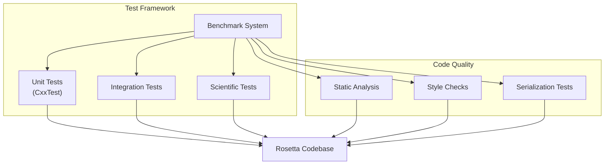
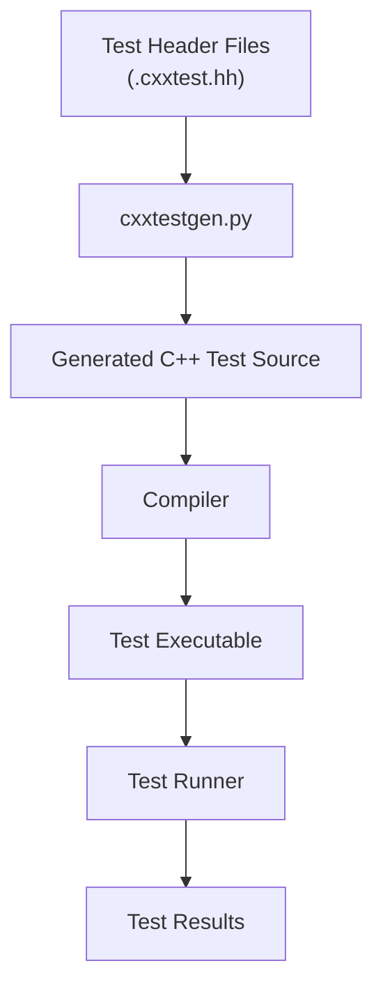
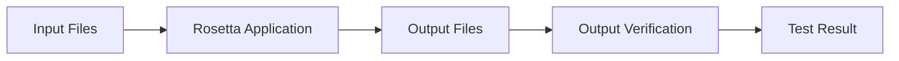
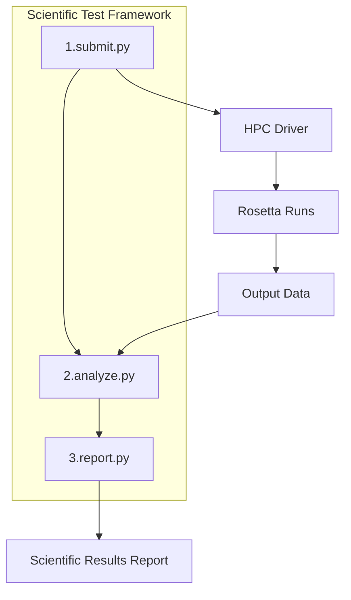
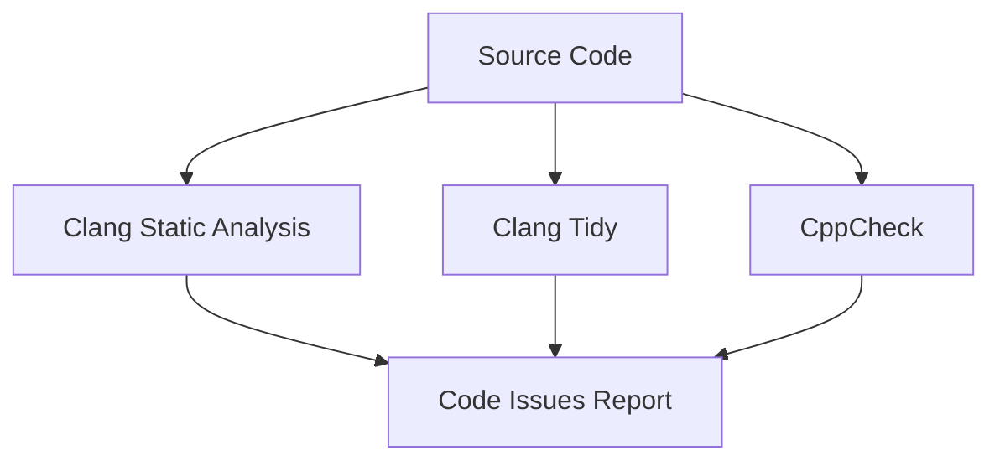
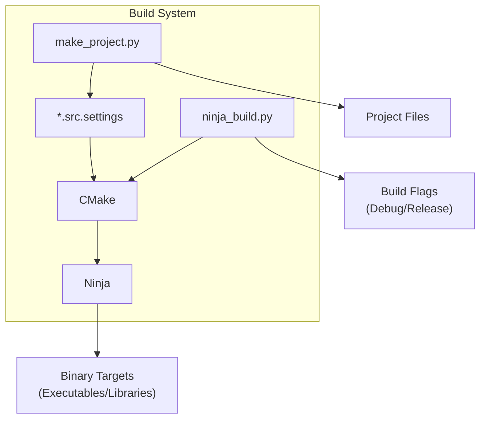
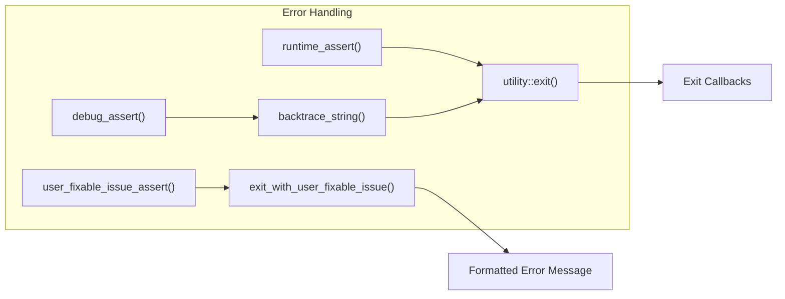
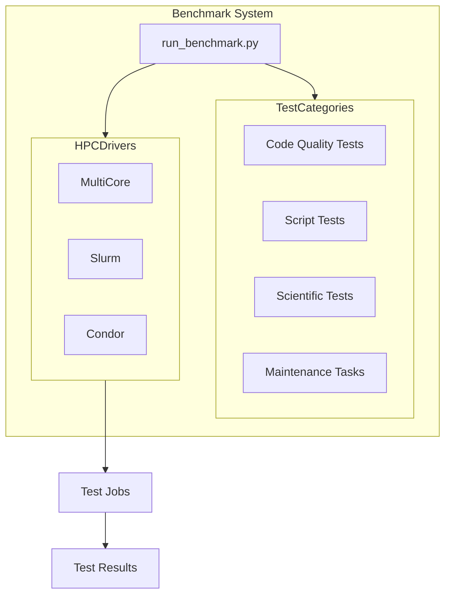
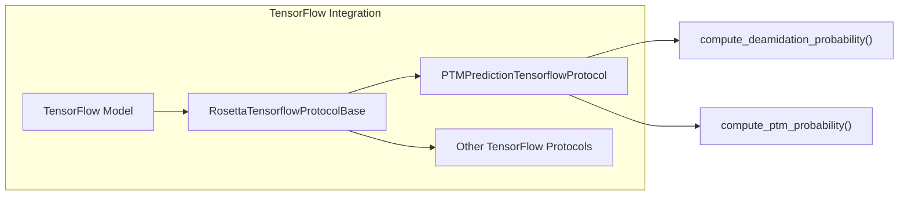

# Testing and Development

<details>
<summary>Relevant source files</summary>

The following files were used as context for generating this wiki page:

- [.benchmark-signature](.benchmark-signature)
- [.gitmodules](.gitmodules)
- [source/cmake/README](source/cmake/README)
- [source/cmake/build/build.post.cmake](source/cmake/build/build.post.cmake)
- [source/cmake/build/build.test.cmake](source/cmake/build/build.test.cmake)
- [source/cmake/build_util.py](source/cmake/build_util.py)
- [source/cmake/gen_cmake_build.py](source/cmake/gen_cmake_build.py)
- [source/cmake/make_new_build.py](source/cmake/make_new_build.py)
- [source/cmake/make_project.py](source/cmake/make_project.py)
- [source/cmake/smart_symlink.py](source/cmake/smart_symlink.py)
- [source/external/cxxtest/cxxtestgen.py](source/external/cxxtest/cxxtestgen.py)
- [source/ninja_build.py](source/ninja_build.py)
- [source/src/apps/public/helical_bundle/helical_bundle_predict.cc](source/src/apps/public/helical_bundle/helical_bundle_predict.cc)
- [source/src/core/energy_methods/ImplicitMembraneCoulomb.hh](source/src/core/energy_methods/ImplicitMembraneCoulomb.hh)
- [source/src/core/energy_methods/ImplicitMembraneElecEnergy.hh](source/src/core/energy_methods/ImplicitMembraneElecEnergy.hh)
- [source/src/protocols/helical_bundle_predict/HBPHelixAssignments.cc](source/src/protocols/helical_bundle_predict/HBPHelixAssignments.cc)
- [source/src/protocols/helical_bundle_predict/HBPHelixAssignments.hh](source/src/protocols/helical_bundle_predict/HBPHelixAssignments.hh)
- [source/src/protocols/helical_bundle_predict/HBP_FinalFullatomRefinementMoveGenerator.cc](source/src/protocols/helical_bundle_predict/HBP_FinalFullatomRefinementMoveGenerator.cc)
- [source/src/protocols/helical_bundle_predict/HBP_HelixCoilMoveGenerator.cc](source/src/protocols/helical_bundle_predict/HBP_HelixCoilMoveGenerator.cc)
- [source/src/protocols/helical_bundle_predict/HBP_HelixCoilMoveGenerator.hh](source/src/protocols/helical_bundle_predict/HBP_HelixCoilMoveGenerator.hh)
- [source/src/protocols/ptm_prediction/PTMPredictionTensorflowProtocol.hh](source/src/protocols/ptm_prediction/PTMPredictionTensorflowProtocol.hh)
- [source/src/protocols/ptm_prediction/PTMPredictionTensorflowProtocolBase.hh](source/src/protocols/ptm_prediction/PTMPredictionTensorflowProtocolBase.hh)
- [source/src/utility/backtrace.hh](source/src/utility/backtrace.hh)
- [source/src/utility/cxx_versioning_macros.hh](source/src/utility/cxx_versioning_macros.hh)
- [source/src/utility/exit.hh](source/src/utility/exit.hh)
- [tests/benchmark/benchmark.template.ini](tests/benchmark/benchmark.template.ini)
- [tests/benchmark/hpc_drivers/slurm.py](tests/benchmark/hpc_drivers/slurm.py)
- [tests/benchmark/tests/code_quality.md](tests/benchmark/tests/code_quality.md)
- [tests/benchmark/tests/code_quality.py](tests/benchmark/tests/code_quality.py)
- [tests/benchmark/tests/integration.demos.md](tests/benchmark/tests/integration.demos.md)
- [tests/benchmark/tests/integration.tutorials.md](tests/benchmark/tests/integration.tutorials.md)
- [tests/benchmark/tests/maintenance.md](tests/benchmark/tests/maintenance.md)
- [tests/benchmark/tests/maintenance.py](tests/benchmark/tests/maintenance.py)
- [tests/benchmark/tests/scientific/command.py](tests/benchmark/tests/scientific/command.py)
- [tests/benchmark/tests/scripts.md](tests/benchmark/tests/scripts.md)
- [tests/benchmark/tests/scripts.py](tests/benchmark/tests/scripts.py)
- [tests/integration/tests/RunSimpleMetric_b_factor_test/command](tests/integration/tests/RunSimpleMetric_b_factor_test/command)
- [tests/integration/tests/energy_based_clustering_alpha_aa_scorefile/command](tests/integration/tests/energy_based_clustering_alpha_aa_scorefile/command)
- [tests/integration/tests/helical_bundle_predict_psipred/command](tests/integration/tests/helical_bundle_predict_psipred/command)
- [tests/scientific/tests/fragments_picking/1.submit.py](tests/scientific/tests/fragments_picking/1.submit.py)
- [tests/scientific/tests/peptide_pnear_vs_ic50/2.analyze.py](tests/scientific/tests/peptide_pnear_vs_ic50/2.analyze.py)
- [tests/scientific/tests/simple_cycpep_predict/2.analyze.py](tests/scientific/tests/simple_cycpep_predict/2.analyze.py)

</details>


This page provides an overview of the testing infrastructure and development tools in the Rosetta codebase. It covers the test frameworks, build system, code quality tools, and utilities that help maintain code integrity and scientific accuracy in Rosetta.

For information about how to create specific scientific tests, see the Scientific Test Framework page. For details about Rosetta's build configuration options, see the Build System page.

## Test Framework Architecture

Rosetta employs multiple layers of testing to ensure both code correctness and scientific validity:



Sources:
- [tests/benchmark/tests/code_quality.py]()
- [tests/benchmark/tests/scripts.py]()
- [tests/benchmark/tests/scientific/command.py]()
- [source/external/cxxtest/cxxtestgen.py]()

## Unit Testing

Rosetta uses the CxxTest framework for unit testing. Unit tests verify that individual components function correctly in isolation.

### CxxTest Framework

CxxTest is a JUnit/CppUnit-like framework for C++ that's designed to be easy to use with minimal overhead.



To create a new unit test:

1. Create a `.cxxtest.hh` file with test classes
2. Test classes must inherit from `CxxTest::TestSuite`
3. Test methods must start with "test" (e.g., `void testSomething()`)
4. Add the test to the appropriate `.test.settings` file

Example test class structure:

```cpp
#include <cxxtest/TestSuite.h>
#include <core/feature/to/test.hh>

class MyTestSuite : public CxxTest::TestSuite {
public:
  void testFeatureWorks() {
    // Test code here
    TS_ASSERT_EQUALS(expected, actual);
  }
};
```

Sources:
- [source/external/cxxtest/cxxtestgen.py]()
- [source/cmake/build/build.test.cmake]()

## Integration Testing

Integration tests verify that Rosetta components work correctly together. These tests typically involve running Rosetta applications with specific input files and checking the outputs.



Integration tests are located in the `tests/integration` directory, with each test in its own subdirectory containing:
- A `command` file that specifies how to run the test
- Input files required by the test
- Reference output files for comparison

Sources:
- [tests/integration/tests/RunSimpleMetric_b_factor_test/command]()
- [tests/integration/tests/energy_based_clustering_alpha_aa_scorefile/command]()

## Scientific Tests

Scientific tests verify that Rosetta's algorithms produce scientifically valid results. These tests typically run more intensive calculations and analyze the results for scientific correctness.



Scientific tests typically follow a multi-step pattern:
1. **Submit**: Prepare and submit computational jobs
2. **Analyze**: Analyze the results of the calculations
3. **Report**: Generate a report of the scientific validity

The benchmark system provides infrastructure for running these tests on various computing resources, including local multi-core machines, SLURM clusters, and Condor pools.

Sources:
- [tests/benchmark/tests/scientific/command.py]()
- [tests/scientific/tests/fragments_picking/1.submit.py]()
- [tests/scientific/tests/simple_cycpep_predict/2.analyze.py]()
- [tests/scientific/tests/peptide_pnear_vs_ic50/2.analyze.py]()

## Code Quality Tools

Rosetta employs several tools to maintain code quality, including static analysis, code style checking, and performance monitoring.

### Static Analysis

Static analysis tools identify potential issues in the code without executing it:



#### Clang Static Analysis

Clang Static Analyzer performs deep analysis of code paths to find potential bugs, memory leaks, and other issues. It's run via the benchmark system with:

```
tests/benchmark/run_benchmark.py code_quality.clang_analysis
```

#### Clang Tidy

Clang Tidy focuses on enforcing coding standards, modern C++ practices, and finding potential problems. It's configured to run specific checks in Rosetta:

```
tests/benchmark/run_benchmark.py code_quality.clang_tidy
```

Current Clang Tidy checks include:
- Clang diagnostics
- Clang analyzer checks
- Bugprone checks
- Miscellaneous checks
- Selected modernization checks

#### CppCheck

CppCheck is another static analysis tool that complements Clang's tools by finding issues that might be missed:

```
tests/benchmark/run_benchmark.py code_quality.cppcheck
```

Sources:
- [tests/benchmark/tests/code_quality.py:236-399]()
- [tests/benchmark/tests/code_quality.py:403-458]()
- [tests/benchmark/tests/code_quality.md]()

### Code Style Checks

Rosetta enforces a consistent code style through automated beautification tools.

#### Beautification Check

The beautification check verifies that code follows Rosetta's style guidelines:

```
tests/benchmark/run_benchmark.py code_quality.beautification
```

This test checks if branch code is beautified according to Rosetta standards, but does not modify the code.

#### Automatic Beautification

The automatic beautification tool can be run to reformat code to match Rosetta's style:

```
tests/benchmark/run_benchmark.py code_quality.beautify
```

This tool beautifies new code (relative to the main branch) in a branch and commits the results.

Sources:
- [tests/benchmark/tests/code_quality.py:461-482]()
- [tests/benchmark/tests/code_quality.py:485-544]()
- [tests/benchmark/tests/code_quality.md]()

### Serialization Validation

The serialization validator ensures that serializable classes properly implement serialization functionality:

```
tests/benchmark/run_benchmark.py code_quality.serialization
```

This is important for maintaining backward compatibility and ensuring that saved data can be reliably loaded.

Sources:
- [tests/benchmark/tests/code_quality.py:30-72]()
- [tests/benchmark/tests/code_quality.md]()

## Build System

Rosetta uses a CMake and Ninja-based build system for efficient compilation across different platforms.



### Key Build Components

- **ninja_build.py**: Primary build script for Rosetta
- **make_project.py**: Generates CMake project files from `.src.settings` files
- **CMake**: Generates build files for different platforms
- **Ninja**: High-performance build system that replaces Make

### Building Rosetta

To build Rosetta, use the `ninja_build.py` script in the source directory:

```bash
# First-time build (release mode)
./ninja_build.py r -remake

# Subsequent builds
./ninja_build.py r

# Debug build
./ninja_build.py d

# Build specific targets
./ninja_build.py r -t bin
```

The build system supports various shorthand options:
- `r` = release
- `d` = debug
- `rs` = release_static
- `z` = zeromq
- `m` = cxx11thread

### Build Configuration

Build configuration is specified in `.src.settings` files, which list the source files for each project. The build system processes these files to generate CMake configuration.

Sources:
- [source/ninja_build.py]()
- [source/cmake/make_project.py]()
- [source/cmake/build_util.py]()
- [source/cmake/README]()

## Development Utilities

Rosetta provides several utilities to aid development and debugging.

### Error Handling and Debugging

Rosetta includes utilities for robust error handling and debugging:



#### Backtrace Utility

The `backtrace.hh` utility provides functions for obtaining a stack trace at runtime, which is useful for debugging:

```cpp
std::string trace = utility::backtrace_string();
```

This functionality is platform-dependent and works best on Linux/Unix systems.

#### Exit Utility

The `exit.hh` utility provides standardized exit functions that show file and line information, and can optionally display a message:

```cpp
// Exit with file, line, and message
utility_exit_with_message("Something went wrong");

// Assert with explanatory message
runtime_assert(condition, "Condition should be true");

// User-fixable issue (nicer error message)
user_fixable_issue_assert(condition, "Please check your input file format");
```

Sources:
- [source/src/utility/backtrace.hh]()
- [source/src/utility/exit.hh]()
- [source/src/utility/cxx_versioning_macros.hh]()

### Submodule Management

Rosetta uses git submodules extensively for external dependencies and associated repositories. The benchmark system includes a submodule regression test to ensure proper submodule versioning:

```
tests/benchmark/run_benchmark.py code_quality.submodule_regression
```

This test checks that:
1. Current commits don't introduce regressions (removing commits that were in Rosetta's main branch)
2. Submodule versions don't trail too far behind the submodule's main branch

Sources:
- [tests/benchmark/tests/code_quality.py:548-710]()
- [tests/benchmark/tests/code_quality.md]()
- [.gitmodules]()

## Documentation Maintenance

Automated documentation generation and maintenance is supported through the benchmark system:

```
tests/benchmark/run_benchmark.py maintenance.documentation
```

This test:
1. Regenerates option documentation from the codebase
2. Generates RosettaScripts XSD documentation
3. Creates a patch file with documentation changes

Sources:
- [tests/benchmark/tests/maintenance.py]()
- [tests/benchmark/tests/maintenance.md]()

## Benchmark System

The benchmark system is the central infrastructure for running tests and maintaining code quality in Rosetta. It provides a unified interface for executing different types of tests and collecting results.



### Running Benchmark Tests

Benchmark tests are run using the `run_benchmark.py` script:

```bash
cd tests/benchmark
./run_benchmark.py test_name
```

The benchmark system can use different HPC (High-Performance Computing) drivers to run tests:
- **MultiCore**: Runs tests locally using multiple CPU cores
- **Slurm**: Submits tests to a SLURM cluster
- **Condor**: Submits tests to a Condor pool

Configuration for the benchmark system is specified in `benchmark.ini`, with a template available in `benchmark.template.ini`.

Sources:
- [tests/benchmark/benchmark.template.ini]()
- [tests/benchmark/hpc_drivers/slurm.py]()
- [tests/benchmark/tests/code_quality.py]()
- [tests/benchmark/tests/scientific/command.py]()

## TensorFlow Integration Testing

Rosetta includes integration with TensorFlow for certain protocols, particularly in prediction tasks. The testing framework includes utilities to test these TensorFlow integrations.



The testing framework ensures that TensorFlow integrations load models correctly and produce expected outputs for various prediction tasks.

Sources:
- [source/src/protocols/ptm_prediction/PTMPredictionTensorflowProtocolBase.hh]()
- [source/src/protocols/ptm_prediction/PTMPredictionTensorflowProtocol.hh]()

## Summary

Rosetta's testing and development infrastructure provides comprehensive tools for ensuring code correctness, maintaining code quality, and verifying scientific accuracy. By utilizing multiple layers of testing and quality assurance, the framework helps maintain the reliability and usability of the Rosetta codebase across its many applications in computational molecular modeling.

---