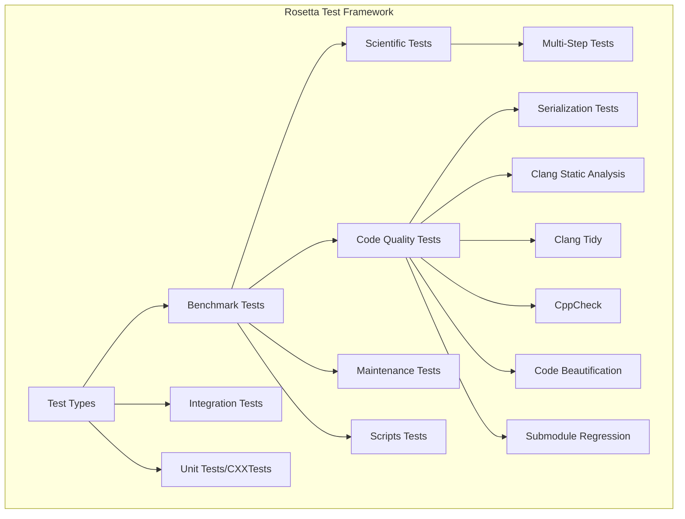
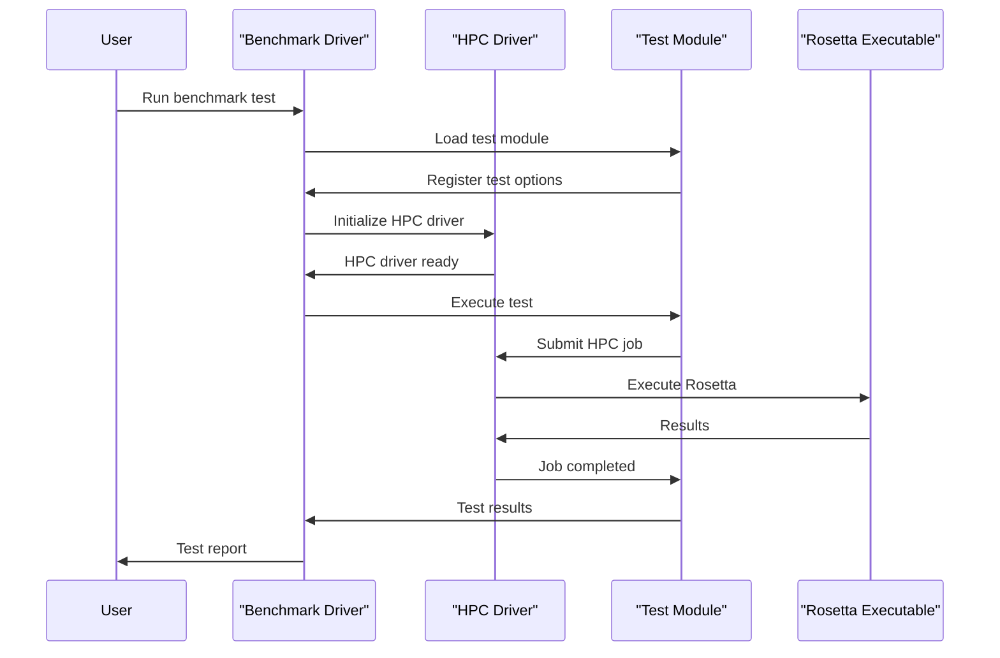
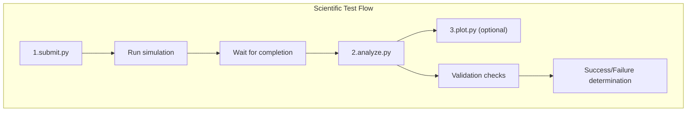
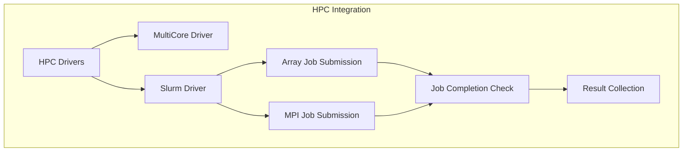

# Test Framework

<details>
<summary>Relevant source files</summary>

The following files were used as context for generating this wiki page:

- [.gitmodules](.gitmodules)
- [source/src/apps/public/helical_bundle/helical_bundle_predict.cc](source/src/apps/public/helical_bundle/helical_bundle_predict.cc)
- [source/src/core/energy_methods/ImplicitMembraneCoulomb.hh](source/src/core/energy_methods/ImplicitMembraneCoulomb.hh)
- [source/src/core/energy_methods/ImplicitMembraneElecEnergy.hh](source/src/core/energy_methods/ImplicitMembraneElecEnergy.hh)
- [source/src/protocols/helical_bundle_predict/HBPHelixAssignments.cc](source/src/protocols/helical_bundle_predict/HBPHelixAssignments.cc)
- [source/src/protocols/helical_bundle_predict/HBPHelixAssignments.hh](source/src/protocols/helical_bundle_predict/HBPHelixAssignments.hh)
- [source/src/protocols/helical_bundle_predict/HBP_FinalFullatomRefinementMoveGenerator.cc](source/src/protocols/helical_bundle_predict/HBP_FinalFullatomRefinementMoveGenerator.cc)
- [source/src/protocols/helical_bundle_predict/HBP_HelixCoilMoveGenerator.cc](source/src/protocols/helical_bundle_predict/HBP_HelixCoilMoveGenerator.cc)
- [source/src/protocols/helical_bundle_predict/HBP_HelixCoilMoveGenerator.hh](source/src/protocols/helical_bundle_predict/HBP_HelixCoilMoveGenerator.hh)
- [source/src/protocols/ptm_prediction/PTMPredictionTensorflowProtocol.hh](source/src/protocols/ptm_prediction/PTMPredictionTensorflowProtocol.hh)
- [source/src/protocols/ptm_prediction/PTMPredictionTensorflowProtocolBase.hh](source/src/protocols/ptm_prediction/PTMPredictionTensorflowProtocolBase.hh)
- [source/src/utility/backtrace.hh](source/src/utility/backtrace.hh)
- [source/src/utility/cxx_versioning_macros.hh](source/src/utility/cxx_versioning_macros.hh)
- [source/src/utility/exit.hh](source/src/utility/exit.hh)
- [tests/benchmark/benchmark.template.ini](tests/benchmark/benchmark.template.ini)
- [tests/benchmark/hpc_drivers/slurm.py](tests/benchmark/hpc_drivers/slurm.py)
- [tests/benchmark/tests/code_quality.md](tests/benchmark/tests/code_quality.md)
- [tests/benchmark/tests/code_quality.py](tests/benchmark/tests/code_quality.py)
- [tests/benchmark/tests/integration.demos.md](tests/benchmark/tests/integration.demos.md)
- [tests/benchmark/tests/integration.tutorials.md](tests/benchmark/tests/integration.tutorials.md)
- [tests/benchmark/tests/maintenance.md](tests/benchmark/tests/maintenance.md)
- [tests/benchmark/tests/maintenance.py](tests/benchmark/tests/maintenance.py)
- [tests/benchmark/tests/scientific/command.py](tests/benchmark/tests/scientific/command.py)
- [tests/benchmark/tests/scripts.md](tests/benchmark/tests/scripts.md)
- [tests/benchmark/tests/scripts.py](tests/benchmark/tests/scripts.py)
- [tests/integration/tests/RunSimpleMetric_b_factor_test/command](tests/integration/tests/RunSimpleMetric_b_factor_test/command)
- [tests/integration/tests/energy_based_clustering_alpha_aa_scorefile/command](tests/integration/tests/energy_based_clustering_alpha_aa_scorefile/command)
- [tests/integration/tests/helical_bundle_predict_psipred/command](tests/integration/tests/helical_bundle_predict_psipred/command)
- [tests/scientific/tests/fragments_picking/1.submit.py](tests/scientific/tests/fragments_picking/1.submit.py)
- [tests/scientific/tests/peptide_pnear_vs_ic50/2.analyze.py](tests/scientific/tests/peptide_pnear_vs_ic50/2.analyze.py)
- [tests/scientific/tests/simple_cycpep_predict/2.analyze.py](tests/scientific/tests/simple_cycpep_predict/2.analyze.py)

</details>


This document provides a comprehensive guide to Rosetta's test framework. The framework contains multiple types of tests that help ensure the correctness, quality, and reliability of the Rosetta software suite. The tests range from unit tests that verify individual code components to integration tests that check interactions between components, and scientific tests that validate the biological correctness of calculations.

The framework integrates with high-performance computing (HPC) systems to run large-scale tests efficiently and provides tools for analyzing test results.

## Overall Architecture

Rosetta's test framework is organized into several distinct test systems, each serving a different purpose in the software quality process.



Sources:
- [tests/benchmark/tests/code_quality.py]()
- [tests/benchmark/tests/code_quality.md]()
- [tests/benchmark/tests/maintenance.py]()
- [tests/benchmark/tests/scripts.py]()

## Execution Flow

Test execution in Rosetta follows a consistent pattern, particularly for benchmark tests, which often involve multiple steps and may require HPC resources.



Sources:
- [tests/benchmark/tests/scientific/command.py]()
- [tests/benchmark/hpc_drivers/slurm.py]()

## Test Types

### Benchmark Tests

Benchmark tests are organized in the `tests/benchmark/tests/` directory and are further divided into several categories:

#### Scientific Tests

Scientific tests validate the scientific correctness of Rosetta's calculations and algorithms. These tests are typically multi-step processes that:

1. Submit computational jobs (often to an HPC system)
2. Analyze the results against expected outcomes
3. Generate plots or other visualizations to help interpret results

These tests are crucial for ensuring that Rosetta's scientific algorithms produce biologically meaningful results.



Sample scientific tests include:
- Fragment picking tests
- Structure prediction tests
- Peptide modeling tests
- Protein-protein docking tests

Sources:
- [tests/scientific/tests/simple_cycpep_predict/2.analyze.py]()
- [tests/scientific/tests/peptide_pnear_vs_ic50/2.analyze.py]()
- [tests/scientific/tests/fragments_picking/1.submit.py]()

#### Code Quality Tests

Code quality tests ensure that the Rosetta codebase maintains high quality standards. These tests are defined in `tests/benchmark/tests/code_quality.py` and include:

1. **Serialization Tests**: Verify that classes are properly serializable
2. **Clang Static Analysis**: Detect potential bugs and code issues using Clang's static analyzer
3. **Clang Tidy**: Check for modern C++ best practices
4. **CppCheck**: Additional static analysis for code issues
5. **Beautification Tests**: Ensure code adheres to formatting standards
6. **Submodule Regression Tests**: Check for issues with Git submodules

These tests help prevent code quality regressions and ensure that new contributions maintain Rosetta's coding standards.

Sources:
- [tests/benchmark/tests/code_quality.py:30-232]()
- [tests/benchmark/tests/code_quality.py:236-400]()
- [tests/benchmark/tests/code_quality.md]()

#### Maintenance Tests

Maintenance tests automate tasks related to code and documentation maintenance. Currently, this includes:

- **Documentation Updates**: Automatically regenerate parts of the documentation from the codebase, such as options documentation and XML schema documentation

These tests help ensure that documentation stays in sync with the codebase.

Sources:
- [tests/benchmark/tests/maintenance.py:48-154]()
- [tests/benchmark/tests/maintenance.md]()

#### Scripts Tests

Scripts tests validate the scripts in the Rosetta and PyRosetta scripting interfaces:

1. **Rosetta Scripts Tests**:
   - **Parse Tests**: Verify that the parse-my-tag methods in XML files run without errors
   - **Verify Tests**: Ensure all scripts are properly accounted for in testing
   - **Validate Tests**: Test XML files against Rosetta's XML schema

2. **PyRosetta Tests**: Run tests from the pyrosetta_scripts repository

These tests ensure that the scripting interfaces remain functional and compatible with the core Rosetta code.

Sources:
- [tests/benchmark/tests/scripts.py:24-66]()
- [tests/benchmark/tests/scripts.py:70-147]()
- [tests/benchmark/tests/scripts.md]()

### Integration Tests

Integration tests verify that different components of Rosetta work together correctly. These tests are typically more focused than benchmark tests and are designed to test specific interactions between components.

Integration tests:
- Use a simple "command" file to specify test execution
- May check for expected output from a combination of commands
- Test real workflows that users might perform

Example integration tests include:
- Energy-based clustering
- RunSimpleMetric B-factor test

Sources:
- [tests/integration/tests/energy_based_clustering_alpha_aa_scorefile/command]()
- [tests/integration/tests/RunSimpleMetric_b_factor_test/command]()
- [tests/integration/tests/helical_bundle_predict_psipred/command]()

### Unit Tests

While not explicitly covered in the provided files, Rosetta also includes unit tests that verify the correctness of individual code units. These tests are likely implemented using a C++ unit testing framework and are run as part of the build process.

## HPC Integration

Rosetta's test framework integrates with high-performance computing (HPC) systems to run computationally intensive tests efficiently.



The HPC drivers handle:
- Job submission to different HPC systems
- Monitoring job progress
- Collecting results when jobs complete

Currently supported HPC systems include:
- **MultiCore**: For local multi-core execution
- **Slurm**: For cluster execution via the Slurm workload manager

Sources:
- [tests/benchmark/hpc_drivers/slurm.py]()
- [tests/benchmark/benchmark.template.ini:19-22]()

## Error Handling and Reporting

Rosetta's test framework includes robust error handling and reporting mechanisms to help identify and debug test failures. Key components include:

1. **Assertion Handling**: Custom assertion handlers that provide detailed information about failures
2. **Backtrace Support**: Stack trace generation to help locate the source of errors
3. **Standardized Reporting**: Consistent reporting of test results across different test types

Sources:
- [source/src/utility/backtrace.hh]()
- [source/src/utility/exit.hh]()
- [source/src/utility/cxx_versioning_macros.hh]()

## Configuration

Tests are configured using INI files that specify parameters such as:

- CPU count
- Memory allocation
- HPC driver selection
- User information for job submission
- Repository paths

The template configuration file is located at `tests/benchmark/benchmark.template.ini`.

Example configuration:
```ini
[main]
cpu_count = 24
memory = 64
user_name = Jane Roe
user_email = jane.roe@university.edu
hpc_driver = MultiCore
```

Sources:
- [tests/benchmark/benchmark.template.ini]()

## Test Writing Best Practices

When writing tests for Rosetta, consider the following best practices:

1. **Scientific Tests**:
   - Organize tests into separate submit, analyze, and plot steps
   - Use clear validation criteria with explicit thresholds
   - Include both debug and production test paths

2. **Code Quality Tests**:
   - Define explicit criteria for pass/fail conditions
   - Include appropriate exclusions for known issues

3. **Integration Tests**:
   - Keep tests focused on specific interactions
   - Use the `-testing:INTEGRATION_TEST` flag to ensure reproducible results

4. **General Best Practices**:
   - Ensure tests are deterministic and have clear pass/fail conditions
   - Include appropriate timeouts for long-running tests
   - Document the purpose and expected behavior of each test

## Conclusion

Rosetta's test framework provides a comprehensive system for ensuring the correctness, quality, and reliability of the software. By combining different types of tests—from unit tests to integration tests to scientific benchmarks—the framework helps maintain Rosetta's high standards as a scientific software package.

The framework's integration with HPC systems allows for efficient execution of computationally intensive tests, while its modular design makes it easy to add new tests as the software evolves.

---