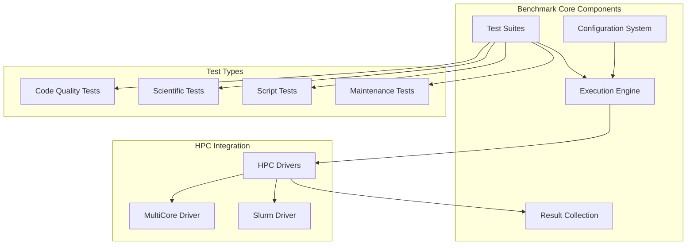
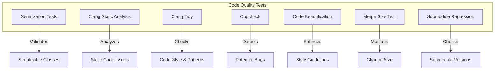
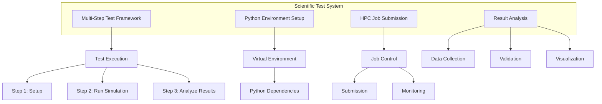
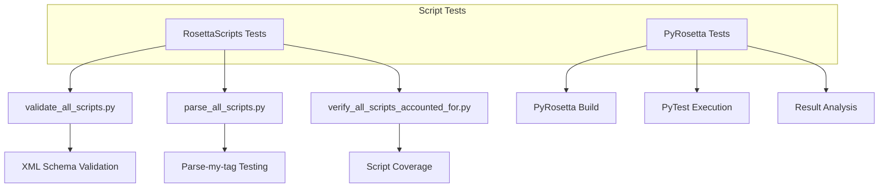
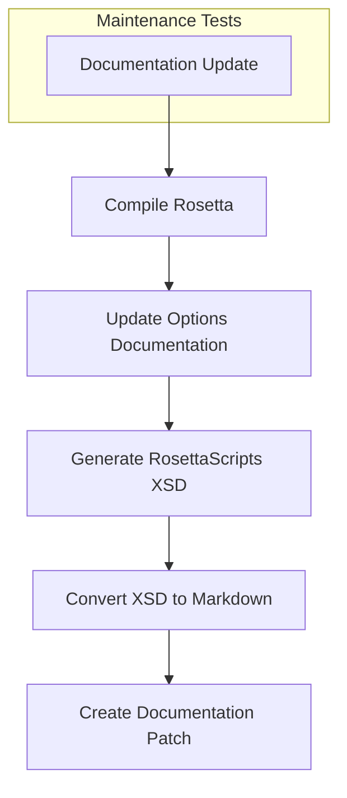
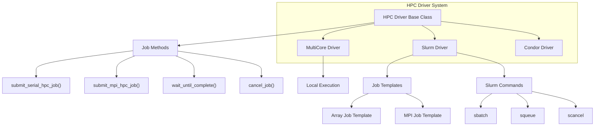
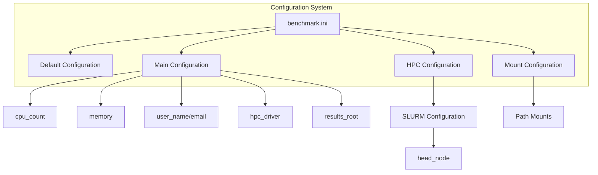
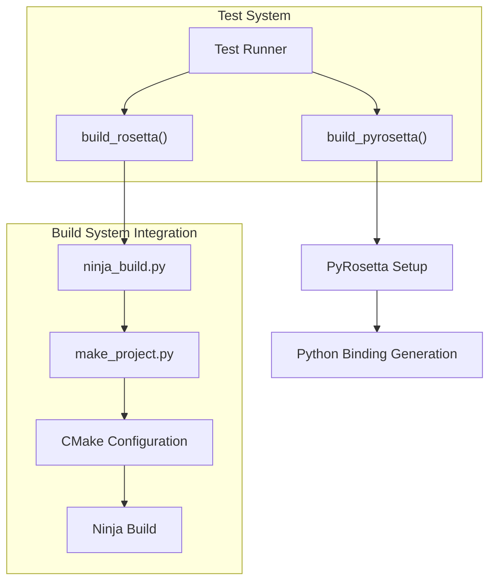
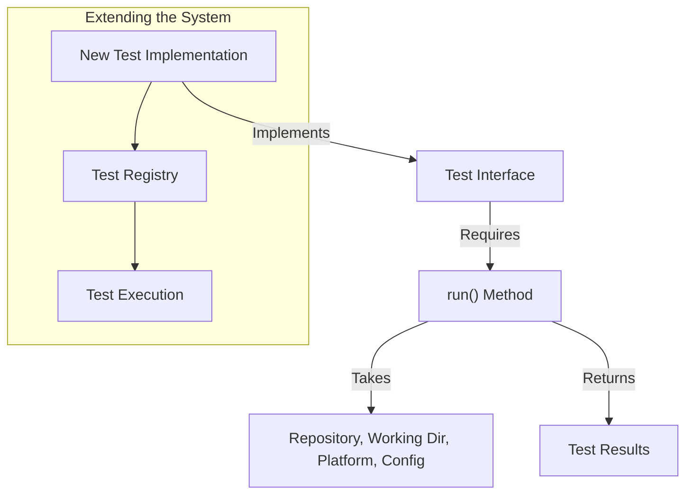

# Benchmarking System

Relevant source files

The following files were used as context for generating this wiki page:

- [.benchmark-signature](.benchmark-signature)
- [.gitmodules](.gitmodules)
- [source/cmake/README](source/cmake/README)
- [source/cmake/build/build.post.cmake](source/cmake/build/build.post.cmake)
- [source/cmake/build/build.test.cmake](source/cmake/build/build.test.cmake)
- [source/cmake/build_util.py](source/cmake/build_util.py)
- [source/cmake/gen_cmake_build.py](source/cmake/gen_cmake_build.py)
- [source/cmake/make_new_build.py](source/cmake/make_new_build.py)
- [source/cmake/make_project.py](source/cmake/make_project.py)
- [source/cmake/smart_symlink.py](source/cmake/smart_symlink.py)
- [source/external/cxxtest/cxxtestgen.py](source/external/cxxtest/cxxtestgen.py)
- [source/ninja_build.py](source/ninja_build.py)
- [source/src/apps/public/helical_bundle/helical_bundle_predict.cc](source/src/apps/public/helical_bundle/helical_bundle_predict.cc)
- [source/src/core/energy_methods/ImplicitMembraneCoulomb.hh](source/src/core/energy_methods/ImplicitMembraneCoulomb.hh)
- [source/src/core/energy_methods/ImplicitMembraneElecEnergy.hh](source/src/core/energy_methods/ImplicitMembraneElecEnergy.hh)
- [source/src/protocols/helical_bundle_predict/HBPHelixAssignments.cc](source/src/protocols/helical_bundle_predict/HBPHelixAssignments.cc)
- [source/src/protocols/helical_bundle_predict/HBPHelixAssignments.hh](source/src/protocols/helical_bundle_predict/HBPHelixAssignments.hh)
- [source/src/protocols/helical_bundle_predict/HBP_FinalFullatomRefinementMoveGenerator.cc](source/src/protocols/helical_bundle_predict/HBP_FinalFullatomRefinementMoveGenerator.cc)
- [source/src/protocols/helical_bundle_predict/HBP_HelixCoilMoveGenerator.cc](source/src/protocols/helical_bundle_predict/HBP_HelixCoilMoveGenerator.cc)
- [source/src/protocols/helical_bundle_predict/HBP_HelixCoilMoveGenerator.hh](source/src/protocols/helical_bundle_predict/HBP_HelixCoilMoveGenerator.hh)
- [source/src/protocols/ptm_prediction/PTMPredictionTensorflowProtocol.hh](source/src/protocols/ptm_prediction/PTMPredictionTensorflowProtocol.hh)
- [source/src/protocols/ptm_prediction/PTMPredictionTensorflowProtocolBase.hh](source/src/protocols/ptm_prediction/PTMPredictionTensorflowProtocolBase.hh)
- [source/src/utility/backtrace.hh](source/src/utility/backtrace.hh)
- [source/src/utility/cxx_versioning_macros.hh](source/src/utility/cxx_versioning_macros.hh)
- [source/src/utility/exit.hh](source/src/utility/exit.hh)
- [tests/benchmark/benchmark.template.ini](tests/benchmark/benchmark.template.ini)
- [tests/benchmark/hpc_drivers/slurm.py](tests/benchmark/hpc_drivers/slurm.py)
- [tests/benchmark/tests/code_quality.md](tests/benchmark/tests/code_quality.md)
- [tests/benchmark/tests/code_quality.py](tests/benchmark/tests/code_quality.py)
- [tests/benchmark/tests/integration.demos.md](tests/benchmark/tests/integration.demos.md)
- [tests/benchmark/tests/integration.tutorials.md](tests/benchmark/tests/integration.tutorials.md)
- [tests/benchmark/tests/maintenance.md](tests/benchmark/tests/maintenance.md)
- [tests/benchmark/tests/maintenance.py](tests/benchmark/tests/maintenance.py)
- [tests/benchmark/tests/scientific/command.py](tests/benchmark/tests/scientific/command.py)
- [tests/benchmark/tests/scripts.md](tests/benchmark/tests/scripts.md)
- [tests/benchmark/tests/scripts.py](tests/benchmark/tests/scripts.py)
- [tests/integration/tests/RunSimpleMetric_b_factor_test/command](tests/integration/tests/RunSimpleMetric_b_factor_test/command)
- [tests/integration/tests/energy_based_clustering_alpha_aa_scorefile/command](tests/integration/tests/energy_based_clustering_alpha_aa_scorefile/command)
- [tests/integration/tests/helical_bundle_predict_psipred/command](tests/integration/tests/helical_bundle_predict_psipred/command)
- [tests/scientific/tests/fragments_picking/1.submit.py](tests/scientific/tests/fragments_picking/1.submit.py)
- [tests/scientific/tests/peptide_pnear_vs_ic50/2.analyze.py](tests/scientific/tests/peptide_pnear_vs_ic50/2.analyze.py)
- [tests/scientific/tests/simple_cycpep_predict/2.analyze.py](tests/scientific/tests/simple_cycpep_predict/2.analyze.py)

The Rosetta Benchmarking System is a framework for testing, verifying, and measuring the performance of Rosetta's codebase. It provides organized methods for running different types of tests, from code quality checks to scientific validation, with support for high-performance computing (HPC) environments. This page documents the architecture and usage of the benchmarking system, focusing on how it supports the development and maintenance of Rosetta code.

For information about specific test implementations, see the test suite pages. For details about the build system, see [Build System](#1.2).

## Benchmarking System Architecture

The benchmarking system consists of several interconnected components that handle different aspects of test execution, resource management, and result reporting.

Sources:
- [tests/benchmark/tests/code_quality.py:1-728]()
- [tests/benchmark/hpc_drivers/slurm.py:1-181]()
- [tests/benchmark/benchmark.template.ini:1-37]()

## Test Types

The benchmarking system supports multiple types of tests, each serving different purposes in ensuring Rosetta's quality and correctness.

### Code Quality Tests

These tests verify that the code meets certain quality standards and doesn't contain obvious issues.

Code quality tests ensure that Rosetta's codebase maintains high standards and avoids regressions.

#### Serialization Tests

Validates that serializable classes properly implement serialization methods.

#### Clang Static Analysis

Runs the Clang Static Analyzer to detect potential issues like memory leaks, null pointer dereferences, and similar bugs.

#### Clang Tidy

Uses Clang-Tidy to enforce coding standards and detect common patterns that might indicate bugs or inefficiencies.

#### Cppcheck

Runs the Cppcheck tool to identify potential bugs and style issues in the C++ code.

#### Code Beautification

Verifies that code conforms to Rosetta's formatting standards. There are two tests:
- `beautification`: Checks if new code meets formatting standards
- `beautify`: Automatically reformats and commits code changes

#### Merge Size Test

Checks the size of merge changes to prevent excessively large diffs.

#### Submodule Regression Test

Verifies that submodule versions don't regress and helps keep them up to date.

Sources:
- [tests/benchmark/tests/code_quality.py:30-730]()
- [tests/benchmark/tests/code_quality.md:1-36]()

### Scientific Tests

Scientific tests verify that Rosetta's scientific algorithms produce expected results. These tests typically involve running simulations and comparing the outputs against known values.

Scientific tests evaluate the correctness of Rosetta's scientific algorithms through a structured multi-step process:

1. **Setup**: Prepare input files, configure test parameters
2. **Run Simulation**: Execute Rosetta algorithms on test inputs
3. **Analysis**: Compare results against expected values

The system supports a wide range of scientific tests, from structure prediction to design algorithms, with customized validation criteria for each test.

Sources:
- [tests/benchmark/tests/scientific/command.py:1-250]()
- [tests/scientific/tests/simple_cycpep_predict/2.analyze.py:1-189]()
- [tests/scientific/tests/peptide_pnear_vs_ic50/2.analyze.py:1-282]()
- [tests/scientific/tests/fragments_picking/1.submit.py:1-153]()

### Script Tests

Script tests verify the functionality of scripts in the Rosetta ecosystem, including RosettaScripts and PyRosetta scripts.

Script tests ensure that RosettaScripts XML files and PyRosetta scripts function correctly:

- **RosettaScripts Tests**:
  - `validate_all_scripts.py`: Validates XML files against the schema
  - `parse_all_scripts.py`: Tests that XML scripts can be parsed correctly
  - `verify_all_scripts_accounted_for.py`: Ensures all scripts are tested

- **PyRosetta Tests**:
  - Tests PyRosetta building
  - Runs PyRosetta scripts with pytest
  - Analyzes results for correctness

Sources:
- [tests/benchmark/tests/scripts.py:1-207]()
- [tests/benchmark/tests/scripts.md:1-36]()

### Maintenance Tests

Maintenance tests help maintain the Rosetta codebase and its supporting files. Currently, this includes documentation updates.

The documentation update test:
1. Compiles Rosetta to generate up-to-date documentation
2. Updates options documentation from the compiled code
3. Generates and processes the RosettaScripts XML schema
4. Creates a patch file with documentation changes

Sources:
- [tests/benchmark/tests/maintenance.py:1-165]()
- [tests/benchmark/tests/maintenance.md:1-9]()

## HPC Integration

The benchmarking system can run tests using different HPC (High-Performance Computing) drivers to efficiently utilize computing resources.

The HPC integration allows tests to be run efficiently on different computing environments:

- **MultiCore Driver**: Runs tests locally using multiple CPU cores
- **Slurm Driver**: Submits jobs to a Slurm cluster
- **Condor Driver**: Submits jobs to a Condor/HTCondor cluster (not shown in provided files)

Each driver implements common methods like:
- `submit_serial_hpc_job()`: Submit independent jobs
- `submit_mpi_hpc_job()`: Submit MPI-based parallel jobs
- `wait_until_complete()`: Wait for jobs to finish
- `cancel_job()`: Cancel running jobs

The Slurm driver supports both array jobs (multiple similar tasks) and MPI jobs (single parallel task).

Sources:
- [tests/benchmark/hpc_drivers/slurm.py:1-181]()

## Configuration and Usage

The benchmarking system uses a configuration file to control its behavior and resource usage.

Configuration is stored in a file named `benchmark.ini` with sections for different aspects of the system:

- **Main Configuration**:
  - `cpu_count`: Number of CPU cores available
  - `memory`: Available memory in GB
  - `user_name` and `user_email`: User information
  - `hpc_driver`: HPC driver to use (MultiCore, Slurm, Condor)
  - `results_root`: Directory for storing results

- **SLURM Configuration**:
  - `head_node`: Optional host for submitting jobs

- **Mount Configuration**:
  - Paths to external resources

The system can be run with different targets to execute specific tests or test suites.

Sources:
- [tests/benchmark/benchmark.template.ini:1-37]()

## Build Integration

The benchmarking system integrates with Rosetta's build system to ensure tests run against the correct version of the code.

The benchmarking system uses Rosetta's build infrastructure to compile the code for testing:

- **build_rosetta()**: Compiles Rosetta using ninja_build.py
- **build_pyrosetta()**: Builds PyRosetta with Python bindings

The build system integration ensures that tests are run against the correct version of the code with appropriate configurations.

Sources:
- [source/ninja_build.py:1-138]()
- [source/cmake/make_project.py:1-188]()
- [source/cmake/build_util.py:1-296]()

## Extending the Benchmarking System

The benchmarking system is designed to be extensible, allowing new tests to be added as Rosetta evolves.

To add a new test to the benchmarking system:

1. Create a new test module implementing the required interface
2. Implement the `run()` method that takes standard parameters:
   - `repository_root`: Path to Rosetta repository
   - `working_dir`: Directory for test output
   - `platform`: Target platform information
   - `config`: Configuration parameters
3. Return results in the standard format with status and logs
4. Register the test in the appropriate test suite

The modular design allows for easy extension as new testing needs arise.

Sources:
- [tests/benchmark/tests/code_quality.py:30-730]()
- [tests/benchmark/tests/scientific/command.py:58-109]()

## Summary

The Rosetta Benchmarking System provides a comprehensive framework for verifying the quality and correctness of the Rosetta codebase. With support for different test types and HPC environments, it enables efficient testing and validation of Rosetta's functionality. The system's modular design allows for extension as Rosetta continues to evolve.

Sources:
- [tests/benchmark/tests/code_quality.py:1-730]()
- [tests/benchmark/tests/scientific/command.py:1-250]()
- [tests/benchmark/tests/scripts.py:1-207]()
- [tests/benchmark/tests/maintenance.py:1-165]()
- [tests/benchmark/hpc_drivers/slurm.py:1-181]()
- [tests/benchmark/benchmark.template.ini:1-37]()
- [source/ninja_build.py:1-138]()