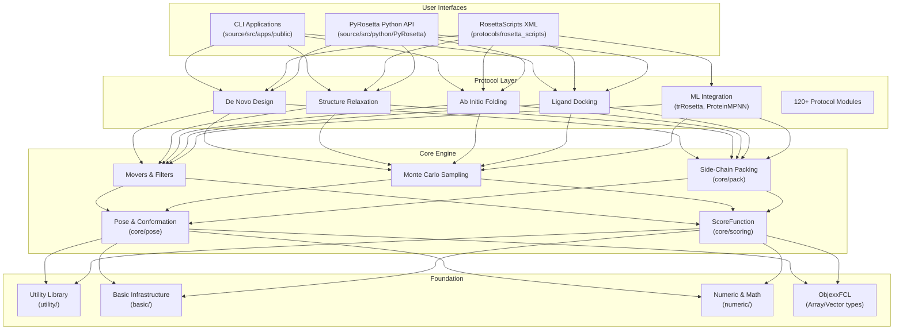
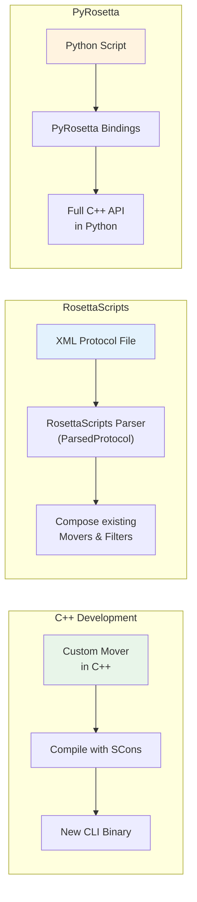

Rosetta is a comprehensive **biomolecular modeling suite** developed collaboratively by the RosettaCommons — a consortium of over 100 academic research groups with more than two decades of continuous development. The software provides algorithms for computational modeling and analysis of protein structures, enabling scientific advances in de novo protein design, enzyme design, ligand docking, and structure prediction of biological macromolecules. This page introduces the repository's architecture, its key subsystems, and the logical pathways for getting started as a new developer.

Sources: [README.md](README.md#L1-L20)

## Repository at a Glance

The Rosetta repository is a large, multi-module C++ codebase hosted on GitHub under the `RosettaCommons/rosetta` organization. Despite being publicly hosted, **Rosetta is not "Open Source" in the OSI (Open Source Initiative) sense** — commercial use requires a separate license obtained from the University of Washington. This distinction is critical for anyone planning to build on or redistribute Rosetta-derived software.

Sources: [README.md](README.md#L42-L46), [LICENSE.md](LICENSE.md#L1-L6)

The top-level repository layout reflects three primary concerns: the **C++ source tree** under `source/`, the **runtime database** under `database/`, and several **git submodules** that provide documentation, demos, example scripts, and external dependencies.

```
rosetta/                          ← Repository root
├── source/                       ← C++ source tree & build system
│   ├── src/                      ← Core library, protocols, apps, utilities
│   ├── test/                     ← Compiled unit tests
│   ├── SConstruct                ← SCons build entry point
│   ├── cmake/                    ← CMake configuration (PyRosetta, extras)
│   └── external/                 ← Vendored dependencies (auto-fetched)
│
├── database/                     ← Runtime data (rotamers, scoring params, etc.)
│   ├── chemical/                 ← Chemical component definitions
│   ├── scoring/                  ← Energy function parameters
│   ├── rotamer/                  ← Rotamer libraries
│   ├── sampling/                 ← Fragment & sampling data
│   ├── sequence/                 ← Sequence profiles
│   └── protocol_data/            ← Protocol-specific data files
│
├── tests/                        ← Integration & scientific tests
│   ├── integration/              ← End-to-end protocol tests
│   ├── scientific/               ← Scientific validation benchmarks
│   └── benchmark/                ← Performance benchmarks
│
├── docker/                       ← Reference Dockerfiles
├── documentation/                ← [submodule] Online documentation source
├── demos/                        ← [submodule] Usage demos
├── tools/                        ← [submodule] Helper scripts & utilities
├── rosetta_scripts_scripts/      ← [submodule] Example RosettaScripts XML
├── pyrosetta_scripts/            ← [submodule] Example PyRosetta scripts
└── PyRosetta.notebooks/          ← [submodule] Jupyter notebooks for PyRosetta
```

Sources: [README.md](README.md#L122-L161)

## High-Level Architecture

Rosetta's architecture follows a layered design: **foundational types and utilities** at the bottom, a **core modeling engine** (Pose, ScoreFunction, kinematics) in the middle, and **domain-specific protocols** and **application executables** on top. Extensibility is achieved through three primary interfaces: C++ protocol development, XML-based RosettaScripts, and Python bindings via PyRosetta.



Sources: [README.md](README.md#L122-L141), [source/src/core](source/src/core), [source/src/protocols](source/src/protocols)

## Core Subsystem Breakdown

The C++ source tree under `source/src/` is organized into several major directories, each with a distinct responsibility within the modeling pipeline.

### `core/` — The Modeling Kernel

The `core/` directory contains the fundamental data structures that every protocol depends on. It is divided into approximately 20 subdirectories, each encapsulating a domain of the modeling problem:

| Subdirectory | Purpose |
|---|---|
| `core/pose/` | The **Pose** class — the central data structure representing a macromolecular structure (atomic coordinates, residues, energies, PDB metadata) |
| `core/scoring/` | The **ScoreFunction** framework — energy terms, scoring methods, and the energy graph used to evaluate and minimize structures |
| `core/conformation/` | **Conformation** data — internal coordinate representation, fold trees, and residue geometry |
| `core/chemical/` | **ResidueType** and atom type definitions — the chemical vocabulary of the system |
| `core/pack/` | **Side-chain packing** — rotamer placement and optimization algorithms |
| `core/kinematics/` | **Kinematics** — fold trees, jumps, and coordinate transformations |
| `core/fragment/` | **Fragment picking** — selecting structural fragments for ab initio folding |
| `core/id/` | **Identifier types** — AtomID, ResidueIndex, DOF_ID used throughout |
| `core/import_pose/` | PDB and structure file import utilities |
| `core/optimization/` | Numerical optimization algorithms (minimizers) |

The foundational type aliases used across all of Rosetta (e.g., `Real`, `Size`, `Length`) are declared in [core/types.hh](source/src/core/types.hh#L30-L50), providing a uniform type system built on platform-specific definitions.

Sources: [source/src/core](source/src/core), [core/types.hh](source/src/core/types.hh#L30-L50)

### `protocols/` — The Protocol Library

The `protocols/` directory is where the vast majority of Rosetta's scientific algorithms live. With over 120 subdirectories, it represents decades of accumulated research. Each subdirectory typically corresponds to a specific modeling task or research domain. Key protocol areas include:

| Protocol Directory | Modeling Domain |
|---|---|
| `protocols/relax/` | Full-atom and centroid structure relaxation |
| `protocols/abinitio/` | Ab initio (de novo) protein folding |
| `protocols/docking/` | Protein-protein and protein-ligand docking |
| `protocols/denovo_design/` | De novo protein structure design |
| `protocols/ligand_docking/` | Small molecule ligand docking |
| `protocols/rosetta_scripts/` | XML protocol parsing and execution engine |
| `protocols/trRosetta/` | Deep learning-based contact prediction integration |
| `protocols/protein_mpnn/` | ProteinMPNN inverse folding model integration |
| `protocols/symmetry/` | Symmetric complex modeling |
| `protocols/membrane/` | Membrane protein modeling |
| `protocols/enzdes/` | Enzyme design |
| `protocols/rna/` | RNA structure prediction and design |
| `protocols/loops/` | Loop modeling and rebuilding |
| `protocols/simple_moves/` | Fundamental structural manipulation movers |
| `protocols/filters/` | Structure evaluation and filtering |
| `protocols/task_operations/` | Residue-level design task specifications |

Sources: [source/src/protocols](source/src/protocols)

### `apps/public/` — Command-Line Applications

The `source/src/apps/public/` directory contains the source for Rosetta's public command-line executables. Each `.cc` file compiles into a standalone binary (e.g., `relax`, `AbinitioRelax`, `minimize`, `rosetta_scripts`). These executables serve as the most common entry point for running Rosetta protocols, particularly for users who prefer CLI-driven workflows over Python or XML interfaces.

Sources: [source/src/apps/public](source/src/apps/public)

### `utility/` and `basic/` — Infrastructure Libraries

The **utility** library provides cross-cutting concerns: string manipulation, file I/O, option parsing (`utility/options/`), pointer management, graph data structures (`utility/graph/`), threading utilities, JSON support, and the factory pattern implementation (`utility/factory/`). The **basic** library provides runtime infrastructure: the `Tracer` logging system, database resource management (`basic/database/`), random number generation, MPI support, TensorFlow integration hooks, and the citation manager that tracks which scientific methods are used during a run.

Sources: [source/src/utility](source/src/utility), [source/src/basic](source/src/basic)

## Extensibility Interfaces

Rosetta provides three distinct interfaces for extending and composing modeling workflows, each targeting a different audience and level of customization:



**C++ protocol development** offers the deepest control — developers can create new `Mover` and `Filter` subclasses, register them with the factory system, and compile them as new applications or as dynamically loaded extras. **RosettaScripts** enables no-compilation workflow composition through XML files that declaratively chain together existing movers and filters. **PyRosetta** provides Python bindings to essentially the entire C++ API, enabling interactive exploration, rapid prototyping, and integration with the Python scientific ecosystem.

Sources: [README.md](README.md#L100-L108), [protocols/rosetta_scripts](source/src/protocols/rosetta_scripts), [PyRosetta](source/src/python/PyRosetta)

## Machine Learning Integration

Rosetta has integrated deep learning approaches alongside its traditional physics-based methods. Two notable integrations are present in the protocols layer:

- **trRosetta** ([`protocols/trRosetta/`](source/src/protocols/trRosetta)) — Integrates the trRosetta deep learning model for predicting inter-residue distance and orientation distributions from multiple sequence alignments, which can then guide structure prediction.
- **ProteinMPNN** ([`protocols/protein_mpnn/`](source/src/protocols/protein_mpnn)) — Provides a Mover and metric for the ProteinMPNN inverse folding neural network, enabling sequence design conditioned on protein backbone geometry.

Both integrations expose themselves through the standard Mover/Filter interface, making them composable via RosettaScripts and PyRosetta alongside traditional protocols.

Sources: [source/src/protocols/trRosetta](source/src/protocols/trRosetta), [source/src/protocols/protein_mpnn](source/src/protocols/protein_mpnn)

## Runtime Database System

The `database/` directory provides the **runtime data files** that Rosetta loads during execution. Unlike compiled code, these files contain parameter tables, statistical potentials, and structural data that are read from disk at startup. Key subdirectories include `database/scoring/` (energy function parameters), `database/rotamer/` (rotamer libraries for side-chain packing), `database/chemical/` (residue type and parameter definitions), and `database/sampling/` (fragment libraries and sampling data). The database is tightly coupled to specific code versions — the build system and versioning infrastructure in [source/version.py](source/version.py#L1-L50) help ensure compatibility between compiled binaries and the correct database revision.

Sources: [README.md](README.md#L131-L133), [database](database), [source/version.py](source/version.py#L1-L50)

## Getting Rosetta Running

There are three primary paths to obtaining a working Rosetta installation:

| Method | Effort Level | Use Case |
|---|---|---|
| **Docker** | Lowest | Quick start, tutorials, reproducible environments |
| **Conda** | Low | Pre-built binaries for standard workflows |
| **Source compilation** | Highest | Development, customization, new protocols |

The official Docker images (available at Docker Hub as `rosettacommons/rosetta`) ship with both Rosetta and PyRosetta pre-installed. The [docker/](docker) directory contains reference Dockerfiles for multiple Ubuntu versions and a machine-learning variant with `libtorch` and TensorFlow support. For Conda, pre-built binaries are available through the RosettaCommons Conda channel. For full source compilation, the build is driven by SCons (`source/SConstruct`) and requires only a C++ compiler and Python.

> [!TIP]
> **Docker is the recommended starting point for new users.** The images include both Rosetta CLI and PyRosetta with Jupyter, letting you run tutorials immediately without wrestling with build dependencies. The Dockerfiles in `docker/` also serve as templates for local installation.
>
> **Git submodules are not fetched by default.** A fresh `git clone` leaves submodule directories empty. The SCons build system auto-fetches build-critical submodules, but for demos, documentation, or tools you need to run `git submodule update --init --recursive` or target specific submodules.

Sources: [README.md](README.md#L63-L80), [docker/README.md](docker/README.md#L1-L19)

## Contributing to Rosetta

Rosetta uses a **fork-and-pull-request** model. Contributors fork the repository under their own GitHub account, develop on branches, and submit PRs against the `main` branch of `RosettaCommons/rosetta`. Before contributions can be merged, contributors must sign the **Rosetta Contributor License Agreement (CLA)** — a legal agreement that grants the RosettaCommons a perpetual, royalty-free license to the contributed code while allowing contributors to retain their own rights to use their contributions independently. This hybrid licensing approach (restrictive for the existing codebase, permissive for inbound contributions) preserves the RosettaCommons' ability to maintain commercial licensing revenue while enabling community contributions.

Sources: [CONTRIBUTING.md](CONTRIBUTING.md#L1-L25), [CLA.md](CLA.md#L1-L18)

## Suggested Reading Path

This Overview has introduced Rosetta's architecture at a high level. To build on this foundation, the following pages are recommended in order:

1. **[Quick Start](2-quick-start)** — Get a working Rosetta environment using Docker, Conda, or source compilation
2. **[Licensing Model](3-licensing-model)** — Understand the non-OSI license, commercial restrictions, and CLA implications
3. **[Docker and Conda Setup](4-docker-and-conda-setup)** — Detailed environment configuration walkthroughs
4. **[Codebase Architecture](5-codebase-architecture)** — Deeper dive into the module organization, build targets, and dependency graph
5. **[Pose and Conformation](8-pose-and-conformation)** — The central data structure that every protocol operates on
6. **[ScoreFunction Framework](9-scorefunction-framework)** — How Rosetta evaluates and optimizes biomolecular structures
7. **[RosettaScripts XML Framework](14-rosettascripts-xml-framework)** — No-compilation protocol composition
8. **[PyRosetta Python Bindings](16-pyrosetta-python-bindings)** — Python-native access to the full modeling engine