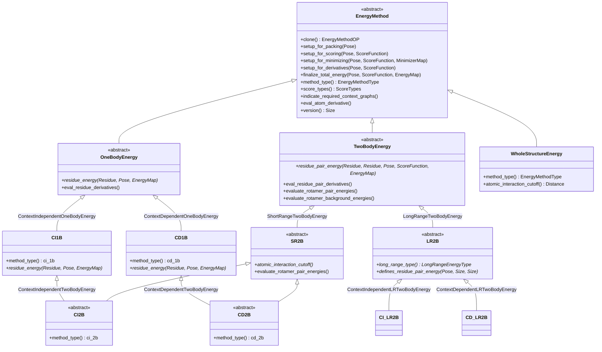
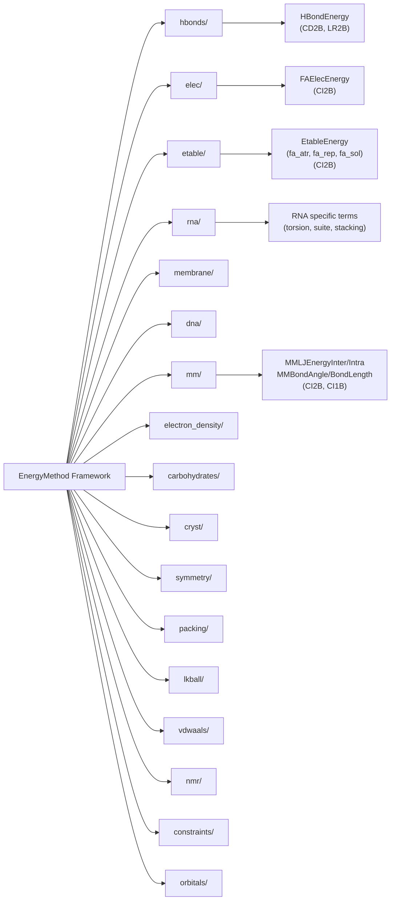

Energy Methods constitute the computational core of Rosetta's scoring engine — the physics-based and knowledge-based functions that assign a numerical energy to a molecular conformation. Every term in a [ScoreFunction](9-scorefunction-framework) is backed by an EnergyMethod instance that knows how to evaluate, minimize, and report on its specific contribution. This page dissects the inheritance hierarchy, the factory registration mechanism, the scoring lifecycle, and the domain-specific subsystems that make up this vast framework.

## Architectural Overview

The Energy Method hierarchy follows a strict classification along two orthogonal axes: **interaction order** (one-body, two-body, whole-structure) and **context dependency** (context-independent, context-dependent). These axes determine both the computational interface a method must implement and how the ScoreFunction schedules its evaluation during scoring, packing, and minimization. The entire system is bootstrapped through a Factory pattern — each concrete energy method pairs with an `EnergyMethodCreator` that registers with the `ScoringManager` singleton before `main()` begins, ensuring all methods are available by the time the first `ScoreFunction` is constructed.

Sources: [EnergyMethod.hh](source/src/core/scoring/methods/EnergyMethod.hh#L50-L62), [OneBodyEnergy.hh](source/src/core/scoring/methods/OneBodyEnergy.hh#L52-L70), [TwoBodyEnergy.hh](source/src/core/scoring/methods/TwoBodyEnergy.hh#L63-L115), [WholeStructureEnergy.hh](source/src/core/scoring/methods/WholeStructureEnergy.hh#L41-L58)

## The Base EnergyMethod Interface

`EnergyMethod` is the abstract root of the entire hierarchy, defined in `core::scoring::methods`. It extends `utility::VirtualBase` and declares the full lifecycle contract that every scoring term must support — from pre-computation setup through energy evaluation to derivative computation. The constructor requires an `EnergyMethodCreatorOP`, which serves double duty: it enables polymorphic cloning via the Factory pattern and it communicates the set of `ScoreType` values the method is responsible for computing.

The lifecycle methods form a carefully ordered protocol. During packing, `setup_for_packing()` runs first, followed by rotamer construction, then `setup_for_packing_with_rotsets()` and `prepare_rotamers_for_packing()` before the actual rotamer scoring begins. During minimization, `setup_for_minimizing()` initializes cached data (such as neighbor lists), with per-residue and per-residue-pair setup hooks available. After minimization completes, `finalize_after_minimizing()` provides a teardown point. For derivative evaluation, `setup_for_derivatives()` prepares state and `finalize_after_derivatives()` cleans up.

Two critical boolean methods control minimization behavior: `minimize_in_whole_structure_context()` (which returns `true` by default, forcing legacy methods to evaluate only in `finalize_total_energy()`) and `defines_high_order_terms()` (which returns `false` by default, allowing methods that evaluate per-residue or per-residue-pair to participate in RTMin). The `method_type()` pure virtual returns one of the seven `EnergyMethodType` enum values, and `indicate_required_context_graphs()` tells the Pose which neighbor graphs to maintain.

Sources: [EnergyMethod.hh](source/src/core/scoring/methods/EnergyMethod.hh#L50-L364), [EnergyMethod.cc](source/src/core/scoring/methods/EnergyMethod.cc)

## One-Body Energy Methods

One-body energies evaluate the intrinsic score of a single residue within the structural context (or without it, for context-independent variants). The `OneBodyEnergy` abstract class extends `EnergyMethod` with the pure virtual `residue_energy()` method that takes a `Residue`, a `Pose`, and an `EnergyMap` to accumulate into. Critically, the documentation emphasizes that implementations must **accumulate** into the EnergyMap, not overwrite it.

Beyond basic energy evaluation, `OneBodyEnergy` provides an extended minimization interface. The `use_extended_residue_energy_interface()` method lets derived classes opt into a faster path during minimization that uses cached `ResSingleMinimizationData`. When enabled, `setup_for_minimizing_for_residue()` populates the cache and `residue_energy_ext()` performs the actual evaluation using it. Similarly, `eval_residue_derivatives()` computes all atom derivatives for a residue at once, writing into a `vector1<DerivVectorPair>` — this batch approach avoids the overhead of per-atom virtual dispatch.

> [!TIP]
> When implementing a new one-body energy, the `defines_score_for_residue()` method can return `false` for residues where the energy is trivially zero. This allows the ScoreFunction to skip both energy evaluation and derivative computation for those residues, yielding significant speedups during minimization of large structures.

Sources: [OneBodyEnergy.hh](source/src/core/scoring/methods/OneBodyEnergy.hh#L52-L200)

## Two-Body Energy Methods

Two-body energies evaluate interactions between residue pairs and form the computational bottleneck of Rosetta scoring. The `TwoBodyEnergy` class declares the pure virtual `residue_pair_energy()` and a rich minimization interface mirroring the one-body pattern but with per-pair caching via `ResPairMinimizationData`. The interface documentation contains an important architectural note about the design trade-off of requiring a `Pose` parameter even for context-independent methods: this ensures a common interface for both CI and CD variants but places the burden on implementers to not accidentally access context-dependent data in methods declared context-independent.

The `defines_score_for_residue_pair()` method is particularly powerful for context-dependent two-body energies. By returning `false` when residues are not moving with respect to each other, a CD2B method can effectively behave as context-independent for stationary pairs, allowing the score caching infrastructure to avoid redundant recomputation. This optimization is critical for large-scale relaxation protocols.

The rotamer interaction methods — `evaluate_rotamer_pair_energies()` and `evaluate_rotamer_background_energies()` — enable batch computation during packing. `ShortRangeTwoBodyEnergy` overrides these with distance-based filtering logic that skips rotamer pairs whose bounding spheres exceed `atomic_interaction_cutoff()`, avoiding unnecessary residue_pair_energy calls for distant pairs.

Sources: [TwoBodyEnergy.hh](source/src/core/scoring/methods/TwoBodyEnergy.hh#L63-L200), [ShortRangeTwoBodyEnergy.hh](source/src/core/scoring/methods/ShortRangeTwoBodyEnergy.hh#L49-L129)

## Context-Independent vs. Context-Dependent Methods

The distinction between context-independent (CI) and context-dependent (CD) energy methods is a first-class architectural concept that directly impacts score caching and recomputation. Context-independent methods depend only on the intrinsic properties of the residue(s) involved — they can be evaluated once and their results reused across scoring rounds. Context-dependent methods depend on the broader structural environment and must be recomputed whenever surrounding residues change.

For one-body energies, `ContextIndependentOneBodyEnergy` overrides `residue_energy()` to omit the `Pose` parameter entirely, making the context-independence explicit in the interface signature. `ContextDependentOneBodyEnergy` retains the `Pose` parameter. Both fix their `method_type()` return values (`ci_1b` and `cd_1b` respectively) and mark the method as final to prevent override.

For two-body energies, both `ContextIndependentTwoBodyEnergy` and `ContextDependentTwoBodyEnergy` inherit from `ShortRangeTwoBodyEnergy` (or from `LongRangeTwoBodyEnergy` for the LR variants). The CI2B methods include the core statistical potentials — `fa_atr`, `fa_rep`, `fa_sol` (the Etable terms), `lk_ball`, `fa_elec`, and `mm_lj_*` terms. The CD2B methods include hydrogen bonding (`hbond_sr_bb`, `hbond_sc`), the `fa_pair` centroid interaction term, `geom_sol`, and the interface scores.

Sources: [ContextIndependentOneBodyEnergy.hh](source/src/core/scoring/methods/ContextIndependentOneBodyEnergy.hh#L47-L62), [ContextDependentOneBodyEnergy.hh](source/src/core/scoring/methods/ContextDependentOneBodyEnergy.hh#L47-L62), [ScoreType.hh](source/src/core/scoring/ScoreType.hh#L36-L264)

## Long-Range Two-Body Energy Methods

Long-range energy methods interact with the scoring infrastructure fundamentally differently from short-range methods. While short-range energies are stored in the `EnergyGraph` edges between neighboring residues, long-range energies require their own `LREnergyContainer` data structures and are initialized during `setup_for_scoring()`. The `LongRangeTwoBodyEnergy` class adds two pure virtual methods: `long_range_type()` returns a `LongRangeEnergyType` enum value, and `defines_residue_pair_energy()` determines whether a specific residue pair should be scored by this method.

The `LongRangeEnergyType` enumeration in [Methods.hh](source/src/core/scoring/methods/Methods.hh) catalogs the long-range categories: `constraints_lr`, `gen_born_lr`, `multipole_elec_lr`, `vdw_tinker_lr`, `sasa_lr`, `epr_deer_lr`, `PB_elec_lr`, `cart_bonded_lr`, `dna_dihedral_lr`, `gen_bonded_lr`, `rama2b_lr`, `ramaprepro_lr`, `rna_suite_lr`, `DFIRE`, `sym_bonus_lr`, and several electron density terms. Each type may have multiple registered energy methods that handle it. Both context-independent (`ContextIndependentLRTwoBodyEnergy`) and context-dependent (`ContextDependentLRTwoBodyEnergy`) variants exist, following the same pattern as their short-range counterparts.

Sources: [LongRangeTwoBodyEnergy.hh](source/src/core/scoring/methods/LongRangeTwoBodyEnergy.hh#L42-L62), [Methods.hh](source/src/core/scoring/methods/Methods.hh#L44-L65)

## Whole-Structure Energy Methods

Whole-structure energies evaluate properties that emerge only from the complete molecular assembly — terms like radius of gyration, buried unsatisfied hydrogen bonds, or symmetry constraints that have no meaningful per-residue decomposition. The `WholeStructureEnergy` class is deliberately minimal: it inherits from `EnergyMethod`, fixes `method_type()` to return the whole-structure enum value, and provides a default `atomic_interaction_cutoff()` of `0.0` (meaning no energy graph edges are needed unless overridden).

All computational work for whole-structure energies happens inside `finalize_total_energy()`, which is called by the ScoreFunction after all residue-level and residue-pair-level evaluations complete. This late-binding execution order means whole-structure terms can observe the results of other scoring terms if needed, and it also means they cannot participate in RTMin's residue-decomposed minimization (unless `minimize_in_whole_structure_context()` is overridden to return `false` and `defines_high_order_terms()` returns `true`).

Sources: [WholeStructureEnergy.hh](source/src/core/scoring/methods/WholeStructureEnergy.hh#L41-L65)

## Factory Registration: EnergyMethodCreator and EnergyMethodRegistrator

The Factory pattern that bootstraps the energy method system involves three cooperating types. `EnergyMethodCreator` is an abstract base class with two pure virtual methods: `create_energy_method()` instantiates a new `EnergyMethod` given `EnergyMethodOptions`, and `score_types_for_method()` returns the `ScoreTypes` the method computes. Each concrete energy method defines a corresponding Creator class (e.g., `MMBondLengthEnergyCreator`, `MMLJEnergyInterCreator`).

`EnergyMethodRegistrator<T>` is a templated class that performs static registration. It inherits from `utility::factory::WidgetRegistrator<ScoringManager, T>` and ensures that each Creator is registered exactly once with the `ScoringManager` singleton at static initialization time — before `main()` begins. This design centralizes thread-safety concerns in one location and prevents double-registration.

> [!TIP]
> When adding a new energy method to Rosetta, you must: (1) define a concrete `EnergyMethod` subclass, (2) define a corresponding `EnergyMethodCreator` subclass, (3) add a static `EnergyMethodRegistrator<YourCreator>` instance in a .cc file, (4) add the new `ScoreType` values to the enum in `ScoreType.hh`, and (5) register the string names in `ScoreTypeManager.cc`. Missing any of these steps will result in silent failures at runtime.

Sources: [EnergyMethodCreator.hh](source/src/core/scoring/methods/EnergyMethodCreator.hh#L40-L55), [EnergyMethodRegistrator.hh](source/src/core/scoring/methods/EnergyMethodRegistrator.hh#L38-L53)

## The ScoreType Enumeration

The `ScoreType` enum in [ScoreType.hh](source/src/core/scoring/ScoreType.hh) is the central registry of all scoring terms in Rosetta, containing well over 200 values organized into sections. The ordering is significant: the enum uses sentinel values (e.g., `n_ci_2b_score_types`) to mark the boundaries between categories, which allows the scoring infrastructure to efficiently iterate over subsets. Each ScoreType maps to exactly one energy method, but a single energy method may claim multiple ScoreTypes.

The major categories in the enum are:

| Category | Boundary Markers | Representative Terms |
|---|---|---|
| CI Two-Body | `fa_atr` → `n_ci_2b_score_types` | `fa_atr`, `fa_rep`, `fa_sol`, `lk_ball`, `fa_elec`, `mm_lj_*`, `ch_bond`, `vdw`, `cenpack` |
| CD Two-Body | `fa_pair` → `n_cd_2b_score_types` | `fa_pair`, `hbond_sr_bb`, `hbond_sc`, `npd_hbond_*`, `geom_sol`, `cen_rot_pair*` |
| CI One-Body | `rama_prepro` → `n_ci_1b_score_types` | `rama_prepro`, `p_aa_pp`, `dunbrack`, `yaad`, `hbond_bb_sc`, `hxl_tors` |
| CD One-Body | `envsmooth` → `n_cd_1b_score_types` | `envsmooth`, `envsmooth_lr`, `bsa`, `env` |
| Whole-Structure | `atom_pair_constraint` → end | Constraint terms, density scores, interface scores, cavity scores, symmetry terms |
| RNA-specific | scattered throughout | `rna_torsion`, `rna_suite`, `rna_base_pair`, `fa_stack_*` |
| Membrane-specific | `Menv_smooth`, `Mpair`, `Msol` | Membrane environment, pair, and solvation terms |

Sources: [ScoreType.hh](source/src/core/scoring/ScoreType.hh#L35-L264)

## Scoring Lifecycle Integration

Understanding when each lifecycle method fires is essential for implementing correct energy methods. The following diagram shows the execution order during a typical scoring-and-minimization sequence:

```mermaid
flowchart TD
    subgraph Scoring
        S1["setup_for_scoring(pose, sfxn)"] --> S2["Per-residue: setup_for_scoring_for_residue()"]
        S2 --> S3["OneBodyEnergy::residue_energy() per residue"]
        S3 --> S4["TwoBodyEnergy::residue_pair_energy() per neighbor pair"]
        S4 --> S5["WholeStructureEnergy::finalize_total_energy()"]
    end

    subgraph Minimization
        M1["setup_for_minimizing(pose, sfxn, minmap)"] --> M2["setup_for_minimizing_for_residue() per residue"]
        M2 --> M3["setup_for_minimizing_for_residue_pair() per pair"]
        M3 --> M4["Loop: energy eval → gradient eval → step"]
        M4 --> M5["finalize_after_minimizing(pose)"]
    end

    subgraph Packing
        P1["setup_for_packing(pose, relevant, designing)"] --> P2["Build rotamers"]
        P2 --> P3["setup_for_packing_with_rotsets()"]
        P3 --> P4["prepare_rotamers_for_packing() per RotamerSet"]
        P4 --> P5["Score all rotamers & pairs"]
        P5 --> P6["Annealing"]
        P6 --> P7["update_residue_for_packing() on acceptance"]
    end

    Scoring --> Minimization
```

During scoring, context graphs (maintained by the Pose) determine which residue pairs are neighbors. The ScoreFunction iterates over all residues for one-body evaluation and over all neighbor pairs for two-body evaluation, dispatching to the appropriate methods. The `finalize_total_energy()` call at the end is where whole-structure energies and any long-range methods using neighbor lists perform their final accumulation.

Sources: [EnergyMethod.hh](source/src/core/scoring/methods/EnergyMethod.hh#L73-L113), [EnergyMethod.hh](source/src/core/scoring/methods/EnergyMethod.hh#L127-L153), [EnergyMethod.hh](source/src/core/scoring/methods/EnergyMethod.hh#L155-L165), [EnergyMethod.hh](source/src/core/scoring/methods/EnergyMethod.hh#L297-L308)

## Domain-Specific Energy Method Subsystems

The `source/src/core/scoring/` directory contains over 40 subdirectories, each implementing a domain-specific set of energy methods. These subsystems demonstrate how the base framework scales to diverse computational biology problems.

Key subsystems and their architectural roles:

| Subsystem | Directory | Primary Methods | Notes |
|---|---|---|---|
| **Etable** | `etable/` | `fa_atr`, `fa_rep`, `fa_sol` | Core van der Waals + solvation; CI2B |
| **LK Ball** | `lkball/` | `lk_ball`, `lk_ball_wtd`, `lk_ball_iso` | Lazaridis-Karplus solvation; CI2B |
| **Hydrogen Bonds** | `hbonds/` | `hbond_sr_bb`, `hbond_sc`, `hbond_lr_bb` | Geometric H-bond scoring; CD2B + LR2B |
| **Electrostatics** | `elec/` | `fa_elec`, `fa_elec_bb_bb` | Coulomb with distance-dependent dielectric; CI2B |
| **Molecular Mechanics** | `mm/` | `mm_lj_inter_*`, `mm_lj_intra_*`, `mm_bond_angle` | CHARMM-style force field terms; CI2B + CI1B |
| **RNA** | `rna/` | `rna_torsion`, `rna_suite`, `fa_stack_*` | RNA-specific scoring ~30+ terms |
| **Membrane** | `membrane/` | `Menv_smooth`, `Mpair`, `Msol` | Implicit membrane potential |
| **Constraints** | `constraints/` | Constraint scores | Whole-structure; LR2B |
| **Electron Density** | `electron_density/` | `elec_dens_*` | Cryo-EM / X-ray map fitting |
| **Carbohydrates** | `carbohydrates/` | Glycan tree scoring | Ring conformer, linkage terms |
| **Orbitals** | `orbitals/` | `pci_cation_pi`, `pci_pi_pi` | Semi-empirical orbital-based terms |

Sources: [Methods.hh](source/src/core/scoring/methods/Methods.hh#L35-L44), [ScoreType.hh](source/src/core/scoring/ScoreType.hh#L120-L264)

## Minimization-Specific Interfaces

The energy method framework provides a dual-path optimization for minimization. The "standard" path uses the basic `residue_energy()` and `residue_pair_energy()` virtual calls during each minimization step. The "extended" path, activated when `use_extended_residue_energy_interface()` or `use_extended_residue_pair_energy_interface()` returns `true`, leverages cached data stored in `ResSingleMinimizationData` and `ResPairMinimizationData` objects. These caches typically hold pre-computed tables, neighbor lists, or atom-pair distance data that would be expensive to recompute every minimization step.

The `minimize_in_whole_structure_context()` method is a critical control point. Methods returning `true` (the default) are evaluated exclusively in `finalize_total_energy()` during minimization and cannot participate in RTMin (residue-trie-based minimization). Methods returning `false` can be decomposed and evaluated on a per-residue or per-residue-pair basis within the `MinimizationGraph`. The `defines_high_order_terms()` method provides a secondary signal: returning `true` indicates the method has terms that span more than two residues (e.g., multi-body constraints) and should use the MinimizationGraph for evaluation despite being decomposable at the residue level.

Derivative computation follows the F1/F2 convention from Abe et al. (1984), where F1 and F2 vectors encode the gradient of the energy with respect to atomic Cartesian coordinates. The `eval_residue_derivatives()` and `eval_residue_pair_derivatives()` methods write into `vector1<DerivVectorPair>` structures, with each entry containing the F1/F2 pair for a single atom.

Sources: [EnergyMethod.hh](source/src/core/scoring/methods/EnergyMethod.hh#L185-L208), [EnergyMethod.hh](source/src/core/scoring/methods/EnergyMethod.hh#L262-L283)

## EnergyMap and Score Accumulation

All energy methods accumulate their results into an `EnergyMap` — a fixed-size array indexed by `ScoreType` that serves as the universal container for all scoring terms. The `ScoreFunction` maintains a weight vector (also an `EnergyMap`) and computes the final weighted sum. This design allows any combination of energy methods to be active simultaneously, with zero-cost terms simply having zero weight.

The `EnergyMap` class defined in `source/src/core/scoring/EnergyMap.hh` supports element-wise arithmetic operations, enabling the ScoreFunction to separate the unweighted energy computation from the weighted total. This separation is architecturally important: the same unweighted energies can be reused across multiple ScoreFunctions with different weight sets, and the unweighted values are accessible for analysis and debugging even when the weighted total is all that matters for optimization.

Sources: [EnergyMap.hh](source/src/core/scoring/EnergyMap.hh), [ScoreType.hh](source/src/core/scoring/ScoreType.hh#L32-L38)

## Continuing the Exploration

This page has covered the architectural skeleton of the energy method system. To understand how these methods are orchestrated into a complete scoring function, continue to the [ScoreFunction Framework](9-scorefunction-framework). For the broader structural context these energies evaluate, see [Pose and Conformation](8-pose-and-conformation). To learn how energy methods participate in conformational search, proceed to [Monte Carlo Sampling](12-monte-carlo-sampling) and [Side-Chain Packing](13-side-chain-packing). For runtime extensibility of scoring through XML, see [RosettaScripts XML Framework](14-rosettascripts-xml-framework).