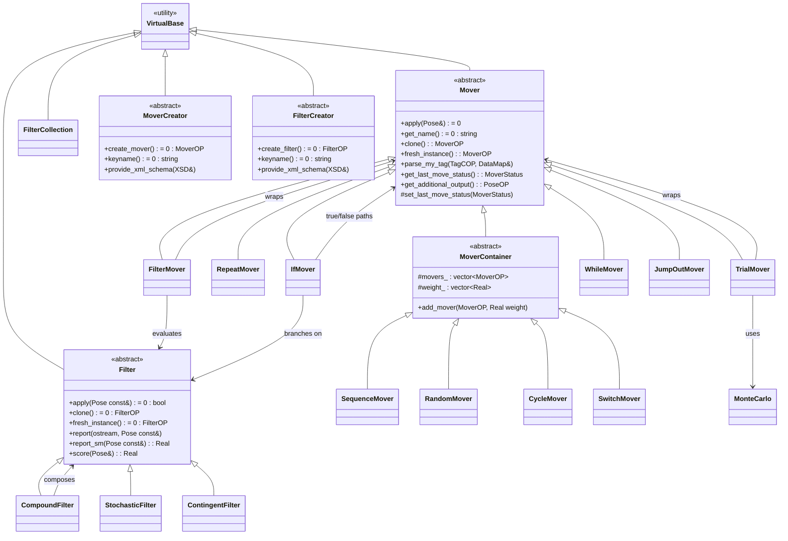
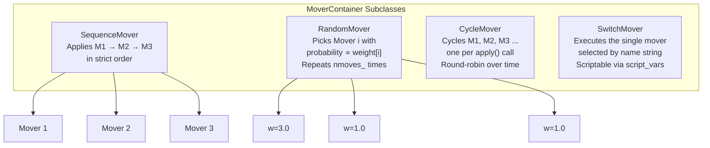
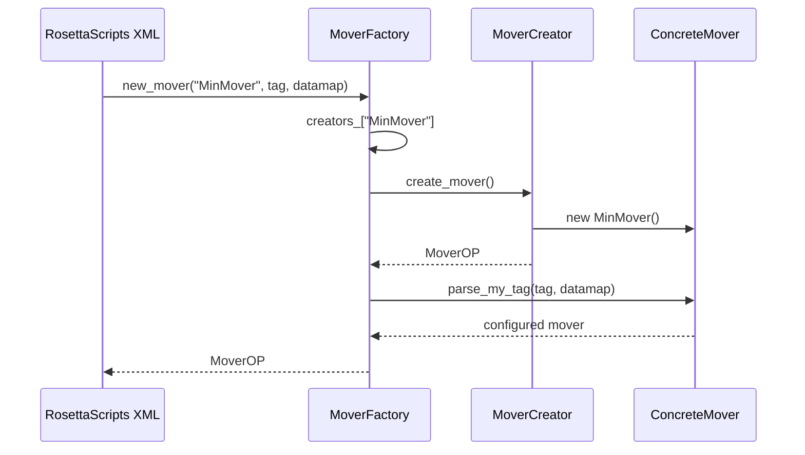
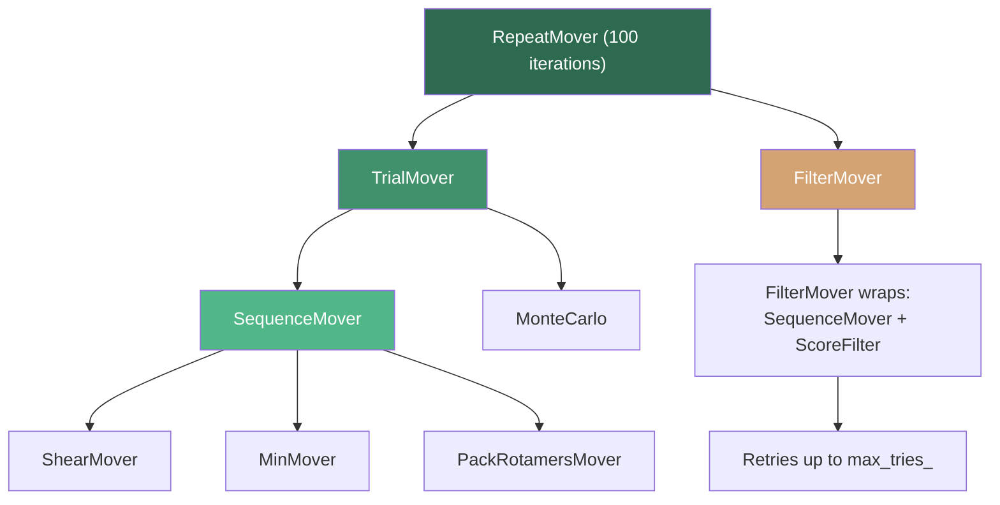

Every Rosetta protocol is ultimately an orchestrated sequence of **Movers** (which mutate a `Pose`) and **Filters** (which evaluate whether a `Pose` meets acceptance criteria). Together they form the backbone of Rosetta's composable, declarative protocol system — one that scales from simple C++ pipelines to complex RosettaScripts XML choreographies. This page dissects their inheritance hierarchies, composition patterns, and the control-flow structures that bind them together.

## Architectural Overview

The Mover and Filter systems are designed around a small number of core abstractions: every Mover transforms state via `apply(Pose&)`, and every Filter judges state via `apply(Pose const&) → bool`. Both hierarchies share a parallel factory/creator architecture that enables runtime instantiation from XML tags, and both expose a `parse_my_tag()` entry point for declarative configuration. The key structural insight is that **Movers consume Filters** — filters never call movers — creating a clean unidirectional dependency graph from structural transformation to quality assessment.

Sources: [Mover.hh](source/src/protocols/moves/Mover.hh#L64-L99), [Filter.hh](source/src/protocols/filters/Filter.hh#L48-L80), [MoverContainer.hh](source/src/protocols/moves/MoverContainer.hh#L44-L97)

## The Mover Base Class

The `protocols::moves::Mover` class is the abstract root of every structural transformation in Rosetta. It inherits from `utility::VirtualBase` and `utility::pointer::enable_shared_from_this<Mover>`, giving it both polymorphic deletion semantics and the ability to safely return shared pointers to itself — a critical requirement for nested mover compositions that must share ownership of child movers [Mover.hh](source/src/protocols/moves/Mover.hh#L64).

### Core Interface Contract

Every concrete Mover must implement at minimum two pure virtual methods. The **`apply(Pose&)`** method is the primary entry point — it receives a mutable `Pose` reference and is expected to perform an in-place conformational change. The **`get_name()`** method returns a human-readable class identifier used for logging, factory lookup, and debugging. Beyond these, the base class provides two cloning strategies: **`clone()`** returns a deep copy preserving the mover's current configuration (useful for reproducing a specific protocol state), while **`fresh_instance()`** returns a default-constructed copy (used by the job distributor to obtain a clean mover for each new job) [Mover.hh](source/src/protocols/moves/Mover.hh#L98-L132).

| Method | Signature | Purpose | Override Requirement |
|--------|-----------|---------|---------------------|
| `apply()` | `void apply(Pose&)` | Perform the conformational change | **Pure virtual** — must override |
| `get_name()` | `string get_name() const` | Return class name for identification | **Pure virtual** — must override |
| `clone()` | `MoverOP clone() const` | Deep copy with current state | Virtual (not pure, but expected) |
| `fresh_instance()` | `MoverOP fresh_instance() const` | Default-constructed copy | Virtual (not pure, but expected) |
| `parse_my_tag()` | `void parse_my_tag(TagCOP, DataMap&)` | Parse XML attributes | Virtual, optional |
| `get_additional_output()` | `PoseOP get_additional_output()` | Multi-output support (JD2) | Virtual, optional |

### Mover Status Protocol

After `apply()` executes, the job distributor inspects the mover's **`MoverStatus`** to determine the outcome. The status is set through the protected `set_last_move_status()` method and retrieved via `get_last_move_status()`. This five-valued enum communicates not just success or failure, but *the nature of the failure* — which the job distributor uses to decide whether to retry, skip, or abort the current job [MoverStatus.hh](source/src/protocols/moves/MoverStatus.hh#L26-L50).

| Status Constant | Value | Semantic Meaning | Job Distributor Action |
|----------------|-------|-----------------|----------------------|
| `MS_SUCCESS` | 0 | Mover completed successfully | Accept output |
| `FAIL_RETRY` | 1 | "Science" failure — stochastic, retryable | Retry same job |
| `FAIL_DO_NOT_RETRY` | 2 | Valid job but uninteresting output | Skip, move on |
| `FAIL_BAD_INPUT` | 3 | Structurally broken input | Cancel all nstruct repeats |
| `FAIL` | 4 | Undefined/general failure | Undefined (not obeyed by JD2) |

> [!TIP]
> The distinction between `FAIL_RETRY` and `FAIL_DO_NOT_RETRY` is fundamental to Rosetta's job distribution strategy. A docking run that fails an RMSD filter receives `FAIL_RETRY` because stochastic re-sampling might escape the local minimum. A design run that produces a sequence violating residue-type constraints receives `FAIL_DO_NOT_RETRY` because the same input will deterministically produce the same invalid result.

### Reference Pose Management

Movers maintain optional references to an **input pose** (the starting structure) and a **native pose** (the reference structure for RMSD calculation) via `set_input_pose()` and `set_native_pose()`. These are propagated through container movers to their children, ensuring that nested movers deep in a protocol hierarchy can access reference structures set at the top level. The `MoverContainer` base class overrides both setters to cascade them to all contained movers, maintaining consistency across the entire composition tree [MoverContainer.hh](source/src/protocols/moves/MoverContainer.hh#L61-L66).

Sources: [Mover.hh](source/src/protocols/moves/Mover.hh#L73-L299), [MoverStatus.hh](source/src/protocols/moves/MoverStatus.hh#L26-L50)

## The Filter Base Class

The `protocols::filters::Filter` class serves as the abstract evaluator in Rosetta's protocol framework. Where Movers *produce* conformational change, Filters *judge* it. The base class defines a minimal but expressive interface built around three layers of reporting: a boolean pass/fail, a real-valued score, and a human-readable text report [Filter.hh](source/src/protocols/filters/Filter.hh#L48-L100).

### The Three-Layer Evaluation Model

The primary method is **`apply(Pose const&)`**, which returns a boolean indicating whether the pose passes the filter's criteria. Critically, the `Pose` is passed by `const` reference — filters are **never permitted to modify the pose**. This asymmetry with Mover's mutable `apply()` is a deliberate architectural invariant that prevents side effects in the evaluation phase. The second layer, **`report_sm(Pose const&)`**, returns a `Real` value typically written to score files and silent-output columns — it represents the *magnitude* of the filter's metric (e.g., an energy threshold distance), not just a binary result. The default returns `-99999` as a sentinel, signaling "no meaningful value." The third layer, **`report(ostream&, Pose const&)`**, writes human-readable diagnostics for protocol analysis [Filter.hh](source/src/protocols/filters/Filter.hh#L54-L82).

A fourth method, **`score(Pose&)`** (note the **non-const** reference), bridges the filter and scoring worlds. It exists primarily for integration with the score-function framework and for filters that need to temporarily modify pose state during evaluation — a rare but necessary escape hatch from the const-correctness contract.

### FilterCollection

Alongside the `Filter` hierarchy, a separate **`FilterCollection`** class provides a simple aggregation mechanism. It wraps a `vector1<FilterCOP>` and evaluates each filter in sequence via its own `apply()` method. The collection uses **logical AND** semantics: all member filters must pass for the collection to pass. This is a lightweight complement to the more feature-rich `CompoundFilter` (discussed below), suitable for straightforward "all of these must pass" scenarios without needing Boolean operators [Filter.hh](source/src/protocols/filters/Filter.hh#L105-L138).

Sources: [Filter.hh](source/src/protocols/filters/Filter.hh#L48-L144)

## Container Movers: Composing Sequential and Stochastic Protocols

The `MoverContainer` class and its subclasses provide the structural backbone for building complex protocols from simpler atomic movers. Rather than hand-writing loop logic and branching in C++ or XML, developers compose container movers that encapsulate common execution patterns. The container holds a `vector0<MoverOP>` paired with a `vector0<Real>` of relative weights, enabling both ordered and probabilistic execution strategies [MoverContainer.hh](source/src/protocols/moves/MoverContainer.hh#L44-L97).

### SequenceMover

The `SequenceMover` applies each contained mover in the order it was added, sequentially modifying the pose. After each sub-mover executes, an optional `use_mover_status_` flag can trigger early termination if a child mover signals failure — otherwise, all movers execute unconditionally regardless of individual outcomes. The deep-copy constructor ensures that each `clone()` call produces independent copies of all child movers, preventing cross-protocol state contamination [MoverContainer.hh](source/src/protocols/moves/MoverContainer.hh#L106-L178).

### RandomMover

The `RandomMover` samples from its child movers with probability proportional to their assigned weights. The `nmoves_` member controls how many random selections occur per `apply()` call (default: 1). For thermodynamic sampling accuracy, it also tracks `last_proposal_density_ratio_`, which is essential for Metropolis-Hastings acceptance in Monte Carlo protocols — the ratio accounts for the asymmetric probability of proposing forward vs. reverse moves when using weighted random selection [MoverContainer.hh](source/src/protocols/moves/MoverContainer.hh#L182-L242).

### CycleMover

Unlike the SequenceMover which exhausts all movers in a single `apply()` call, the `CycleMover` advances an internal cursor by one position each time `apply()` is invoked, wrapping around at the end. This is specifically designed for interleaved sampling patterns — for example, performing a full repack once every eight cycles while doing rotamer trials on the other seven [MoverContainer.hh](source/src/protocols/moves/MoverContainer.hh#L249-L269).

### SwitchMover

The `SwitchMover` provides named dispatch: it holds multiple movers with associated string names and executes only the one matching its `selected_` string. This enables a single RosettaScripts XML block to encode multiple protocol behaviors, with the active behavior selected at runtime through `parser:script_vars` or other external control mechanisms. The mover also logs which mover was selected in the output scores for traceability [MoverContainer.hh](source/src/protocols/moves/MoverContainer.hh#L275-L316).

| Container | Execution Pattern | Per-Call Behavior | Key Use Case |
|-----------|------------------|-------------------|-------------|
| `SequenceMover` | Sequential, all movers | Runs all children | Multi-stage protocols |
| `RandomMover` | Stochastic, weighted | Samples `nmoves_` times | Monte Carlo move sets |
| `CycleMover` | Round-robin | One child per call | Interleaved sampling |
| `SwitchMover` | Named dispatch | One named child | Multi-mode scripts |

Sources: [MoverContainer.hh](source/src/protocols/moves/MoverContainer.hh#L100-L322)

## Control-Flow Movers: Bridging Movers and Filters

The most powerful pattern in the Rosetta protocol framework is the set of control-flow movers that **consume both Movers and Filters** to implement conditional execution, retry logic, and acceptance criteria directly within the mover hierarchy. These classes eliminate the need for external loop/branch logic and enable fully declarative protocol specification.

### TrialMover — The Monte Carlo Gate

The `TrialMover` wraps a single Mover with a `MonteCarlo` acceptor, implementing the classic Metropolis criterion: apply the mover, compute the score change, and stochastically accept or reject based on the Boltzmann factor. It tracks statistics through a `StatsType` enum (all scores, accept/reject counts only, or no stats) and exposes `acceptance_rate()` and `num_accepts()` for monitoring convergence. This is the fundamental building block of nearly every Rosetta sampling protocol, from simple minimization to full ab initio folding [TrialMover.hh](source/src/protocols/moves/TrialMover.hh#L96-L197).

### RepeatMover — Fixed Iteration

The `RepeatMover` provides the simplest form of control flow: it invokes its child mover exactly `nmoves_` times in sequence. While trivial, it's the standard way to express "run this mover N times" in both C++ and RosettaScripts, and is commonly composed with `TrialMover` to create N independent Monte Carlo trials [RepeatMover.hh](source/src/protocols/moves/RepeatMover.hh#L36-L62).

### FilterMover — Retry on Rejection

The `FilterMover` applies its child mover and then evaluates its child filter. If the filter passes, execution succeeds. If the filter fails, the mover retries up to `max_tries_` times, restoring the pose between attempts. On final failure, it sets its `MoverStatus` to a configurable `ms_whenfail_` value (default: `FAIL_DO_NOT_RETRY`). This pattern is essential for protocols that require a move to satisfy a quality threshold before proceeding [FilterMover.hh](source/src/protocols/moves/FilterMover.hh#L33-L76).

### IfMover — Conditional Branching

The `IfMover` implements a two-way conditional branch based on filter evaluation. It holds a filter, a `true_mover_`, and a `false_mover_`. When `apply()` is called, it evaluates the filter: if true, `true_mover_` executes; if false, `false_mover_` executes. Critically, `IfMover` leverages the `get_additional_output()` mechanism to support **dual-output mode** — `get_additional_output_true_mover()` and `get_additional_output_false_mover()` can each yield a separate output pose, enabling JD2 to collect both branches of a conditional protocol [IfMover.hh](source/src/protocols/moves/IfMover.hh#L36-L84).

### JumpOutMover — Score-Threshold Branching

The `JumpOutMover` applies a first mover, evaluates whether the score improvement is within a `tolerance_` of the initial score using a `ScoreFunction`, and conditionally applies a second mover only if the threshold is met. This is useful for protocols where an expensive refinement step should only be attempted when a preliminary move has already achieved a sufficient energy improvement [JumpOutMover.hh](source/src/protocols/moves/JumpOutMover.hh#L43-L69).

### WhileMover — Pose-Condition Loops

The `WhileMover` repeatedly applies its child mover while a `PoseCondition` functor returns true, up to `nmoves_` iterations. The `PoseCondition` base class is a minimal abstract functor with `operator()(Pose const&) → bool`, allowing developers to define arbitrary termination conditions — from score thresholds to geometric criteria to convergence checks [WhileMover.hh](source/src/protocols/moves/WhileMover.hh#L40-L67).

Sources: [TrialMover.hh](source/src/protocols/moves/TrialMover.hh#L96-L197), [RepeatMover.hh](source/src/protocols/moves/RepeatMover.hh#L36-L62), [FilterMover.hh](source/src/protocols/moves/FilterMover.hh#L33-L76), [IfMover.hh](source/src/protocols/moves/IfMover.hh#L36-L84), [JumpOutMover.hh](source/src/protocols/moves/JumpOutMover.hh#L43-L69), [WhileMover.hh](source/src/protocols/moves/WhileMover.hh#L40-L67)

## The Creator Pattern: Runtime Factory Registration

Both the Mover and Filter hierarchies use an identical **Creator pattern** for load-time factory registration. Each concrete class pairs with a corresponding `MoverCreator` or `FilterCreator` that knows how to instantiate it and describe its XML schema. These creators self-register with their respective factories (`MoverFactory` and `FilterFactory`) at program startup through static initialization, enabling any protocol to be instantiated by name from XML without the application needing to `#include` its header [MoverCreator.hh](source/src/protocols/moves/MoverCreator.hh#L32-L46).

### The Three-Method Creator Contract

Every Creator implementation must provide exactly three methods. **`create_mover()` / `create_filter()`** returns a fresh `OP` to a default-constructed instance. **`keyname()`** returns the string identifier used as the XML tag name (e.g., `"MinMover"`, `"InterfaceScoreFilter"`). **`provide_xml_schema()`** populates an `XMLSchemaDefinition` object with the attribute and sub-element definitions that the RosettaScripts parser will use to validate the mover's XML configuration. This schema-generation approach replaces the older hand-written parsing with type-safe, validated configuration [MoverCreator.hh](source/src/protocols/moves/MoverCreator.hh#L32-L46), [FilterCreator.hh](source/src/protocols/filters/FilterCreator.hh#L32-L43).

> [!TIP]
> When implementing a new Mover for RosettaScripts, you must create three artifacts: the Mover class itself, a corresponding `MoverCreator` subclass, and a static registration call (typically via `MoverRegistrator` or `MoverFactory::CreatorRegistrer`). The Creator's `provide_xml_schema()` method must be complete and accurate — the RosettaScripts parser will reject XML that doesn't conform to the schema, and silently ignored attributes are a common source of configuration bugs.

Sources: [MoverCreator.hh](source/src/protocols/moves/MoverCreator.hh#L32-L46), [FilterCreator.hh](source/src/protocols/filters/FilterCreator.hh#L32-L43)

## Composable Filter Patterns

Beyond the base `Filter` class, Rosetta provides several filter composition strategies that enable building complex acceptance criteria from simpler building blocks. These are particularly valuable in RosettaScripts where multi-criteria filtering is the norm.

### CompoundFilter — Boolean Logic on Filters

The `CompoundFilter` implements compound logical expressions over other filters using AND, OR, and XOR operators. Each entry in its `CompoundStatement` vector pairs a `FilterOP` with a `boolean_operations` enum value. An optional `invert()` method negates the entire compound expression. It also supports `reset_filters` — a set of stateful filters that must have their internal caches cleared before evaluation, preventing stale data from contaminating multi-iteration protocols. The `compute()` method evaluates the compound expression and returns a boolean, while `apply()` delegates to it [BasicFilters.hh](source/src/protocols/filters/BasicFilters.hh#L172-L200).

### StochasticFilter — Probabilistic Acceptance

The `StochasticFilter` passes with a configurable `confidence_` probability (the fraction of calls that return `true`). It optionally wraps a sub-filter that is evaluated only when the core stochastic check matches a `run_subfilter_on_` condition. This is useful for implementing rejection sampling protocols or for intentionally allowing occasional "bad" structures through to maintain diversity in a sampling trajectory [BasicFilters.hh](source/src/protocols/filters/BasicFilters.hh#L126-L170).

### ContingentFilter — Cross-Mover Communication

The `ContingentFilter` is a stateful filter whose pass/fail value is set externally by another mover via `set_value()`, rather than being computed from the pose. This creates a communication channel between movers and filters, enabling patterns like "mover A sets a flag that filter B reads." The value defaults to `false` and persists until explicitly changed. This is the only filter type whose `apply()` result is decoupled from the pose state [ContingentFilter.hh](source/src/protocols/filters/ContingentFilter.hh#L35-L74).

| Filter | Composition Type | Stateful? | Typical Use |
|--------|-----------------|-----------|------------|
| `TrueFilter` / `FalseFilter` | Constant | No | Testing, always-accept branches |
| `TrueFalseFilter` | Configurable constant | No | Parameterized pass-through |
| `CompoundFilter` | Boolean expression | Optional (reset_filters) | Multi-criteria acceptance |
| `StochasticFilter` | Probabilistic wrapper | No | Diversity maintenance |
| `ContingentFilter` | External state flag | Yes | Cross-mover signaling |
| `FilterCollection` | Logical AND aggregation | No | Simple multi-filter gates |

Sources: [BasicFilters.hh](source/src/protocols/filters/BasicFilters.hh#L41-L200), [ContingentFilter.hh](source/src/protocols/filters/ContingentFilter.hh#L35-L74)

## The Mover-Filter Protocol Pattern

In practice, Rosetta protocols assemble Movers and Filters into layered pipelines. A typical pattern nests container movers inside control-flow movers, with filters providing acceptance gates at multiple levels. The following diagram illustrates a canonical structure common to many RosettaScripts protocols:

The outer `RepeatMover` runs 100 independent iterations. Each iteration applies a `SequenceMover` of perturbation moves (shear, minimize, repack) through a `TrialMover` that gate-keeps acceptance via Metropolis criteria. After each iteration, a `FilterMover` checks whether the result meets a quality threshold, retrying the entire sequence if it doesn't. This layered composition — iteration → acceptance → sequence → atomic moves — is the idiomatic Rosetta protocol structure, and every layer is itself a Mover that can be independently tested, configured, and reused.

## Navigating the Protocol Ecosystem

The `source/src/protocols/` directory contains **over 180 subdirectories**, each typically housing one or more specialized movers and filters for a particular modeling domain. A few key directories worth noting for further exploration: `simple_moves/` contains fundamental atomic movers (minimization, packing, side-chain movers); `relax/` implements structure relaxation protocols; `docking/` provides protein-protein and protein-ligand docking movers; and `rosetta_scripts/` contains the parser infrastructure that ties this entire hierarchy together [protocols directory](source/src/protocols/).

For a deeper understanding of how these movers integrate with Rosetta's sampling framework, see [Monte Carlo Sampling](12-monte-carlo-sampling). To learn how the Creator pattern enables XML-based protocol construction, see [RosettaScripts XML Framework](14-rosettascripts-xml-framework). For the underlying data structure that all movers consume, revisit [Pose and Conformation](8-pose-and-conformation).