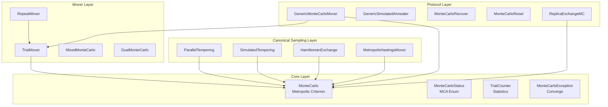
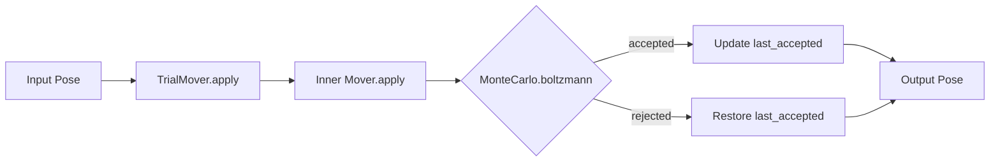
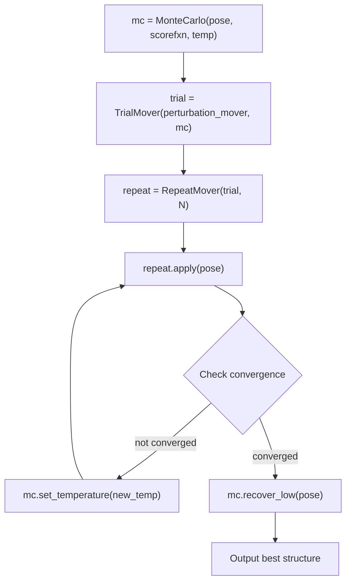

Monte Carlo (MC) sampling is the thermodynamic engine that powers nearly every Rosetta protocol—from ab initio folding to protein design to structure relaxation. Rather than exhaustively enumerating conformational space, Rosetta uses stochastic Metropolis accept/reject criteria to explore energy landscapes efficiently. This page dissects the layered MC architecture: the core `MonteCarlo` state machine, the mover-level integration via `TrialMover`, the self-contained `GenericMonteCarloMover`, and the advanced canonical sampling framework for tempering and replica exchange.

## Architecture Overview

The MC subsystem is organized into four conceptual layers, each serving a distinct role in the sampling pipeline. The core layer manages thermodynamic state, the mover layer couples perturbations to acceptance decisions, the protocol layer provides high-level iteration control, and the canonical sampling layer implements advanced sampling techniques.

Sources: [MonteCarlo.hh](source/src/protocols/moves/MonteCarlo.hh#L70-L98), [GenericMonteCarloMover.hh](source/src/protocols/monte_carlo/GenericMonteCarloMover.hh#L60-L93), [ReplicaExchangeMC.hh](source/src/protocols/moves/ReplicaExchangeMC.hh#L27-L60)

## The Core MonteCarlo Object

The `protocols::moves::MonteCarlo` class is the heart of Rosetta's sampling engine. It extends `utility::VirtualBase` and is responsible for all major functions needed in a Monte Carlo simulation: applying the Metropolis Criterion, tracking the lowest-energy and last-accepted conformations, and maintaining simulation statistics. It is constructed from three fundamental inputs: an initial `Pose`, a `ScoreFunction`, and a temperature value.

Sources: [MonteCarlo.hh](source/src/protocols/moves/MonteCarlo.hh#L51-L98)

### Constructors and Initialization

The `MonteCarlo` class provides three constructor variants, each addressing a different initialization scenario. The primary constructor takes a full `Pose`, `ScoreFunction`, and temperature—it scores the initial pose and sets both `last_accepted_pose_` and `lowest_score_pose_` to it. A second constructor accepts an externally computed score instead of a `ScoreFunction`, useful when scoring logic lives outside Rosetta's standard framework. A third "deferred" constructor accepts only a `ScoreFunction` and temperature, requiring a subsequent `reset(pose)` call before the first trial.

Sources: [MonteCarlo.hh](source/src/protocols/moves/MonteCarlo.hh#L94-L118)

### The Boltzmann Accept/Reject Criterion

The `boltzmann()` method is the central decision point of every MC trial. It is overloaded in four variants, each accommodating different calling patterns. The primary variant accepts a `Pose&`, evaluates its score via the internal `ScoreFunction`, and then applies the Metropolis criterion. The returned `bool` indicates acceptance, and the `MCA` enum (stored internally and retrievable via `mc_accepted()`) encodes the *reason* for acceptance at four granularity levels.

Sources: [MonteCarlo.hh](source/src/protocols/moves/MonteCarlo.hh#L174-L229)

### Acceptance States: The MCA Enum

The `MCA` enum in `MonteCarloStatus.hh` defines a four-level acceptance taxonomy. This granularity is critical for diagnostics and for protocols that need to distinguish between energetically favorable moves and thermally uphill ones.

| MCA Value | Constant | Meaning |
|-----------|----------|---------|
| 3 | `MCA_accepted_score_beat_low` | Accepted: score is the new global best |
| 2 | `MCA_accepted_score_beat_last` | Accepted: score improved over last accepted |
| 1 | `MCA_accepted_thermally` | Accepted: score worsened but passed Boltzmann probability |
| 0 | `MCA_rejected` | Rejected: move did not pass acceptance test |

This enum is hierarchical—each value implies the properties of all lower values—enabling callers to filter acceptance statistics at the desired granularity.

Sources: [MonteCarloStatus.hh](source/src/protocols/moves/MonteCarloStatus.hh#L21-L31)

### Pose State Management

The `MonteCarlo` object maintains three independent pose snapshots: the **last accepted pose** (used as the reference for the next Boltzmann evaluation), the **lowest score pose** (the global best encountered across all trials), and the **working pose** (the input to each `boltzmann()` call). Several methods govern transitions between these states: `recover_low(pose)` copies the lowest-score conformation into the working pose and updates the last-accepted state; `reset(pose)` reinitializes both reference poses to the current conformation; `eval_lowest_score_pose()` evaluates the current pose against the lowest without invoking full Boltzmann logic.

Sources: [MonteCarlo.hh](source/src/protocols/moves/MonteCarlo.hh#L249-L404)

### Temperature Control and Annealing

Temperature is the central control knob for exploration versus exploitation. The `set_temperature()` method updates the temperature in real time, enabling simulated annealing schedules. Additionally, `set_autotemp()` enables automatic quenching: when enabled, the temperature is gradually reduced toward a user-specified `quench_temp` after each acceptance. The `change_weight()` method allows selective reweighting of individual score terms without rebuilding the entire `ScoreFunction`, providing finer-grained control during multi-stage annealing protocols.

Sources: [MonteCarlo.hh](source/src/protocols/moves/MonteCarlo.hh#L132-L171)

### Convergence Monitoring

The `MonteCarloExceptionConverge` class (included conditionally on Win32) provides a mechanism to detect when a simulation has stalled—that is, when the acceptance rate drops below a useful threshold. The `show_state()`, `show_scores()`, and `show_counters()` methods provide real-time diagnostic output including temperature, scores, annealing settings, and per-move-type statistics.

Sources: [MonteCarlo.hh](source/src/protocols/moves/MonteCarlo.hh#L464-L504)

> [!TIP]
> The `boltzmann()` method accepts a `proposal_density_ratio` parameter (defaulting to 1.0) that corrects for asymmetric proposal distributions—critical when using non-reversible moves like certain fragment insertions or biased perturbations. Setting this incorrectly silently biases your sampling distribution.

## Mover-Level Integration: TrialMover

The `TrialMover` bridges Rosetta's Mover hierarchy and the MonteCarlo acceptance engine. It composes any arbitrary `MoverOP` with a `MonteCarloOP`, executing the move and then delegating the accept/reject decision. This composition pattern is the standard idiom for MC-driven protocols throughout Rosetta.

Sources: [TrialMover.hh](source/src/protocols/moves/TrialMover.hh#L46-L117)

### Construction and Usage Pattern

A `TrialMover` is constructed with a `MoverOP` (the perturbation) and a `MonteCarloOP` (the acceptance criterion). When `apply(pose)` is called, it first invokes the inner mover's `apply()`, then calls `mc_->boltzmann(pose)`. If the move is rejected, the pose is automatically restored to the last accepted conformation. This pattern is so fundamental that it is typically wrapped in a `RepeatMover` to execute thousands of trials.

Sources: [TrialMover.hh](source/src/protocols/moves/TrialMover.hh#L133-L145)

### Statistics and Diagnostics

The `TrialMover` supports three statistics granularity levels via the `StatsType` enum. Setting `keep_stats_type(all_stats)` tracks per-trial energy changes, accept/reject counts, and score distributions—useful for analysis but with memory overhead. The `accept_reject` mode tracks only counts (the default for production), while `no_stats` disables tracking entirely for maximum throughput. The `acceptance_rate()` and `num_accepts()` methods expose aggregate statistics.

Sources: [TrialMover.hh](source/src/protocols/moves/TrialMover.hh#L64-L68), [TrialMover.hh](source/src/protocols/moves/TrialMover.hh#L151-L154)

### MonteCarloUtil: Reset Mover

The `MonteCarloUtil` class (defined alongside `TrialMover`) provides a lightweight Mover wrapper for MC state operations. It wraps a `MonteCarloOP` and exposes a `mode_` string that controls whether `apply()` performs a recover-low or reset operation. This is commonly used in RosettaScripts pipelines to reset MC state between protocol stages.

Sources: [TrialMover.hh](source/src/protocols/moves/TrialMover.hh#L73-L94)

## GenericMonteCarloMover: Self-Contained MC Protocols

The `GenericMonteCarloMover` in `protocols::monte_carlo` is a high-level, self-contained Mover that bundles an inner mover, its own `MonteCarlo`-like state, trial counters, and termination conditions into a single RosettaScripts-compatible unit. It extends `MoverApplyingMover` and provides both score-function-based and filter-based evaluation.

Sources: [GenericMonteCarloMover.hh](source/src/protocols/monte_carlo/GenericMonteCarloMover.hh#L60-L93)

### Key Features

The mover operates around a central `boltzmann()` method that accepts a pose and a vector of random numbers (enabling deterministic replay). It tracks the last accepted pose, lowest score pose, and current score independently. The `sample_type_` parameter supports both `"low"` (standard MC, minimizing energy) and `"high"` (maximizing energy) sampling directions. The `drift` parameter controls whether the last accepted pose "drifts" with each acceptance or is reset to the original at the start of each trial. The `task_scaling` parameter adjusts the number of designable residues, and the `max_accepted_trials` parameter provides an alternative convergence criterion to raw trial count.

Sources: [GenericMonteCarloMover.hh](source/src/protocols/monte_carlo/GenericMonteCarloMover.hh#L132-L166)

### Trigger API

A distinctive feature is the **trigger system**: users can register callback functions via `add_trigger()` that fire at each MC iteration. Triggers receive the current trial index and can return `true` to force rescoring—enabling adaptive schemes like dynamic score weight adjustment mid-simulation. The trigger signature binds stage and total-stage information at registration time, providing context about overall simulation progress.

Sources: [GenericMonteCarloMover.hh](source/src/protocols/monte_carlo/GenericMonteCarloMover.hh#L179-L199)

## The Monte Carlo Protocol Mover Family

Beyond the core classes, the `protocols::monte_carlo` namespace provides several specialized movers for common MC workflow patterns.

Sources: [monte_carlo/ directory](source/src/protocols/monte_carlo/)

### Mover Summary

| Mover | Purpose | Key Parameter |
|-------|---------|---------------|
| `GenericMonteCarloMover` | Full MC loop with configurable inner mover, filters, and termination | `maxtrials`, `temperature` |
| `GenericSimulatedAnnealer` | MC with automatic temperature ramping | Start/end temperature |
| `MonteCarloRecover` | Restore pose to the MC lowest-energy state | N/A |
| `MonteCarloReset` | Reset MC state (counters, poses) to a new baseline | N/A |
| `ResetBaselineMover` | Re-establish the scoring baseline for the current pose | N/A |
| `MonteCarloTest` | Diagnostic mover for testing MC acceptance behavior | N/A |
| `MonteCarloInterface` | Adapts external MC frameworks to Rosetta's Pose system | N/A |

The `MonteCarloRecover` and `MonteCarloReset` movers are particularly important in multi-stage RosettaScripts protocols. After an MC sampling stage, `MonteCarloRecover` ensures the pose is set to the best structure found (not the last trial), while `MonteCarloReset` prepares the MC object for a fresh sampling phase at a different temperature or with different weights.

Sources: [GenericMonteCarloMover.hh](source/src/protocols/monte_carlo/GenericMonteCarloMover.hh#L82-L117), [MonteCarloRecover.hh](source/src/protocols/monte_carlo/MonteCarloRecover.hh)

## Advanced Mover Composition Patterns

The `protocols::moves` namespace provides several composition movers that enable complex MC strategies beyond simple single-mover trials.

Sources: [moves/ directory](source/src/protocols/moves/)

### Composition Movers

The `RepeatMover` wraps any mover (typically a `TrialMover`) and executes it N times—forming the outer loop of virtually every MC protocol. The `MixedMonteCarlo` maintains multiple `MonteCarlo` objects and randomly selects among them at each trial, enabling multi-resolution sampling where different score functions guide different move types. The `DualMonteCarlo` extends this to two MC objects with independent temperature and score settings, commonly used for coupled backbone/sidechain sampling.

Sources: [MixedMonteCarlo.hh](source/src/protocols/moves/MixedMonteCarlo.hh), [DualMonteCarlo.hh](source/src/protocols/moves/DualMonteCarlo.hh)

### ReplicaExchangeMC

The `ReplicaExchangeMC` class extends `MonteCarlo` to implement replica exchange (parallel tempering). It accepts a list of temperatures (`tlist`) and a replica exchange frequency (`nreplica_frequency`). On each call to its overridden `boltzmann()`, it periodically attempts temperature swaps between neighboring replicas according to the standard Metropolis exchange criterion. The class maintains parallel energy lists and temperature tags, supporting both serial and MPI-parallel exchange schedules.

Sources: [ReplicaExchangeMC.hh](source/src/protocols/moves/ReplicaExchangeMC.hh#L27-L76)

## Canonical Sampling Framework

The `protocols::canonical_sampling` namespace implements a comprehensive framework for thermodynamically rigorous sampling, supporting parallel tempering, simulated tempering, Hamiltonian exchange, and Metropolis-Hastings with bias corrections. This is Rosetta's most advanced MC subsystem, designed for applications requiring proper Boltzmann ensemble sampling.

Sources: [canonical_sampling/ directory](source/src/protocols/canonical_sampling/)

### Framework Architecture

The canonical sampling framework decomposes complex sampling protocols into three orthogonal plugin types: **ThermodynamicMovers** (perturbations), **ThermodynamicObservers** (recording), and **TemperatureControllers** (annealing). The `CanonicalSamplingMover` orchestrates these components, while `MetropolisHastingsMover` implements the generalized accept/reject criterion with support for asymmetric proposal distributions.

Sources: [CanonicalSamplingMover.hh](source/src/protocols/canonical_sampling/CanonicalSamplingMover.hh), [MetropolisHastingsMover.hh](source/src/protocols/canonical_sampling/MetropolisHastingsMover.hh), [ThermodynamicMover.hh](source/src/protocols/canonical_sampling/ThermodynamicMover.hh)

### Tempering Methods

| Class | Method | Description |
|-------|--------|-------------|
| `ParallelTempering` | Parallel tempering | Multiple replicas at different temperatures with periodic exchange attempts |
| `SimulatedTempering` | Simulated tempering | Single replica that randomly proposes temperature changes |
| `HamiltonianExchange` | Hamiltonian exchange | Multiple replicas with different energy functions (e.g., different score weights) |
| `AsyncMPITemperingBase` | Async MPI tempering | Asynchronous replica exchange for improved scaling on large clusters |

Each tempering method inherits from `TemperingBase`, which manages the temperature schedule, exchange logic, and MPI coordination (when enabled). The `TemperatureController` class provides automated annealing with configurable cooling schedules.

Sources: [ParallelTempering.hh](source/src/protocols/canonical_sampling/ParallelTempering.hh), [SimulatedTempering.hh](source/src/protocols/canonical_sampling/SimulatedTempering.hh), [HamiltonianExchange.hh](source/src/protocols/canonical_sampling/HamiltonianExchange.hh)

### Bias Energy and Well-Tempered Ensemble

The `BiasedMonteCarlo` and `BiasEnergy` classes introduce biasing potentials that reshape the effective energy landscape to enhance sampling of specific collective variables. The `WTEBiasEnergy` implements the Well-Tempered Ensemble approach, which adds a Gaussian bias centered on the current energy to flatten the energy distribution—particularly useful for escaping deep local minima.

Sources: [BiasedMonteCarlo.hh](source/src/protocols/canonical_sampling/BiasedMonteCarlo.hh), [WTEBiasEnergy.hh](source/src/protocols/canonical_sampling/WTEBiasEnergy.hh)

### Trajectory Recording

The framework provides three recording backends for capturing simulation trajectories: `PDBTrajectoryRecorder` (writes individual PDB files), `SilentTrajectoryRecorder` (writes to Rosetta's silent file format for compact storage), and `DbTrajectoryRecorder` (writes to a SQLite database for complex analysis). The `MetricRecorder` enables recording arbitrary `SimpleMetric` values at each trial, providing extensible observables beyond raw scores.

Sources: [PDBTrajectoryRecorder.hh](source/src/protocols/canonical_sampling/PDBTrajectoryRecorder.hh), [SilentTrajectoryRecorder.hh](source/src/protocols/canonical_sampling/SilentTrajectoryRecorder.hh), [MetricRecorder.hh](source/src/protocols/canonical_sampling/MetricRecorder.hh)

### Convergence Assessment

The `mc_convergence_checks/` subdirectory implements hierarchical convergence detection. The `HPool` (Hierarchical Pool) maintains a tree of energy pools at different resolution thresholds, enabling efficient detection of structural convergence without storing full poses. MPI variants (`MPIPool_ConvergenceCheck`, `MPIHPool_ConvergenceCheck`, `MPIBPool_ConvergenceCheck`) aggregate convergence statistics across processes for distributed sampling campaigns.

Sources: [mc_convergence_checks/](source/src/protocols/canonical_sampling/mc_convergence_checks/)

## MC in Practice: Typical Protocol Pattern

The most common MC protocol in Rosetta follows a consistent pattern: create a `MonteCarlo` object, wrap a perturbation mover in a `TrialMover`, repeat for N iterations, then recover the best structure. This pattern is used across relaxation, design, docking, and folding protocols.

> [!TIP]
> A critical and frequently overlooked step is calling `mc.recover_low(pose)` *after* the sampling loop. Without this, the output pose reflects the last trial's state (which may have been a rejected move restored to the last accepted conformation), not necessarily the global best encountered during sampling.

## Relationship to Other Rosetta Systems

Monte Carlo sampling does not exist in isolation—it depends on and is depended upon by several other core systems. Understanding these relationships is essential for extending or debugging MC-based protocols.

### Dependencies

| System | Relationship |
|--------|-------------|
| **[Pose and Conformation](8-pose-and-conformation)** | The `Pose` is the mutable state that MC samples; conformations are cloned internally for pose snapshots |
| **[ScoreFunction Framework](9-scorefunction-framework)** | Provides the energy landscape that MC explores via `MonteCarlo.boltzmann()` |
| **[Mover and Filter Hierarchy](11-mover-and-filter-hierarchy)** | Supplies perturbation movers for `TrialMover` and acceptance filters for `GenericMonteCarloMover` |
| **[RosettaScripts XML Framework](14-rosettascripts-xml-framework)** | All MC movers are registered via `MoverFactory` and configurable through XML tags |

### Downstream Consumers

Nearly every application-domain protocol consumes the MC infrastructure: [Structure Relaxation](18-structure-relaxation) uses temperature-ramped MC with minimization interleaving; [Ab Initio Folding](20-ab-initio-folding) uses fragment-insertion MC with stage-dependent score functions; [De Novo Protein Design](17-de-novo-protein-design) alternates backbone MC perturbation with sequence design; and [Ligand Docking](19-ligand-docking) uses rigid-body MC with soft-repulsive score functions.

Sources: [MonteCarlo.hh](source/src/protocols/moves/MonteCarlo.hh#L19-L39), [TrialMover.hh](source/src/protocols/moves/TrialMover.hh#L192-L196)

## Summary

Rosetta's Monte Carlo sampling subsystem is a carefully layered architecture that scales from simple single-temperature accept/reject loops to sophisticated parallel tempering with bias corrections. The core `MonteCarlo` class implements the thermodynamic decision logic, `TrialMover` provides the composition bridge to Rosetta's mover hierarchy, `GenericMonteCarloMover` offers a self-contained protocol unit for RosettaScripts, and the canonical sampling framework delivers production-grade ensemble sampling with convergence assessment. Understanding how these layers interact—and critically, where pose state is managed and recovered—is essential for building correct and efficient sampling protocols.

For deeper understanding of the components that MC depends on, see [ScoreFunction Framework](9-scorefunction-framework) for energy evaluation, [Mover and Filter Hierarchy](11-mover-and-filter-hierarchy) for perturbation strategies, and [RosettaScripts XML Framework](14-rosettascripts-xml-framework) for configuring MC protocols declaratively. To see MC in action within specific protocols, proceed to [Structure Relaxation](18-structure-relaxation) or [Ab Initio Folding](20-ab-initio-folding).