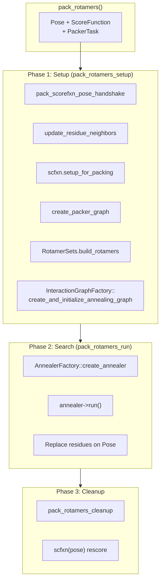
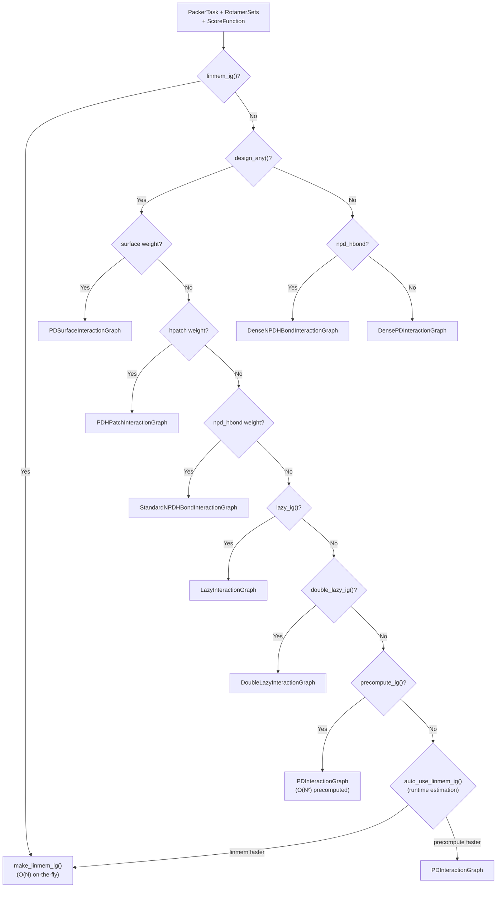

Side-chain packing is the combinatorial optimization problem at the heart of Rosetta's protein modeling pipeline: given a fixed backbone, find the set of side-chain conformations (rotamers) that minimizes the total energy. This page dissects the packing subsystem's architecture — from the task specification that governs what the packer is allowed to do, through rotamer generation and interaction graph construction, to the simulated annealing search that produces the final assignment.

## Architectural Overview

The packing system follows a strict **three-phase pipeline**: setup, search, and cleanup. Each phase is deliberately factored into independent functions so that setup (which is expensive) can be decoupled from search (which may be repeated across multiple annealing runs). The `pack_rotamers()` function in [pack_rotamers.cc](source/src/core/pack/pack_rotamers.cc#L74-L110) serves as the canonical entry point, orchestrating these phases in sequence:

This pipeline architecture is not merely organizational — it enables the `pack_rotamers_loop()` variant ([pack_rotamers.cc](source/src/core/pack/pack_rotamers.cc#L144-L190)) to reuse a single interaction graph across multiple independent annealing runs, storing the best result found. The setup phase is amortized over `nloop` iterations, which is critical for stochastic sampling protocols where you need independent decoys from the same rotamer landscape.

Sources: [pack_rotamers.cc](source/src/core/pack/pack_rotamers.cc#L74-L110), [pack_rotamers.cc](source/src/core/pack/pack_rotamers.cc#L144-L190)

## PackerTask: Specifying What the Packer May Do

The `PackerTask` class hierarchy is the **declarative specification layer** for packing. Rather than imperatively telling the packer what to change, you declare a policy: which residues may be repacked (same amino acid, new conformation), which may be redesigned (potentially different amino acid), and which are frozen entirely. The abstract interface is defined in [PackerTask.hh](source/src/core/pack/task/PackerTask.hh#L59-L150), with the concrete implementation in `PackerTask_` ([PackerTask_.hh](source/src/core/pack/task/PackerTask_.hh#L57-L99)).

The PackerTask controls packing behavior along several orthogonal dimensions:

| Dimension | Key Methods | Effect |
|-----------|-------------|--------|
| **Repacking** | `pack_residue()`, `being_packed()` | Allows side-chain conformational search at fixed identity |
| **Design** | `design_residue()`, `design_any()` | Allows amino acid identity to change during optimization |
| **Bump checking** | `bump_check()`, `max_rotbump_energy()` | Filters rotamers that clash with the backbone |
| **Interaction graph** | `linmem_ig()`, `lazy_ig()`, `double_lazy_ig()`, `precompute_ig()` | Selects which IG data structure to use |
| **Annealer** | `multi_cool_annealer()`, `smart_annealer()` | Selects which simulated annealing strategy to employ |
| **Symmetry** | `keep_sequence_symmetry()` | Constrains symmetric subunits to maintain identical sequences |
| **Rotamer links** | `rotamer_couplings_exist()`, `rotamer_links_exist()` | Enforces correlated rotamer changes across residues |

The task system is further extensible through **TaskOperations** (in [task/operation/](source/src/core/pack/task/operation/)), which modify PackerTask policies programmatically or via RosettaScripts. This is the primary extensibility point for controlling packing behavior without modifying the packer itself. Common operations include `RestrictToRepacking`, `PreventRepacking`, `OperateOnResidueSubset`, and `ClashBasedRepackShell`.

Sources: [PackerTask.hh](source/src/core/pack/task/PackerTask.hh#L59-L150), [PackerTask_.hh](source/src/core/pack/task/PackerTask_.hh#L57-L99)

## Rotamer Generation

Before the packer can optimize, it needs a **discrete set of candidate conformations** — rotamers — to consider at each position. This is the responsibility of the `RotamerSets` subsystem ([rotamer_set/](source/src/core/pack/rotamer_set/)).

### Rotamer Library Foundation

Rosetta's rotamer libraries live in [database/rotamer/](database/rotamer/) and come in several variants. The **Dunbrack rotamer library** is the primary backbone-dependent library, with implementations in [dunbrack/](source/src/core/pack/dunbrack/). Key classes include `RotamerLibrary` (the singleton manager), `RotamericSingleResidueDunbrackLibrary` for standard amino acids, and `SemiRotamericSingleResidueDunbrackLibrary` for residues where the rotameric model is only partially applicable.

### Rotamer Database Variants

| Library Path | Purpose |
|-------------|---------|
| `database/rotamer/ExtendedOpt1-5/` | Default backbone-dependent rotamers with extended optimization |
| `database/rotamer/beta_nov2016/` | Beta-sheet optimized rotamer statistics |
| `database/rotamer/corrections_conway2016/` | Corrections from Conway et al. 2016 re-derived statistics |
| `database/rotamer/shapovalov/` | Shapovalov-Dunbrack library with higher discretization levels |
| `database/rotamer/dna/` | Vector-quantized DNA rotamer libraries |
| `database/rotamer/ncaa_rotlibs/` | Non-canonical amino acid rotamer libraries |
| `database/rotamer/peptoid_rotlibs/` | Peptoid rotamer libraries |

### RotamerSet Building Pipeline

Within `pack_rotamers_setup()`, the rotamer set construction follows a precise sequence ([pack_rotamers.cc](source/src/core/pack/pack_rotamers.cc#L196-L246)):

1. **`rotsets->set_task(task)`** — Bind the PackerTask to determine which residues are packable
2. **`rotsets->initialize_pose_for_rotsets_creation(pose)`** — Prepare the pose
3. **`rotsets->build_rotamers(pose, scfxn, packer_neighbor_graph)`** — Generate candidate rotamers from the Dunbrack library, filtered by bump checking and task restrictions
4. **`scfxn.setup_for_packing_with_rotsets(pose, rotsets)`** — Allow the score function to adapt to the rotamer sets
5. **`rotsets->prepare_sets_for_packing(pose, scfxn)`** — Final preparation for energy computation

The `FixbbRotamerSets` class ([rotamer_set/FixbbRotamerSets.hh](source/src/core/pack/rotamer_set/FixbbRotamerSets.hh)) manages the mapping between "molten residues" (positions being optimized) and their rotamer collections. Additional rotamers can be injected or filtered via **RotamerSetOperations** such as `AddResiduesRotamerSetOperation`, `DeleteAllRotamerSetOperation`, `BumpSelector`, and `UnboundRotamersOperation`.

> [!TIP]
> The rotamer generation step often produces the largest number of rotamers at designed positions (where multiple amino acid types are allowed). The `RotamerSampleOptions` class in [task/RotamerSampleOptions.hh](source/src/core/pack/task/RotamerSampleOptions.hh) controls how many extra chi-angle samples are added per residue type, directly impacting the combinatorial explosion that the interaction graph must handle.

Sources: [pack_rotamers.cc](source/src/core/pack/pack_rotamers.cc#L196-L246), [database/rotamer/](database/rotamer/), [dunbrack/](source/src/core/pack/dunbrack/), [rotamer_set/](source/src/core/pack/rotamer_set/)

## Interaction Graph: Modeling Rotamer Compatibility

The **interaction graph (IG)** is the core data structure that makes combinatorial rotamer optimization tractable. Each rotamer assignment has an intrinsic (one-body) energy, and each pair of rotamers on neighboring residues has a pairwise (two-body) energy. The total energy decomposes exactly into these terms, enabling efficient simulated annealing. The interaction graph hierarchy lives in [interaction_graph/](source/src/core/pack/interaction_graph/).

### Graph Selection Logic

The `InteractionGraphFactory` ([InteractionGraphFactory.cc](source/src/core/pack/interaction_graph/InteractionGraphFactory.cc#L233-L341)) employs a sophisticated decision tree to select the most appropriate graph type based on the PackerTask settings, score function weights, and symmetry:

### Interaction Graph Type Comparison

| Graph Type | Memory | Precompute Cost | Per-Iteration Cost | Best For |
|-----------|--------|-----------------|-------------------|----------|
| `DensePDInteractionGraph` | O(N²) | O(N²) | O(1) per swap | Small repack-only jobs |
| `PDInteractionGraph` | O(N²) | O(N²) | O(1) per swap | Design with few rotamers |
| `LazyInteractionGraph` | O(N²) amortized | Lazy | O(1) cached, O(N) uncached | Design where many pairs never swap |
| `DoubleLazyInteractionGraph` | Bounded | Lazy + deferred alloc | O(1) cached | Multi-state design with memory constraints |
| `LinearMemoryInteractionGraph` | O(N) | Minimal | O(N) per swap | Large-scale design (95% less memory) |
| `OnTheFlyInteractionGraph` | O(N) | None | O(N) per evaluation | Maximum memory savings |
| `SymmLinMemInteractionGraph` | O(N) | Minimal | O(N) per swap | Symmetric packing with memory constraints |

The auto-selection logic in `auto_use_linmem_ig()` ([InteractionGraphFactory.cc](source/src/core/pack/interaction_graph/InteractionGraphFactory.cc#L120-L162)) estimates runtime using empirical scaling factors (derived from benchmarks) and compares expected precompute time against expected linear-memory per-iteration time multiplied by `nloop`. When precomputation is estimated at under 60 seconds, the precomputed graph is always preferred due to the noise in the estimation model at small scales.

> [!TIP]
> When multi-threaded builds are active (`MULTI_THREADED`), the precomputed interaction graph computation is parallelized across the requested thread count, effectively dividing the precompute time. The linear memory IG does not yet support multi-threaded construction, so the auto-selection threshold shifts accordingly. The `ig_threads_to_request` parameter on `PackerTask_` controls this.

Sources: [InteractionGraphFactory.cc](source/src/core/pack/interaction_graph/InteractionGraphFactory.cc#L233-L341), [InteractionGraphFactory.cc](source/src/core/pack/interaction_graph/InteractionGraphFactory.cc#L120-L162), [InteractionGraphFactory.cc](source/src/core/pack/interaction_graph/InteractionGraphFactory.cc#L392-L420)

## Simulated Annealing: The Search Strategy

Once the interaction graph is built and populated with energy data, the **simulated annealer** searches for the globally optimal rotamer assignment. The annealer hierarchy lives in [annealer/](source/src/core/pack/annealer/), with the factory pattern in `AnnealerFactory` ([AnnealerFactory.cc](source/src/core/pack/annealer/AnnealerFactory.cc#L42-L96)).

### Annealer Selection

The `AnnealerFactory::create_annealer()` method follows a priority chain:

| Priority | Condition | Annealer Type | Purpose |
|----------|-----------|---------------|---------|
| 1 | `keep_sequence_symmetry()` | `SequenceSymmetricAnnealer` | Maintains identical sequences across symmetric subunits |
| 2 | `rotamer_couplings_exist()` | `FixbbCoupledRotamerSimAnnealer` | Handles correlated rotamer changes via coupling specifications |
| 3 | `rotamer_links_exist()` | `FixbbLinkingRotamerSimAnnealer` | Handles rotamer link constraints |
| 4 | `multi_cool_annealer()` | `MultiCoolAnnealer` | Multiple independent cooling schedules with history-based selection |
| 5 | `smart_annealer()` | `SmartFixbbSimAnnealer` | Adaptive temperature schedule based on acceptance history |
| 6 | Default | `FixbbSimAnnealer` | Standard Metropolis simulated annealing with fixed temperature schedule |

All annealers share a common base class `SimAnnealerBase` ([SimAnnealerBase.hh](source/src/core/pack/annealer/SimAnnealerBase.hh)) and operate on the `AnnealableGraphBase` interface, making them interchangeable once the interaction graph is constructed. The annealer's `run()` method ([pack_rotamers.cc](source/src/core/pack/pack_rotamers.cc#L333-L335)) performs the stochastic search, writing the best rotamer assignment into a `bestrotamer_at_seqpos` array.

### Temperature Control

The PackerTask exposes `low_temp()` and `high_temp()` methods ([pack_rotamers.cc](source/src/core/pack/pack_rotamers.cc#L328-L329)) to override the default annealing temperature schedule. When set to values greater than 0, these override the score function's default temperature range. The `disallow_quench()` flag prevents the final low-temperature quenching step, which can be useful when you want to preserve the Metropolis acceptance dynamics at all temperatures.

Sources: [AnnealerFactory.cc](source/src/core/pack/annealer/AnnealerFactory.cc#L42-L96), [pack_rotamers.cc](source/src/core/pack/pack_rotamers.cc#L294-L336), [annealer/](source/src/core/pack/annealer/)

## Putting It All Together: The Complete Flow

The following diagram shows the full packing pipeline with all key components and their relationships:

```mermaid
flowchart LR
    subgraph Input
        Pose["Pose"]
        Sfxn["ScoreFunction"]
        Task["PackerTask"]
    end

    subgraph Setup["pack_rotamers_setup()"]
        PN["create_packer_graph()"]
        RS["RotamerSets<br/>.build_rotamers()"]
        IGF["InteractionGraphFactory"]
    end

    subgraph IGTypes["Interaction Graph Variants"]
        DenseIG["DensePDInteractionGraph"]
        PDIG["PDInteractionGraph"]
        LazyIG["LazyInteractionGraph"]
        LinMemIG["LinearMemoryInteractionGraph"]
        SymmIG["SymmLinMemInteractionGraph"]
    end

    subgraph Search["pack_rotamers_run()"]
        AF["AnnealerFactory"]
        Annealer["SimAnnealerBase"]
        MuxIG["MultiplexedAnnealableGraph"]
    end

    subgraph Output
        BestPose["Best Pose"]
        BestEnergy["Best Energy"]
    end

    Pose --> Setup
    Sfxn --> Setup
    Task --> Setup
    
    PN --> RS
    RS --> IGF
    IGF --> IGTypes
    Task --> IGF

    IGTypes --> MuxIG
    MuxIG --> Search
    Task --> AF
    AF --> Annealer
    Annealer --> BestEnergy
    Annealer --> BestPose
```

The `MultiplexedAnnealableGraph` ([InteractionGraphFactory.cc](source/src/core/pack/interaction_graph/InteractionGraphFactory.cc#L404-L419)) is a notable composite pattern: when the score function includes whole-structure energy methods (such as buried unsaturation penalties) that cannot be decomposed into pairwise terms, the factory wraps the two-body interaction graph together with a `ResidueArrayAnnealingEvaluator` into a multiplexed graph that combines both energy models during annealing.

## Specialized Packing Modes

The `core::pack` directory contains several specialized packing utilities beyond the standard fixed-backbone pipeline:

| Component | Location | Purpose |
|-----------|----------|---------|
| `rotamer_trials` | [rotamer_trials.hh](source/src/core/pack/rotamer_trials.hh) | Single-pass greedy rotamer optimization (no annealing) |
| `min_pack` / `rtmin` | [min_pack.hh](source/src/core/pack/min_pack.hh), [rtmin.hh](source/src/core/pack/rtmin.hh) | Rotamer minimization: continuous chi-angle optimization after discrete packing |
| `optimizeH` | [optimizeH.hh](source/src/core/pack/optimizeH.hh) | Specialized hydrogen placement optimization |
| `pack_missing_sidechains` | [pack_missing_sidechains.hh](source/src/core/pack/pack_missing_sidechains.hh) | Packs only residues that lack side-chain coordinates |
| `scmin` | [scmin/](source/src/core/pack/scmin/) | Side-chain minimization framework |
| Symmetric packing | [make_symmetric_task.hh](source/src/core/pack/make_symmetric_task.hh) | Symmetry-aware task transformation |
| RNA packing | [task/rna/](source/src/core/pack/task/rna/) | RNA-specific residue level tasks |
| Water packing | [rotamer_set/water_rotamer_building_functions.hh](source/src/core/pack/rotamer_set/water_rotamer_building_functions.hh) | Explicit water molecule placement |

Sources: [source/src/core/pack/](source/src/core/pack/)

## Integration with the Broader Rosetta Framework

Side-chain packing is not an isolated operation — it is a fundamental subroutine called by virtually every protocol in Rosetta. Understanding its architecture is essential for working with:

- **[Structure Relaxation](18-structure-relaxation)** — Calls packing iteratively as the backbone moves
- **[De Novo Protein Design](17-de-novo-protein-design)** — Relies heavily on the design capabilities of the packer
- **[Mover and Filter Hierarchy](11-mover-and-filter-hierarchy)** — `PackRotamersMover` wraps the packing API as a Mover
- **[RosettaScripts XML Framework](14-rosettascripts-xml-framework)** — Exposes PackerTask configuration via XML (see [xml_util.cc](source/src/core/pack/task/xml_util.cc) and [task_op_schemas.cc](source/src/core/pack/task/operation/task_op_schemas.cc))
- **[Symmetry Modeling](24-symmetry-modeling)** — Uses `SymmetricRotamerSets` and symmetry-aware interaction graphs
- **[ScoreFunction Framework](9-scorefunction-framework)** — Provides energy terms that populate the interaction graph; `setup_for_packing()` prepares context-dependent evaluation

For the next step in understanding Rosetta's protocol architecture, see [Mover and Filter Hierarchy](11-mover-and-filter-hierarchy) to learn how packing is exposed as a composable protocol step, or [Structure Relaxation](18-structure-relaxation) to see how packing integrates with backbone optimization.