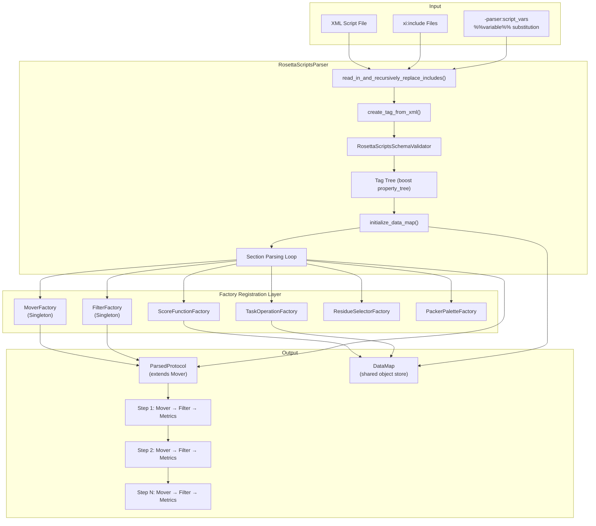

RosettaScripts is Rosetta's declarative protocol construction system — an XML-driven framework that lets you compose Movers, Filters, ScoreFunctions, and other components into executable pipelines without writing C++. Rather than compiling custom applications, you define entire computational protocols as structured XML documents that the parser translates into a chain of C++ objects at runtime. This page dissects the architecture that makes that translation possible.

## Architectural Overview

The RosettaScripts framework forms a bridge between declarative XML and imperative C++ execution. At its core, a **RosettaScriptsParser** reads an XML file, resolves includes and script variables, validates the structure against a generated XML Schema, and then walks the tag tree to instantiate objects through a set of singleton **Factory** registries. The resulting object graph is packaged into a **ParsedProtocol** — itself a Mover — whose `apply()` method executes each protocol step sequentially. All instantiated objects share state through a **DataMap**, a keyed container that acts as the dependency injection mechanism for the framework.



The parser itself lives in `source/src/protocols/rosetta_scripts/` and coordinates all of these operations. Its constructor triggers `register_factory_prototypes()` and reads the inclusion recursion limit from options [RosettaScriptsParser.cc](source/src/protocols/rosetta_scripts/RosettaScriptsParser.cc#L102-L106). The class exposes multiple `generate_mover()` overloads accepting file paths, XML strings, script variables, and resource managers, providing flexible entry points for both command-line and programmatic usage [RosettaScriptsParser.hh](source/src/protocols/rosetta_scripts/RosettaScriptsParser.hh#L75-L105).

## XML Document Structure

Every RosettaScript must be wrapped in a top-level `<ROSETTASCRIPTS>` element. Within this root, several top-level sections define the objects available to the protocol. The sections are parsed independently, but **only `<PROTOCOLS>` is order-sensitive** — it defines the execution sequence of mover-filter pairs. All other sections function as declarative registries.

```xml
<ROSETTASCRIPTS>
    <SCOREFXNS>
        <!-- ScoreFunction definitions -->
    </SCOREFXNS>
    <FILTERS>
        <!-- Filter definitions -->
    </FILTERS>
    <MOVERS>
        <!-- Mover definitions -->
    </MOVERS>
    <TASKOPERATIONS>
        <!-- TaskOperation definitions -->
    </TASKOPERATIONS>
    <RESIDUE_SELECTORS>
        <!-- ResidueSelector definitions -->
    </RESIDUE_SELECTORS>
    <SIMPLE_METRICS>
        <!-- SimpleMetric definitions -->
    </SIMPLE_METRICS>
    <PROTOCOLS>
        <!-- Order-sensitive execution steps -->
        <Add mover="some_mover" name="step1"/>
        <Filter filter="some_filter" name="step2"/>
    </PROTOCOLS>
    <OUTPUT />
</ROSETTASCRIPTS>
```

The `generate_mover_for_protocol()` method in the parser orchestrates the traversal of these sections [RosettaScriptsParser.cc](source/src/protocols/rosetta_scripts/RosettaScriptsParser.cc#L474-L500). It first calls `initialize_data_map()` to populate the DataMap with predefined objects (default score functions, task operations, etc.), then iterates over the tag's children, dispatching each section to the appropriate instantiation method. The parser's documentation explicitly notes that xi:include statements can be placed anywhere and will be replaced with the contents of the included file [RosettaScriptsParser.hh](source/src/protocols/rosetta_scripts/RosettaScriptsParser.hh#L73-L87).

The following table summarizes each top-level section and its role:

| Section | Order-Sensitive | Purpose | Factory Used |
|---|---|---|---|
| `<SCOREFXNS>` | No | Register named ScoreFunction objects | `ScoreFunctionFactory` |
| `<FILTERS>` | No | Register named Filter objects | `FilterFactory` |
| `<MOVERS>` | No | Register named Mover objects | `MoverFactory` |
| `<TASKOPERATIONS>` | No | Register named TaskOperation objects | `TaskOperationFactory` |
| `<RESIDUE_SELECTORS>` | No | Register named ResidueSelector objects | `ResidueSelectorFactory` |
| `<SIMPLE_METRICS>` | No | Register named SimpleMetric objects | `SimpleMetricFactory` |
| `<PROTOCOLS>` | **Yes** | Define ordered execution sequence | Direct instantiation |
| `<RESOURCES>` | No | Load ResourceManager resources | `ResourceManager` |
| `<OUTPUT>` | No | Configure output behavior | `OutputMover` |
| `<APPLY_TO_POSE>` | N/A | **Deprecated/Removed** — raises error if non-empty | N/A |

## The Tag Abstraction Layer

The `utility::tag::Tag` class is Rosetta's unified representation of an XML element. Each Tag has a name (the element name), a map of string key-value pairs (attributes/options), and an ordered vector of child Tags (sub-elements). The class derives from both `utility::VirtualBase` and `enable_shared_from_this<Tag>`, making it reference-counted and suitable for shared ownership across the object graph [Tag.hh](source/src/utility/tag/Tag.hh#L73-L78).

Type-safe attribute access is provided through templated `getOption<T>()` methods. A required variant throws if the key is missing, while an optional variant accepts a default value. All access is tracked internally — the `accessed_options_` set records which options have been read, enabling the framework to warn about unrecognized XML attributes [Tag.hh](source/src/utility/tag/Tag.hh#L100-L170). Type conversion is handled by `boost::lexical_cast`, with clear error messages on failure:

```cpp
template< class T >
T getOption(std::string const& key, T const& t_default) const {
    auto i = mOptions_.find(key);
    if ( i == mOptions_.end() ) {
        accessed_options_[key]= key;
        return t_default;
    }
    accessed_options_[key]= i->second;
    try {
        return boost::lexical_cast<T>(i->second);
    } catch(boost::bad_lexical_cast &) {
        // Throws descriptive error message
    }
}
```

The Tag class also supports the PyRosetta Python bindings through dedicated `get_option_bool()` and `get_option_int()` methods that bypass the templated approach for interoperability [Tag.hh](source/src/utility/tag/Tag.hh#L188-L192).

## Factory Pattern and Component Registration

Every component type that RosettaScripts can instantiate (Movers, Filters, TaskOperations, ResidueSelectors, SimpleMetrics, etc.) uses the same factory pattern. Each factory is a **SingletonBase** subclass that maintains a `std::map<string, CreatorOP>` mapping human-readable keynames to Creator objects. The Creator pattern separates object creation from object use: each concrete component class has a corresponding Creator class that knows how to instantiate it.

The **MoverFactory** exemplifies this pattern clearly. It stores a `MoverMap` (a map of `MoverCreatorOP`s keyed by string) and provides `newMover()` methods — one that creates a Mover by name, and another that creates one by parsing a Tag while also accepting a DataMap for dependency resolution [MoverFactory.hh](source/src/protocols/moves/MoverFactory.hh#L51-L111). The abstract `MoverCreator` base class requires three methods [MoverCreator.hh](source/src/protocols/moves/MoverCreator.hh#L32-L46):

| Method | Return Type | Purpose |
|---|---|---|
| `create_mover()` | `MoverOP` | Construct and return a new default instance |
| `keyname()` | `std::string` | Return the XML tag name (e.g., `"MinMover"`) |
| `provide_xml_schema()` | `void` | Write the XML Schema definition for this Mover |

Registration happens at static initialization time through the **Registrator** pattern. Each Mover's `.cc` file typically contains a static global variable:

```cpp
static protocols::moves::MoverRegistrator< MyMoverCreator > reg_MyMover( "MyMover" );
```

The `MoverRegistrator<T>` template derives from `utility::factory::WidgetRegistrator<MoverFactory, T>`, which calls `MoverFactory::factory_register()` in its constructor at program startup [MoverFactory.hh](source/src/protocols/moves/MoverFactory.hh#L41-L48). This ensures all Movers are available before any XML parsing occurs. The identical pattern is replicated for Filters (`FilterRegistrator`), TaskOperations, ResidueSelectors, and other component types [FilterFactory.hh](source/src/protocols/filters/FilterFactory.hh#L49-L56).

> [!TIP]
> The static-registration-via-Registrator pattern is fundamental to Rosetta's extensibility. Any new Mover you create automatically becomes available in RosettaScripts XML simply by including its Registrator in a linked translation unit — no manual factory registration code is needed.

## ParsedProtocol: The Executable Pipeline

`ParsedProtocol` is the runtime representation of a RosettaScript protocol. It extends `protocols::moves::Mover` (so it can itself be nested in other protocols), implements `ResId` for residue-level targeting, and observes `JobOutputterObserver` for JD2 score reporting integration [ParsedProtocol.hh](source/src/protocols/rosetta_scripts/ParsedProtocol.hh#L56-L62). Internally, it maintains an ordered vector of `ParsedProtocolStep` objects, each containing a Mover, an optional Filter, optional SimpleMetrics, and a `FilterReportTime` enum controlling when filter results are reported [ParsedProtocol.hh](source/src/protocols/rosetta_scripts/ParsedProtocol.hh#L74-L96).

The `FilterReportTime` enum offers three modes:

| Enum Value | Behavior |
|---|---|
| `AT_END` | Re-run all filters at protocol completion |
| `AFTER_APPLY` | Re-run each filter immediately after application |
| `NONE` | Never re-run filters after initial apply |

During execution, `ParsedProtocol::apply()` iterates through its steps sequentially. For each step, it applies the Mover (if present), then the Filter (if present), and finally any SimpleMetrics. If a filter fails (returns `false`), the protocol can optionally halt or continue depending on configuration. The `apply_step()` method returns a boolean indicating success, and `finish_protocol()` handles any post-processing including final scoring [ParsedProtocol.hh](source/src/protocols/rosetta_scripts/ParsedProtocol.hh#L155-L170).

Critically, `ParsedProtocol` can also be constructed **programmatically** — the `add_step()` methods accept Mover/Filter pairs directly, enabling C++ code to build protocol pipelines that reuse the same execution semantics as XML-defined protocols [ParsedProtocol.hh](source/src/protocols/rosetta_scripts/ParsedProtocol.hh#L122-L133).

## The DataMap: Shared State and Dependency Injection

The `basic::datacache::DataMap` is the central repository through which all RosettaScripts components share named objects. It is a nested map structure (`DataMap::DataMap_map`) where the outer key is a category string (e.g., `"scorefxns"`, `"filters"`, `"movers"`, `"task_operations"`) and the inner key is the user-assigned name. Values are stored as `DataMapObjOP` — type-erased smart pointers to `DataMapObj<T>` instances.

When a Mover's XML tag references `scorefxn="ref2015"`, the parser looks up `data["scorefxns"]["ref2015"]`, casts it to `ScoreFunctionOP`, and passes it to `parse_my_tag()`. The same mechanism connects Movers to TaskOperations (`task_operations="..."`), Filters to ScoreFunctions, and any other named dependency. The `initialize_data_map()` method pre-populates the DataMap with default objects read from command-line options before any user-defined objects are instantiated [RosettaScriptsParser.cc](source/src/protocols/rosetta_scripts/RosettaScriptsParser.cc#L484).

## Script Variables and Include Processing

RosettaScripts supports two powerful composability features: **script variable substitution** and **xi:include directives**. Script variables are passed via `-parser:script_vars var1=val1,var2=val2` and substituted into the XML text wherever `%%var1%%` appears before parsing begins. This allows parameterized protocols without XML modifications. The parser provides dedicated `create_tag_from_xml()` and `create_tag_from_xml_string()` overloads accepting either an `OptionCollection` or explicit `vector1<string>` of `key=value` pairs [RosettaScriptsParser.hh](source/src/protocols/rosetta_scripts/RosettaScriptsParser.hh#L234-L255).

The include system uses standard xi:include syntax. The `read_in_and_recursively_replace_includes()` method performs recursive file inclusion with circular dependency detection by maintaining a copy-on-include stack of parent filenames. Recursion depth is bounded by `parser::inclusion_recursion_limit` [RosettaScriptsParser.hh](source/src/protocols/rosetta_scripts/RosettaScriptsParser.hh#L332-L345).

## XML Schema Generation and Validation

RosettaScripts includes a comprehensive **schema validation** subsystem built on libxml2. The `RosettaScriptsSchemaValidator` is a singleton that aggregates XML Schema definitions from every registered Mover, Filter, and other component type. Each component's `provide_xml_schema()` method contributes its attribute types, sub-element rules, and restrictions to a shared `XMLSchemaDefinition` object [RosettaScriptsSchemaValidator.hh](source/src/protocols/rosetta_scripts/RosettaScriptsSchemaValidator.hh#L27-L74).

The `utility::tag::XMLSchemaGeneration` module provides the C++ abstraction for constructing XSD documents programmatically — elements, complex types, attributes, model groups, and restrictions can all be composed without touching raw XML Schema syntax [XMLSchemaGeneration.hh](source/src/utility/tag/XMLSchemaGeneration.hh#L13-L80). At validation time, the generated schema is compiled into an `XMLSchemaValidator` that checks user XML files against the complete RosettaScripts grammar, providing early and precise error messages for typos, missing required attributes, or unrecognized elements.

The static method `xsd_for_rosetta_scripts()` returns the complete XSD as a string, and `write_ROSETTASCRIPTS_complex_type()` defines the root element's structure including all legal top-level sections [RosettaScriptsSchemaValidator.hh](source/src/protocols/rosetta_scripts/RosettaScriptsSchemaValidator.hh#L39-L43).

## XmlObjects: Programmatic XML-to-Object Conversion

The `XmlObjects` class provides a standalone interface for instantiating individual Rosetta components from XML fragments, independent of the full RosettaScripts protocol machinery. It supports three usage patterns as documented in its header [XmlObjects.hh](source/src/protocols/rosetta_scripts/XmlObjects.hh#L26-L35):

1. **File-based**: `XmlObjects::create_from_file("my_objects.xml")` returns an `XmlObjectsCOP` whose `get_*()` methods retrieve named components
2. **String-based**: `XmlObjects::create_from_string(xml_text)` wraps incomplete XML with `<ROSETTASCRIPTS>` and `<PROTOCOLS>` tags as needed
3. **Static single-object**: `XmlObjects::static_get_score_function("<ScoreFunction .../>")` instantiates a single component from an XML fragment

The class exposes typed getters for all major component types — ScoreFunctions, ResidueSelectors, SimpleMetrics, Movers, Filters, TaskOperations, PackerPalettes, and JumpSelectors — each with both OptionCollection-aware and backwards-compatible overloads [XmlObjects.hh](source/src/protocols/rosetta_scripts/XmlObjects.hh#L110-L200). This makes `XmlObjects` particularly valuable in PyRosetta workflows where you want to construct a single Mover from XML without executing an entire protocol.

## Multi-Pose Processing and Selectors

Beyond single-pose pipelines, RosettaScripts supports multi-pose workflows through the `MultiplePoseMover` and its supporting `PoseSelector` and `PosePropertyReporter` classes. A `PoseSelector` receives a vector of `PoseOP`s and returns a boolean mask indicating which poses to retain, while a `PosePropertyReporter` computes per-pose properties that selectors can reference [PoseSelector.hh](source/src/protocols/rosetta_scripts/PoseSelector.hh#L28-L77). The `PoseSelectorFlags` enum allows selectors to declare whether they need access to the full pose set upfront (`PSF_NEED_FULL_POSE_SET`) or can evaluate poses independently.

The `PoseSelectorFactory` mirrors the MoverFactory pattern — each selector has a Creator and a `parse_my_tag()` method for XML-driven configuration [PoseSelector.hh](source/src/protocols/rosetta_scripts/PoseSelector.hh#L57-L61). Selectors are registered in their own XML section and referenced by name from the `MultiplePoseMover`.

## Summary of Key Source Locations

| Component | Header | Implementation |
|---|---|---|
| XML Parser | `protocols/rosetta_scripts/RosettaScriptsParser.hh` | `.cc` |
| Protocol Executor | `protocols/rosetta_scripts/ParsedProtocol.hh` | `.cc` |
| Object Loader | `protocols/rosetta_scripts/XmlObjects.hh` | `.cc` |
| XML Tag | `utility/tag/Tag.hh` | `Tag.cc` |
| Schema Validation | `utility/tag/XMLSchemaValidation.hh` | `.cc` |
| Schema Generation | `utility/tag/XMLSchemaGeneration.hh` | `.cc` |
| Schema Validator | `protocols/rosetta_scripts/RosettaScriptsSchemaValidator.hh` | `.cc` |
| Mover Factory | `protocols/moves/MoverFactory.hh` | `MoverFactory.cc` |
| Mover Creator | `protocols/moves/MoverCreator.hh` | `MoverCreator.cc` |
| Filter Factory | `protocols/filters/FilterFactory.hh` | `FilterFactory.cc` |
| Pose Selector | `protocols/rosetta_scripts/PoseSelector.hh` | `PoseSelector.cc` |
| Pose Reporter | `protocols/rosetta_scripts/PosePropertyReporter.hh` | `.cc` |
| Multi-Pose Mover | `protocols/rosetta_scripts/MultiplePoseMover.hh` | `.cc` |

## Navigating Further

This page covered the XML parsing, object instantiation, and execution machinery of RosettaScripts. For related topics in the codebase architecture:

- **[Mover and Filter Hierarchy](11-mover-and-filter-hierarchy)** — the base classes that all RosettaScripts components implement, including the `parse_my_tag()` interface contract
- **[Factory Pattern Architecture](15-factory-pattern-architecture)** — a deeper look at Rosetta's singleton factory system, WidgetRegistrator, and static initialization ordering
- **[ScoreFunction Framework](9-scorefunction-framework)** — how score functions are constructed and used as named dependencies within XML
- **[PyRosetta Python Bindings](16-pyrosetta-python-bindings)** — how the Tag and XmlObjects classes are exposed to Python, enabling XML-driven protocols from interactive sessions