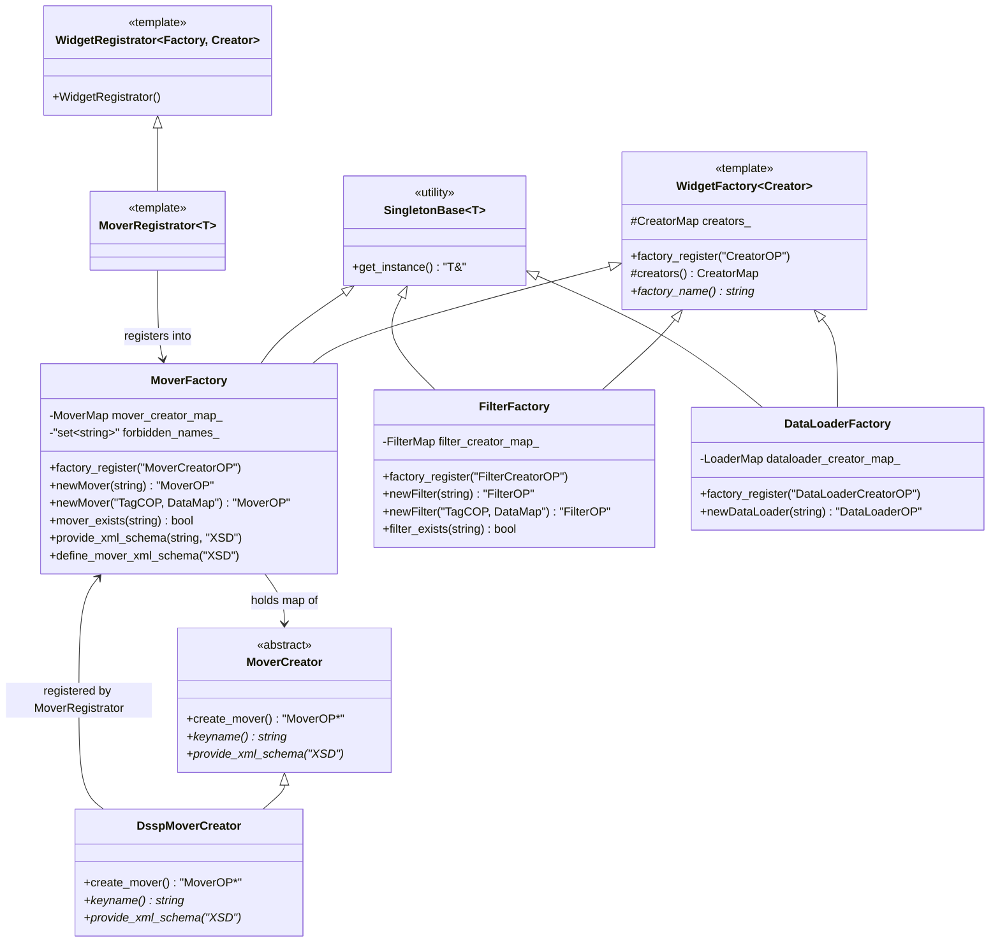
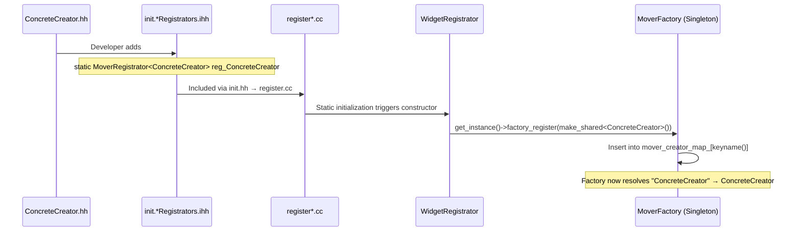

Rosetta's extensibility rests on a comprehensive, self-registering factory system that allows hundreds of protocol components to be instantiated by name at runtime—primarily from XML input via the RosettaScripts framework. This system eliminates the need for centralized switch statements or manual registration calls; instead, every Mover, Filter, TaskOperation, and other pluggable component registers itself into a global singleton factory through static initialization. Understanding this architecture is essential for anyone extending Rosetta with new protocol components or debugging registration failures.

## Architectural Overview

The factory system is a layered design built on three foundational templates: a **WidgetFactory** base, a **WidgetRegistrator** for load-time registration, and a **Creator** abstract interface for each component domain. Each domain (Movers, Filters, etc.) instantiates this pattern into a concrete singleton factory that maps string identifiers to Creator objects. The registration happens before `main()` executes, driven by static global variables declared in dedicated initialization headers.

## The Three-Layer Template Foundation

At the base of the entire system lies `utility::factory::WidgetFactory<Creator>`, a CRTP-style template that holds a `std::map<std::string, CreatorOP>` mapping component key names to owning pointers of their Creator objects. The `factory_register()` method inserts new Creators into this map, with an assertion that rejects duplicate names by calling `utility_exit_with_message()`. A comment in the source explicitly notes where mutex locking should occur for thread safety, though the base template does not implement it—concrete factories like `FilterFactory` include `#ifdef MULTI_THREADED` guards for mutex support.

Sources: [WidgetFactory.hh](source/src/utility/factory/WidgetFactory.hh#L39-L79)

The `utility::factory::WidgetRegistrator<Factory, Creator>` template is the mechanism that drives load-time self-registration. Its constructor body contains a single statement: `FACTORY::get_instance()->factory_register(make_shared<CREATOR>())`. Because each domain-specific Registrator (e.g., `MoverRegistrator<T>`) derives from `WidgetRegistrator<MoverFactory, T>`, and is declared as a `static` global variable, C++ static initialization guarantees that every Registrator's constructor runs before `main()`, populating the factory map before any XML parsing begins.

Sources: [WidgetRegistrator.hh](source/src/utility/factory/WidgetRegistrator.hh#L34-L45)

The Singleton pattern is applied through `utility::SingletonBase<T>`, which all concrete factories inherit from. This ensures a single global instance of each factory. The `MoverFactory`, for instance, declares `SingletonBase<MoverFactory>` as its base and `friend class utility::SingletonBase<MoverFactory>` to grant the singleton access to its private constructor.

Sources: [MoverFactory.hh](source/src/protocols/moves/MoverFactory.hh#L58-L60)

## Domain-Specific Factories and Creators

Each component domain in Rosetta follows an identical structural pattern. The table below catalogs the major factory/creator pairs and their locations:

| Domain | Factory Class | Creator Base Class | Registrator Alias |
|--------|--------------|-------------------|-------------------|
| **Movers** | `protocols::moves::MoverFactory` | `MoverCreator` | `MoverRegistrator<T>` |
| **Filters** | `protocols::filters::FilterFactory` | `FilterCreator` | `FilterRegistrator<T>` |
| **Task Operations** | `core::pack::task::operation::TaskOperationFactory` | `TaskOperationCreator` | `TaskOperationRegistrator<T>` |
| **Residue Selectors** | `core::select::residue_selector::ResidueSelectorFactory` | `ResidueSelectorCreator` | `ResidueSelectorRegistrator<T>` |
| **Data Loaders** | `protocols::parser::DataLoaderFactory` | `DataLoaderCreator` | `DataLoaderRegistrator<T>` |
| **Pose Selectors** | `protocols::rosetta_scripts::PoseSelectorFactory` | `PoseSelectorCreator` | `PoseSelectorRegistrator<T>` |
| **Simple Metrics** | `core::simple_metrics::SimpleMetricFactory` | `SimpleMetricCreator` | `SimpleMetricRegistrator<T>` |

Each Creator base class defines the same three pure virtual methods: a factory method (`create_mover()`, `newFilter()`, etc.), a key name accessor (`keyname()`), and an XML schema provider (`provide_xml_schema()`). The concrete Creator implementation supplies these: the key name must match the XML tag name used in RosettaScripts, the factory method returns a fresh instance of the concrete component, and the schema method defines the XSD complex type for XML validation.

Sources: [MoverCreator.hh](source/src/protocols/moves/MoverCreator.hh#L35-L47), [DsspMoverCreator.hh](source/src/protocols/moves/DsspMoverCreator.hh#L23-L33)

## Registration Mechanism: From Static Globals to Factory Maps

The registration pipeline flows through four stages that connect a concrete component to its runtime availability:

The init headers in `source/src/protocols/init/` come in two varieties per domain: `init.*Creators.ihh` (which includes the Creator header files) and `init.*Registrators.ihh` (which declares the static `Registrator` instances). For Movers, there are four `register*.cc` files that include these headers, partitioned alphabetically to reduce per-compilation-unit load time. Each `init.MoverRegistrators.ihh` contains hundreds of static declarations like `static MoverRegistrator<abinitio::DomainAssemblyCreator> reg_DomainAssemblyCreator;`, maintaining alphabetical order across 698 lines.

Sources: [init.MoverRegistrators.ihh](source/src/protocols/init/init.MoverRegistrators.ihh#L1-L100)

The MoverFactory adds a layer of protection with a `forbidden_names_` set containing five historically reserved names (`quick_ccd`, `sdwindow`, `quick_ccd_moves`, `perturb_ccd`, `perturb_kic`) that originated from the legacy LoopMoverFactory. Attempting to register a Mover with one of these names throws a `RosettaScriptsOptionError`.

Sources: [MoverFactory.cc](source/src/protocols/moves/MoverFactory.cc#L45-L55)

## Object Creation and XML Parsing Pathways

Factories expose two creation pathways. The simple form `newMover(string const&)` performs a map lookup and calls `creator->create_mover()`, returning a default-configured instance. The XML-aware form `newMover(TagCOP, DataMap&)` additionally calls `mover->parse_my_tag(tag, data)` to populate the component from XML attributes, then registers the mover's citations with the `CitationManager`. The error path is particularly informative: when a key name is not found, the factory iterates the entire creator map and prints all known names to the tracer, then throws an exception with explicit instructions pointing to the init header files that need modification.

Sources: [MoverFactory.cc](source/src/protocols/moves/MoverFactory.cc#L135-L178)

The XML schema system provides two layers of validation. Individual Creators define their own complex type schemas via `provide_xml_schema()`, and the factory's `define_mover_xml_schema()` method aggregates all registered movers into an XML Schema Definition group named `"mover"` using `utility::tag::define_xml_schema_group()`. This enables RosettaScripts to validate entire XML protocols against the schema before execution begins, catching typos and missing attributes at parse time rather than at runtime.

> [!TIP]
> When a Mover is reported as "not known to the MoverFactory," the error message explicitly names the two init files that must be updated: `src/protocols/init/init.MoverCreators.ihh` (add the `#include`) and `src/protocols/init/init.MoverRegistrators.ihh` (add the `static MoverRegistrator` declaration). This diagnostic exists in both `newMover()` and `provide_xml_schema()` error paths.

Sources: [MoverFactory.cc](source/src/protocols/moves/MoverFactory.cc#L98-L108)

## Implementing a New Factory-Registered Component

Adding a new Mover to Rosetta requires creating four artifacts and modifying two init files:

| Step | Artifact | Responsibility |
|------|----------|----------------|
| 1 | `ConcreteMover.hh/.cc` | The Mover implementation with `parse_my_tag()` and `apply()` |
| 2 | `ConcreteMoverCreator.hh/.cc` | Creator returning `keyname()`, `create_mover()`, and `provide_xml_schema()` |
| 3 | Edit `init.MoverCreators.ihh` | Add `#include <path/ConcreteMoverCreator.hh>` |
| 4 | Edit `init.MoverRegistrators.ihh` | Add `static MoverRegistrator<ConcreteMoverCreator> reg_ConcreteMoverCreator;` |

The same pattern applies identically for Filters (editing `init.FilterCreators.ihh` and `init.FilterRegistrators.ihh`), TaskOperations, ResidueSelectors, and every other factory-registered domain.

> [!TIP]
> The static Registrator variables must use globally unique names. The convention `reg_ConcreteCreator` prevents linker collisions but collisions are still possible across domains. Keep names specific to both the class and its namespace.

## Relationship to the XML Framework and JD2/JD3

The factory architecture is the backbone of the [RosettaScripts XML Framework](14-rosettascripts-xml-framework) and is consumed by the `RosettaScriptsParser` during protocol loading. The parser calls `newMover(TagCOP, DataMap)` for each `<MOVERS>` sub-tag, `newFilter()` for each `<FILTERS>` sub-tag, and so forth. The `ParsedProtocol` (a Mover itself, registered as `"ParsedProtocol"`) orchestrates the sequential execution of these factory-created components against each Pose produced by the job distribution system. The JD3 job queen (`RosettaScriptsJobQueen`) uses the same factories but through a different code path, reflecting the architectural evolution documented in the job distribution system.

Sources: [RosettaScriptsParser.hh](source/src/protocols/rosetta_scripts/RosettaScriptsParser.hh), [ParsedProtocol.hh](source/src/protocols/rosetta_scripts/ParsedProtocol.hh)

## Scope and Limitations

This factory system is limited to components that are parseable from XML and needed at protocol definition time. It does not cover energy methods (which use a separate `EnergyMethodCreator`/`EnergyMethodFactory` system), scoring functions, or rotamer libraries—those have their own registration pathways described in the [ScoreFunction Framework](9-scorefunction-framework) and [Energy Methods](10-energy-methods) pages. The architecture also does not address component discovery at runtime (plugin DLLs); registration is determined entirely at compile time through static linking of the init headers.

For protocol authors, the practical implication is that any component not appearing in the init headers is invisible to RosettaScripts, even if the source is compiled into the binary. This is the single most common source of "X is not known to the Factory" errors in practice.