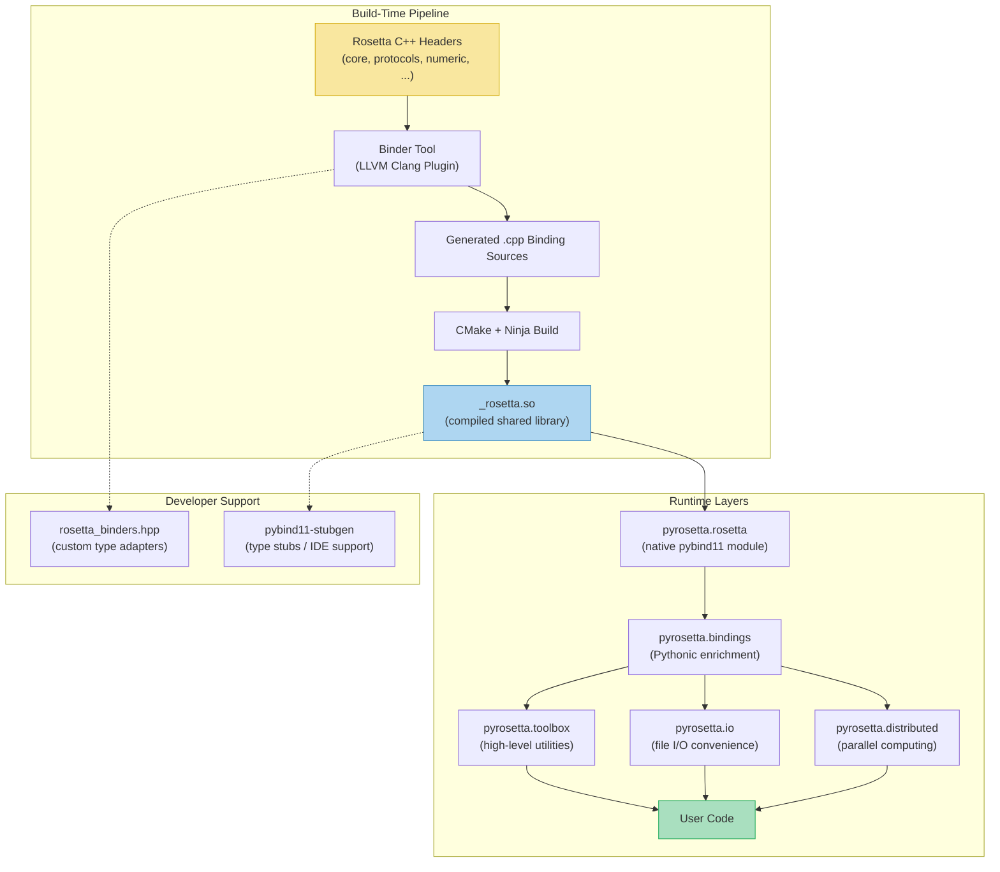

PyRosetta bridges the Rosetta molecular modeling suite and the Python ecosystem, enabling rapid prototyping of structural biology protocols without C++ compilation cycles. This page dissects its four-layer architecture — the **C++ binding generation pipeline**, the **native pybind11 interface**, the **Pythonic enrichment layer**, and the **distributed computing framework** — and provides practical guidance for intermediate developers who need to understand how the bindings work under the hood or extend them.

## Architecture Overview

PyRosetta is not a hand-maintained wrapper around selected Rosetta functions. It is an **automatically generated, near-complete Python binding** of the entire Rosetta C++ codebase, produced by a custom LLVM-based binder tool. The resulting compiled shared library exposes virtually every class, function, and enum in Rosetta's `core` and `protocols` namespaces, which is then enriched with a pure-Python layer providing idiomatic interfaces.



This architecture separates concerns cleanly: the C++ pipeline handles bulk binding generation with zero manual maintenance, while the Python layer selectively overrides and enriches specific classes where a more Pythonic interface is warranted.

## Build-Time Binding Generation

### The Binder Tool Pipeline

The binding generation system lives in `build.py` and orchestrates a multi-stage pipeline that transforms the entire Rosetta C++ codebase into a compilable Python extension module. At its core is a **custom LLVM Clang plugin** called "binder" that performs AST-level analysis of Rosetta headers to produce pybind11 binding code.
Sources: [build.py](source/src/python/PyRosetta/build.py#L1-L200)

The build script identifies all eligible headers by walking the Rosetta source tree (`ObjexxFCL`, `utility`, `numeric`, `basic`, `core`, `protocols`) while filtering out implementation files (`.impl.hh`, `.fwd.hh`, `.py.hh`) and explicitly banned headers — notably GPU code, deprecated database session loaders, and JD3 output writers. All remaining headers are aggregated into a single `all_rosetta_includes.hh` umbrella file, which the binder tool consumes in a single compilation pass.
Sources: [build.py](source/src/python/PyRosetta/build.py#L637-L685)

A content-hash signature mechanism avoids redundant binder runs: the build script computes an MD5 hash of all include file paths, their modification times, and the binder configuration. If this signature matches the cached value from the previous run, the generation step is skipped entirely, significantly reducing rebuild times during iterative development.
Sources: [build.py](source/src/python/PyRosetta/build.py#L671-L692)

### Compilation Defines and Conditional Binding

The generated bindings respect Rosetta's preprocessor feature flags, controlled through the `get_defines()` function. Key defines include `PYROSETTA` (enabling PyRosetta-specific code paths), `NOCRASHREPORT` (disabling C++ crash reporters that would terminate the Python process), and optional flags for `SERIALIZATION`, `MULTI_THREADED`, `USE_TORCH`, and `USE_TENSORFLOW`. When serialization is enabled, the build system additionally scans `.cc` files for `SAVE_AND_LOAD_SERIALIZABLE` macros and rewrites them as `EXTERN_SAVE_AND_LOAD_SERIALIZABLE` to ensure serialization templates are instantiated in the binding module.
Sources: [build.py](source/src/python/PyRosetta/build.py#L117-L136)

### Build Invocation

Building PyRosetta requires Clang 3.4+ or GCC 4.8+, CMake, Ninja, and Python 3.8+. The standard build invocation is straightforward, with the build script handling LLVM/binder toolchain installation, binding generation, CMake configuration, and Ninja compilation as a single operation.
Sources: [README.md](source/src/python/PyRosetta/README.md#L13-L18)

```bash
cd source/src/python/PyRosetta
python3 build.py -j8
```

Useful flags include `--create-package` (produces a `setup.py`-based installable package), `--create-wheel` (produces a `.whl` file), and `--skip-namespaces N` (binds only the first N of the six Rosetta namespaces, useful for faster iteration). During development, the `--print-build-root` flag reveals the build output directory, allowing direct `PYTHONPATH` manipulation without full package installation — all Python files at the build location are symlinks to the originals, so code changes take effect immediately.
Sources: [README.md](source/src/python/PyRosetta/README.md#L25-L33), [build.py](source/src/python/PyRosetta/build.py#L369-L400)

> [!TIP]
> **Development workflow**: Use `python3 build.py -j8 --print-build-root` to get the build directory, then set `PYTHONPATH` to that directory. The build system symlinks Python source files, so edits to `pyrosetta/bindings/pose.py` etc. are reflected immediately without rebuilding. Only C++ changes require re-running `build.py`.

### CMake Integration and Library Assembly

After binder generates the `.cpp` source files, the build system produces per-library CMake files from Rosetta's SCons `.src.settings` files, converting each into an `add_library(... OBJECT ...)` directive with `POSITION_INDEPENDENT_CODE` enabled. These object libraries are then consumed by the main `rosetta.cmake` template, which links everything into the final `_rosetta.so` shared module. External dependencies (sqlite3, cppdb, and optionally others) are handled through parallel `.external.settings` parsing.
Sources: [build.py](source/src/python/PyRosetta/build.py#L442-L599)

## The Native pybind11 Module: `pyrosetta.rosetta`

### Bulk Auto-Generated Bindings

The compiled `_rosetta.so` is imported as `pyrosetta.rosetta` and exposes the near-complete Rosetta C++ API. Every class in `core`, `protocols`, `numeric`, `basic`, `utility`, and `ObjexxFCL` namespaces is available, typically with its original C++ name preserved. Enum types, typedefs, and free functions are also bound. The module serves as the **single source of truth** for all Rosetta functionality — nothing is hidden behind a Python-only facade.
Sources: [pyrosetta/__init__.py](source/src/python/PyRosetta/src/pyrosetta/__init__.py#L24-L38)

### Custom C++ Binders for Special Types

While the binder tool handles the vast majority of types automatically, certain Rosetta template-heavy types require **hand-written binders** defined in [`rosetta_binders.hpp`](source/src/python/PyRosetta/include/rosetta_binders.hpp). This header provides specialized pybind11 adapters for three categories of types:

**Utility vectors** — Rosetta's `utility::vector0<T>` and `utility::vector1<T>` (0-based and 1-based indexed vectors) receive full Python sequence protocol support including `__getitem__`, `__setitem__`, `__len__`, `__iter__`, `append`, `extend`, `pop`, `remove`, `__contains__`, and `__repr__`. The binder uses SFINAE-based compile-time introspection (`has_equal_operator_s`) to conditionally enable equality comparisons and containment testing only for element types that support them. The 1-based indexing of `vector1` is preserved at the C++ level — Python code using `pose.residues[1]` accesses the first residue correctly.
Sources: [rosetta_binders.hpp](source/src/python/PyRosetta/include/rosetta_binders.hpp#L146-L283)

**xyzVector and xyzMatrix** — These geometric types receive property-based attribute access (`vector.x`, `vector.y`, `vector.z`, `matrix.xx`, `matrix.xy`, etc.), arithmetic operator overloads, and Python index protocol support (`v[0]`, `v[1]`, `v[2]`).
Sources: [rosetta_binders.hpp](source/src/python/PyRosetta/include/rosetta_binders.hpp#L388-L475)

**Standard containers** — `std::set`, `std::map`, and `std::list` receive analogous Pythonic treatment with appropriate protocol methods.
Sources: [rosetta_binders.hpp](source/src/python/PyRosetta/include/rosetta_binders.hpp#L94-L142)

The following table summarizes how major Rosetta C++ types map to their Python representations:

| C++ Type | Python Access | Indexing | Python Protocol |
|---|---|---|---|
| `utility::vector1<T>` | `rosetta.utility.vector1_<T>` | 1-based | Full sequence (`len`, `iter`, slicing`) |
| `utility::vector0<T>` | `rosetta.utility.vector0_<T>` | 0-based | Full sequence |
| `numeric::xyzVector<double>` | `rosetta.numeric.xyzVector_double_t` | 0-based (`v[0]`, `v[1]`, `v[2]`) | Properties: `.x`, `.y`, `.z` |
| `numeric::xyzMatrix<double>` | `rosetta.numeric.xyzMatrix_double_t` | 0-based (rows) | Properties: `.xx`, `.xy`, ... `.zz` |
| `core::pose::Pose` | `rosetta.core.pose.Pose` | — | Enriched by Python layer |
| `core::scoring.ScoreFunction` | `rosetta.core.scoring.ScoreFunction` | — | Direct access |

## Pythonic Enrichment Layer: `pyrosetta.bindings`

The `pyrosetta.bindings` subpackage applies selective Pythonic enhancements to the raw pybind11 bindings. Rather than re-wrapping entire classes, it uses a `bind_method` utility to **monkey-patch additional methods** onto the existing C++ classes. This approach preserves full access to the native API while adding convenience features where they matter most.
Sources: [bindings/__init__.py](source/src/python/PyRosetta/src/pyrosetta/bindings/__init__.py#L1-L7)

### Pose Enrichments

The [`pose.py`](source/src/python/PyRosetta/src/pyrosetta/bindings/pose.py) module provides the most extensive enrichment, adding several Python-native interfaces to the core `Pose` class:

**PoseResidueAccessor** — A collection-like wrapper accessed via `pose.residues` that provides Pythonic iteration, slicing with 1-based index translation, and even in-place append (`pose.residues += residue`). Slicing such as `pose.residues[2:6]` returns a generator yielding `Residue` objects for positions 2 through 5, respecting Rosetta's 1-based convention. A zero-index access raises `IndexError` with a clear message about the 1-based indexing requirement.
Sources: [pose.py](source/src/python/PyRosetta/src/pyrosetta/bindings/pose.py#L117-L188)

**residue_pairs() generator** — A composable method that yields permutations of residue pairs filtered by `ResidueSelector` instances and optional cartesian/sequence distance cutoffs. It composes `NeighborhoodResidueSelector` and `PrimarySequenceNeighborhoodSelector` internally, providing a high-level interface for tasks like interface analysis.
Sources: [pose.py](source/src/python/PyRosetta/src/pyrosetta/bindings/pose.py#L78-L115)

**Pose pickling support** — Custom `__getstate__`/`__setstate__` methods enable serialization of Pose objects through Python's `pickle` protocol (used by `pyrosetta.distributed`). Sequence constraints are explicitly unsupported with a warning; the implementation strips them before pickling. The serialization itself uses cereal, Rosetta's C++ serialization framework.
Sources: [pose.py](source/src/python/PyRosetta/src/pyrosetta/bindings/pose.py#L61-L76)

### Energy Array Bindings

The [`energies.py`](source/src/python/PyRosetta/src/pyrosetta/bindings/energies.py) module adds NumPy integration to the `Energies` class, providing methods that return structured NumPy arrays of energy decompositions:

- **`residue_pair_energies_array()`** — Returns a 2D structured array of shape `(n_residues, n_residues)` where each entry contains named fields for every non-zero-weight energy type. This enables direct NumPy-based analysis of pairwise interaction energies.
- **`residue_onebody_energies_array()`** and **`residue_total_energies_array()`** — Return per-residue energy decompositions as 1D structured arrays.
- **`total_energies_array()`** and **`active_total_energies()`** — Provide total energy summaries.
- **`nonzero_weights()`** — Returns the set of energy terms with non-zero weights, used to determine which fields appear in the structured arrays.

All array methods accept optional residue selection arguments (indices or boolean masks) for focused analysis. The structured dtype is dynamically constructed from `ScoreType` enum members whose weights are non-zero in the active `ScoreFunction`.
Sources: [energies.py](source/src/python/PyRosetta/src/pyrosetta/bindings/energies.py#L1-L215)

> [!TIP]
> **NumPy energy analysis**: Use `pose.energies().residue_total_energies_array()` to get a structured NumPy array where each row is a residue and each column is a named energy term. This enables vectorized operations like `array['fa_atr'].mean()` for rapid statistical analysis without Python loops.

### ResidueSelector Operator Overloads

The [`residue_selectors.py`](source/src/python/PyRosetta/src/pyrosetta/bindings/residue_selectors.py) module overloads Python bitwise operators on all `ResidueSelector` subclasses, enabling combinatorial selection logic with familiar syntax:

| Python Operator | Rosetta Equivalent | Example |
|---|---|---|
| `&` | `AndResidueSelector` | `chainA & near_active_site` |
| `\|` | `OrResidueSelector` | `polar_residues \| charged_residues` |
| `~` | `NotResidueSelector` | `~glycines` |
| `^` | XOR composition | `selectorA ^ selectorB` |
| `&=`, `\|=`, `^=` | In-place variants | `selection &= backbone` |

A `get_residues(pose)` convenience method is also added, returning a plain Python `list` of selected residue indices (in Rosetta 1-based numbering).
Sources: [residue_selectors.py](source/src/python/PyRosetta/src/pyrosetta/bindings/residue_selectors.py#L24-L91)

### Homogeneous Transform and RT Bindings

The [`homogeneous_transform.py`](source/src/python/PyRosetta/src/pyrosetta/bindings/homogeneous_transform.py) module and [`rt.py`](source/src/python/PyRosetta/src/pyrosetta/bindings/rt.py) module bridge Rosetta's rigid-body transform types to NumPy arrays. The `RT.as_array()` method converts a `core.kinematics.RT` object into a 4×4 homogeneous transformation matrix (`numpy.ndarray`), combining the rotation and translation components. An `is_homog_xform()` validation function verifies the matrix properties. This integration enables direct use of Rosetta transforms within NumPy/SciPy linear algebra pipelines.
Sources: [rt.py](source/src/python/PyRosetta/src/pyrosetta/bindings/rt.py#L1-L18)

## Initialization and Configuration

### The `pyrosetta.init()` Function

The `init()` function is the mandatory entry point for any PyRosetta session. It accepts command-line-style option strings, resolves the Rosetta database location, initializes global scoring data, and sets up logging. The default flags `-ex1 -ex2aro` enable extra chi1 rotamers and extra aromatic chi sampling — these are nearly always desirable for production protocols.
Sources: [pyrosetta/__init__.py](source/src/python/PyRosetta/src/pyrosetta/__init__.py#L113-L173)

```python
import pyrosetta
pyrosetta.init()                                    # defaults: -ex1 -ex2aro
pyrosetta.init(extra_options='-pH')                 # append flags
pyrosetta.init('-pH -database /path/to/database')   # override all defaults
pyrosetta.init(silent=True)                         # suppress output
```

Database resolution follows a priority chain: the `PYROSETTA_DATABASE` environment variable, then the package installation directory, the current working directory, the user's home directory, and standard system paths.
Sources: [pyrosetta/__init__.py](source/src/python/PyRosetta/src/pyrosetta/__init__.py#L68-L110)

### Logging Integration

The `set_logging_handler` parameter controls how Rosetta's C++ tracing system routes output through Python's `logging` module. In interactive contexts (REPLs, Jupyter notebooks), it defaults to `"interactive"` mode, which registers a Python log handler and displays output. For batch scripts, the default is `None`, which writes through C++ file handles. The `"logging"` mode registers the handler without modifying the logging configuration, suitable for integration with existing logging setups.
Sources: [pyrosetta/__init__.py](source/src/python/PyRosetta/src/pyrosetta/__init__.py#L127-L145)

## I/O Convenience Layer: `pyrosetta.io`

The `pyrosetta.io` subpackage provides Pythonic wrappers around Rosetta's PDB I/O functions, handling compressed file formats and providing generator-based interfaces for multi-file operations:

| Function | Description |
|---|---|
| `pose_from_pdb(filename)` | Load a single PDB file (supports `.bz2`, `.gz`, `.xz` compression) |
| `pose_from_sequence(seq)` | Create a Pose from an amino acid letter sequence |
| `poses_from_files(file_list)` | Generator yielding Poses from multiple files |
| `poses_from_silent(filename)` | Generator yielding Poses from a Rosetta silent file |
| `poses_from_multimodel_pdb(filename)` | Generator yielding Poses from multi-model PDB files |
| `dump_pdb(pose, filename)` | Write Pose to PDB file |
| `dump_cif(pose, filename)` | Write Pose to mmCIF format |
| `dump_silent(...)` | Write Poses to Rosetta silent file format |
| `create_score_function(name)` | Factory for named ScoreFunction presets |

The `pose_from_sequence()` function goes beyond `make_pose_from_sequence()` by setting all torsion angles to 180° and attaching `PDBInfo`, producing a properly initialized Pose suitable for immediate scoring or manipulation.
Sources: [io/__init__.py](source/src/python/PyRosetta/src/pyrosetta/io/__init__.py#L82-L117)

## The Distributed Computing Framework

PyRosetta includes a first-class distributed computing framework under `pyrosetta.distributed`, designed for cluster and cloud-scale structural modeling. It integrates with **Dask** for task scheduling, **blosc** for efficient pose serialization, and provides its own `PackedPose` container for network-transparent pose transport. The framework is declared as an optional dependency in `setup.py` (under the `distributed` extra), requiring `numpy`, `pandas`, `blosc`, and `traitlets`.
Sources: [setup.py](source/src/python/PyRosetta/src/setup.py#L61-L76)

Key components include a cluster management module (`pyrosetta.distributed.cluster`), task definitions (`pyrosetta.distributed.tasks`), an I/O system for distributed file handling (`pyrosetta.distributed.io`), a `packed_pose` serialization format, and a `viewer` module for result visualization. Pose pickling within the distributed framework uses cereal-based serialization through the custom `__getstate__`/`__setstate__` methods defined in the bindings layer.
Sources: [pyrosetta/__init__.py](source/src/python/PyRosetta/src/pyrosetta/__init__.py#L55-L58), [pose.py](source/src/python/PyRosetta/src/pyrosetta/bindings/pose.py#L61-L76)

## Toolbox and Utility Modules

The `pyrosetta.toolbox` subpackage collects high-level convenience functions commonly needed in structural biology workflows. Notable modules include: Sources: [pyrosetta/__init__.py](source/src/python/PyRosetta/src/pyrosetta/__init__.py#L93-L94)

| Module | Key Functions |
|---|---|
| `cleaning.py` | PDB structure cleanup and preparation |
| `generate_resfile.py` | Resfile generation for packing/design |
| `load_ligand.py` | Param file loading for small molecules |
| `mutants.py` | Point mutation generation |
| `numpy_utils.py` | NumPy conversion utilities for Rosetta types |
| `py_jobdistributor.py` | Python-native job distribution loop |
| `rcsb.py` | Download structures directly from the RCSB PDB |
| `atom_pair_energy.py` | Atom-pair energy decomposition |
| `extract_coords_pose.py` | Coordinate extraction utilities |

## Package Distribution and Installation

PyRosetta is distributed as a native Python package via `setup.py`, which uses a custom `PyRosettaDistribution` class that declares the package as containing non-pure (compiled) extension modules. The package requires `numpy` as a core dependency and optionally depends on `pandas`, `blosc`, and `traitlets` for the distributed framework. The `package_data` specification includes compiled `.so` files, Markdown documentation, type stubs (`.pyi`), and the Rosetta database directory.
Sources: [setup.py](source/src/python/PyRosetta/src/setup.py#L19-L86)

Type stubs are generated post-build using `pybind11-stubgen`, which introspects the compiled module to produce `.pyi` files that enable IDE autocompletion and static type checking. This is critical for developer experience given that the bulk of PyRosetta's API lives in the compiled module where standard Python introspection is limited.
Sources: [build.py](source/src/python/PyRosetta/build.py#L763-L775)

## Navigating Further

PyRosetta's bindings provide access to every core Rosetta concept. To deepen your understanding of what the bindings expose and how to use them effectively:

- **[Pose and Conformation](8-pose-and-conformation)** — Understanding the central data structure that PyRosetta's `pose.py` bindings enrich
- **[ScoreFunction Framework](9-scorefunction-framework)** — The scoring system that `energies.py` bridges to NumPy
- **[Mover and Filter Hierarchy](11-mover-and-filter-hierarchy)** — The protocol framework accessible as `pyrosetta.rosetta.protocols.moves`
- **[RosettaScripts XML Framework](14-rosettascripts-xml-framework)** — XML-driven protocols that can be loaded and executed from PyRosetta
- **[Factory Pattern Architecture](15-factory-pattern-architecture)** — The registration system that PyRosetta's `create_score_function()` and other factory calls depend on
- **[Docker and Conda Setup](4-docker-and-conda-setup)** — Pre-built PyRosetta environments for quick start without source compilation