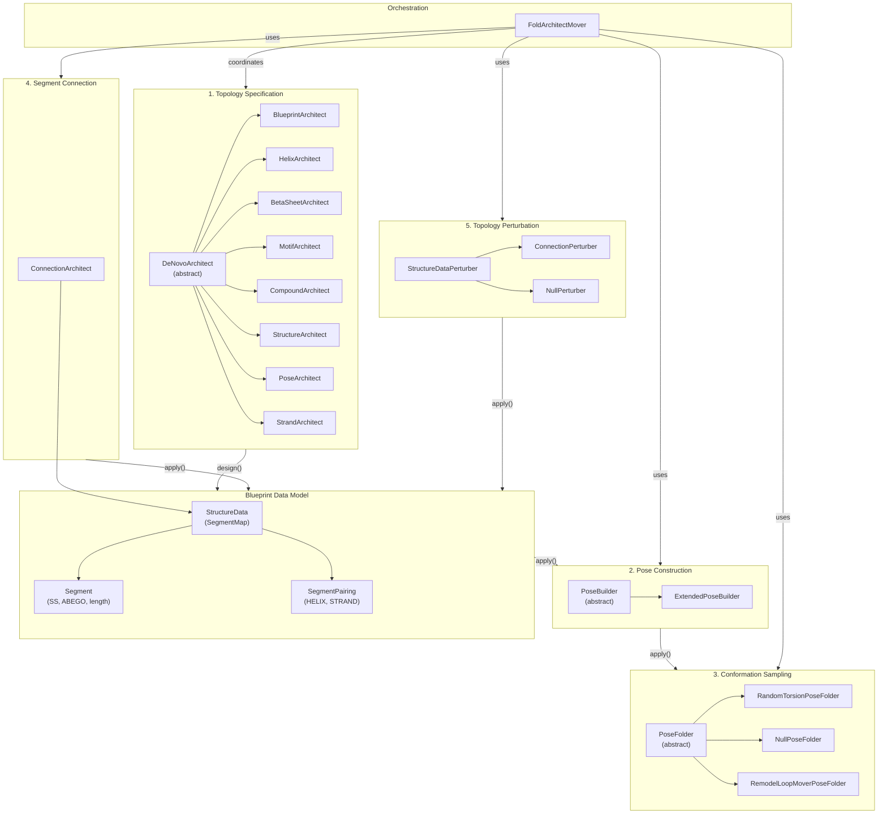
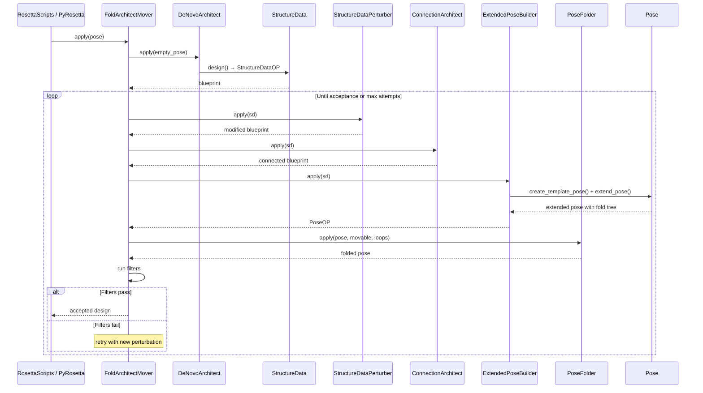

De novo protein design in Rosetta addresses the inverse folding problem: given a desired structure or topology, generate amino acid sequences that fold into that conformation with high stability. Unlike comparative modeling or refinement, de novo design constructs entirely new proteins from first principles using parameterized backbone geometries, fragment-based folding, and sequence optimization. This page documents the core framework in `protocols/denovo_design` — the component-based architecture that decomposes structure creation into composable phases of topology specification, pose building, folding, connection, and perturbation.

## Architectural Overview

The de novo design system follows a **pipeline architecture** where each stage is encapsulated by a pluggable interface. The central orchestrator is `FoldArchitectMover`, which coordinates the entire flow from topology definition through folded pose generation. This design mirrors the Mover/Filter hierarchy described in [Mover and Filter Hierarchy](11-mover-and-filter-hierarchy) but specializes it for the unique requirements of building proteins from scratch rather than modifying existing ones.

The pipeline flows through five logically distinct phases. The **Topology Specification** phase uses an `DeNovoArchitect` to produce a `StructureData` blueprint containing named `Segment` objects with secondary structure, ABEGO conformation codes, and `SegmentPairing` relationships. The **Pose Construction** phase materializes this blueprint into a physical `Pose` via `ExtendedPoseBuilder`. The **Conformation Sampling** phase folds the extended pose into 3D space using a `PoseFolder` strategy. **Connection** and **Perturbation** phases optionally modify the topology blueprint and re-fold, enabling iterative refinement.

Sources: [FoldArchitectMover.hh](source/src/protocols/denovo_design/movers/FoldArchitectMover.hh#L49-L119), [DeNovoArchitect.hh](source/src/protocols/denovo_design/architects/DeNovoArchitect.hh#L47-L87), [PoseBuilder](source/src/protocols/denovo_design/components/ExtendedPoseBuilder.hh#L40-L65), [PoseFolder.hh](source/src/protocols/denovo_design/components/PoseFolder.hh#L48-L97)

## The StructureData Blueprint Model

At the heart of every de novo design is `StructureData` — a serializable, cacheable data structure stored as `WriteableCacheableData` on the Pose. It acts as the authoritative blueprint from which all geometry and connectivity are derived. A `StructureData` is essentially an ordered map of `Segment` objects, plus metadata for pairings, aliases, covalent bonds, and user-defined data fields.

### Segment: The Atomic Unit of Topology

Each `Segment` encapsulates a contiguous block of residues with shared structural intent. A segment carries three defining properties:

| Property | Type | Description |
|----------|------|-------------|
| `ss` | `std::string` | Secondary structure string (one char per residue: H, E, L) |
| `abego` | `std::string` | ABEGO backbone torsion bins per residue |
| `id` | `std::string` | Unique name used for pairing and referencing |

Segments also track pose-coordinate mapping (`set_pose_start()`, `segment_to_pose()`, `pose_to_segment()`) and boundary inclusion flags (`nterm_included_`, `cterm_included_`) that control whether padding residues are considered part of the designable segment. The `parse_motif()` method accepts compact strings like `"1LX-10HA-1LA-1LB"`, describing a 1-residue loop, 10-residue helix, and two 1-residue loops — a common pattern in blueprint notation.

Sources: [Segment.hh](source/src/protocols/denovo_design/components/Segment.hh#L47-L200), [ResidueDihedrals](source/src/protocols/denovo_design/components/Segment.hh#L47-L93)

### SegmentPairing: Defining Inter-Segment Geometry

When segments must adopt specific relative orientations — such as parallel or antiparallel helix pairings, or strand hydrogen-bonding registers — `SegmentPairing` objects encode these constraints. The base class defines four pairing types through an enum: `HELIX`, `STRAND`, `HELIX_SHEET`, and `UNKNOWN`. Derived classes `HelixPairing` and `StrandPairing` carry the specific geometric parameters. The `pairing_string()` method serializes the pairing into the classic Rosetta pairing notation used by constraints and filters.

Sources: [SegmentPairing.hh](source/src/protocols/denovo_design/components/SegmentPairing.hh#L35-L139)

### StructureData Operations

`StructureData` provides a rich manipulation API organized into several categories. **Segment management** includes `add_segment()`, `delete_segment()`, `rename_segment()`, `move_segment()`, `merge_segments()`, and `replace_segment()`. **Connectivity** is controlled through `connect_segments()`, `disconnect_segments()`, and `declare_covalent_bond()` using the `BondInfo` class. **Alias** support allows naming specific residues (`set_alias()`) for convenient cross-referencing in movers and filters. **Arbitrary user data** (integers, reals, strings) can be attached per-segment via the `set_data_*()` / `get_data_*()` family of methods. The `slice()` method extracts a subset of segments into a new `StructureData`, and `merge()` / `merge_before()` combine two blueprints — critical for modular assembly.

Sources: [StructureData.hh](source/src/protocols/denovo_design/components/StructureData.hh#L106-L327)

## The Architect Hierarchy: Blueprint Generation

`DeNovoArchitect` is the abstract interface whose `design()` method produces a `StructureDataOP` from an optional input pose. The class extends `StructureArchitect` and provides the critical `apply()` method that internally calls `design()`, making it usable both programmatically and within the [RosettaScripts XML Framework](14-rosettascripts-xml-framework). Each concrete architect encodes a different strategy for topology creation.

### Concrete Architect Implementations

| Architect | Source | Topology Strategy |
|-----------|--------|-------------------|
| `BlueprintArchitect` | Blueprint file | Parses the classic Rosetta blueprint format including HHPAIR lines for helix-helix contacts |
| `HelixArchitect` | Parameterized | Generates helical bundle topologies with controllable helix count, lengths, and packing angles |
| `BetaSheetArchitect` | Parameterized | Constructs β-sheet topologies with strand count, register, and orientation specifications |
| `MotifArchitect` | PDB fragments | Extracts structural motifs from input poses and wraps them into segments |
| `CompoundArchitect` | Composite | Chains multiple child architects to combine their output into a single `StructureData` |
| `PoseArchitect` | Input pose | Converts an existing pose into a `StructureData` by extracting its secondary structure and geometry |
| `StrandArchitect` | Parameterized | Creates individual strand segments with specific strand pairing constraints |

`BlueprintArchitect` deserves special attention: it wraps the legacy `BluePrint` parser and additionally handles `HHPAIR` lines that specify helix-helix pairings with orientation (P/A = parallel/antiparallel) and register offsets. Template segments — residues with non-zero residue numbers in the blueprint — are extracted from the input pose and anchored in the blueprint via `set_template_segments()`, enabling hybrid templated/de novo design.

Sources: [BlueprintArchitect.hh](source/src/protocols/denovo_design/architects/BlueprintArchitect.hh#L37-L103), [DeNovoArchitectFactory](source/src/protocols/denovo_design/architects/DeNovoArchitectFactory.hh#L1-L50)

## Pose Building: From Blueprint to Extended Chain

Once `StructureData` is defined, `ExtendedPoseBuilder` materializes it into a physical `Pose`. The builder operates in two stages. First, `create_template_pose()` extracts segments that have template conformations (stored via `set_template_pose()`) and assembles them into a partial pose with correct chain boundaries. Then `extend_pose()` inserts de novo segments as extended-chain residues (glycines or poly-alanine) at the appropriate positions, guided by the `ResidueDihedrals` helper for dihedral anchoring at junctions. The `FoldTree` is constructed to reflect the segment connectivity encoded in the blueprint.

The `PoseBuilder` base class provides a `debug` flag that, when enabled, outputs intermediate PDB files at each build stage — invaluable for diagnosing topology issues. The standalone functions `prepend_new_residues()` and `append_new_residues()` handle the low-level mechanics of residue insertion with proper variant type assignment at cutpoints.

Sources: [ExtendedPoseBuilder.hh](source/src/protocols/denovo_design/components/ExtendedPoseBuilder.hh#L67-L104)

## Pose Folding: Sampling 3D Conformations

The `PoseFolder` abstract interface defines the contract for conformation sampling. Its `apply()` method receives a pose (with all residues already present), a `ResidueSubset` marking which residues are movable, and a `Loops` object defining foldable regions. Critically, residues not marked as movable and not contained within any loop must not be modified — this ensures template segments remain fixed while de novo segments are folded.

| Folder | Strategy |
|--------|----------|
| `RemodelLoopMoverPoseFolder` | Wraps the Remodel loop modeling mover for kinematics-based loop closure |
| `RandomTorsionPoseFolder` | Assigns random backbone torsions within ABEGO constraints |
| `NullPoseFolder` | No-op folder; leaves the pose as-is for scenarios where only sequence design is needed |

The `FoldGraph` class plays a supporting role here: it constructs a graph representation of segment connectivity from `StructureData`, enabling computation of optimal fold trees and loop definitions. The `compute_best_solution()` method identifies movable segment groups that minimize the number of independent folding subproblems — essentially a graph partitioning problem solved via `create_loops()`.

> [!TIP]
> The `EXCN_Fold` exception class signals folding failures. Derived `PoseFolder` implementations should throw this exception rather than silently producing invalid conformations, allowing `FoldArchitectMover` to trigger retries with perturbed topologies.

Sources: [PoseFolder.hh](source/src/protocols/denovo_design/components/PoseFolder.hh#L41-L97), [FoldGraph.hh](source/src/protocols/denovo_design/components/FoldGraph.hh#L45-L80)

## Segment Connection and Loop Closure

`ConnectionArchitect` addresses the challenge of covalently joining separate chain segments (e.g., closing a cutpoint between two helices). It operates on `StructureData` rather than the Pose, modifying the blueprint to add connecting loop segments. The architect maintains lists of `segment1_ids()` and `segment2_ids()` specifying which segment pairs are candidates for connection, and `compute_connection_candidates()` evaluates feasible loop motifs by length and geometry.

Connection architects are consumed by `FoldArchitectMover` as a vector of `ConnectionArchitectCOPs`, applied sequentially to the `StructureData` before folding. The `BridgeChainsMover` provides an alternative Pose-level implementation that uses kinematic closure (KIC) to bridge chain termini, and `DeclareStructureDataCovalentBondMover` handles non-peptide covalent bonds between arbitrary atoms.

Sources: [ConnectionArchitect.hh](source/src/protocols/denovo_design/connection/ConnectionArchitect.hh#L48-L93), [BridgeChainsMover](source/src/protocols/denovo_design/movers/BridgeChainsMover.hh#L1-L50)

## StructureData Perturbation: Topology Search

`StructureDataPerturber` enables systematic exploration of topology space by modifying the blueprint between folding attempts. The base class defines `enumerate()` which returns a set of `Permutation` objects (lists of replacement `Segment` COPs), and `apply()` replaces segments in the current `StructureData` with the selected permutation.

The `ConnectionPerturber` subclass "mutates" existing connections by varying loop lengths and ABEGO patterns, while `NullPerturber` serves as the identity operation. The `EnumeratedVectorSelector` used internally cycles through permutations, enabling controlled enumeration without replacement — essential for thorough sampling in large topology spaces. The `ignore_segments()` mechanism allows excluding template or fixed segments from perturbation.

Sources: [StructureDataPerturber.hh](source/src/protocols/denovo_design/components/StructureDataPerturber.hh#L39-L88)

## The FoldArchitectMover Orchestrator

`FoldArchitectMover` is the primary entry point that wires together all the components described above. It implements the standard `moves::Mover` interface, making it directly usable from RosettaScripts, PyRosetta, and the job-distribution system. The mover manages the complete lifecycle:

1. **Topology generation**: Calls `DeNovoArchitect::apply()` to produce `StructureData`
2. **Perturbation**: Optionally applies `StructureDataPerturber` to explore topology variants
3. **Connection**: Runs `ConnectionArchitect` instances to close chain gaps
4. **Build**: Uses `PoseBuilder` to create the extended-chain pose
5. **Constraint setup**: Applies `ConstraintGenerator` instances for folding guidance
6. **Fold**: Invokes `PoseFolder` to sample backbone conformations
7. **Post-processing**: Runs secondary `Mover` and `Filter` pipelines for refinement and quality assessment

The `DivideAndConqueror` component referenced in the mover's interface handles the strategy of folding complex topologies by decomposing them into independently foldable subproblems based on the `FoldGraph` connectivity analysis.

> [!TIP]
> `FoldArchitectMover` stores both an architect and a folder as mutable state. When configuring via RosettaScripts, use `set_architect()` and `set_folder()` separately to compose different topology strategies with different folding strategies — e.g., pair `BlueprintArchitect` with `RemodelLoopMoverPoseFolder` for classic blueprint-based design, or `HelixArchitect` with `RandomTorsionPoseFolder` for parametric bundle exploration.

Sources: [FoldArchitectMover.hh](source/src/protocols/denovo_design/movers/FoldArchitectMover.hh#L49-L119)

## Design-Time Filters and Quality Assessment

The `denovo_design` module provides specialized filters that evaluate design quality during the RosettaScripts pipeline:

| Filter | Purpose |
|--------|---------|
| `CavityVolumeFilter` | Detects buried cavities via the `CavityCalculator` — large cavities indicate poor packing |
| `ExposedHydrophobicsFilter` | Flags solvent-exposed hydrophobic residues that destabilize the design |
| `PreProlineFilter` | Ensures pre-proline residues adopt favorable backbone conformations |
| `SSPredictionFilter` | Validates that predicted secondary structure matches design intent |
| `SSShapeComplementarityFilter` | Evaluates shape complementarity at secondary structure element interfaces |

These filters complement the broader Rosetta filter system and are typically chained after the design mover in a RosettaScripts protocol. The `ConsensusLoopDesignOperation` task operation provides loop-specific sequence design constraints that prefer consensus loop geometries.

Sources: [filters/](source/src/protocols/denovo_design/filters/CavityVolumeFilter.cc#L1-L10), [task_operations/ConsensusLoopDesignOperation](source/src/protocols/denovo_design/task_operations/ConsensusLoopDesignOperation.hh#L1-L10)

## Related Modules and Complementary Systems

De novo design in Rosetta extends well beyond the `denovo_design` module. Several related subsystems provide specialized capabilities that integrate with or complement the core framework.

### Topology Analysis (fldsgn)

The `protocols/fldsgn` module provides secondary structure topology analysis infrastructure, including `StrandPairing`, `HelixPairing`, `HSSTriplet` (helix-strand-strand motifs), and `Sheet` topology objects. The `BluePrintBDR` mover is a legacy topology builder, and `SheetConstraintGenerator` / `SheetRemodelConstraintGenerator` enforce β-sheet geometry during folding. The `potentials/` subdirectory contains `AACompositionEnergy` and `SetSecStructEnergies` — energy functions that bias the [ScoreFunction](9-scorefunction-framework) toward designed secondary structure patterns.

Sources: [fldsgn/](source/src/protocols/fldsgn/topology/StrandPairing.hh#L1-L10), [fldsgn/potentials](source/src/protocols/fldsgn/potentials/AACompositionEnergy.hh#L1-L10)

### Helical Bundle Design (helical_bundle)

The `protocols/helical_bundle` module provides a parametric framework for coiled-coil and helical bundle design, built around `MakeBundle` (creates bundles from Crick parameterization), `PerturbBundle` / `PerturbBundleHelix` (searches parameter space), and `BundleGridSampler` (systematic parameter exploration). `helical_bundle_predict.cc` is the standalone application. This system can feed into the de novo framework via `HelixArchitect` or operate independently for symmetric bundle design.

### Residue Selectors

The `NamedSegmentSelector` and `PairedSheetResidueSelector` provide `ResidueSelector` implementations that select residues based on `StructureData` segment names or β-sheet pairing membership, enabling design task operations targeted to specific structural elements within a de novo design.

Sources: [residue_selectors/NamedSegmentSelector](source/src/protocols/denovo_design/residue_selectors/NamedSegmentSelector.hh#L1-L10)

## Component Interaction Pattern

This sequence diagram illustrates the iterative nature of the de novo design process. Each iteration perturbs the topology, rebuilds the pose, and re-folds — with filter evaluation determining acceptance. The separation of topology (StructureData) from conformation (Pose) enables this efficient exploration, as blueprint modifications are far cheaper than rebuilding and refolding from scratch.

Sources: [FoldArchitectMover.hh](source/src/protocols/denovo_design/movers/FoldArchitectMover.hh#L78-L86), [DeNovoArchitect.hh](source/src/protocols/denovo_design/architects/DeNovoArchitect.hh#L84-L87), [StructureDataPerturber.hh](source/src/protocols/denovo_design/components/StructureDataPerturber.hh#L58-L66)

## Navigating Further

The de novo design system sits at the intersection of several architectural layers in Rosetta. Understanding its neighbors provides fuller context:

- **[Pose and Conformation](8-pose-and-conformation)** — The Pose object that StructureData materializes into, and the conformational representations used during folding
- **[ScoreFunction Framework](9-scorefunction-framework)** — Energy functions that evaluate and drive the design toward stable, well-packed structures
- **[RosettaScripts XML Framework](14-rosettascripts-xml-framework)** — How to compose de novo design protocols using XML; all architects, folders, and filters support `parse_my_tag()` / `provide_xml_schema()` for declarative configuration
- **[Monte Carlo Sampling](12-monte-carlo-sampling)** — The stochastic acceptance framework that governs topology perturbation iterations
- **[Fragment Picking System](26-fragment-picking-system)** — Fragment libraries used by folding strategies like `RemodelLoopMoverPoseFolder`
- **[Structure Relaxation](18-structure-relaxation)** — Post-folding refinement that polishes de novo designs into physically realistic structures
- **[ProteinMPNN Integration](22-proteinmpnn-integration)** — Modern sequence design methods that can replace Rosetta's native packing for sequence optimization of de novo backbones