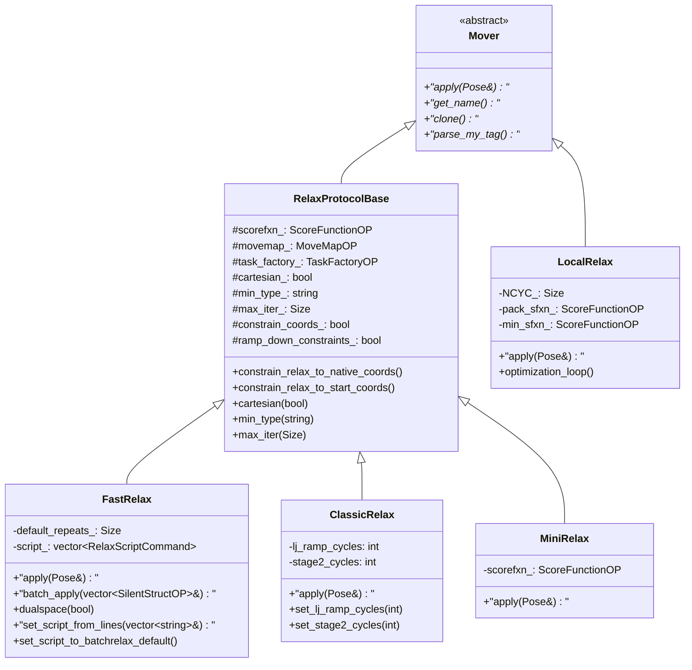
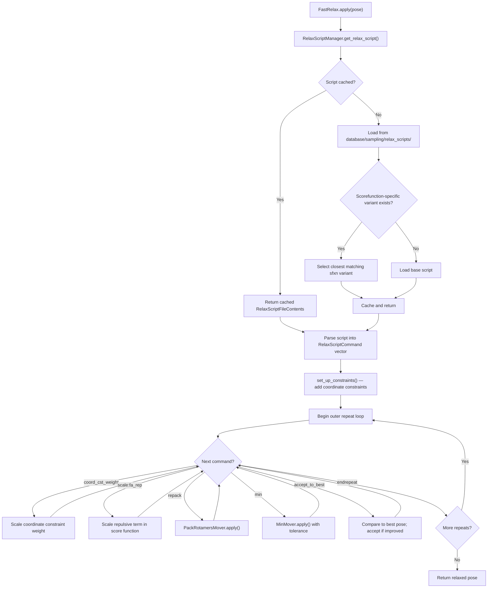

Structure relaxation is the computational process of reducing steric clashes, improving hydrogen bonding geometry, and optimizing backbone and sidechain conformations of a protein model. Within Rosetta, relaxation serves as both a standalone refinement protocol and a critical post-processing step woven into nearly every major workflow — from ab initio folding to comparative modeling to design. This page documents the architectural foundations, protocol variants, and script-driven orchestration system that collectively form Rosetta's relaxation framework.

## Architecture Overview

The relaxation subsystem is built on a disciplined class hierarchy that separates *policy* (which degrees of freedom to move, which scoring to use) from *orchestration* (the order and repetition of packing/minimization cycles). All production relax movers descend from `RelaxProtocolBase`, which itself inherits from the foundational `moves::Mover` class, while specialized variants like `LocalRelax` operate independently at the `Mover` level for fundamentally different algorithmic approaches.

Sources: [RelaxProtocolBase.hh](source/src/protocols/relax/RelaxProtocolBase.hh#L45-L52)



The `RelaxProtocolBase` class codifies the shared vocabulary for all script-driven relax protocols. It manages the **MoveMap** (controlling which torsions and bond angles are free to move), the **ScoreFunction** (defining the energy landscape), the **TaskFactory** (governing which residues may be repacked or redesigned), and an extensive set of boolean flags for constraint behavior and minimization geometry. These settings are the knobs that every downstream protocol either respects or overrides.

Sources: [RelaxProtocolBase.hh](source/src/protocols/relax/RelaxProtocolBase.hh#L142-L183)

## Protocol Variants

Rosetta provides four distinct relaxation implementations, each optimized for different scenarios. Understanding their trade-offs is essential for choosing the right tool.

| Protocol | Class | Strategy | Use Case | Speed |
|---|---|---|---|---|
| **FastRelax** | `FastRelax` | Script-driven repack/minimize cycles with ramped repulsive weights | Default refinement; most general-purpose | Moderate |
| **ClassicRelax** | `ClassicRelax` | Three-phase protocol with explicit Lennard-Jones ramping | Legacy Rosetta++ compatibility | Slow |
| **MiniRelax** | `MiniRelax` | Minimal-cycle relaxation using base-class settings | Lightweight post-processing | Fast |
| **LocalRelax** | `LocalRelax` | Iterative Cartesian relaxation on clustered residue subsets | Large structures; local strain relief | Variable |

### FastRelax — The Standard Protocol

`FastRelax` is the workhorse of Rosetta refinement. It operates by interpreting a *relax script* — a sequence of declarative commands that specify how many times to repeat a cycle, what coordinate constraint weights to apply, how to scale the repulsive term (`fa_rep`), and when to repack versus minimize. The script language acts as a domain-specific orchestrator decoupling the sequence of operations from their implementation.

Sources: [FastRelax.hh](source/src/protocols/relax/FastRelax.hh#L74-L102)

A `RelaxScriptCommand` struct captures each parsed line of the script, storing the command name, up to four numeric parameters, and a vector for variable-length parameter lists. This design allows the `apply()` method to dispatch commands through a simple switch-like structure without re-parsing on every iteration.

Sources: [FastRelax.hh](source/src/protocols/relax/FastRelax.hh#L50-L66)

FastRelax supports both **dihedral-space** and **Cartesian-space** minimization. When `dualspace(true)` is called, the minimizer operates in both dihedral and Cartesian coordinates simultaneously, using the `lbfgs_armijo_nonmonotone` algorithm. This is particularly effective for correcting severe geometric distortions (e.g., from homology models) because Cartesian minimization can directly improve bond angles and lengths, while dihedral minimization preserves the protein's chain connectivity intuition. The documentation recommends setting `max_iter` to 200 and enabling `minimize_bond_angles` when using dualspace mode.

Sources: [FastRelax.hh](source/src/protocols/relax/FastRelax.hh#L115-L122)

### ClassicRelax — Legacy Three-Phase Relaxation

`ClassicRelax` implements the original Rosetta++ `pose_relax` protocol. It operates in three explicit phases — phase 1 (high repulsive weight, coarse repacking), phase 2 (ramped repulsive, rotamer trials), and phase 3 (full repulsive, final minimization) — controlled by configurable cycle counts and Lennard-Jones ramp parameters. While superseded by FastRelax for most applications, ClassicRelax remains available for backward compatibility and for cases where its explicit phase structure provides useful control points.

Sources: [ClassicRelax.hh](source/src/protocols/relax/ClassicRelax.hh#L55-L107)

### LocalRelax — Cluster-Based Local Optimization

`LocalRelax` takes a fundamentally different approach. Rather than relaxing the entire structure simultaneously, it computes a neighbor interaction graph, clusters spatially proximate residues, and performs iterative Cartesian relaxation on each cluster independently. This is particularly useful for very large structures or for relieving local strain without perturbing well-folded regions. It maintains separate `pack_sfxn_` and `min_sfxn_` score functions, allowing different scoring regimes for packing and minimization phases within each local cluster.

Sources: [LocalRelax.hh](source/src/protocols/relax/LocalRelax.hh#L34-L99)

## Relax Script System

The relax script is the central orchestration mechanism for FastRelax. Scripts are text files containing one command per line, supporting conditional repetition and weight scaling. They reside in the Rosetta database at `database/sampling/relax_scripts/` and are managed by the `RelaxScriptManager` singleton.

Sources: [RelaxScriptManager.hh](source/src/protocols/relax/RelaxScriptManager.hh#L124-L128)

### Script Command Language

Below is a representative FastRelax script (`MonomerRelax2019.txt`) annotated with the role of each command:

```
repeat %%nrepeats%%          ← Outer loop; %%nrepeats%% is substituted at load time
coord_cst_weight 1.0         ← Set coordinate constraint weight (full tethering)
scale:fa_rep 0.040           ← Scale repulsive term to 4% of full weight
repack                        ← Perform full rotamer packing
scale:fa_rep 0.051           ← Slightly raise repulsive weight
min 0.01                     ← Minimize with tolerance 0.01
coord_cst_weight 0.5         ← Halve coordinate constraint strength
scale:fa_rep 0.265           ← Continue ramping repulsive
repack                        ← Repack again at higher repulsive
scale:fa_rep 0.280
min 0.01
coord_cst_weight 0.0         ← Release coordinate constraints entirely
scale:fa_rep 0.559
repack
scale:fa_rep 0.581
min 0.01
coord_cst_weight 0.0
scale:fa_rep 1               ← Full repulsive weight
repack
min 0.00001                  ← Final tight minimization
accept_to_best               ← Accept if this is the best score seen
endrepeat
```

Sources: [MonomerRelax2019.txt](database/sampling/relax_scripts/MonomerRelax2019.txt#L1-L22)

The key architectural insight is the **repulsive ramping** pattern. The `fa_rep` (full-atom repulsive) term starts at a very low fraction of its full weight, allowing the structure to resolve severe clashes through gradual rearrangement. As the weight increases, the structure settles into the correct energy basin. Simultaneously, the **coordinate constraint** weight is ramped *down* — the structure starts tightly tethered to its input coordinates and is progressively released. This dual-ramping prevents the minimizer from wandering into unrelated conformational space while still allowing significant structural improvement.

### Available Database Scripts

The `database/sampling/relax_scripts/index.dat` file catalogs all available scripts and indicates which ones are scorefunction-specialized:

| Script | Scorefunction-Specific | Purpose |
|---|---|---|
| `MonomerRelax2019` | No | Default monomer refinement (relax only, no design) |
| `MonomerDesign2019` | No | Monomer refinement with sequence design enabled |
| `InterfaceRelax2019` | No | Multi-chain interface refinement |
| `InterfaceDesign2019` | No | Interface refinement with design |
| `PolarDesign2019` | Yes (score12, talaris2013/4, ref2015, beta_nov16) | Design with polar residue optimization |
| `legacy` | No | Original FastRelax default script |
| `no_cst_ramping` | No | Relaxation without coordinate constraint ramping |
| `rosettacon2018` | No | RosettaCon 2018 experimental script |

Sources: [index.dat](database/sampling/relax_scripts/index.dat#L1-L14)

Each script with scorefunction-specific variants has additional files named `<title>.<scorefxn>.txt` and `<title>.<scorefxn>.dualspace.txt`. For example, `PolarDesign2019` exists as `PolarDesign2019.ref2015.txt`, `PolarDesign2019.beta_nov16.txt`, and so on. The `RelaxScriptManager` automatically selects the closest matching variant based on the score function's weight composition.

Sources: [index.dat](database/sampling/relax_scripts/index.dat#L1-L5)

### RelaxScriptManager — Singleton Script Loader

The `RelaxScriptManager` is a thread-safe singleton that ensures each relax script is loaded from disk exactly once, regardless of how many `FastRelax` instances reference it. It implements lazy loading with a three-tier caching strategy:

1. **Script file contents** are cached in a `std::map` keyed by a tuple of `(filename, nearest_sfxn_name, dualspace)`.
2. **Database script metadata** from `index.dat` is loaded once into `relax_scripts_in_database_`.
3. **Energy maps** for scorefunction distance computation are cached separately in `energy_maps_map_`.

When a `FastRelax` instance requests a script via `get_relax_script()`, the manager first checks whether the script is a database script with scorefunction-specific variants. If so, it computes the squared Euclidean distance between the caller's score function weights and each candidate's cached energy map to select the best match. This ensures that `PolarDesign2019` used with `ref2015` automatically loads `PolarDesign2019.ref2015.txt` without any manual configuration.

Sources: [RelaxScriptManager.hh](source/src/protocols/relax/RelaxScriptManager.hh#L131-L182)

> [!TIP]
> The `%%nrepeats%%` variable in relax scripts is substituted at load time with the `standard_repeats` parameter passed to `FastRelax`. The default for `MonomerRelax2019` is 5 repeats, but the `FastRelax(scorefxn, standard_repeats, script_file)` constructor allows explicit control. The `batch_apply()` method provides an optimized path for relaxing large batches of structures by sharing constraint sets across poses.

## Coordinate Constraint System

Coordinate constraints are the primary mechanism by which relaxation balances structural improvement against deviation from the input model. The `AtomCoordinateCstMover` provides standalone functionality for adding harmonic constraints to protein atoms, while `RelaxProtocolBase` integrates constraint management directly into the relaxation pipeline through its `set_up_constraints()` method.

Sources: [AtomCoordinateCstMover.hh](source/src/protocols/relax/AtomCoordinateCstMover.hh#L39-L50)

The `AtomCoordinateCstMover` supports several configuration options that control constraint behavior:

| Parameter | Method | Default | Purpose |
|---|---|---|---|
| `cst_sd` | `cst_sd(Real)` | — | Standard deviation of harmonic constraint (lower = tighter) |
| `bounded` | `bounded(bool)` | — | Whether constraints are bounded (flat-bottom potential) |
| `cst_width` | `cst_width(Real)` | — | Width of the bounded constraint flat region |
| `cst_sidechain` | `cst_sidechain(bool)` | — | Whether to constrain sidechain atoms |
| `ambiguous_hnq` | `ambiguous_hnq(bool)` | — | Ambiguous HNQ atom handling for HIS/ASN/GLN |
| `func_groups` | `func_groups(bool)` | — | Whether to use functional group constraints |

Sources: [AtomCoordinateCstMover.hh](source/src/protocols/relax/AtomCoordinateCstMover.hh#L67-L84)

Within the relaxation pipeline itself, `RelaxProtocolBase` provides a complementary set of constraint controls through boolean flags. `constrain_relax_to_native_coords` and `constrain_relax_to_start_coords` determine the reference structure for constraints. The `ramp_down_constraints` flag — when true — instructs the script interpreter to gradually reduce constraint weights across relaxation cycles, which is the default behavior in all 2019-era scripts. The `constrain_relax_segments` flag enables segment-specific constraint behavior, useful when only certain loops or domains should be mobile.

Sources: [RelaxProtocolBase.hh](source/src/protocols/relax/RelaxProtocolBase.hh#L77-L108)

> [!TIP]
> When relaxing homology models or RosettaCM outputs, always enable coordinate constraints (`constrain_coords(true)`) and ramp them down. Without tethering, minimization can cause large-scale domain movements that destroy the model's global fold. The 2019 default scripts handle this automatically via the `coord_cst_weight` command sequence.

## Minimization Infrastructure

The relaxation framework delegates actual energy minimization to Rosetta's minimization movers in `protocols/minimization_packing/`. `FastRelax` creates and configures `MinMover` instances internally through its `do_minimize()` method, passing the current `MoveMap`, `ScoreFunction`, and tolerance from the script command. The choice of minimization algorithm is controlled by the `min_type_` string — typically `lbfgs_armijo_nonmonotone` for dualspace/Cartesian or the default `dfpmin` for dihedral-space.

Sources: [FastRelax.hh](source/src/protocols/relax/FastRelax.hh#L191-L196)

The `RelaxProtocolBase` class exposes fine-grained control over what degrees of freedom the minimizer may alter:

| Setting | Method | Effect |
|---|---|---|
| `minimize_bond_lengths` | `minimize_bond_lengths(bool)` | Allow bond length changes during minimization |
| `minimize_bond_angles` | `minimize_bond_angles(bool)` | Allow bond angle changes during minimization |
| `minimize_bondlength_subset` | `minimize_bondlength_subset(int)` | Subset-specific bond length minimization |
| `minimize_bondangle_subset` | `minimize_bondangle_subset(int)` | Subset-specific bond angle minimization |
| `fix_omega` | `fix_omega(bool)` | Prevent ω dihedral rotation (peptide bonds) |
| `limit_aroma_chi2` | `limit_aroma_chi2()` | Restrict aromatic χ2 angles |
| `cartesian` | `cartesian(bool)` | Use Cartesian vs. dihedral minimization |

Sources: [RelaxProtocolBase.hh](source/src/protocols/relax/RelaxProtocolBase.hh#L72-L86)

The `max_iter_` parameter (default varies by context) limits the number of minimizer iterations per step. For dualspace relaxation, the documentation explicitly recommends increasing this to 200, as Cartesian minimization converges more slowly than dihedral minimization for the same tolerance threshold. The `dry_run_` flag, when set, bypasses all cycles entirely — useful for validating script parsing and constraint setup without spending compute time.

Sources: [RelaxProtocolBase.hh](source/src/protocols/relax/RelaxProtocolBase.hh#L74-L101)

## End-to-End Relaxation Flow

The following diagram illustrates the complete lifecycle of a `FastRelax.apply()` call, from script loading through the iterative repack-minimize cycles to final output:



## Integration with the Broader Framework

Relaxation does not exist in isolation — it is deeply integrated with several other subsystems covered elsewhere in this documentation:

- **[ScoreFunction Framework](9-scorefunction-framework)**: Relaxation's effectiveness depends critically on the choice of score function. The `ref2015` weight set is the standard pairing with the 2019 relax scripts, while `beta_nov16` is commonly used for design-oriented relaxation.
- **[Side-Chain Packing](13-side-chain-packing)**: The `repack` command in relax scripts invokes `PackRotamersMover`, which performs the full rotamer packing algorithm including dead-end elimination and simulated annealing over rotamer combinations.
- **[Mover and Filter Hierarchy](11-mover-and-filter-hierarchy)**: All relax protocols are `Mover` subclasses and can be composed within RosettaScripts pipelines, chained with filters, and controlled by the job distribution system.
- **[RosettaScripts XML Framework](14-rosettascripts-xml-framework)**: `FastRelax` exposes itself via `parse_my_tag()` with full XML Schema support (`provide_xml_schema()`), enabling declarative configuration within XML protocol files.
- **[Membrane Protein Modeling](25-membrane-protein-modeling)**: Specialized relax variants exist under `source/src/protocols/relax/membrane/` that incorporate membrane-specific energy terms and constraints.
- **[Monte Carlo Sampling](12-monte-carlo-sampling)**: The `accept_to_best` command introduces a Monte Carlo acceptance criterion within the relaxation loop, allowing the protocol to escape local minima.

## Recommended Reading Progression

For developers seeking to extend or customize relaxation behavior, the following sequence provides the most efficient learning path:

1. **[ScoreFunction Framework](9-scorefunction-framework)** — understand the energy landscape that relaxation optimizes
2. **[Side-Chain Packing](13-side-chain-packing)** — understand the rotamer packing engine invoked by `repack` commands
3. **[Mover and Filter Hierarchy](11-mover-and-filter-hierarchy)** — understand the base class interface all relax protocols implement
4. **[Monte Carlo Sampling](12-monte-carlo-sampling)** — understand the acceptance criteria used during relaxation
5. **[RosettaScripts XML Framework](14-rosettascripts-xml-framework)** — learn to compose relaxation into larger protocol pipelines